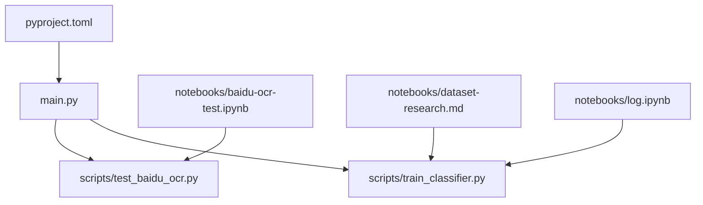
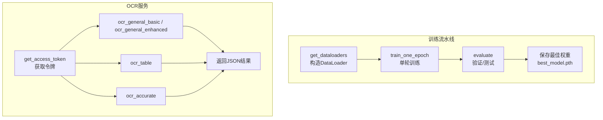
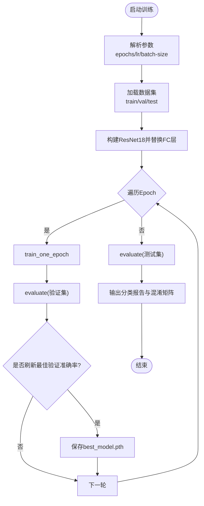
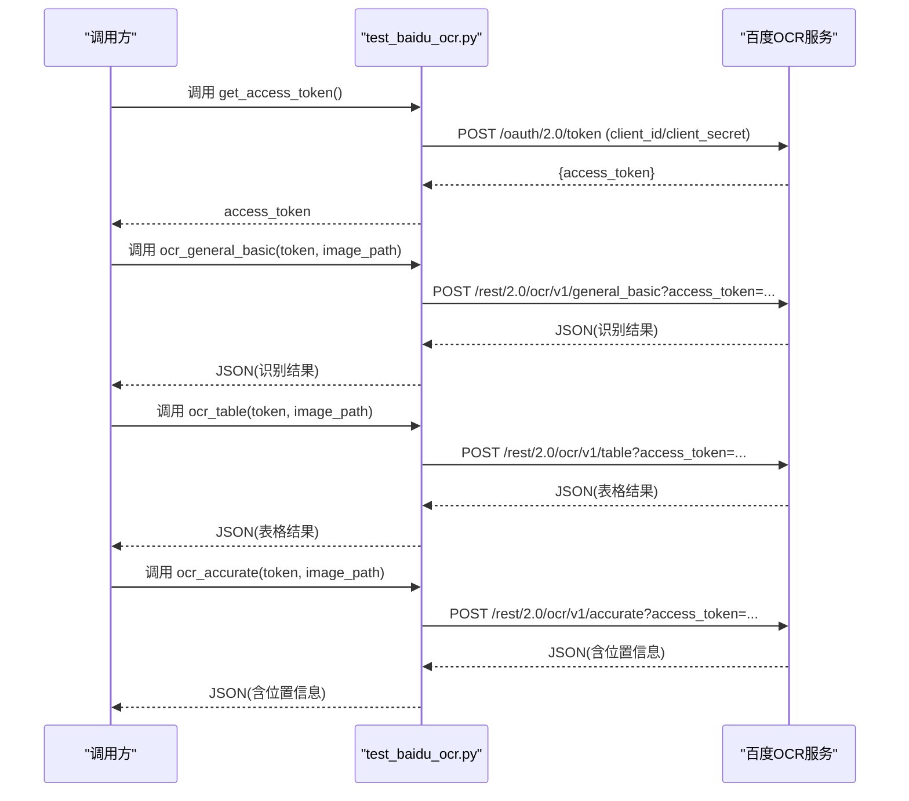
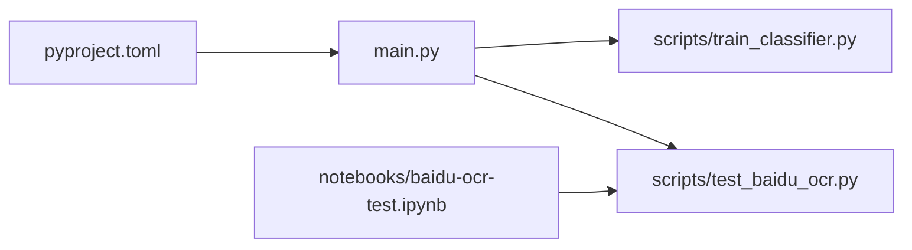

# API参考文档

<cite>
**本文引用的文件**   
- [main.py](file://main.py)
- [train_classifier.py](file://scripts/train_classifier.py)
- [test_baidu_ocr.py](file://scripts/test_baidu_ocr.py)
- [baidu-ocr-test.ipynb](file://notebooks/baidu-ocr-test.ipynb)
- [dataset-research.md](file://notebooks/dataset-research.md)
- [log.ipynb](file://notebooks/log.ipynb)
- [pyproject.toml](file://pyproject.toml)
</cite>

## 目录
1. [简介](#简介)
2. [项目结构](#项目结构)
3. [核心组件](#核心组件)
4. [架构总览](#架构总览)
5. [详细组件分析](#详细组件分析)
6. [依赖关系分析](#依赖关系分析)
7. [性能与限制](#性能与限制)
8. [故障排查指南](#故障排查指南)
9. [结论](#结论)
10. [附录：调用示例与最佳实践](#附录调用示例与最佳实践)

## 简介
本API参考文档面向考古LLM项目的图像分类训练/推理与OCR服务接口，聚焦以下能力：
- 图像分类器训练脚本（ResNet18迁移学习）的命令行参数、数据组织约定、输出产物与评估指标。
- OCR服务封装函数（百度OCR）的接口定义、请求/响应格式、错误处理与批量处理流程。
- 版本兼容性、使用限制、最佳实践与调试技巧，确保开发者能准确对接并稳定运行。

## 项目结构
仓库采用“脚本+Notebook”的轻量结构：
- scripts：训练与OCR测试脚本
- notebooks：实验记录与OCR测试Notebook
- main.py：最小入口（占位）
- pyproject.toml：项目元信息与环境要求

图表来源
- [main.py:1-6](file://main.py#L1-L6)
- [train_classifier.py:1-124](file://scripts/train_classifier.py#L1-L124)
- [test_baidu_ocr.py:1-109](file://scripts/test_baidu_ocr.py#L1-L109)
- [baidu-ocr-test.ipynb:1-330](file://notebooks/baidu-ocr-test.ipynb#L1-L330)
- [dataset-research.md:1-287](file://notebooks/dataset-research.md#L1-L287)
- [log.ipynb:1-370](file://notebooks/log.ipynb#L1-L370)
- [pyproject.toml:1-8](file://pyproject.toml#L1-L8)

章节来源
- [main.py:1-6](file://main.py#L1-L6)
- [pyproject.toml:1-8](file://pyproject.toml#L1-L8)

## 核心组件
- 图像分类训练脚本：提供命令行训练流程、数据加载、模型构建、训练/验证循环、保存最佳权重与最终评测报告。
- OCR服务封装：提供获取访问令牌、通用文字识别（标准/高精度）、表格识别、高精度含位置版等接口，以及批量处理工具。

章节来源
- [train_classifier.py:1-124](file://scripts/train_classifier.py#L1-L124)
- [test_baidu_ocr.py:1-109](file://scripts/test_baidu_ocr.py#L1-L109)
- [baidu-ocr-test.ipynb:1-330](file://notebooks/baidu-ocr-test.ipynb#L1-L330)

## 架构总览
整体由两类独立能力组成：离线训练流水线与在线OCR调用。训练脚本读取本地数据集目录，执行迁移学习；OCR脚本通过HTTP调用第三方服务完成文本识别。

图表来源
- [train_classifier.py:14-66](file://scripts/train_classifier.py#L14-L66)
- [train_classifier.py:68-123](file://scripts/train_classifier.py#L68-L123)
- [test_baidu_ocr.py:8-57](file://scripts/test_baidu_ocr.py#L8-L57)

## 详细组件分析

### 图像分类训练接口（命令行）
- 入口与参数
  - 入口：scripts/train_classifier.py
  - 参数：--epochs, --lr, --batch-size
- 数据约定
  - 根目录：datasets/ArchaeoMind_dataset
  - 子目录：train, val, test（ImageFolder格式）
- 模型与优化
  - 模型：ResNet18（ImageNet预训练），替换全连接层适配类别数
  - 损失：交叉熵
  - 优化器：Adam（默认仅训练FC层）
- 训练流程
  - 每轮训练后在验证集上评估，保存最高验证准确率对应的权重到 best_model.pth
  - 最终在测试集上评估并输出分类报告与混淆矩阵
- 返回值/产物
  - 控制台输出：每轮训练/验证损失与准确率、最终测试准确率、分类报告、混淆矩阵
  - 文件产物：best_model.pth（PyTorch状态字典）

图表来源
- [train_classifier.py:68-123](file://scripts/train_classifier.py#L68-L123)
- [train_classifier.py:14-66](file://scripts/train_classifier.py#L14-L66)

章节来源
- [train_classifier.py:14-66](file://scripts/train_classifier.py#L14-L66)
- [train_classifier.py:68-123](file://scripts/train_classifier.py#L68-L123)

### OCR服务接口（百度OCR）
- 认证
  - 函数：get_access_token()
  - 输入：环境变量 BAIDU_OCR_API_KEY, BAIDU_OCR_SECRET_KEY
  - 输出：access_token（字符串）
  - 错误：网络异常或鉴权失败时抛出HTTP错误
- 通用文字识别（标准版）
  - 函数：ocr_general_basic(token, image_path)
  - 输入：token（字符串），image_path（图片路径）
  - 输出：JSON（包含words_result等字段）
- 通用文字识别（高精度版）
  - 函数：ocr_general_enhanced(token, image_path)
  - 输入：同上
  - 输出：JSON（可能包含language_type相关配置）
- 表格识别
  - 函数：ocr_table(token, image_path)
  - 输入：同上
  - 输出：JSON（包含表格结构与单元格内容）
- 高精度含位置版
  - 函数：ocr_accurate(token, image_path)
  - 输入：同上
  - 输出：JSON（每个词项含location坐标）
- 批量处理（Notebook中提供）
  - 函数：batch_ocr(token, image_dir, api_type="general_basic", extensions=(...))
  - 输入：token，目录路径，API类型，扩展名过滤
  - 输出：dict{文件名: 识别行列表或错误信息}

图表来源
- [test_baidu_ocr.py:8-57](file://scripts/test_baidu_ocr.py#L8-L57)
- [baidu-ocr-test.ipynb:134-156](file://notebooks/baidu-ocr-test.ipynb#L134-L156)
- [baidu-ocr-test.ipynb:262-286](file://notebooks/baidu-ocr-test.ipynb#L262-L286)

章节来源
- [test_baidu_ocr.py:8-57](file://scripts/test_baidu_ocr.py#L8-L57)
- [baidu-ocr-test.ipynb:134-156](file://notebooks/baidu-ocr-test.ipynb#L134-L156)
- [baidu-ocr-test.ipynb:262-286](file://notebooks/baidu-ocr-test.ipynb#L262-L286)

## 依赖关系分析
- 训练脚本依赖
  - torch, torchvision（模型与数据管道）
  - sklearn.metrics（分类报告与混淆矩阵）
- OCR脚本依赖
  - requests（HTTP请求）
  - base64（图片编码）
  - os（环境变量读取）
- 项目环境
  - Python版本要求：>=3.14（见pyproject.toml）

图表来源
- [pyproject.toml:1-8](file://pyproject.toml#L1-L8)
- [main.py:1-6](file://main.py#L1-L6)
- [train_classifier.py:1-124](file://scripts/train_classifier.py#L1-L124)
- [test_baidu_ocr.py:1-109](file://scripts/test_baidu_ocr.py#L1-L109)
- [baidu-ocr-test.ipynb:1-330](file://notebooks/baidu-ocr-test.ipynb#L1-L330)

章节来源
- [pyproject.toml:1-8](file://pyproject.toml#L1-L8)
- [train_classifier.py:1-124](file://scripts/train_classifier.py#L1-L124)
- [test_baidu_ocr.py:1-109](file://scripts/test_baidu_ocr.py#L1-L109)

## 性能与限制
- 训练性能
  - 设备选择：优先CUDA，否则回退CPU
  - 批大小与迭代次数影响训练时长与内存占用
  - 建议：小数据集下仅微调FC层可显著降低过拟合风险
- OCR性能
  - 网络延迟与并发：建议对批量任务进行串行或限流调用
  - 图片大小与编码：base64传输体积较大，注意带宽与超时设置
- 版本兼容
  - Python版本要求：>=3.14（项目声明）
  - 第三方库版本以实际运行环境为准（如torch、requests）

[本节为通用指导，不直接分析具体文件]

## 故障排查指南
- 训练阶段
  - 数据路径不存在：确认 datasets/ArchaeoMind_dataset 下存在 train/val/test 子目录
  - 类别数量不一致：确保训练/验证/测试目录类别一致
  - 显存不足：减小 batch-size 或切换CPU
- OCR阶段
  - 鉴权失败：检查环境变量 BAIDU_OCR_API_KEY 与 BAIDU_OCR_SECRET_KEY 是否正确
  - 网络错误：检查网络连通性与代理设置
  - 图片路径无效：确认传入的图片路径存在且可读
  - 返回JSON结构差异：根据具体API返回字段进行容错处理（如 words_result 是否存在）

章节来源
- [train_classifier.py:14-38](file://scripts/train_classifier.py#L14-L38)
- [train_classifier.py:68-123](file://scripts/train_classifier.py#L68-L123)
- [test_baidu_ocr.py:8-57](file://scripts/test_baidu_ocr.py#L8-L57)

## 结论
本项目提供了两条相对独立的实用能力：基于ResNet18的图像分类训练脚本与百度OCR的封装接口。前者适用于考古图像的迁移学习与快速基线验证，后者可用于扫描报告的文本提取与结构化。结合Notebook中的批量处理逻辑，可形成从图像到文本的结构化流水线。建议在真实数据上持续验证与调优，并关注网络与环境的稳定性。

[本节为总结性内容，不直接分析具体文件]

## 附录：调用示例与最佳实践

- 训练脚本调用
  - 基本用法：python scripts/train_classifier.py --epochs 5 --lr 1e-3 --batch-size 32
  - 数据准备：将数据集按 ImageFolder 规范放置于 datasets/ArchaeoMind_dataset/{train,val,test}
  - 产物查看：训练结束后检查 best_model.pth 与终端输出的分类报告
  - 参考实现路径：[训练主流程:68-123](file://scripts/train_classifier.py#L68-L123), [数据加载:14-38](file://scripts/train_classifier.py#L14-L38)

- OCR服务调用
  - 获取令牌：python scripts/test_baidu_ocr.py（需先设置环境变量）
  - 通用识别：调用 ocr_general_basic(token, image_path)
  - 表格识别：调用 ocr_table(token, image_path)
  - 高精度定位：调用 ocr_accurate(token, image_path)
  - 批量处理：参考 Notebook 中的 batch_ocr 函数
  - 参考实现路径：[OCR函数定义:8-57](file://scripts/test_baidu_ocr.py#L8-L57), [批量处理:262-286](file://notebooks/baidu-ocr-test.ipynb#L262-L286)

- 最佳实践
  - 训练：固定随机种子、早停策略、数据增强适度、监控验证集性能
  - OCR：重试与退避策略、日志记录关键步骤、对返回结构做健壮解析
  - 环境：统一Python版本与依赖管理，避免运行时差异

章节来源
- [train_classifier.py:68-123](file://scripts/train_classifier.py#L68-L123)
- [train_classifier.py:14-38](file://scripts/train_classifier.py#L14-L38)
- [test_baidu_ocr.py:8-57](file://scripts/test_baidu_ocr.py#L8-L57)
- [baidu-ocr-test.ipynb:262-286](file://notebooks/baidu-ocr-test.ipynb#L262-L286)