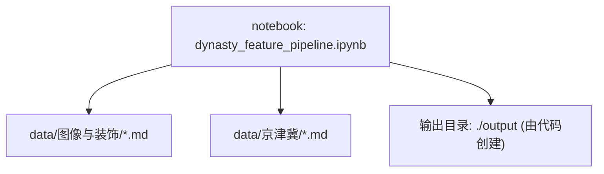
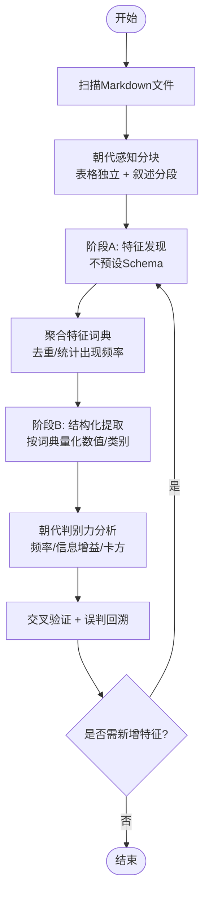
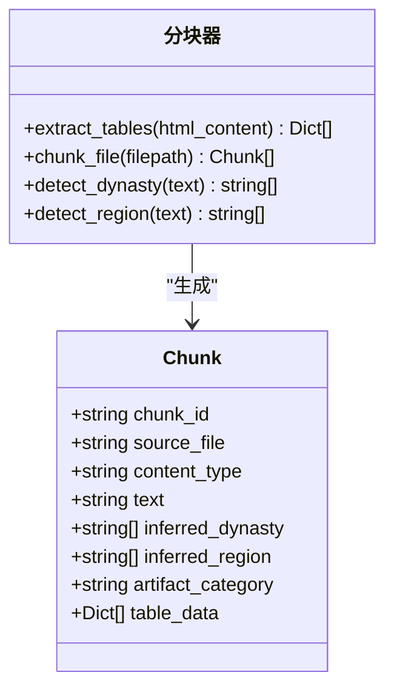
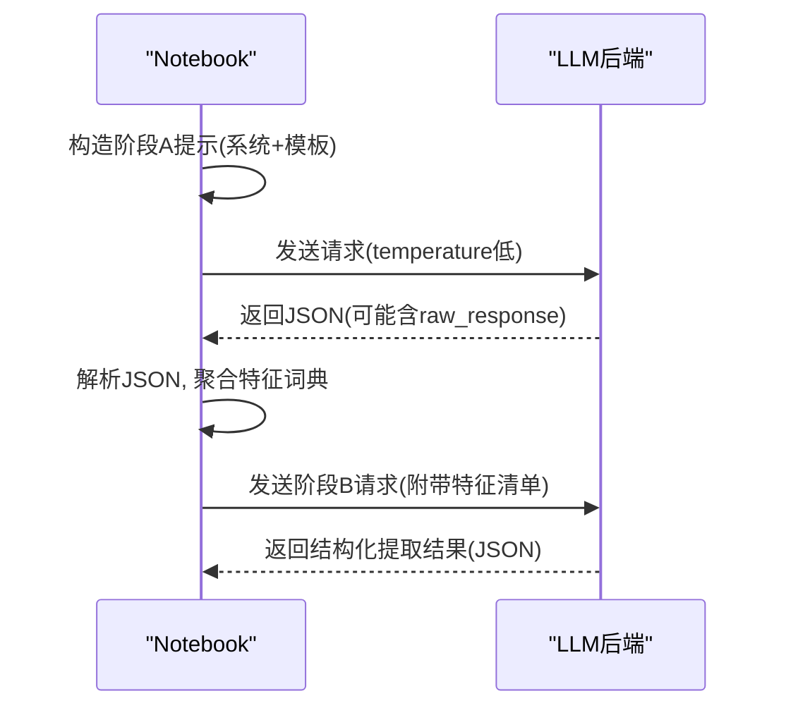
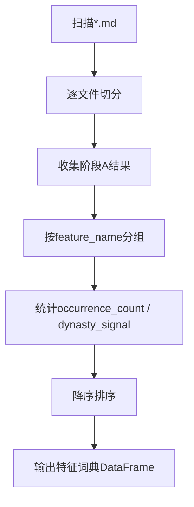
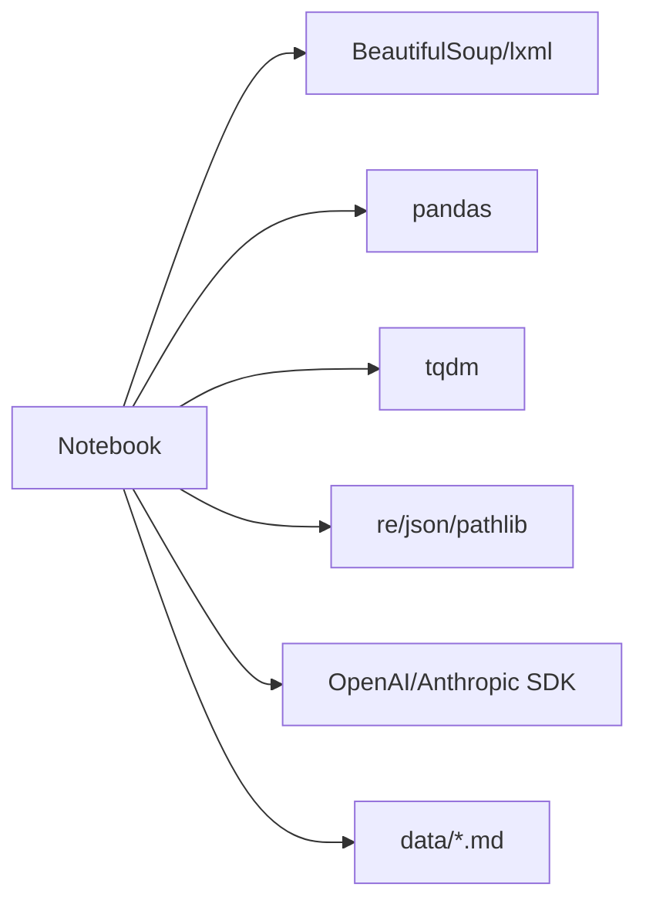

# 应用案例与实践

<cite>
**本文引用的文件**   
- [dynasty_feature_pipeline.ipynb](file://dynasty_feature_pipeline.ipynb)
- [图像与装饰_北朝墓葬的生死表象_gq_part2.pdf_by_PaddleOCR-VL-1.6.md](file://data/图像与装饰/图像与装饰_北朝墓葬的生死表象_gq_part2.pdf_by_PaddleOCR-VL-1.6.md)
- [京津冀汉墓研究_part1.pdf_by_PaddleOCR-VL-1.6.md](file://data/京津冀/京津冀汉墓研究_part1.pdf_by_PaddleOCR-VL-1.6.md)
- [京津冀汉墓研究_part2.pdf_by_PaddleOCR-VL-1.6.md](file://data/京津冀/京津冀汉墓研究_part2.pdf_by_PaddleOCR-VL-1.6.md)
</cite>

## 目录
1. [引言](#引言)
2. [项目结构](#项目结构)
3. [核心组件](#核心组件)
4. [架构总览](#架构总览)
5. [详细组件分析](#详细组件分析)
6. [依赖关系分析](#依赖关系分析)
7. [性能考虑](#性能考虑)
8. [故障排查指南](#故障排查指南)
9. [结论](#结论)
10. [附录：学习路径与最佳实践](#附录学习路径与最佳实践)

## 引言
本文件面向考古学研究者与数据工程师，提供从“数据准备—特征提取—判别分析—验证迭代”的端到端工作流，结合具体案例（如朝阳袁台子墓葬的特征提取与朝代判定）展示如何处理发掘报告、专题论文、图录等不同格式的文献。文档同时给出Prompt调优技巧、分块策略调整、特征筛选方法、性能优化建议与常见问题解决方案，帮助不同经验水平的用户循序渐进地掌握该Pipeline的使用方法。

## 项目结构
仓库包含一个可执行的Notebook与若干已OCR处理的Markdown数据文件，用于演示从多源考古文献中动态提取计数特征并构建朝代识别模型的工作流。

图表来源
- [dynasty_feature_pipeline.ipynb:273-280](file://dynasty_feature_pipeline.ipynb#L273-L280)
- [dynasty_feature_pipeline.ipynb:295-302](file://dynasty_feature_pipeline.ipynb#L295-L302)

章节来源
- [dynasty_feature_pipeline.ipynb:1-48](file://dynasty_feature_pipeline.ipynb#L1-L48)
- [dynasty_feature_pipeline.ipynb:273-280](file://dynasty_feature_pipeline.ipynb#L273-L280)
- [dynasty_feature_pipeline.ipynb:295-302](file://dynasty_feature_pipeline.ipynb#L295-L302)

## 核心组件
- 朝代感知分块器：按语义段落与朝代边界切分文本，并将HTML表格独立为结构化chunk。
- LLM双阶段特征提取：阶段A发现特征（不预设schema），阶段B基于发现的特征词典做结构化量化提取。
- 朝代判别力分析：聚合各时期特征分布，计算信息增益/卡方等指标，输出特征重要性与时期“指纹”。
- 验证与迭代：用已知年代样本交叉验证，回看误判样本补充新特征，回到阶段A迭代。

章节来源
- [dynasty_feature_pipeline.ipynb:55-81](file://dynasty_feature_pipeline.ipynb#L55-L81)
- [dynasty_feature_pipeline.ipynb:87-133](file://dynasty_feature_pipeline.ipynb#L87-L133)
- [dynasty_feature_pipeline.ipynb:158-173](file://dynasty_feature_pipeline.ipynb#L158-L173)
- [dynasty_feature_pipeline.ipynb:180-189](file://dynasty_feature_pipeline.ipynb#L180-L189)

## 架构总览
整体流程分为四层：预处理+朝代感知分块、LLM动态特征提取（两阶段）、朝代判别力分析、验证+迭代。

图表来源
- [dynasty_feature_pipeline.ipynb:33-48](file://dynasty_feature_pipeline.ipynb#L33-L48)
- [dynasty_feature_pipeline.ipynb:666-699](file://dynasty_feature_pipeline.ipynb#L666-L699)

## 详细组件分析

### 组件一：朝代感知分块器
- 功能要点
  - 表格解析：使用BeautifulSoup解析HTML表格，生成headers与rows的结构化列表。
  - 叙述分段：移除表格后按Markdown标题分段，过滤过短段落。
  - 朝代/区域检测：基于关键词字典推断每个chunk的inferred_dynasty与inferred_region。
  - 输出对象：Chunk类包含chunk_id、source_file、content_type、text、inferred_dynasty、inferred_region、artifact_category、table_data等字段。
- 复杂度与性能
  - 表格解析时间复杂度近似O(N)，N为表格单元格数量；叙述分段正则匹配开销较小。
  - 对长表格进行截断以避免后续LLM调用过长输入。
- 错误处理
  - 空表格或无标题行时跳过；极短段落被过滤。
- 适用场景
  - 适用于含大量表格的发掘报告与图录，以及带章节标题的专题论文。

图表来源
- [dynasty_feature_pipeline.ipynb:361-454](file://dynasty_feature_pipeline.ipynb#L361-L454)

章节来源
- [dynasty_feature_pipeline.ipynb:316-346](file://dynasty_feature_pipeline.ipynb#L316-L346)
- [dynasty_feature_pipeline.ipynb:361-454](file://dynasty_feature_pipeline.ipynb#L361-L454)

### 组件二：LLM双阶段特征提取
- 阶段A：特征发现
  - 通过系统提示与模板提示，让LLM从文本中自然发现可量化的器物/墓葬特征，标注类型、朝代信号、证据与置信度。
  - 返回JSON格式，支持容错解析（尝试提取JSON块）。
- 阶段B：结构化提取
  - 将阶段A发现的特征词典作为约束，对每个chunk进行数值/类别的结构化提取，输出统一JSON。
- Prompt设计要点
  - 明确任务角色（考古学专家）、输出格式（JSON）、字段定义（feature_name/type/dynasty_signal/evidence/confidence）。
  - 针对表格与叙述两类内容分别设置上下文元数据（content_type、inferred_dynasty、inferred_region）。
- 后端适配
  - 封装OpenAI与Anthropic两种后端，统一接口call_llm。

图表来源
- [dynasty_feature_pipeline.ipynb:506-542](file://dynasty_feature_pipeline.ipynb#L506-L542)
- [dynasty_feature_pipeline.ipynb:557-618](file://dynasty_feature_pipeline.ipynb#L557-L618)

章节来源
- [dynasty_feature_pipeline.ipynb:506-542](file://dynasty_feature_pipeline.ipynb#L506-L542)
- [dynasty_feature_pipeline.ipynb:557-618](file://dynasty_feature_pipeline.ipynb#L557-L618)

### 组件三：批量处理与特征词典聚合
- 批量扫描与切分：遍历data目录下所有Markdown文件，生成chunks列表。
- 特征聚合：收集阶段A输出的features，按feature_name去重，统计出现次数与朝代信号集合，生成排序后的特征词典DataFrame。
- 可扩展性：支持增量更新，新文件进来先跑阶段A，若发现新特征则扩充词典。

图表来源
- [dynasty_feature_pipeline.ipynb:666-699](file://dynasty_feature_pipeline.ipynb#L666-L699)

章节来源
- [dynasty_feature_pipeline.ipynb:666-699](file://dynasty_feature_pipeline.ipynb#L666-L699)

### 组件四：朝代判别力分析与验证迭代
- 判别力分析：对各时期聚合特征分布，计算信息增益/卡方等指标，输出特征重要性排序与各时期“指纹”。
- 验证与迭代：用已知年代的墓葬样本做交叉验证，若误判则回溯缺失特征，回到阶段A补充新特征。

章节来源
- [dynasty_feature_pipeline.ipynb:158-173](file://dynasty_feature_pipeline.ipynb#L158-L173)
- [dynasty_feature_pipeline.ipynb:180-189](file://dynasty_feature_pipeline.ipynb#L180-L189)

## 依赖关系分析
- Notebook依赖
  - pandas、BeautifulSoup、lxml、tqdm、re、json、pathlib、typing、dataclasses等标准库与第三方包。
  - LLM客户端：openai或anthropic（按需启用）。
- 数据依赖
  - data/图像与装饰/*.md：北朝墓葬图像与装饰主题的多篇OCR Markdown。
  - data/京津冀/*.md：京津冀地区汉代墓葬研究的OCR Markdown。
- 外部集成点
  - OpenAI/Anthropic API（需要配置密钥与环境变量）。

图表来源
- [dynasty_feature_pipeline.ipynb:263-280](file://dynasty_feature_pipeline.ipynb#L263-L280)
- [dynasty_feature_pipeline.ipynb:506-542](file://dynasty_feature_pipeline.ipynb#L506-L542)

章节来源
- [dynasty_feature_pipeline.ipynb:263-280](file://dynasty_feature_pipeline.ipynb#L263-L280)
- [dynasty_feature_pipeline.ipynb:506-542](file://dynasty_feature_pipeline.ipynb#L506-L542)

## 性能考虑
- 分块策略
  - 避免固定大小chunk，采用语义段落+朝代边界切分，减少跨期信息割裂。
  - 对长表格截断，降低LLM输入长度与成本。
- LLM调用优化
  - 阶段A与阶段B分离，先发现再量化，减少无效抽取。
  - 使用较低temperature提升稳定性；必要时增加few-shot示例以稳定输出格式。
- 存储与分析
  - 使用SQLite+JSON字段存储灵活schema；pandas+scipy进行统计与可视化。
- 并行与批处理
  - 批量处理函数配合tqdm进度条，便于监控大规模文件的处理进度。

[本节为通用指导，无需特定文件引用]

## 故障排查指南
- JSON解析失败
  - 现象：LLM返回非严格JSON导致解析异常。
  - 解决：使用正则提取JSON块；记录raw_response以便人工复核。
- 表格为空或缺失表头
  - 现象：BeautifulSoup未找到有效tr/th/td。
  - 解决：在extract_tables中加入空检查与日志；跳过无效表格。
- 朝代/区域检测为空
  - 现象：关键词字典未命中。
  - 解决：扩展DYNASTY_KEYWORDS与REGION_KEYWORDS；引入模糊匹配或同义词映射。
- LLM后端不可用
  - 现象：API key未配置或服务不可达。
  - 解决：检查环境变量与网络；切换backend或降级到本地模型。
- 内存与速度瓶颈
  - 现象：大文件处理缓慢或内存占用高。
  - 解决：分批处理、限制chunk长度、缓存中间结果。

章节来源
- [dynasty_feature_pipeline.ipynb:595-618](file://dynasty_feature_pipeline.ipynb#L595-L618)
- [dynasty_feature_pipeline.ipynb:395-408](file://dynasty_feature_pipeline.ipynb#L395-L408)
- [dynasty_feature_pipeline.ipynb:373-392](file://dynasty_feature_pipeline.ipynb#L373-L392)
- [dynasty_feature_pipeline.ipynb:506-542](file://dynasty_feature_pipeline.ipynb#L506-L542)

## 结论
该Pipeline通过“朝代感知分块+LLM双阶段特征提取+判别力分析+验证迭代”的设计，实现了从多源考古文献中动态提取计数特征并辅助朝代判定的目标。其关键优势在于不预设schema、增量更新与置信度标注，能够适应不同格式与风格的考古学文献。通过合理的Prompt调优、分块策略与特征筛选，可在保证准确率的同时控制成本与延迟。

[本节为总结，无需特定文件引用]

## 附录：学习路径与最佳实践

### 端到端工作流示例（从数据准备到结果分析）
- 数据准备
  - 将PDF/图录/报告经OCR转为Markdown，确保保留HTML表格与章节标题。
  - 放置于data目录，运行文件扫描与分块。
- 特征发现（阶段A）
  - 选择代表性文件（如专题论文与发掘报告各一份）运行阶段A，观察LLM发现的特征种类与质量。
  - 根据结果调整system prompt与few-shot示例，强化对考古术语的理解。
- 特征量化（阶段B）
  - 使用聚合后的特征词典对全部chunks进行结构化提取，得到统一的数值/类别矩阵。
- 判别力分析与验证
  - 按时期聚合特征，计算信息增益/卡方，输出特征重要性与时期指纹。
  - 用已知年代样本做交叉验证，定位误判样本，回溯缺失特征并回到阶段A迭代。

章节来源
- [dynasty_feature_pipeline.ipynb:227-236](file://dynasty_feature_pipeline.ipynb#L227-L236)
- [dynasty_feature_pipeline.ipynb:666-699](file://dynasty_feature_pipeline.ipynb#L666-L699)

### 典型用例：朝阳袁台子墓葬的特征提取与朝代判定
- 背景与材料
  - 京津冀地区汉代屈肢葬研究中提及辽宁朝阳袁台子西汉墓的相关描述，包括葬式、规模、等级与陪葬品情况。
- 步骤
  - 读取相关Markdown片段，确认朝代关键词（如“西汉早期”“侧身屈肢”“单人葬”“陪葬品较少”等）。
  - 分块器将其切分为叙述型chunk，并标注inferred_dynasty与inferred_region。
  - 阶段A发现特征：例如“葬式=侧身屈肢”“墓主等级=较低”“随葬陶罐数量=少”等。
  - 阶段B量化：将上述特征转换为结构化值（如布尔/分类/计数）。
  - 判别力分析：对比京津冀地区其他西汉早期墓葬的特征分布，评估“侧身屈肢+低等级+少随葬”组合的区分度。
  - 验证与迭代：若与其他西汉早期样本存在混淆，补充更多细粒度特征（如陶器形制、尺寸、位置等）回到阶段A。

章节来源
- [京津冀汉墓研究_part2.pdf_by_PaddleOCR-VL-1.6.md:820-850](file://data/京津冀/京津冀汉墓研究_part2.pdf_by_PaddleOCR-VL-1.6.md#L820-L850)
- [dynasty_feature_pipeline.ipynb:316-346](file://dynasty_feature_pipeline.ipynb#L316-L346)
- [dynasty_feature_pipeline.ipynb:361-454](file://dynasty_feature_pipeline.ipynb#L361-L454)
- [dynasty_feature_pipeline.ipynb:557-618](file://dynasty_feature_pipeline.ipynb#L557-L618)

### 不同类型考古学文献的处理策略
- 发掘报告
  - 特点：表格密集、形制与出土物清单详尽。
  - 策略：优先将表格独立为chunk，利用阶段B精确量化；叙述部分按章节切分。
- 专题论文
  - 特点：论述性强、概念丰富、跨期比较多。
  - 策略：阶段A重点捕捉抽象特征（如“礼制变化”“文化融合”）对应的可量化代理指标；阶段B聚焦具体数值/比例。
- 图录
  - 特点：图片说明为主、文字简短。
  - 策略：将图注与说明合并为叙述chunk；关注材质、纹饰、尺寸等可量化维度。

章节来源
- [图像与装饰_北朝墓葬的生死表象_gq_part2.pdf_by_PaddleOCR-VL-1.6.md:1-200](file://data/图像与装饰/图像与装饰_北朝墓葬的生死表象_gq_part2.pdf_by_PaddleOCR-VL-1.6.md#L1-L200)
- [京津冀汉墓研究_part1.pdf_by_PaddleOCR-VL-1.6.md:72-88](file://data/京津冀/京津冀汉墓研究_part1.pdf_by_PaddleOCR-VL-1.6.md#L72-L88)

### Prompt调优技巧
- 角色设定：强调“精通中国考古学的专家”，限定时代范围（东汉→魏晋十六国→北魏）。
- 输出约束：强制JSON格式，明确字段定义与取值范围。
- 示例引导：提供少量高质量few-shot样例，覆盖表格与叙述两类内容。
- 置信度标注：要求LLM自评置信度，便于后续人工复核与质量控制。
- 迭代反馈：根据误判样本调整prompt，加入反例或边界条件。

章节来源
- [dynasty_feature_pipeline.ipynb:557-618](file://dynasty_feature_pipeline.ipynb#L557-L618)

### 分块策略调整
- 触发词：使用朝代/区域关键词进行边界检测，避免跨期混合。
- 内容类型：区分table与narrative，分别设计提示与后处理逻辑。
- 长度控制：对超长chunk进行截断，平衡上下文完整性与成本。

章节来源
- [dynasty_feature_pipeline.ipynb:316-346](file://dynasty_feature_pipeline.ipynb#L316-L346)
- [dynasty_feature_pipeline.ipynb:361-454](file://dynasty_feature_pipeline.ipynb#L361-L454)

### 特征筛选方法
- 频率统计：观察特征在各时期的出现频次。
- 信息增益/卡方检验：量化特征的朝代区分度。
- 组合指纹：提炼各时期的关键特征组合，辅助解释与可视化。

章节来源
- [dynasty_feature_pipeline.ipynb:158-173](file://dynasty_feature_pipeline.ipynb#L158-L173)

### 性能优化建议
- 批处理与缓存：对重复chunk或相似内容进行缓存，减少重复LLM调用。
- 异步并发：在资源允许下对多个chunk并发调用LLM（注意速率限制）。
- 降级策略：当API不可用时，切换到本地模型或仅做规则抽取。

[本节为通用指导，无需特定文件引用]

### 常见问题解决方案
- 表格解析失败：检查HTML结构，增加健壮性处理与日志。
- 朝代标签缺失：扩展关键词字典，引入同义词与别名。
- 输出格式不稳定：加强JSON校验与重试机制，记录原始响应。
- 成本过高：减少chunk长度、合并相似内容、提高阶段A召回率以降低阶段B冗余。

章节来源
- [dynasty_feature_pipeline.ipynb:395-408](file://dynasty_feature_pipeline.ipynb#L395-L408)
- [dynasty_feature_pipeline.ipynb:595-618](file://dynasty_feature_pipeline.ipynb#L595-L618)

### 循序渐进的学习路径
- 入门
  - 安装依赖，运行文件扫描与分块，理解Chunk结构与输出。
- 进阶
  - 配置LLM后端，运行阶段A与阶段B，观察特征发现与量化效果。
- 高级
  - 实现判别力分析与交叉验证，完善特征词典与Prompt，形成闭环迭代。

[本节为通用指导，无需特定文件引用]