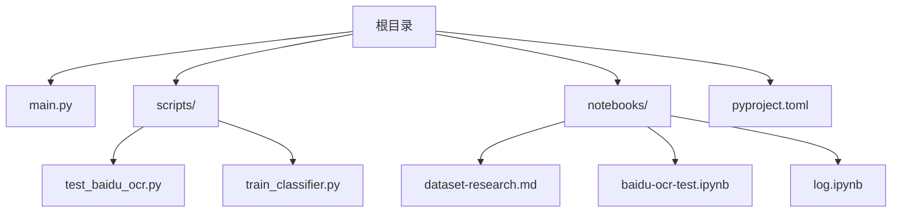
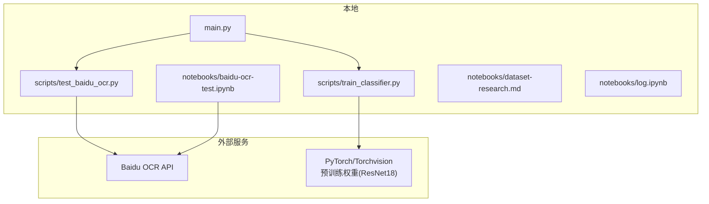
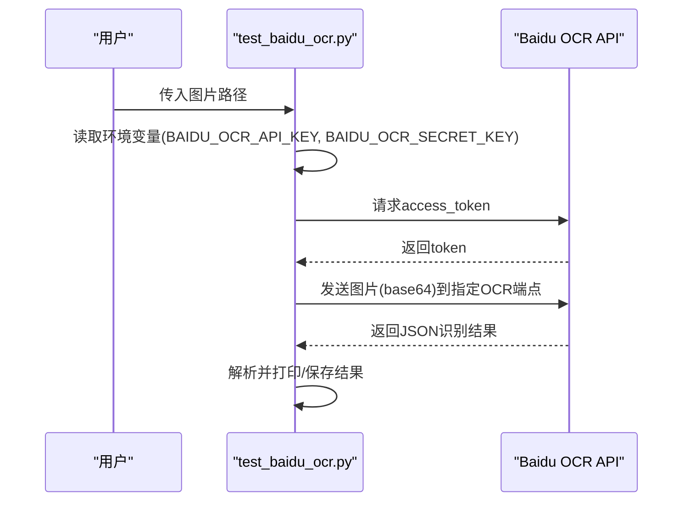
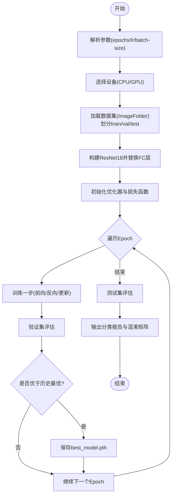
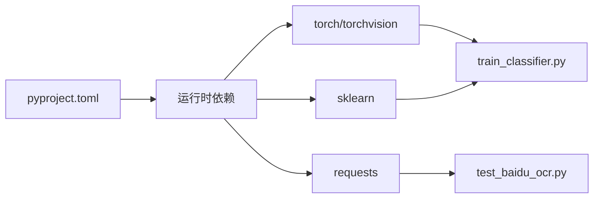

# 开发指南

<cite>
**本文引用的文件**   
- [main.py](file://main.py)
- [pyproject.toml](file://pyproject.toml)
- [scripts/test_baidu_ocr.py](file://scripts/test_baidu_ocr.py)
- [scripts/train_classifier.py](file://scripts/train_classifier.py)
- [notebooks/dataset-research.md](file://notebooks/dataset-research.md)
- [notebooks/baidu-ocr-test.ipynb](file://notebooks/baidu-ocr-test.ipynb)
- [notebooks/log.ipynb](file://notebooks/log.ipynb)
</cite>

## 目录
1. [简介](#简介)
2. [项目结构](#项目结构)
3. [核心组件](#核心组件)
4. [架构总览](#架构总览)
5. [详细组件分析](#详细组件分析)
6. [依赖关系分析](#依赖关系分析)
7. [性能与扩展性](#性能与扩展性)
8. [开发与调试](#开发与调试)
9. [测试方法](#测试方法)
10. [贡献规范](#贡献规范)
11. [故障排除](#故障排除)
12. [结论](#结论)
13. [附录：快速上手清单](#附录快速上手清单)

## 简介
本项目为“考古LLM”早期原型，聚焦于以下能力探索：
- 图像分类基线（ResNet18迁移学习）
- 百度OCR API集成与批量处理
- 数据集调研与策略规划（COCO、Roboflow Universe、ImageNet等）
- 研究日志与实验记录（Jupyter Notebook）

当前仓库处于起步阶段，包含最小可运行入口、训练脚本、OCR测试脚本以及研究笔记。后续将在此基础上逐步构建PDF→OCR→结构化抽取→可视化与分析的完整流水线。

## 项目结构
仓库采用“脚本+笔记本+配置”的轻量组织方式：
- main.py：应用入口（占位）
- scripts：独立可执行脚本（OCR测试、模型训练）
- notebooks：研究与实验记录（含数据调研报告与OCR实验）
- pyproject.toml：项目元信息与依赖声明

图表来源
- [main.py:1-7](file://main.py#L1-L7)
- [scripts/test_baidu_ocr.py:1-109](file://scripts/test_baidu_ocr.py#L1-L109)
- [scripts/train_classifier.py:1-124](file://scripts/train_classifier.py#L1-L124)
- [notebooks/dataset-research.md:1-287](file://notebooks/dataset-research.md#L1-L287)
- [notebooks/baidu-ocr-test.ipynb:1-331](file://notebooks/baidu-ocr-test.ipynb#L1-L331)
- [notebooks/log.ipynb:1-370](file://notebooks/log.ipynb#L1-L370)
- [pyproject.toml:1-8](file://pyproject.toml#L1-L8)

章节来源
- [main.py:1-7](file://main.py#L1-L7)
- [pyproject.toml:1-8](file://pyproject.toml#L1-L8)

## 核心组件
- 应用入口
  - 提供最小化启动逻辑，便于后续扩展为CLI或Web服务入口。
- OCR能力封装
  - 实现访问令牌获取、通用文字识别、表格识别、高精度识别等API调用；支持批量处理与结果汇总。
- 图像分类训练脚本
  - 基于ResNet18预训练权重进行迁移学习，支持训练/验证/测试流程、指标输出与混淆矩阵生成。
- 数据集与研究笔记
  - 对COCO、Roboflow Universe、ImageNet等进行对比评估，形成迁移学习与微调策略建议。
  - 研究日志记录环境搭建、任务拆解与阶段性成果。

章节来源
- [scripts/test_baidu_ocr.py:1-109](file://scripts/test_baidu_ocr.py#L1-L109)
- [scripts/train_classifier.py:1-124](file://scripts/train_classifier.py#L1-L124)
- [notebooks/dataset-research.md:1-287](file://notebooks/dataset-research.md#L1-L287)
- [notebooks/log.ipynb:1-370](file://notebooks/log.ipynb#L1-L370)

## 架构总览
当前为“脚本驱动”的轻量架构，未来可扩展为模块化服务。下图展示现有脚本与外部服务的交互关系。

图表来源
- [scripts/test_baidu_ocr.py:1-109](file://scripts/test_baidu_ocr.py#L1-L109)
- [scripts/train_classifier.py:1-124](file://scripts/train_classifier.py#L1-L124)
- [notebooks/baidu-ocr-test.ipynb:1-331](file://notebooks/baidu-ocr-test.ipynb#L1-L331)
- [notebooks/dataset-research.md:1-287](file://notebooks/dataset-research.md#L1-L287)
- [notebooks/log.ipynb:1-370](file://notebooks/log.ipynb#L1-L370)
- [main.py:1-7](file://main.py#L1-L7)

## 详细组件分析

### 组件A：百度OCR集成（scripts/test_baidu_ocr.py）
职责
- 获取访问令牌
- 调用多种OCR接口（通用、高精度、表格等）
- 批量处理图片并汇总结果
- 列出可用API类型

关键流程（序列图）

图表来源
- [scripts/test_baidu_ocr.py:8-17](file://scripts/test_baidu_ocr.py#L8-L17)
- [scripts/test_baidu_ocr.py:20-57](file://scripts/test_baidu_ocr.py#L20-L57)
- [scripts/test_baidu_ocr.py:60-81](file://scripts/test_baidu_ocr.py#L60-L81)
- [scripts/test_baidu_ocr.py:83-109](file://scripts/test_baidu_ocr.py#L83-L109)

章节来源
- [scripts/test_baidu_ocr.py:1-109](file://scripts/test_baidu_ocr.py#L1-L109)

### 组件B：图像分类训练（scripts/train_classifier.py）
职责
- 加载ArchaeoMind数据集（ImageFolder）
- 使用ResNet18预训练权重进行迁移学习
- 训练、验证、测试流程
- 输出分类报告与混淆矩阵

训练流程（流程图）

图表来源
- [scripts/train_classifier.py:68-124](file://scripts/train_classifier.py#L68-L124)
- [scripts/train_classifier.py:14-38](file://scripts/train_classifier.py#L14-L38)
- [scripts/train_classifier.py:40-66](file://scripts/train_classifier.py#L40-L66)

章节来源
- [scripts/train_classifier.py:1-124](file://scripts/train_classifier.py#L1-L124)

### 组件C：研究笔记与策略（notebooks/dataset-research.md）
要点
- 对比COCO、Roboflow Universe、ImageNet在规模、标注类型、考古相关度、许可证等方面的差异
- 推荐策略：以COCO/ImageNet预训练为基础，结合考古专用小样本数据进行迁移学习
- 提供下载与导出格式说明，便于后续数据处理与训练

章节来源
- [notebooks/dataset-research.md:1-287](file://notebooks/dataset-research.md#L1-L287)

### 组件D：OCR实验Notebook（notebooks/baidu-ocr-test.ipynb）
要点
- 封装统一的OCR调用函数，支持多API类型
- 提供批量处理函数，按目录扫描图片并汇总结果
- 记录不同API的特点与适用场景（印刷体、表格、手写等）

章节来源
- [notebooks/baidu-ocr-test.ipynb:1-331](file://notebooks/baidu-ocr-test.ipynb#L1-L331)

### 组件E：研究日志（notebooks/log.ipynb）
要点
- 记录VPS环境搭建、数据集下载、基线模型训练结果
- 将工作拆分为多层任务（环境→PDF提取→QGIS→PyTorch→OCR），明确并行策略与阻塞项
- 沉淀突破记录与下一步行动计划

章节来源
- [notebooks/log.ipynb:1-370](file://notebooks/log.ipynb#L1-L370)

## 依赖关系分析
- 运行时依赖
  - PyTorch/Torchvision：用于ResNet18迁移学习训练与推理
  - requests：用于HTTP调用百度OCR API
  - base64/json：用于图片编码与结果解析
  - sklearn：用于分类报告与混淆矩阵输出
- 项目配置
  - pyproject.toml定义项目名称、版本、Python版本要求与依赖列表（当前为空，需按需补充）

图表来源
- [pyproject.toml:1-8](file://pyproject.toml#L1-L8)
- [scripts/train_classifier.py:1-124](file://scripts/train_classifier.py#L1-L124)
- [scripts/test_baidu_ocr.py:1-109](file://scripts/test_baidu_ocr.py#L1-L109)

章节来源
- [pyproject.toml:1-8](file://pyproject.toml#L1-L8)
- [scripts/train_classifier.py:1-124](file://scripts/train_classifier.py#L1-L124)
- [scripts/test_baidu_ocr.py:1-109](file://scripts/test_baidu_ocr.py#L1-L109)

## 性能与扩展性
- 训练性能
  - 使用预训练权重显著降低收敛成本；仅微调FC层可在CPU上快速完成小规模数据集训练
  - 可通过增大batch size、启用GPU、调整学习率与数据增强强度进一步提升效果
- OCR性能
  - 批量处理时注意网络延迟与限流；建议增加重试与退避策略
  - 针对复杂版面（表格、手写）可选择高精度或专用API，并在后处理中做结构化清洗
- 扩展性
  - 建议将OCR与训练脚本抽象为模块，统一错误处理、日志与配置管理
  - 引入配置文件与环境变量管理，避免硬编码密钥与路径

[本节为通用指导，不直接分析具体文件]

## 开发与调试
- 环境准备
  - Python版本要求：>=3.14（见项目配置）
  - 安装依赖：根据实际使用补充至pyproject.toml，并使用uv/pip安装
- 运行入口
  - 主入口：python main.py（当前为占位输出）
- 训练脚本
  - 基本用法：python scripts/train_classifier.py --epochs N --lr LR --batch-size B
  - 数据目录约定：datasets/ArchaeoMind_dataset/{train,val,test}
- OCR测试
  - 设置环境变量：BAIDU_OCR_API_KEY、BAIDU_OCR_SECRET_KEY
  - 基本用法：python scripts/test_baidu_ocr.py <image_path>
- 调试技巧
  - 训练过程：关注loss与准确率变化，必要时调整学习率与正则化
  - OCR调用：捕获HTTP异常并重试；打印部分响应以便定位问题
  - 日志记录：在关键步骤添加结构化日志，便于追踪与复现

章节来源
- [pyproject.toml:1-8](file://pyproject.toml#L1-L8)
- [scripts/train_classifier.py:68-124](file://scripts/train_classifier.py#L68-L124)
- [scripts/test_baidu_ocr.py:8-17](file://scripts/test_baidu_ocr.py#L8-L17)
- [scripts/test_baidu_ocr.py:83-109](file://scripts/test_baidu_ocr.py#L83-L109)

## 测试方法
- OCR连通性与功能测试
  - 使用scripts/test_baidu_ocr.py对单张图片进行通用、表格、高精度识别测试
  - 通过notebooks/baidu-ocr-test.ipynb中的批量处理函数对目录内图片进行批测
- 模型训练与评估
  - 使用scripts/train_classifier.py在ArchaeoMind数据集上进行训练与测试
  - 检查分类报告与混淆矩阵，确认类别平衡与过拟合情况
- 回归与稳定性
  - 固定随机种子与数据预处理，确保结果可复现
  - 对OCR结果进行一致性校验（如字段完整性、数值范围合理性）

章节来源
- [scripts/test_baidu_ocr.py:1-109](file://scripts/test_baidu_ocr.py#L1-L109)
- [notebooks/baidu-ocr-test.ipynb:1-331](file://notebooks/baidu-ocr-test.ipynb#L1-L331)
- [scripts/train_classifier.py:1-124](file://scripts/train_classifier.py#L1-L124)

## 贡献规范
- 代码风格
  - 遵循PEP8；使用清晰命名与注释；函数与类职责单一
- 命名约定
  - 模块与文件：小写下划线分隔（如 test_baidu_ocr.py）
  - 函数与方法：小写下划线分隔
  - 常量：大写下划线分隔（如 DATA_DIR）
- 提交信息格式
  - 类型：feat/fix/docs/style/refactor/perf/test/build/ci/chore/revert
  - 主题：简洁描述变更目的
  - 正文：说明动机、影响范围与注意事项
  - 示例：feat: 新增百度OCR批量处理函数
- 分支策略
  - 主分支稳定；功能分支以feat/*命名；修复分支以fix/*命名
- 文档与可复现性
  - 重要变更同步更新README或相应notebook
  - 记录关键参数、数据路径与环境要求，保证他人可复现实验

[本节为通用规范，不直接分析具体文件]

## 故障排除
- 无法获取百度OCR access token
  - 检查环境变量BAIDU_OCR_API_KEY与BAIDU_OCR_SECRET_KEY是否正确设置
  - 确认网络可达与API配额未耗尽
- OCR返回错误或空结果
  - 检查图片格式与大小；尝试更换API类型（通用/高精度/表格）
  - 查看响应JSON结构，定位缺失字段
- 训练失败或精度低
  - 确认数据集目录结构与标签正确
  - 调整学习率、批次大小与数据增强；观察过拟合迹象
  - 切换设备（GPU/CPU）并监控显存占用
- 依赖安装问题
  - 核对Python版本满足>=3.14
  - 使用uv或pip安装torch/torchvision/sklearn/requests等依赖

章节来源
- [scripts/test_baidu_ocr.py:8-17](file://scripts/test_baidu_ocr.py#L8-L17)
- [scripts/train_classifier.py:68-124](file://scripts/train_classifier.py#L68-L124)
- [pyproject.toml:1-8](file://pyproject.toml#L1-L8)

## 结论
当前仓库提供了考古AI/ML项目的良好起点：OCR能力验证与图像分类基线均已具备。建议在后续迭代中：
- 将脚本模块化，完善配置管理与错误处理
- 建立数据与模型版本化管理机制
- 持续丰富数据集与评测指标，推动从原型到生产可用的演进

[本节为总结，不直接分析具体文件]

## 附录：快速上手清单
- 环境搭建
  - 安装Python >=3.14，创建虚拟环境
  - 安装依赖：torch、torchvision、requests、sklearn
- 运行入口
  - python main.py
- 训练基线
  - 准备数据集目录：datasets/ArchaeoMind_dataset/{train,val,test}
  - 运行：python scripts/train_classifier.py --epochs 5 --lr 1e-3 --batch-size 32
- OCR测试
  - 设置环境变量：BAIDU_OCR_API_KEY、BAIDU_OCR_SECRET_KEY
  - 运行：python scripts/test_baidu_ocr.py <image_path>
- 参考与记录
  - 阅读notebooks/dataset-research.md了解数据集策略
  - 参考notebooks/log.ipynb了解环境与任务进度

章节来源
- [pyproject.toml:1-8](file://pyproject.toml#L1-L8)
- [scripts/train_classifier.py:1-124](file://scripts/train_classifier.py#L1-L124)
- [scripts/test_baidu_ocr.py:1-109](file://scripts/test_baidu_ocr.py#L1-L109)
- [notebooks/dataset-research.md:1-287](file://notebooks/dataset-research.md#L1-L287)
- [notebooks/log.ipynb:1-370](file://notebooks/log.ipynb#L1-L370)