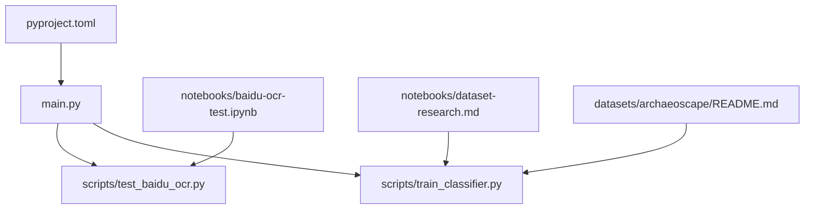
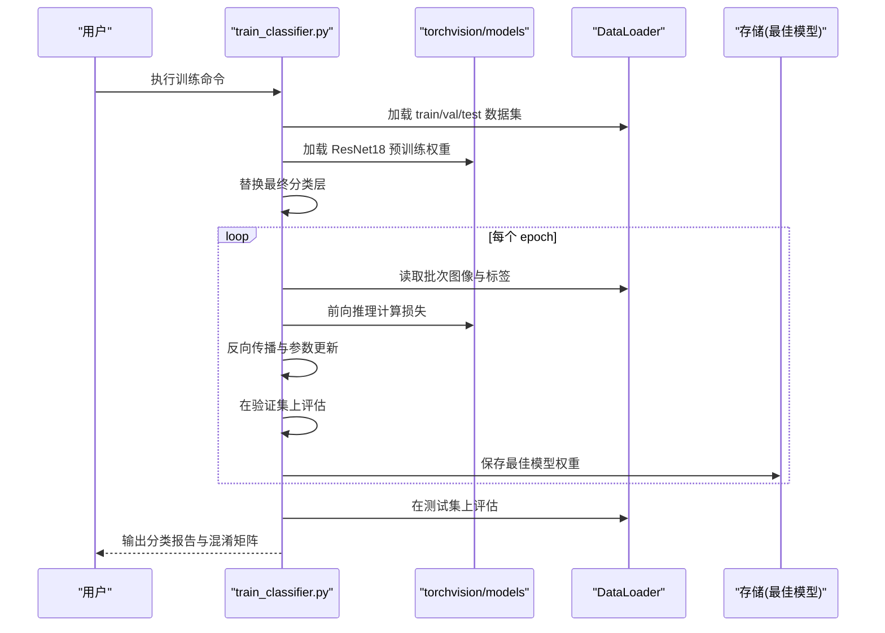
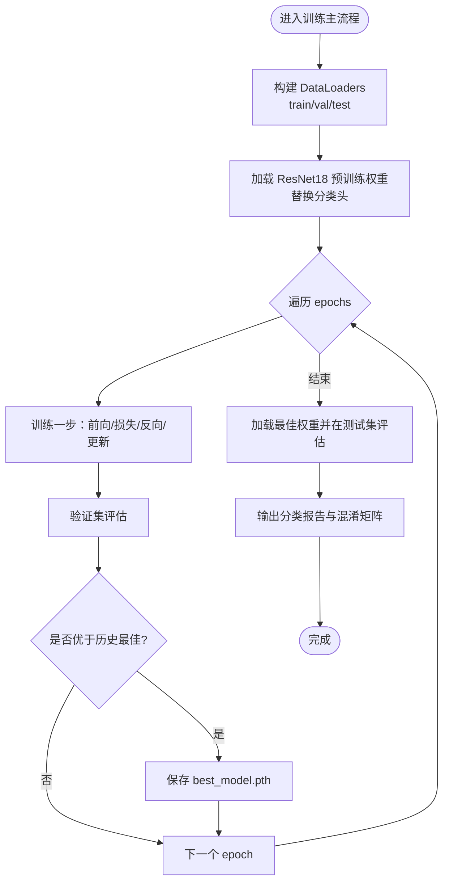
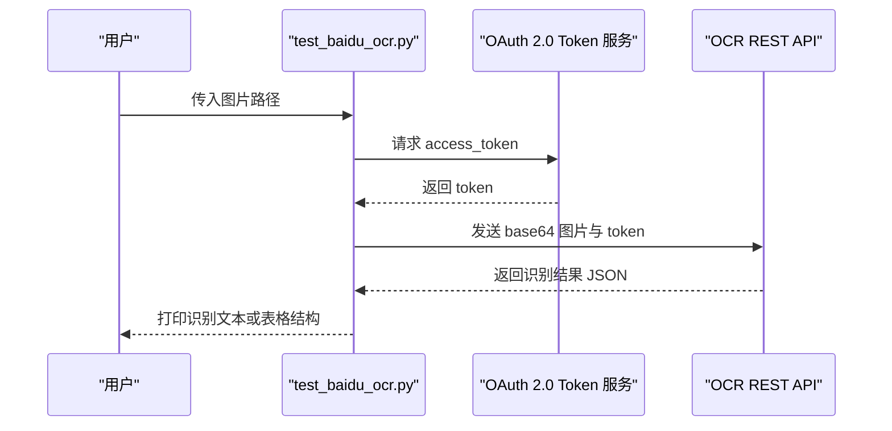
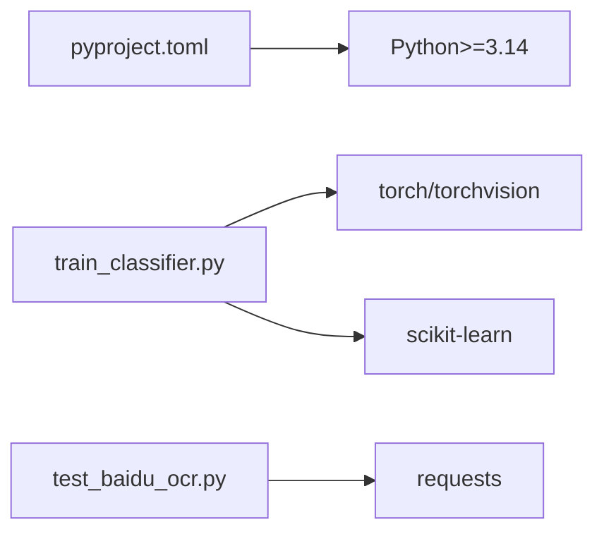

# 快速开始

<cite>
**本文引用的文件**   
- [main.py](file://main.py)
- [pyproject.toml](file://pyproject.toml)
- [scripts/train_classifier.py](file://scripts/train_classifier.py)
- [scripts/test_baidu_ocr.py](file://scripts/test_baidu_ocr.py)
- [notebooks/baidu-ocr-test.ipynb](file://notebooks/baidu-ocr-test.ipynb)
- [notebooks/dataset-research.md](file://notebooks/dataset-research.md)
- [datasets/archaeoscape/README.md](file://datasets/archaeoscape/README.md)
</cite>

## 目录
1. [简介](#简介)
2. [项目结构](#项目结构)
3. [核心组件](#核心组件)
4. [架构总览](#架构总览)
5. [详细组件分析](#详细组件分析)
6. [依赖关系分析](#依赖关系分析)
7. [性能与资源建议](#性能与资源建议)
8. [故障排除指南](#故障排除指南)
9. [结论](#结论)
10. [附录：环境安装与运行步骤](#附录环境安装与运行步骤)

## 简介
本指南面向初学者与有经验的开发者，提供考古LLM项目的快速上手路径。你将完成以下目标：
- 配置 Python 3.14+ 环境并安装必要依赖（torch、torchvision、scikit-learn、requests 等）
- 运行主程序入口
- 使用 ResNet18 进行考古图像分类训练与评估
- 调用百度 OCR API 进行文字识别（通用、表格、高精度等）
- 获取常见问题解决方案与排错建议

## 项目结构
仓库采用“脚本 + Notebook”的轻量组织方式，便于快速验证与实验：
- main.py：项目最小可运行入口
- scripts/train_classifier.py：基于 ResNet18 的二分类/多分类迁移学习训练脚本
- scripts/test_baidu_ocr.py：百度 OCR API 测试脚本（命令行）
- notebooks/baidu-ocr-test.ipynb：百度 OCR 交互式实验笔记本
- notebooks/dataset-research.md：数据集调研文档（COCO、Roboflow、ImageNet 等）
- datasets/archaeoscape/README.md：Archaeoscape 数据集说明与安装参考
- pyproject.toml：项目元数据与 Python 版本要求

图表来源
- [main.py:1-7](file://main.py#L1-L7)
- [scripts/train_classifier.py:1-124](file://scripts/train_classifier.py#L1-L124)
- [scripts/test_baidu_ocr.py:1-109](file://scripts/test_baidu_ocr.py#L1-L109)
- [notebooks/baidu-ocr-test.ipynb:1-331](file://notebooks/baidu-ocr-test.ipynb#L1-L331)
- [notebooks/dataset-research.md:1-287](file://notebooks/dataset-research.md#L1-L287)
- [datasets/archaeoscape/README.md:1-80](file://datasets/archaeoscape/README.md#L1-L80)
- [pyproject.toml:1-8](file://pyproject.toml#L1-L8)

章节来源
- [main.py:1-7](file://main.py#L1-L7)
- [pyproject.toml:1-8](file://pyproject.toml#L1-L8)

## 核心组件
- 主程序入口：打印欢迎信息，作为项目最小可运行示例
- 图像分类训练器：基于 torchvision 的 ResNet18 预训练权重，替换全连接层以适配考古图像二分类或多分类任务；支持训练、验证、测试与报告输出
- 百度 OCR 测试器：封装访问令牌获取与多种 OCR 接口调用（通用、表格、高精度），并提供批量处理思路

章节来源
- [main.py:1-7](file://main.py#L1-L7)
- [scripts/train_classifier.py:1-124](file://scripts/train_classifier.py#L1-L124)
- [scripts/test_baidu_ocr.py:1-109](file://scripts/test_baidu_ocr.py#L1-L109)

## 架构总览
整体流程分为两条主线：
- 图像分类训练线：准备数据集 → 构建 DataLoader → 加载 ResNet18 预训练模型 → 微调全连接层 → 训练/验证/测试 → 保存最佳模型与指标报告
- OCR 服务调用线：设置环境变量 → 获取 access token → 选择 OCR 接口 → 上传图片 → 解析返回结果

图表来源
- [scripts/train_classifier.py:14-38](file://scripts/train_classifier.py#L14-L38)
- [scripts/train_classifier.py:68-124](file://scripts/train_classifier.py#L68-L124)

## 详细组件分析

### 图像分类训练器（ResNet18 迁移学习）
- 数据预处理：统一尺寸、随机水平翻转、旋转、颜色抖动、归一化；验证/测试仅做 Resize 与 Normalize
- 数据加载：按 train/val/test 子目录自动构建 ImageFolder 与 DataLoader
- 模型：使用 ResNet18 的 ImageNet 预训练权重，冻结主干，仅训练新替换的全连接层
- 优化策略：交叉熵损失、Adam 优化器、按验证准确率保存 best_model.pth
- 评估：输出训练/验证/测试损失与准确率，生成分类报告与混淆矩阵

图表来源
- [scripts/train_classifier.py:40-66](file://scripts/train_classifier.py#L40-L66)
- [scripts/train_classifier.py:68-124](file://scripts/train_classifier.py#L68-L124)

章节来源
- [scripts/train_classifier.py:14-38](file://scripts/train_classifier.py#L14-L38)
- [scripts/train_classifier.py:68-124](file://scripts/train_classifier.py#L68-L124)

### 百度 OCR 测试器（命令行）
- 认证：通过 client_id/client_secret 获取 access_token
- 接口：通用文字识别（标准版）、通用文字识别（高精度含位置版）、表格识别等
- 输入：本地图片路径（base64 编码后上传）
- 输出：结构化 JSON，包含 words_result 列表及可选坐标信息

图表来源
- [scripts/test_baidu_ocr.py:8-17](file://scripts/test_baidu_ocr.py#L8-L17)
- [scripts/test_baidu_ocr.py:20-57](file://scripts/test_baidu_ocr.py#L20-L57)
- [scripts/test_baidu_ocr.py:83-109](file://scripts/test_baidu_ocr.py#L83-L109)

章节来源
- [scripts/test_baidu_ocr.py:1-109](file://scripts/test_baidu_ocr.py#L1-L109)

### Jupyter 实验笔记本（百度 OCR）
- 提供分步实验：获取 token、列出可用 API、封装 call_ocr、批量处理函数
- 适合交互式探索不同 OCR 接口的效果差异与结果结构

章节来源
- [notebooks/baidu-ocr-test.ipynb:1-331](file://notebooks/baidu-ocr-test.ipynb#L1-L331)

## 依赖关系分析
- 运行时依赖
  - torch、torchvision：深度学习框架与视觉工具库
  - scikit-learn：分类报告与混淆矩阵
  - requests：HTTP 客户端用于调用百度 OCR API
- 项目元数据
  - requires-python >= 3.14
  - dependencies 为空，需手动安装上述包

图表来源
- [pyproject.toml:1-8](file://pyproject.toml#L1-L8)
- [scripts/train_classifier.py:1-10](file://scripts/train_classifier.py#L1-L10)
- [scripts/test_baidu_ocr.py:1-6](file://scripts/test_baidu_ocr.py#L1-L6)

章节来源
- [pyproject.toml:1-8](file://pyproject.toml#L1-L8)
- [scripts/train_classifier.py:1-10](file://scripts/train_classifier.py#L1-L10)
- [scripts/test_baidu_ocr.py:1-6](file://scripts/test_baidu_ocr.py#L1-L6)

## 性能与资源建议
- GPU 加速：若检测到 CUDA，训练将自动使用 GPU；否则回退 CPU
- 批大小与线程：默认 batch_size=32，num_workers=2；可根据显存调整
- 数据增强：训练阶段启用随机翻转、旋转与颜色抖动，有助于提升泛化能力
- 模型微调：仅训练全连接层，降低过拟合风险并缩短训练时间

[本节为通用指导，不直接分析具体文件]

## 故障排除指南
- 无法找到数据集目录
  - 现象：训练脚本报错找不到 datasets/ArchaeoMind_dataset
  - 解决：确保存在 train/val/test 三个子目录，且每类图片位于对应类别文件夹中
- 缺少环境变量导致 OCR 失败
  - 现象：获取 access_token 时报错
  - 解决：设置 BAIDU_OCR_API_KEY 与 BAIDU_OCR_SECRET_KEY 两个环境变量
- 网络请求异常
  - 现象：requests 抛出 HTTP 错误
  - 解决：检查网络连通性与 API Key 有效性；必要时重试或更换代理
- 设备不可用
  - 现象：CUDA 不可用导致训练缓慢或失败
  - 解决：确认驱动与 CUDA 版本匹配，或改用 CPU 模式

章节来源
- [scripts/train_classifier.py:12-38](file://scripts/train_classifier.py#L12-L38)
- [scripts/test_baidu_ocr.py:8-17](file://scripts/test_baidu_ocr.py#L8-L17)

## 结论
本项目提供了考古图像分类与 OCR 文字识别的最小可行实现。通过 ResNet18 迁移学习与百度 OCR API，你可以快速搭建从图像到文字的自动化流水线。建议在真实考古数据上迭代验证，并结合数据集调研报告选择合适的预训练与数据增强策略。

[本节为总结性内容，不直接分析具体文件]

## 附录：环境安装与运行步骤

### 1. 环境准备
- 安装 Python 3.14+
- 创建虚拟环境（推荐 venv 或 conda）
- 安装依赖：torch、torchvision、scikit-learn、requests

提示：pyproject.toml 指定 requires-python >= 3.14，请确保满足最低版本要求。

章节来源
- [pyproject.toml:6-7](file://pyproject.toml#L6-L7)

### 2. 运行主程序
- 在项目根目录执行主程序，应看到欢迎信息输出

章节来源
- [main.py:1-7](file://main.py#L1-L7)

### 3. 图像分类训练（ResNet18）
- 准备数据集目录结构：datasets/ArchaeoMind_dataset/{train,val,test}/类别名/*.jpg
- 执行训练命令（可调节 epochs、lr、batch-size）
- 训练完成后会在当前目录生成 best_model.pth，并在控制台输出分类报告与混淆矩阵

章节来源
- [scripts/train_classifier.py:12-38](file://scripts/train_classifier.py#L12-L38)
- [scripts/train_classifier.py:68-124](file://scripts/train_classifier.py#L68-L124)

### 4. 调用百度 OCR API
- 设置环境变量：BAIDU_OCR_API_KEY、BAIDU_OCR_SECRET_KEY
- 运行测试脚本并传入图片路径，查看通用文字识别与表格识别结果
- 也可在 notebook 中进行交互式实验，对比不同 OCR 接口的效果

章节来源
- [scripts/test_baidu_ocr.py:8-17](file://scripts/test_baidu_ocr.py#L8-L17)
- [scripts/test_baidu_ocr.py:83-109](file://scripts/test_baidu_ocr.py#L83-L109)
- [notebooks/baidu-ocr-test.ipynb:1-331](file://notebooks/baidu-ocr-test.ipynb#L1-L331)

### 5. 数据集参考与扩展
- 如需更多考古相关数据，可参考数据集调研报告中的 COCO、Roboflow Universe、ImageNet 等资源
- Archaeoscape 数据集 README 提供了安装与运行参考，可作为后续扩展的借鉴

章节来源
- [notebooks/dataset-research.md:1-287](file://notebooks/dataset-research.md#L1-L287)
- [datasets/archaeoscape/README.md:1-80](file://datasets/archaeoscape/README.md#L1-L80)