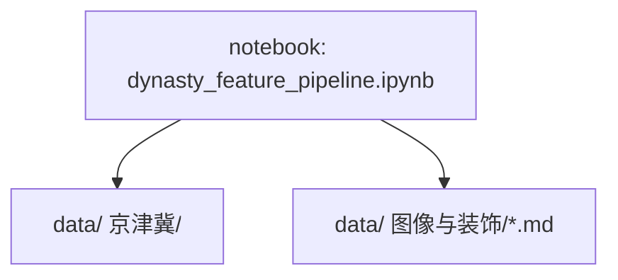
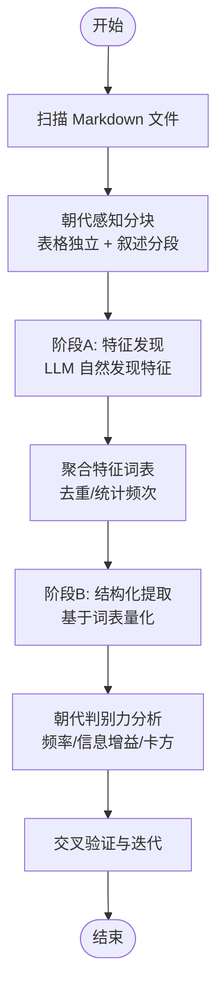
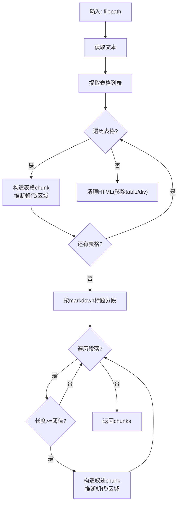
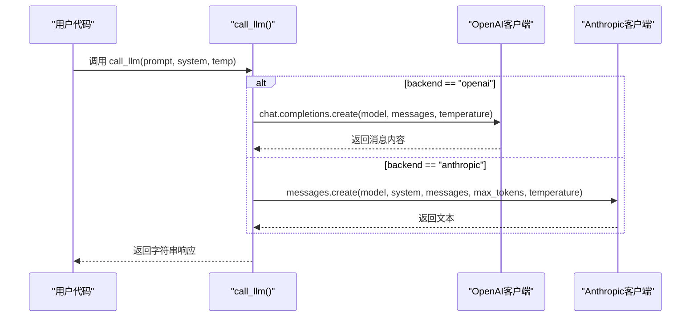
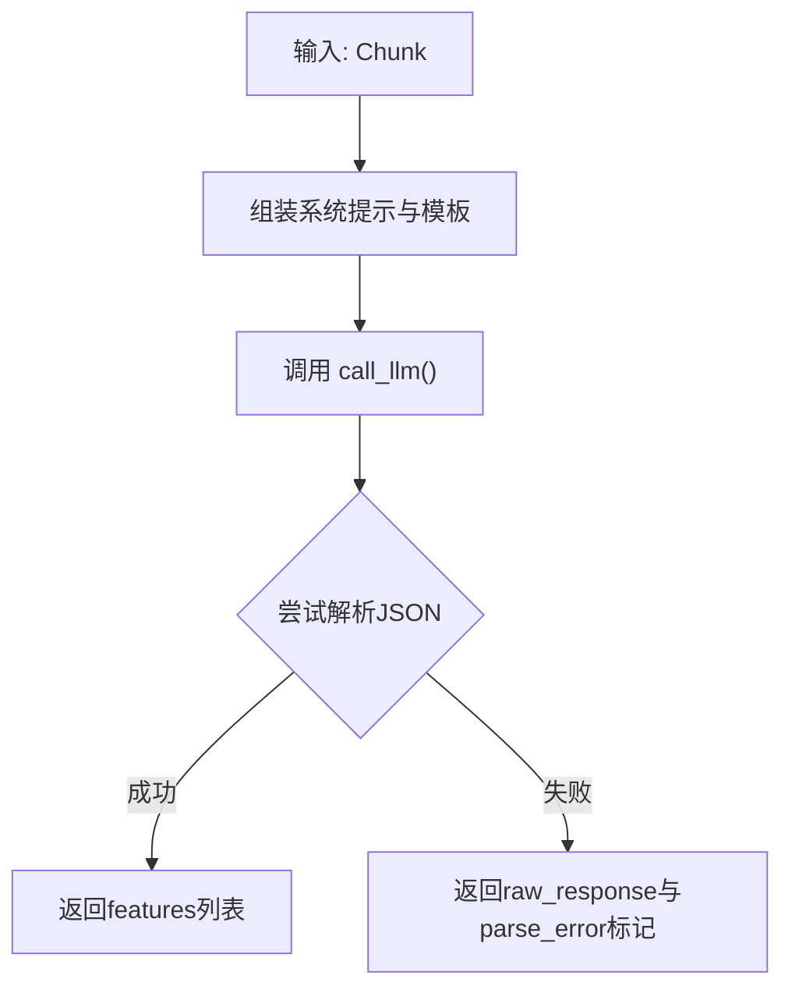
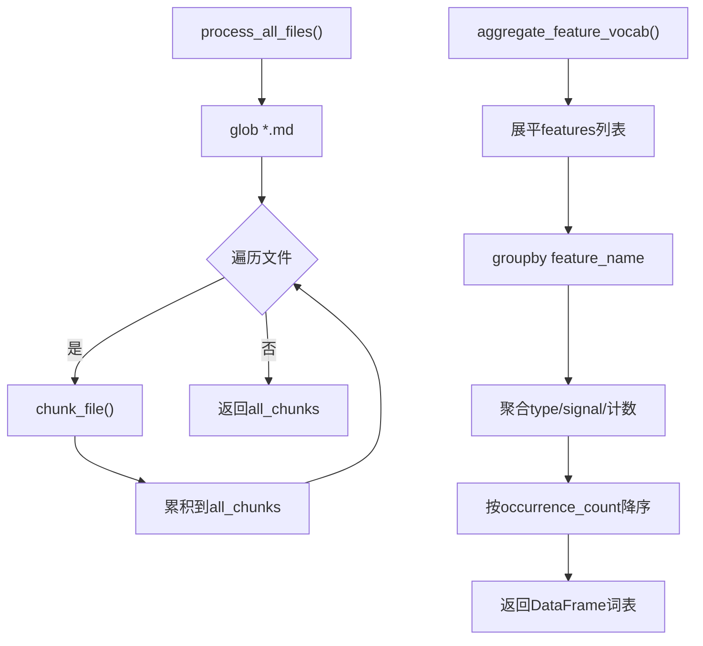

# 技术实现指南

<cite>
**本文引用的文件**   
- [dynasty_feature_pipeline.ipynb](file://dynasty_feature_pipeline.ipynb)
</cite>

## 目录
1. [简介](#简介)
2. [项目结构](#项目结构)
3. [核心组件](#核心组件)
4. [架构总览](#架构总览)
5. [详细组件分析](#详细组件分析)
6. [依赖与环境配置](#依赖与环境配置)
7. [LLM后端与密钥管理](#llm后端与密钥管理)
8. [核心函数使用示例](#核心函数使用示例)
9. [自定义扩展开发指南](#自定义扩展开发指南)
10. [错误处理与调试技巧](#错误处理与调试技巧)
11. [性能与可扩展性建议](#性能与可扩展性建议)
12. [故障排查清单](#故障排查清单)
13. [结论](#结论)

## 简介
本指南面向考古学数据特征提取流水线，目标是从 Markdown 文献中动态提取可量化的器物/墓葬特征，构建东汉→魏晋十六国→北魏的朝代识别模型。流水线采用“预处理+朝代感知分块”、“LLM两阶段特征发现与量化”、“朝代判别力分析”和“验证迭代”四层架构，强调不预设特征词典、增量更新、置信度标注与模糊朝代标签。

## 项目结构
仓库包含一个 Jupyter Notebook 作为主实现入口，以及若干已处理的 Markdown 文本样例（由 OCR 工具生成）。

图表来源
- [dynasty_feature_pipeline.ipynb:1-20](file://dynasty_feature_pipeline.ipynb#L1-L20)

章节来源
- [dynasty_feature_pipeline.ipynb:1-20](file://dynasty_feature_pipeline.ipynb#L1-L20)

## 核心组件
- 朝代关键词与区域关键词：用于分块与元数据标注
- 朝代感知分块器：将表格与叙述文本切分为语义 chunk
- LLM 统一调用接口：支持 OpenAI 与 Anthropic 两种后端
- 阶段A 特征发现：从单个 chunk 自然发现可量化特征
- 批处理与聚合：批量扫描、分块、特征聚合为词表

章节来源
- [dynasty_feature_pipeline.ipynb:307-346](file://dynasty_feature_pipeline.ipynb#L307-L346)
- [dynasty_feature_pipeline.ipynb:352-454](file://dynasty_feature_pipeline.ipynb#L352-L454)
- [dynasty_feature_pipeline.ipynb:492-543](file://dynasty_feature_pipeline.ipynb#L492-L543)
- [dynasty_feature_pipeline.ipynb:548-618](file://dynasty_feature_pipeline.ipynb#L548-L618)
- [dynasty_feature_pipeline.ipynb:657-699](file://dynasty_feature_pipeline.ipynb#L657-L699)

## 架构总览
流水线按四层组织：预处理与分块、LLM 两阶段特征提取、判别力分析、验证迭代。

图表来源
- [dynasty_feature_pipeline.ipynb:33-48](file://dynasty_feature_pipeline.ipynb#L33-L48)
- [dynasty_feature_pipeline.ipynb:158-189](file://dynasty_feature_pipeline.ipynb#L158-L189)

## 详细组件分析

### 数据与路径
- 数据根目录与输出目录在 Notebook 中定义，默认读取 data 目录下所有 .md 文件并写入 output 目录。

章节来源
- [dynasty_feature_pipeline.ipynb:258-281](file://dynasty_feature_pipeline.ipynb#L258-L281)

### 朝代与区域关键词
- 提供多粒度时期与区域关键词字典，用于推断每个 chunk 的朝代与区域标签。

章节来源
- [dynasty_feature_pipeline.ipynb:307-346](file://dynasty_feature_pipeline.ipynb#L307-L346)

### 朝代感知分块器
- 功能要点
  - 表格优先：解析 HTML table，转为结构化 dict 列表，单独成 chunk
  - 叙述文本：去除表格后按 markdown 标题分段，过滤过短段落
  - 元数据：对每个 chunk 推断朝代与区域，记录内容类型与可选表格数据
- 复杂度
  - 时间复杂度近似 O(N)，N 为文档字符数；正则与 BeautifulSoup 遍历线性开销
  - 空间复杂度取决于文档大小与表格规模
- 关键函数
  - extract_tables(html_content): 解析 HTML 表格
  - detect_dynasty(text)/detect_region(text): 关键词匹配
  - chunk_file(filepath): 主分块流程

图表来源
- [dynasty_feature_pipeline.ipynb:395-454](file://dynasty_feature_pipeline.ipynb#L395-L454)

章节来源
- [dynasty_feature_pipeline.ipynb:352-454](file://dynasty_feature_pipeline.ipynb#L352-L454)

### LLM 统一调用接口
- 支持后端
  - openai: 通过 OpenAI SDK 调用 chat.completions
  - anthropic: 通过 anthropic SDK 调用 messages
- 设计要点
  - 统一 call_llm(prompt, system, temperature) 接口
  - 根据 LLM_BACKEND 选择客户端与参数
- 注意事项
  - 需要正确设置环境变量或 SDK 默认凭据
  - 温度较低以保证稳定 JSON 输出

图表来源
- [dynasty_feature_pipeline.ipynb:498-543](file://dynasty_feature_pipeline.ipynb#L498-L543)

章节来源
- [dynasty_feature_pipeline.ipynb:492-543](file://dynasty_feature_pipeline.ipynb#L492-L543)

### 阶段A：特征发现
- 目标：不预设 schema，让 LLM 从文本中自然发现可量化特征
- 输入：单个 Chunk（含 content_type、inferred_dynasty、inferred_region、text）
- 输出：JSON 结构的 features 列表，包含 feature_name、feature_type、value、dynasty_signal、evidence、confidence
- 容错：尝试用正则提取 JSON 块，失败时保留原始响应以便调试

图表来源
- [dynasty_feature_pipeline.ipynb:548-618](file://dynasty_feature_pipeline.ipynb#L548-L618)

章节来源
- [dynasty_feature_pipeline.ipynb:548-618](file://dynasty_feature_pipeline.ipynb#L548-L618)

### 批处理与特征聚合
- process_all_files(file_pattern="*.md"): 递归扫描 data 目录，逐文件分块，汇总所有 chunks
- aggregate_feature_vocab(all_features): 合并各 chunk 的特征结果，去重并按出现次数排序，得到特征词表 DataFrame

图表来源
- [dynasty_feature_pipeline.ipynb:657-699](file://dynasty_feature_pipeline.ipynb#L657-L699)

章节来源
- [dynasty_feature_pipeline.ipynb:657-699](file://dynasty_feature_pipeline.ipynb#L657-L699)

## 依赖与环境配置
- Python 版本
  - 建议使用 Python 3.11（Notebook 元数据指定）
- 必需包
  - pandas、beautifulsoup4、lxml、openai、anthropic、scipy、matplotlib、plotly、tqdm
- 安装方式
  - 在 Notebook 中执行 pip 安装命令或在虚拟环境中提前安装
- 数据路径
  - DATA_DIR = ./data
  - OUTPUT_DIR = ./output（自动创建）

章节来源
- [dynasty_feature_pipeline.ipynb:248-281](file://dynasty_feature_pipeline.ipynb#L248-L281)
- [dynasty_feature_pipeline.ipynb:716-726](file://dynasty_feature_pipeline.ipynb#L716-L726)

## LLM后端与密钥管理
- 后端切换
  - 通过变量 LLM_BACKEND 选择 "openai" 或 "anthropic"
- 凭据管理
  - OpenAI: 确保 SDK 能读取默认凭据（如环境变量 OPENAI_API_KEY）
  - Anthropic: 确保 SDK 能读取默认凭据（如环境变量 ANTHROPIC_API_KEY）
- 模型与参数
  - OpenAI: gpt-4o
  - Anthropic: claude-sonnet-4-20250514
  - 温度建议偏低以稳定输出

章节来源
- [dynasty_feature_pipeline.ipynb:498-543](file://dynasty_feature_pipeline.ipynb#L498-L543)

## 核心函数使用示例
以下示例仅说明调用方式与预期行为，不包含具体代码内容。

- 扫描 Markdown 文件
  - 使用 glob 递归查找 data 下所有 .md 文件，打印数量与大小
  - 参考路径：[dynasty_feature_pipeline.ipynb:286-302](file://dynasty_feature_pipeline.ipynb#L286-L302)

- 分块处理
  - 调用 chunk_file(filepath) 将单个文件切分为多个 Chunk
  - 参考路径：[dynasty_feature_pipeline.ipynb:410-454](file://dynasty_feature_pipeline.ipynb#L410-L454)

- 试运行单文件
  - 选取测试文件，运行分块并预览前几个 chunk 的 ID、类型、朝代/区域推断与文本片段
  - 参考路径：[dynasty_feature_pipeline.ipynb:464-487](file://dynasty_feature_pipeline.ipynb#L464-L487)

- 特征发现（阶段A）
  - 选择一个叙述型 chunk，调用 discover_features(chunk) 获取 JSON 形式的特征列表
  - 参考路径：[dynasty_feature_pipeline.ipynb:595-618](file://dynasty_feature_pipeline.ipynb#L595-L618)
  - 试运行示例位置：[dynasty_feature_pipeline.ipynb:627-652](file://dynasty_feature_pipeline.ipynb#L627-L652)

- 批量处理
  - 调用 process_all_files() 扫描全部文件并返回所有 chunks
  - 参考路径：[dynasty_feature_pipeline.ipynb:666-677](file://dynasty_feature_pipeline.ipynb#L666-L677)

- 特征聚合
  - 调用 aggregate_feature_vocab(all_features) 生成特征词表 DataFrame
  - 参考路径：[dynasty_feature_pipeline.ipynb:679-699](file://dynasty_feature_pipeline.ipynb#L679-L699)

## 自定义扩展开发指南
- 新增朝代关键词
  - 在 DYNASTY_KEYWORDS 中添加新的时期键与对应关键词列表
  - 参考路径：[dynasty_feature_pipeline.ipynb:316-328](file://dynasty_feature_pipeline.ipynb#L316-L328)
- 新增区域标签
  - 在 REGION_KEYWORDS 中添加新的区域键与对应关键词列表
  - 参考路径：[dynasty_feature_pipeline.ipynb:331-338](file://dynasty_feature_pipeline.ipynb#L331-L338)
- 自定义 LLM 后端集成
  - 在 call_llm 中增加新的 elif 分支，封装新 SDK 的调用逻辑
  - 保持统一的 prompt/system/temperature 参数约定
  - 参考路径：[dynasty_feature_pipeline.ipynb:508-538](file://dynasty_feature_pipeline.ipynb#L508-L538)
- 调整分块策略
  - 修改 extract_tables 的解析规则或 chunk_file 的分段正则，以适应不同来源的 Markdown 结构
  - 参考路径：[dynasty_feature_pipeline.ipynb:395-454](file://dynasty_feature_pipeline.ipynb#L395-L454)
- 扩展阶段B（结构化提取）
  - 基于聚合得到的特征词表，构造阶段B的 prompt，要求 LLM 按固定 schema 输出数值/类别
  - 可在现有 discover_features 基础上复用 call_llm 与 JSON 解析逻辑
  - 参考路径：[dynasty_feature_pipeline.ipynb:548-618](file://dynasty_feature_pipeline.ipynb#L548-L618)

## 错误处理与调试技巧
- JSON 解析容错
  - 使用正则提取 JSON 块，捕获 JSONDecodeError 并返回 raw_response 与 parse_error 标记，便于人工复核
  - 参考路径：[dynasty_feature_pipeline.ipynb:606-615](file://dynasty_feature_pipeline.ipynb#L606-L615)
- 未知后端异常
  - 当 LLM_BACKEND 未注册时抛出 ValueError，快速定位配置问题
  - 参考路径：[dynasty_feature_pipeline.ipynb:536-538](file://dynasty_feature_pipeline.ipynb#L536-L538)
- 调试建议
  - 先对单个 chunk 运行 discover_features，检查返回的 raw_response 与 features 结构
  - 逐步扩大范围至批量处理，观察 tqdm 进度与最终聚合结果
  - 若 LLM 返回非 JSON，可在 prompt 中强化“只输出 JSON”的约束，并降低 temperature

章节来源
- [dynasty_feature_pipeline.ipynb:606-615](file://dynasty_feature_pipeline.ipynb#L606-L615)
- [dynasty_feature_pipeline.ipynb:536-538](file://dynasty_feature_pipeline.ipynb#L536-L538)

## 性能与可扩展性建议
- 并行化
  - 对大量文件的分块与 LLM 调用可使用线程池或进程池进行并发处理，注意控制并发度以避免触发 API 限流
- 缓存与幂等
  - 对 chunk_id 与 LLM 请求做哈希缓存，避免重复计算
- 增量更新
  - 新增文件后仅对新增 chunk 跑阶段A，合并已有词表，减少全量成本
- 资源限制
  - 对过长表格与段落进行截断，控制单次 LLM 输入长度
  - 参考路径：[dynasty_feature_pipeline.ipynb:423-448](file://dynasty_feature_pipeline.ipynb#L423-L448)

## 故障排查清单
- 环境
  - Python 版本是否为 3.11？依赖是否安装完整？
- 数据
  - data 目录下是否存在 .md 文件？路径是否正确？
- LLM
  - 是否设置了正确的 API Key？后端名称是否与 LLM_BACKEND 一致？
  - 模型名称是否可用？网络是否可达？
- 分块
  - 是否遇到空 chunk 或过短段落被过滤？
  - 表格是否被正确解析？
- 特征发现
  - LLM 返回是否为合法 JSON？若非 JSON，查看 raw_response 并优化 prompt
- 批处理
  - 是否出现内存不足或超时？考虑分批处理与重试机制

## 结论
本指南提供了从环境准备、依赖安装、LLM 后端配置到核心函数调用的完整实现路径，并给出了扩展开发与调试排障的建议。按照四层架构逐步推进，可以在保证质量的前提下高效完成考古学文献的定量特征提取与朝代判别分析。