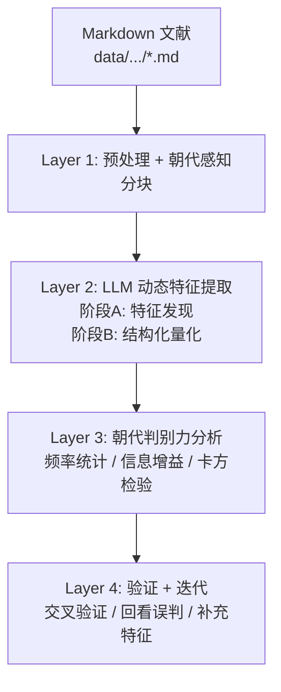
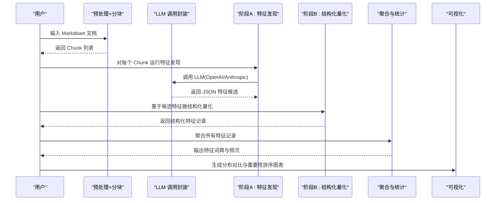
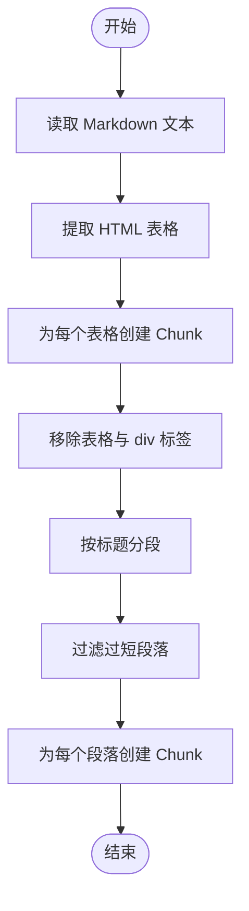
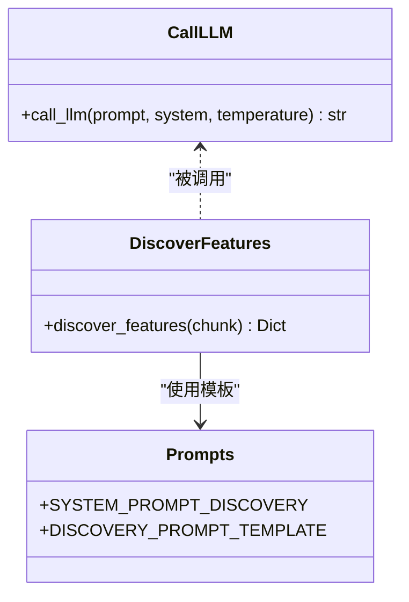
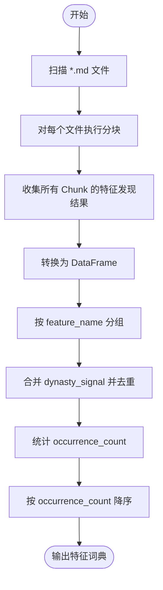
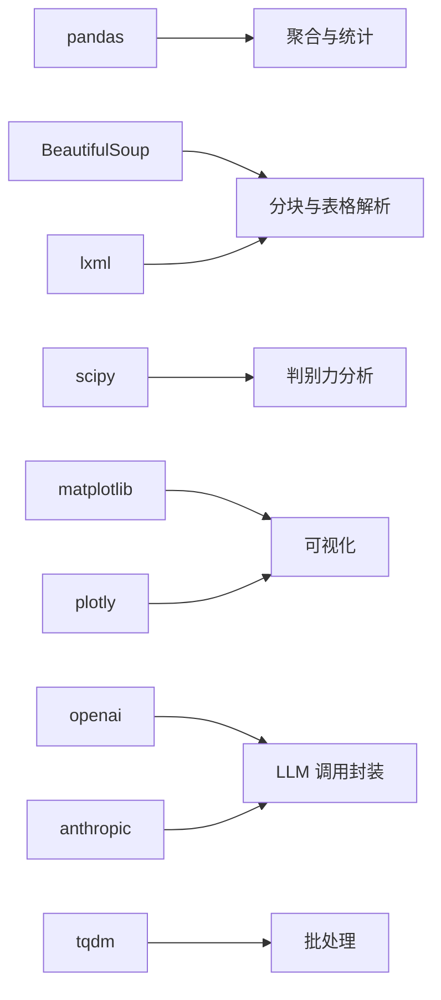

# 数据分析工具

<cite>
**本文引用的文件**
- [dynasty_feature_pipeline.ipynb](file://dynasty_feature_pipeline.ipynb)
</cite>

## 目录
1. [引言](#引言)
2. [项目结构](#项目结构)
3. [核心组件](#核心组件)
4. [架构总览](#架构总览)
5. [详细组件分析](#详细组件分析)
6. [依赖关系分析](#依赖关系分析)
7. [性能与可扩展性](#性能与可扩展性)
8. [可视化输出指南](#可视化输出指南)
9. [结果解读指南](#结果解读指南)
10. [故障排查](#故障排查)
11. [结论](#结论)

## 引言
本文件面向考古学研究者与数据工程师，系统化说明“考古器物计数特征提取 Pipeline”的数据分析工具与可视化输出方法。重点覆盖：
- 特征聚合与统计功能实现，特别是 aggregate_feature_vocab() 的去重与频率统计逻辑
- 朝代分布分析方法：如何计算每个特征在各时期的分布情况
- 可视化输出指南：使用 matplotlib 与 plotly 生成图表，展示特征分布对比与重要性排序
- 结果解读指南：理解“朝代指纹（关键特征组合）”与“过渡期的混合信号”
- 实际分析案例与图表示例路径，帮助正确解读与分析提取结果

## 项目结构
仓库包含一个 Jupyter Notebook 作为主流程入口，以及若干已 OCR 处理后的 Markdown 文献数据。Notebook 定义了从预处理、分块、LLM 动态特征发现到聚合分析的完整管线。

图示来源
- [dynasty_feature_pipeline.ipynb:33-47](file://dynasty_feature_pipeline.ipynb#L33-L47)

章节来源
- [dynasty_feature_pipeline.ipynb:1-28](file://dynasty_feature_pipeline.ipynb#L1-L28)
- [dynasty_feature_pipeline.ipynb:33-47](file://dynasty_feature_pipeline.ipynb#L33-L47)

## 核心组件
- 朝代关键词与区域关键词定义：用于分块与标注
- 朝代感知分块器：按语义段落与朝代边界切分文本，并提取表格为独立 chunk
- LLM 调用封装：统一接口支持 OpenAI 与 Anthropic
- 阶段 A 特征发现 Prompt：让模型自然发现可量化特征
- 批处理与特征词典聚合：aggregate_feature_vocab() 负责去重与频率统计
- 技术选型表：明确 pandas、scipy、matplotlib、plotly 等工具用途

章节来源
- [dynasty_feature_pipeline.ipynb:316-346](file://dynasty_feature_pipeline.ipynb#L316-L346)
- [dynasty_feature_pipeline.ipynb:361-454](file://dynasty_feature_pipeline.ipynb#L361-L454)
- [dynasty_feature_pipeline.ipynb:503-541](file://dynasty_feature_pipeline.ipynb#L503-L541)
- [dynasty_feature_pipeline.ipynb:557-617](file://dynasty_feature_pipeline.ipynb#L557-L617)
- [dynasty_feature_pipeline.ipynb:666-699](file://dynasty_feature_pipeline.ipynb#L666-L699)
- [dynasty_feature_pipeline.ipynb:196-207](file://dynasty_feature_pipeline.ipynb#L196-L207)

## 架构总览
整体采用四层架构：预处理与分块 → LLM 动态特征提取 → 朝代判别力分析 → 验证与迭代。该设计强调“不预设 schema”，通过两阶段让模型从数据中自然发现特征，再进行结构化量化与统计分析。

图示来源
- [dynasty_feature_pipeline.ipynb:33-47](file://dynasty_feature_pipeline.ipynb#L33-L47)
- [dynasty_feature_pipeline.ipynb:503-541](file://dynasty_feature_pipeline.ipynb#L503-L541)
- [dynasty_feature_pipeline.ipynb:557-617](file://dynasty_feature_pipeline.ipynb#L557-L617)
- [dynasty_feature_pipeline.ipynb:666-699](file://dynasty_feature_pipeline.ipynb#L666-L699)

## 详细组件分析

### 组件一：朝代感知分块器
- 目标：将 Markdown 内容切分为语义连贯的 chunk，并为每个 chunk 推断朝代与区域标签
- 关键点：
  - 先提取 HTML 表格作为独立 chunk，保留结构化数据
  - 去除表格后按 markdown 标题分段，过滤过短段落
  - 使用预定义的朝代与区域关键词进行匹配标注
- 复杂度：线性扫描文本，正则分割与关键词匹配均为 O(n)；表格解析为 O(m)，m 为表格单元格数

图示来源
- [dynasty_feature_pipeline.ipynb:395-454](file://dynasty_feature_pipeline.ipynb#L395-L454)

章节来源
- [dynasty_feature_pipeline.ipynb:361-454](file://dynasty_feature_pipeline.ipynb#L361-L454)

### 组件二：LLM 调用封装与阶段 A 特征发现
- 统一接口：call_llm() 支持 OpenAI 与 Anthropic 后端
- 阶段 A 提示词：SYSTEM_PROMPT_DISCOVERY 与 DISCOVERY_PROMPT_TEMPLATE 引导模型输出 JSON 格式的特征候选
- 健壮性：尝试用正则提取 JSON 块，失败时返回原始响应以便人工检查

图示来源
- [dynasty_feature_pipeline.ipynb:503-541](file://dynasty_feature_pipeline.ipynb#L503-L541)
- [dynasty_feature_pipeline.ipynb:557-617](file://dynasty_feature_pipeline.ipynb#L557-L617)

章节来源
- [dynasty_feature_pipeline.ipynb:503-541](file://dynasty_feature_pipeline.ipynb#L503-L541)
- [dynasty_feature_pipeline.ipynb:557-617](file://dynasty_feature_pipeline.ipynb#L557-L617)

### 组件三：批量处理与特征词典聚合（含 aggregate_feature_vocab）
- process_all_files()：递归扫描 data 目录下的 Markdown 文件，逐文件分块并汇总
- aggregate_feature_vocab(all_features)：将所有发现的特征合并为 DataFrame，并按 feature_name 分组去重与统计出现次数
  - 去重策略：以 feature_name 为键进行 groupby
  - 频率统计：evidence 字段计数作为 occurrence_count
  - 其他字段：feature_type 取首个值；dynasty_signal 合并并去重逗号分隔字符串
  - 输出：按 occurrence_count 降序排列的特征词典

图示来源
- [dynasty_feature_pipeline.ipynb:666-699](file://dynasty_feature_pipeline.ipynb#L666-L699)

章节来源
- [dynasty_feature_pipeline.ipynb:666-699](file://dynasty_feature_pipeline.ipynb#L666-L699)

### 组件四：朝代分布分析方法
- 目标：计算每个特征在各时期（如西汉早期、东汉中期、北魏等）的出现或占比分布
- 输入：结构化量化后的特征记录（包含 dynasty 标签与特征值）
- 步骤建议：
  1) 构建“特征 × 时期”的二维矩阵，值为出现次数或比例
  2) 对数值型特征，可按时期分组计算均值/中位数/方差
  3) 对分类/比率特征，计算类别占比
  4) 可选：使用信息增益或卡方检验评估特征的朝代区分度
- 输出：各时期“指纹”（关键特征组合）与过渡期“混合信号”（多时期共存的高频特征）

章节来源
- [dynasty_feature_pipeline.ipynb:158-173](file://dynasty_feature_pipeline.ipynb#L158-L173)

## 依赖关系分析
- 数据处理：pandas、BeautifulSoup、lxml
- 统计与可视化：scipy、matplotlib、plotly
- LLM 后端：openai、anthropic
- 进度条：tqdm

图示来源
- [dynasty_feature_pipeline.ipynb:196-207](file://dynasty_feature_pipeline.ipynb#L196-L207)
- [dynasty_feature_pipeline.ipynb:253-255](file://dynasty_feature_pipeline.ipynb#L253-L255)

章节来源
- [dynasty_feature_pipeline.ipynb:196-207](file://dynasty_feature_pipeline.ipynb#L196-L207)
- [dynasty_feature_pipeline.ipynb:253-255](file://dynasty_feature_pipeline.ipynb#L253-L255)

## 性能与可扩展性
- 分块与解析：正则与 BeautifulSoup 解析为线性时间，适合中等规模文档；若文档极大，建议流式读取与分批处理
- LLM 调用：受限于 API 速率限制与成本，建议并行度控制与重试机制
- 聚合与统计：groupby 操作在大数据集上可能成为瓶颈，可考虑分片聚合或增量更新
- 可视化：plotly 交互图适合探索性分析；大规模数据集建议采样或下采样后再绘图

[本节为通用指导，无需具体文件引用]

## 可视化输出指南
以下提供两类常用图表的实现思路与示例路径，便于快速落地：

- 特征分布对比（柱状图/堆叠柱状图）
  - 横轴：时期（如西汉早期、东汉中期、北魏等）
  - 纵轴：特征出现次数或占比
  - 颜色：不同特征类别或具体特征名
  - 工具：matplotlib 或 plotly
  - 数据来源：由“特征 × 时期”矩阵生成

- 特征重要性排序（条形图）
  - 依据：occurrence_count 或判别力指标（信息增益/卡方）
  - 工具：matplotlib 或 plotly
  - 数据来源：aggregate_feature_vocab() 的输出

- 过渡期混合信号（热力图）
  - 行：特征名；列：时期；颜色深浅：出现强度
  - 工具：plotly 热力图
  - 数据来源：各时期分布矩阵

章节来源
- [dynasty_feature_pipeline.ipynb:196-207](file://dynasty_feature_pipeline.ipynb#L196-L207)
- [dynasty_feature_pipeline.ipynb:666-699](file://dynasty_feature_pipeline.ipynb#L666-L699)

## 结果解读指南
- 朝代指纹（关键特征组合）
  - 识别在某时期显著高发的特征集合
  - 结合领域知识解释其文化与技术背景
- 过渡期混合信号
  - 某些特征在多时期同时高频出现，反映文化交融或制度延续
  - 需结合区域差异与样本量谨慎解读
- 置信度与证据
  - 低置信度的特征应优先人工复核
  - evidence 字段提供原文定位，便于回溯验证

章节来源
- [dynasty_feature_pipeline.ipynb:158-173](file://dynasty_feature_pipeline.ipynb#L158-L173)
- [dynasty_feature_pipeline.ipynb:557-617](file://dynasty_feature_pipeline.ipynb#L557-L617)

## 故障排查
- LLM 返回非 JSON
  - 现象：JSON 解析失败
  - 处理：捕获异常并保存 raw_response，必要时调整 prompt 或温度参数
- 分块过细或过粗
  - 现象：特征碎片化或缺失上下文
  - 处理：调整标题分段阈值与最小长度过滤
- 聚合结果异常
  - 现象：occurrence_count 为 0 或重复项过多
  - 处理：检查 feature_name 标准化（大小写、空格、同义词合并）

章节来源
- [dynasty_feature_pipeline.ipynb:557-617](file://dynasty_feature_pipeline.ipynb#L557-L617)
- [dynasty_feature_pipeline.ipynb:666-699](file://dynasty_feature_pipeline.ipynb#L666-L699)

## 结论
本工具链以“不预设 schema”的动态特征发现为核心，配合朝代感知分块与结构化量化，形成从数据到洞察的闭环。通过 aggregate_feature_vocab() 的高效去重与频率统计，以及灵活的可视化方案，研究者可以快速识别各时期的“指纹”特征与过渡期的“混合信号”，从而支撑更深入的考古学分析与断代研究。

[本节为总结性内容，无需具体文件引用]