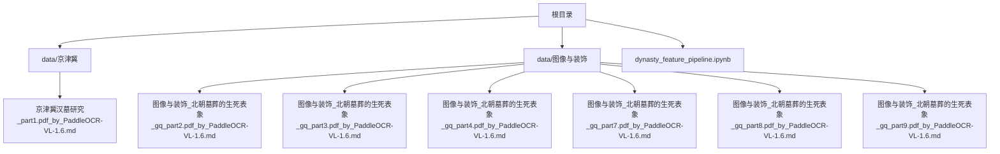
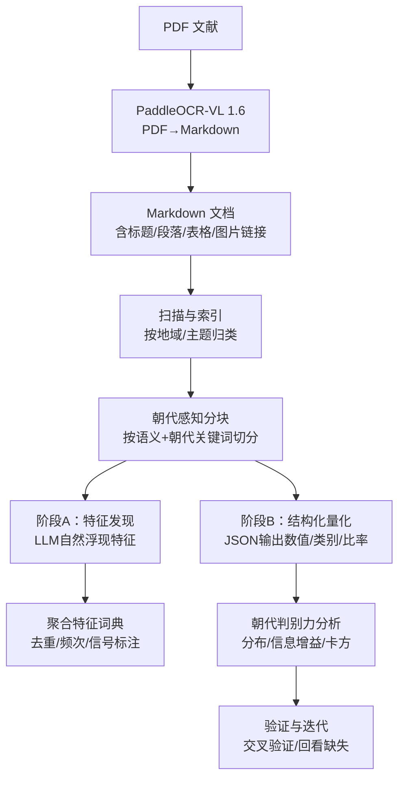
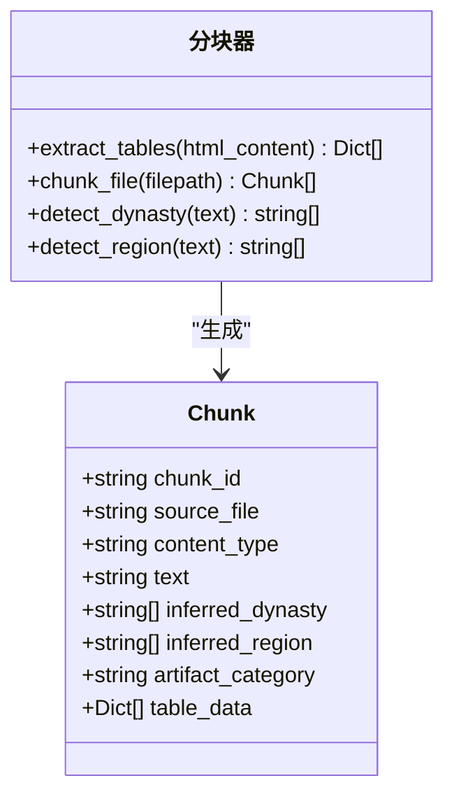
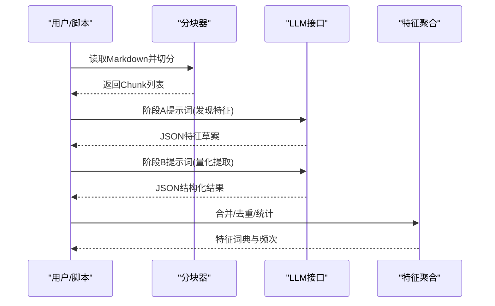
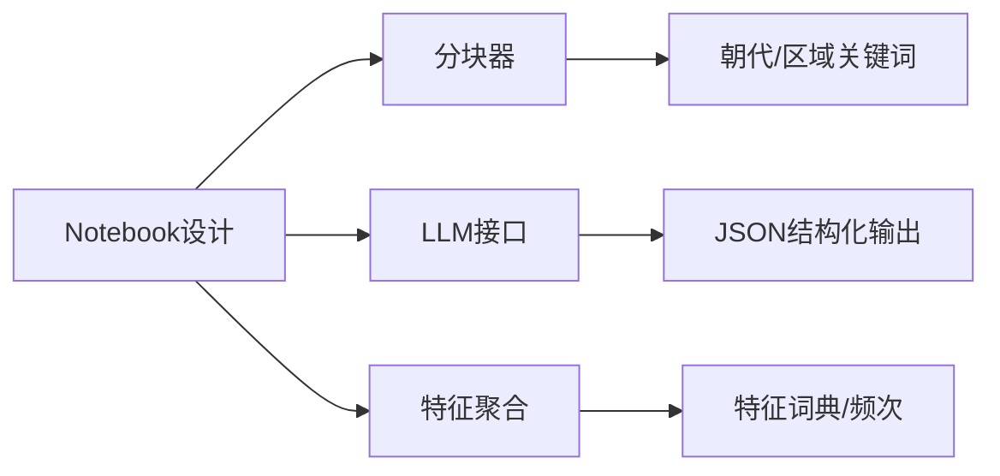

# 数据资源说明

<cite>
**本文引用的文件**   
- [dynasty_feature_pipeline.ipynb](file://dynasty_feature_pipeline.ipynb)
- [京津冀汉墓研究_part1.pdf_by_PaddleOCR-VL-1.6.md](file://data/京津冀/京津冀汉墓研究_part1.pdf_by_PaddleOCR-VL-1.6.md)
- [图像与装饰_北朝墓葬的生死表象_gq_part2.pdf_by_PaddleOCR-VL-1.6.md](file://data/图像与装饰/图像与装饰_北朝墓葬的生死表象_gq_part2.pdf_by_PaddleOCR-VL-1.6.md)
- [图像与装饰_北朝墓葬的生死表象_gq_part3.pdf_by_PaddleOCR-VL-1.6.md](file://data/图像与装饰/图像与装饰_北朝墓葬的生死表象_gq_part3.pdf_by_PaddleOCR-VL-1.6.md)
</cite>

## 目录
1. [引言](#引言)
2. [项目结构](#项目结构)
3. [核心组件](#核心组件)
4. [架构总览](#架构总览)
5. [详细组件分析](#详细组件分析)
6. [依赖关系分析](#依赖关系分析)
7. [性能与质量考量](#性能与质量考量)
8. [使用建议与局限](#使用建议与局限)
9. [结论](#结论)
10. [附录：数据清单与分类索引](#附录数据清单与分类索引)

## 引言
本说明面向考古学研究者，系统梳理“汉代至北朝墓葬”主题的数据资源。数据集以PDF文献经PaddleOCR-VL转换为Markdown格式为基础，围绕地域（京津冀、山东、幽燕等）与主题（印章、墓葬形制、随葬品、图像与装饰等）进行组织，并配套一个特征提取Pipeline的设计文档，用于后续从文本中动态发现与量化可比较的器物/墓葬特征，支撑朝代识别与区域文化比较研究。

## 项目结构
仓库包含一个Jupyter Notebook设计文档与按主题分区的Markdown数据目录：
- data/京津冀：京津冀地区汉代墓葬研究（已转换的Markdown）
- data/图像与装饰：北朝墓葬图像与装饰专题（已转换的Markdown）
- dynasty_feature_pipeline.ipynb：特征提取Pipeline设计与实现框架

图表来源
- [dynasty_feature_pipeline.ipynb:1-27](file://dynasty_feature_pipeline.ipynb#L1-L27)

章节来源
- [dynasty_feature_pipeline.ipynb:1-27](file://dynasty_feature_pipeline.ipynb#L1-L27)

## 核心组件
- 数据源与范围
  - 京津冀地区汉代墓葬研究（系统性专著，含类型分期、社会内容、墓地专题、陪葬品专题等）
  - 图像与装饰专题：北朝墓葬的生死表象（多部分PDF转Markdown，含大量图示与图注）
  - Pipeline文档列出的其他来源（作为目标范围与背景）：山东地区汉代墓葬研究、幽燕地区两汉墓葬研究、光宅中原拓跋至北魏墓葬文化、各类发掘报告与专题论文
- 预处理流程
  - PDF → Markdown：通过PaddleOCR-VL 1.6将PDF转为结构化Markdown，保留标题层级、段落、表格与图片引用
  - 目录与元信息：Markdown中包含图书CIP信息、摘要、目录等，便于自动抽取来源与主题标签
- 分类与归档方式
  - 按地域：京津冀、图像与装饰（北朝）
  - 按主题：墓葬形制、随葬品、壁画与装饰、印章（在Pipeline示例中提及）
- 处理管线（设计）
  - Layer 1：预处理 + 朝代感知分块（按语义段落与朝代关键词切分）
  - Layer 2：LLM动态特征提取（阶段A：特征发现；阶段B：结构化量化）
  - Layer 3：朝代判别力分析（频率统计、信息增益/卡方检验）
  - Layer 4：验证与迭代（交叉验证、回看缺失特征）

章节来源
- [dynasty_feature_pipeline.ipynb:17-27](file://dynasty_feature_pipeline.ipynb#L17-L27)
- [dynasty_feature_pipeline.ipynb:33-47](file://dynasty_feature_pipeline.ipynb#L33-L47)
- [dynasty_feature_pipeline.ipynb:55-80](file://dynasty_feature_pipeline.ipynb#L55-L80)
- [dynasty_feature_pipeline.ipynb:87-132](file://dynasty_feature_pipeline.ipynb#L87-L132)
- [dynasty_feature_pipeline.ipynb:158-189](file://dynasty_feature_pipeline.ipynb#L158-L189)

## 架构总览
下图展示从原始PDF到可计算特征的端到端流程，以及当前仓库中实际可用的数据形态。

图表来源
- [dynasty_feature_pipeline.ipynb:33-47](file://dynasty_feature_pipeline.ipynb#L33-L47)
- [dynasty_feature_pipeline.ipynb:55-80](file://dynasty_feature_pipeline.ipynb#L55-L80)
- [dynasty_feature_pipeline.ipynb:87-132](file://dynasty_feature_pipeline.ipynb#L87-L132)
- [dynasty_feature_pipeline.ipynb:158-189](file://dynasty_feature_pipeline.ipynb#L158-L189)

## 详细组件分析

### 数据预处理与OCR转换（PaddleOCR-VL）
- 输入：PDF学术文献（专著、论文集、发掘报告等）
- 工具：PaddleOCR-VL 1.6在线服务
- 输出：Markdown文件，包含：
  - 标题层级（#、##、###）
  - 正文段落
  - 表格（HTML table结构）
  - 图片与图注（以img标签与alt/标题形式呈现）
- 命名约定：文件名后缀包含“_by_PaddleOCR-VL-1.6.md”，便于溯源版本

章节来源
- [dynasty_feature_pipeline.ipynb:19-26](file://dynasty_feature_pipeline.ipynb#L19-L26)
- [京津冀汉墓研究_part1.pdf_by_PaddleOCR-VL-1.6.md:1-30](file://data/京津冀/京津冀汉墓研究_part1.pdf_by_PaddleOCR-VL-1.6.md#L1-L30)
- [图像与装饰_北朝墓葬的生死表象_gq_part2.pdf_by_PaddleOCR-VL-1.6.md:1-20](file://data/图像与装饰/图像与装饰_北朝墓葬的生死表象_gq_part2.pdf_by_PaddleOCR-VL-1.6.md#L1-L20)

### 文献分类与组织方式
- 地域维度
  - 京津冀：以专著《京津冀汉墓研究》为主，涵盖类型分期、社会内容、墓地专题、陪葬品专题等
  - 图像与装饰：聚焦北朝墓葬图像与装饰母题（神兽、镇墓武士、莲花与龙、矩形框格等）
- 主题维度（依据Pipeline示例与数据内容归纳）
  - 印章：无字印材质、钮制、尺寸、位置、伴随印章、年代等（见Pipeline示例字段）
  - 墓葬形制：竖穴坑墓、洞室墓、砖室/石室墓、家族墓地布局等
  - 随葬品：陶俑、连枝灯、陶楼、金属牌饰、带具、瓦当、柱础等
  - 图像与装饰：神兽纹、云气纹、忍冬纹、莲花纹、矩形框格、壁画题材等

章节来源
- [dynasty_feature_pipeline.ipynb:17-27](file://dynasty_feature_pipeline.ipynb#L17-L27)
- [dynasty_feature_pipeline.ipynb:138-151](file://dynasty_feature_pipeline.ipynb#L138-L151)
- [京津冀汉墓研究_part1.pdf_by_PaddleOCR-VL-1.6.md:72-110](file://data/京津冀/京津冀汉墓研究_part1.pdf_by_PaddleOCR-VL-1.6.md#L72-L110)
- [图像与装饰_北朝墓葬的生死表象_gq_part2.pdf_by_PaddleOCR-VL-1.6.md:118-170](file://data/图像与装饰/图像与装饰_北朝墓葬的生死表象_gq_part2.pdf_by_PaddleOCR-VL-1.6.md#L118-L170)

### 朝代感知分块器（Layer 1）
- 策略：不做固定长度chunk，按语义段落与朝代边界切分
- 触发词：西汉/东汉/魏晋/十六国/北魏/拓跋/平城/洛阳/大同等
- 输出对象：Chunk（含chunk_id、source_file、content_type、text、inferred_dynasty、inferred_region、artifact_category、table_data）
- 表格优先：先提取HTML表格为独立chunk，再对叙述文本按标题分段

图表来源
- [dynasty_feature_pipeline.ipynb:361-454](file://dynasty_feature_pipeline.ipynb#L361-L454)

章节来源
- [dynasty_feature_pipeline.ipynb:55-80](file://dynasty_feature_pipeline.ipynb#L55-L80)
- [dynasty_feature_pipeline.ipynb:361-454](file://dynasty_feature_pipeline.ipynb#L361-L454)

### LLM动态特征提取（Layer 2）
- 阶段A（特征发现）：不预设schema，让模型从文本中自然发现可量化特征，输出feature_name、feature_type、dynasty_signal、evidence等
- 阶段B（结构化量化）：基于阶段A发现的特征清单，对每个chunk做结构化提取，输出JSON（含dynasty、region、features键值）
- 置信度标注：每个提取值附带置信度，低置信度标记人工复核

图表来源
- [dynasty_feature_pipeline.ipynb:87-132](file://dynasty_feature_pipeline.ipynb#L87-L132)
- [dynasty_feature_pipeline.ipynb:557-618](file://dynasty_feature_pipeline.ipynb#L557-L618)

章节来源
- [dynasty_feature_pipeline.ipynb:87-132](file://dynasty_feature_pipeline.ipynb#L87-L132)
- [dynasty_feature_pipeline.ipynb:557-618](file://dynasty_feature_pipeline.ipynb#L557-L618)

### 朝代判别力分析与验证（Layer 3/4）
- 频率统计：各时期特征分布对比
- 判别力评估：信息增益/卡方检验筛选高区分度特征
- 验证与迭代：用已知年代样本交叉验证，误判样本回溯补充特征

章节来源
- [dynasty_feature_pipeline.ipynb:158-189](file://dynasty_feature_pipeline.ipynb#L158-L189)

## 依赖关系分析
- 外部依赖（设计层面）
  - pandas、BeautifulSoup、lxml：表格解析与HTML处理
  - OpenAI/Anthropic：LLM调用（阶段A/B）
  - scipy：统计检验（信息增益/卡方）
  - matplotlib/plotly：可视化
- 内部依赖
  - 分块器依赖朝代/区域关键词表
  - 特征发现与量化依赖统一LLM接口
  - 聚合模块负责去重与频次统计

图表来源
- [dynasty_feature_pipeline.ipynb:247-280](file://dynasty_feature_pipeline.ipynb#L247-L280)
- [dynasty_feature_pipeline.ipynb:316-346](file://dynasty_feature_pipeline.ipynb#L316-L346)
- [dynasty_feature_pipeline.ipynb:498-542](file://dynasty_feature_pipeline.ipynb#L498-L542)
- [dynasty_feature_pipeline.ipynb:666-699](file://dynasty_feature_pipeline.ipynb#L666-L699)

章节来源
- [dynasty_feature_pipeline.ipynb:196-207](file://dynasty_feature_pipeline.ipynb#L196-L207)
- [dynasty_feature_pipeline.ipynb:247-280](file://dynasty_feature_pipeline.ipynb#L247-L280)
- [dynasty_feature_pipeline.ipynb:316-346](file://dynasty_feature_pipeline.ipynb#L316-L346)
- [dynasty_feature_pipeline.ipynb:498-542](file://dynasty_feature_pipeline.ipynb#L498-L542)
- [dynasty_feature_pipeline.ipynb:666-699](file://dynasty_feature_pipeline.ipynb#L666-L699)

## 性能与质量考量
- OCR质量
  - 中文古籍/繁体字、复杂版式、插图密集场景下，需关注字符识别准确率与版面还原度
  - 图片与图注分离、跨页表格断行、脚注与引文编号可能影响下游分块与抽取
- 分块稳定性
  - 朝代关键词匹配简单直接，但存在同义词/别称覆盖不足的风险，建议持续扩充关键词库
  - 表格优先策略有助于提高结构化数据的召回率
- LLM抽取一致性
  - 阶段A/B提示词需结合领域术语微调，保证输出JSON稳定
  - 置信度阈值设定与人工复核流程应纳入质量控制闭环
- 存储与分析
  - SQLite+JSON字段适合灵活schema，但需注意字段规范化与索引优化
  - 大规模文本与图片URL较多时，注意磁盘与网络I/O开销

[本节为通用指导，无需特定文件来源]

## 使用建议与局限
- 适用场景
  - 区域比较：京津冀 vs 其他地区（待扩展）
  - 时代序列：西汉→东汉→魏晋十六国→北魏
  - 主题深挖：印章、墓葬形制、随葬品组合、图像与装饰母题
- 使用步骤建议
  1) 准备API密钥（OpenAI或Anthropic），配置环境变量
  2) 运行分块器，检查分块粒度与朝代/区域推断
  3) 小批量跑阶段A，审查发现特征，调整提示词
  4) 阶段B批量量化，导出JSON/CSV
  5) 聚合特征词典，进行判别力分析与可视化
  6) 交叉验证与人工复核，迭代完善
- 局限性
  - 当前仓库仅包含京津冀与图像与装饰两个子集；山东、幽燕、光宅中原等来源在Pipeline文档中列为目标范围，尚未提供对应Markdown文件
  - OCR产物中的图片以远程URL嵌入，离线环境需下载或替换本地路径
  - 未内置完整实现代码，需根据Notebook模板自行落地执行

章节来源
- [dynasty_feature_pipeline.ipynb:17-27](file://dynasty_feature_pipeline.ipynb#L17-L27)
- [dynasty_feature_pipeline.ipynb:705-714](file://dynasty_feature_pipeline.ipynb#L705-L714)

## 结论
本数据集以PaddleOCR-VL 1.6为核心预处理手段，将PDF学术文献转化为可计算的Markdown语料，并通过一套“朝代感知分块 + LLM动态特征提取 + 判别力分析 + 验证迭代”的Pipeline设计，构建面向汉代至北朝墓葬研究的量化特征体系。当前可用数据集中于京津冀汉墓与北朝图像装饰专题，后续可扩展至山东、幽燕、光宅中原等区域与更多专题，形成更完整的跨区域、跨时代比较基础。

[本节为总结性内容，无需特定文件来源]

## 附录：数据清单与分类索引
- 京津冀
  - 京津冀汉墓研究_part1.pdf_by_PaddleOCR-VL-1.6.md
    - 主题：类型与分期、社会内容、墓地专题、陪葬品专题
    - 价值：系统性综述，适合作为基线参考与指标对照
- 图像与装饰（北朝）
  - 图像与装饰_北朝墓葬的生死表象_gq_part2.pdf_by_PaddleOCR-VL-1.6.md
  - 图像与装饰_北朝墓葬的生死表象_gq_part3.pdf_by_PaddleOCR-VL-1.6.md
  - 图像与装饰_北朝墓葬的生死表象_gq_part4.pdf_by_PaddleOCR-VL-1.6.md
  - 图像与装饰_北朝墓葬的生死表象_gq_part7.pdf_by_PaddleOCR-VL-1.6.md
  - 图像与装饰_北朝墓葬的生死表象_gq_part8.pdf_by_PaddleOCR-VL-1.6.md
  - 图像与装饰_北朝墓葬的生死表象_gq_part9.pdf_by_PaddleOCR-VL-1.6.md
    - 主题：神兽、镇墓武士/兽、矩形框格、莲花与龙、壁画题材等
    - 价值：图像与装饰母题的细粒度材料，利于风格与传播路径分析

章节来源
- [dynasty_feature_pipeline.ipynb:19-26](file://dynasty_feature_pipeline.ipynb#L19-L26)
- [京津冀汉墓研究_part1.pdf_by_PaddleOCR-VL-1.6.md:111-200](file://data/京津冀/京津冀汉墓研究_part1.pdf_by_PaddleOCR-VL-1.6.md#L111-L200)
- [图像与装饰_北朝墓葬的生死表象_gq_part2.pdf_by_PaddleOCR-VL-1.6.md:118-170](file://data/图像与装饰/图像与装饰_北朝墓葬的生死表象_gq_part2.pdf_by_PaddleOCR-VL-1.6.md#L118-L170)
- [图像与装饰_北朝墓葬的生死表象_gq_part3.pdf_by_PaddleOCR-VL-1.6.md:85-138](file://data/图像与装饰/图像与装饰_北朝墓葬的生死表象_gq_part3.pdf_by_PaddleOCR-VL-1.6.md#L85-L138)