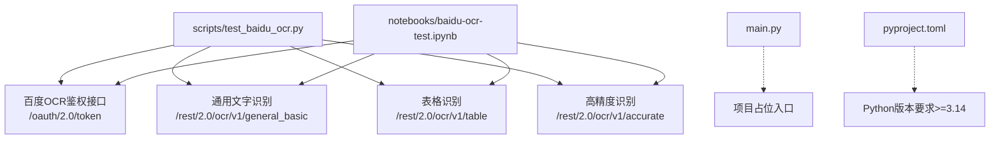
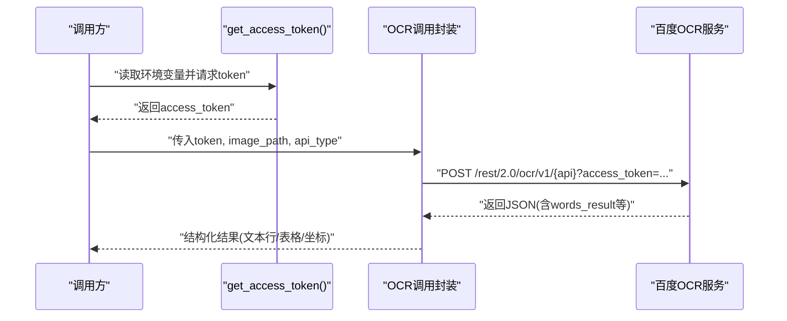
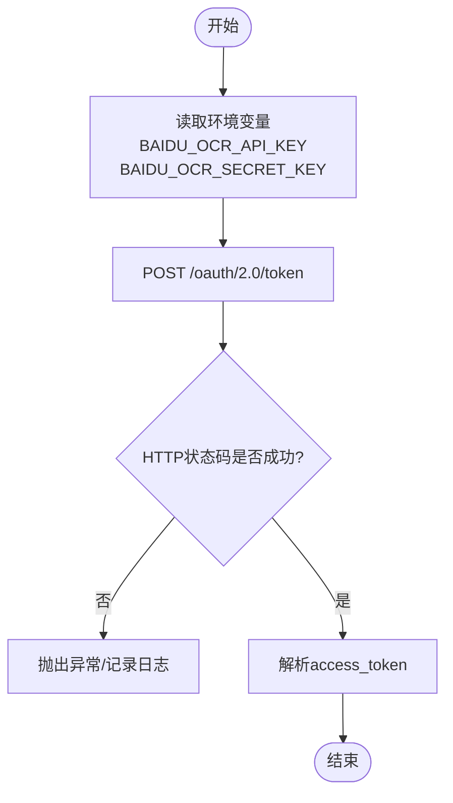
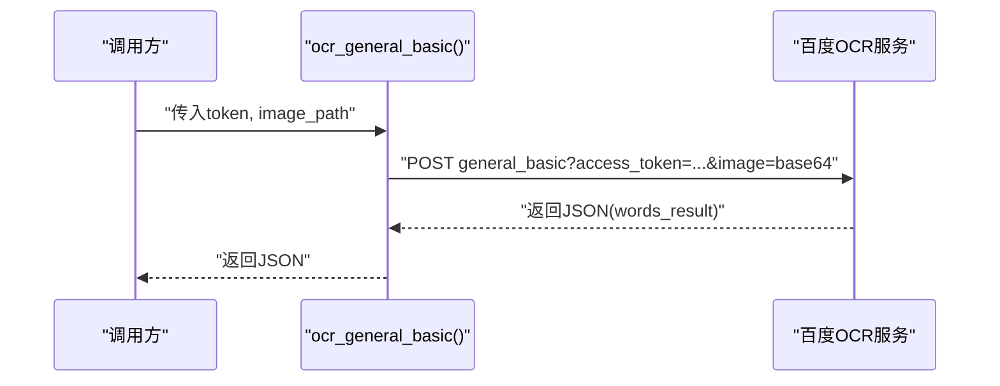
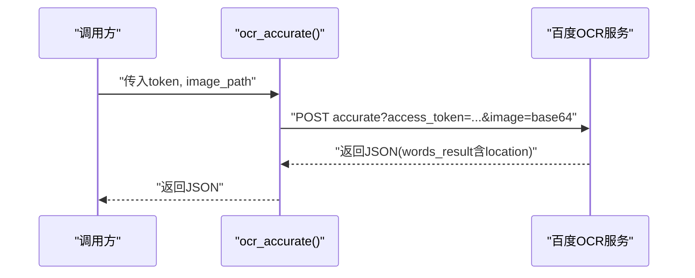
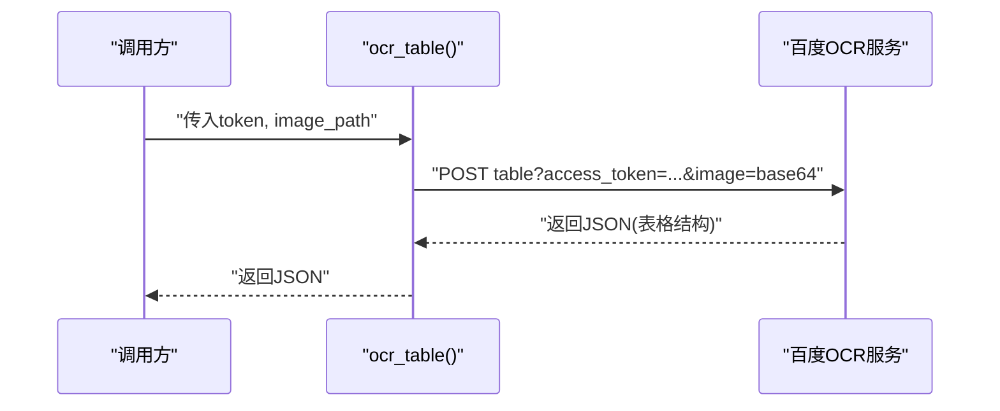
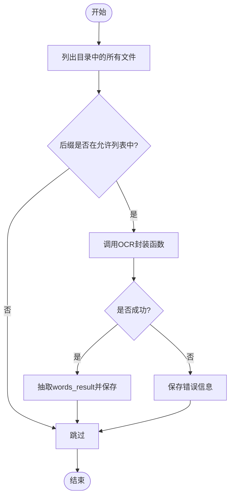
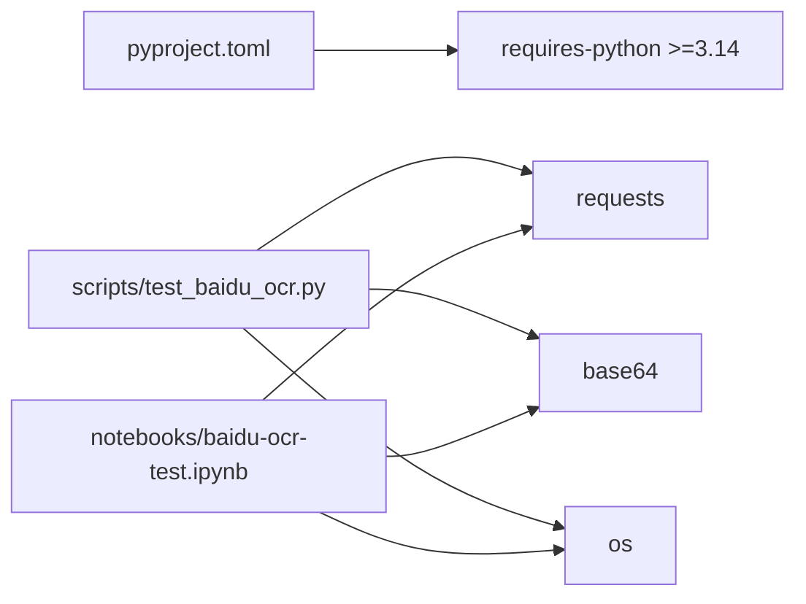

# OCR文字识别系统

<cite>
**本文引用的文件**   
- [main.py](file://main.py)
- [test_baidu_ocr.py](file://scripts/test_baidu_ocr.py)
- [baidu-ocr-test.ipynb](file://notebooks/baidu-ocr-test.ipynb)
- [pyproject.toml](file://pyproject.toml)
- [PROJECT.md](file://PROJECT.md)
</cite>

## 目录
1. [简介](#简介)
2. [项目结构](#项目结构)
3. [核心组件](#核心组件)
4. [架构总览](#架构总览)
5. [详细组件分析](#详细组件分析)
6. [依赖关系分析](#依赖关系分析)
7. [性能与并发优化](#性能与并发优化)
8. [故障排查指南](#故障排查指南)
9. [结论](#结论)
10. [附录：集成示例与最佳实践](#附录集成示例与最佳实践)

## 简介
本仓库围绕“考古报告中的文字与表格信息提取”目标，提供基于百度OCR API的集成方案。文档聚焦以下方面：
- 百度OCR API密钥配置、请求构建与响应处理
- 支持的识别类型：通用文字识别、表格识别、高精度识别的特点与适用场景
- 批量图像处理实现：错误处理、重试机制与性能优化策略
- 实际项目集成方式：异步处理与结果结构化输出
- 具体调用示例与参数说明（以代码片段路径引用形式呈现）

## 项目结构
本项目采用脚本+Notebook的轻量组织方式，便于快速验证与迭代：
- scripts/test_baidu_ocr.py：封装百度OCR鉴权与各API调用方法，提供命令行测试入口
- notebooks/baidu-ocr-test.ipynb：交互式实验，包含token获取、API枚举、通用/表格/高精度识别与批量处理函数
- main.py：项目占位入口
- pyproject.toml：项目元数据与依赖声明（当前未声明第三方依赖）
- PROJECT.md：研究背景与技术路线说明

图表来源
- [test_baidu_ocr.py:8-57](file://scripts/test_baidu_ocr.py#L8-L57)
- [baidu-ocr-test.ipynb:52-156](file://notebooks/baidu-ocr-test.ipynb#L52-L156)

章节来源
- [main.py:1-7](file://main.py#L1-L7)
- [test_baidu_ocr.py:1-109](file://scripts/test_baidu_ocr.py#L1-L109)
- [baidu-ocr-test.ipynb:1-331](file://notebooks/baidu-ocr-test.ipynb#L1-L331)
- [pyproject.toml:1-8](file://pyproject.toml#L1-L8)
- [PROJECT.md:1-99](file://PROJECT.md#L1-L99)

## 核心组件
- 鉴权模块：通过client_credentials模式获取access_token，使用环境变量注入BAIDU_OCR_API_KEY与BAIDU_OCR_SECRET_KEY
- OCR调用封装：按API类型选择端点，将图片二进制进行Base64编码后POST到对应REST接口
- 批量处理：遍历目录图片，统一调用OCR并汇总结果；支持扩展名过滤与异常捕获
- 结果解析：从返回JSON中抽取words_result等字段，形成结构化文本或表格数据

章节来源
- [test_baidu_ocr.py:8-17](file://scripts/test_baidu_ocr.py#L8-L17)
- [test_baidu_ocr.py:20-57](file://scripts/test_baidu_ocr.py#L20-L57)
- [baidu-ocr-test.ipynb:134-156](file://notebooks/baidu-ocr-test.ipynb#L134-L156)
- [baidu-ocr-test.ipynb:262-286](file://notebooks/baidu-ocr-test.ipynb#L262-L286)

## 架构总览
整体流程分为三步：鉴权→OCR请求→结果解析。各API共享鉴权与网络层差异仅在于端点与可选参数。

图表来源
- [test_baidu_ocr.py:8-17](file://scripts/test_baidu_ocr.py#L8-L17)
- [test_baidu_ocr.py:20-57](file://scripts/test_baidu_ocr.py#L20-L57)
- [baidu-ocr-test.ipynb:134-156](file://notebooks/baidu-ocr-test.ipynb#L134-L156)

## 详细组件分析

### 鉴权与令牌管理
- 鉴权端点：/oauth/2.0/token
- 认证参数：grant_type=client_credentials，client_id与client_secret来自环境变量
- 返回值：JSON中包含access_token，后续所有OCR请求需附带该token

图表来源
- [test_baidu_ocr.py:8-17](file://scripts/test_baidu_ocr.py#L8-L17)
- [baidu-ocr-test.ipynb:52-64](file://notebooks/baidu-ocr-test.ipynb#L52-L64)

章节来源
- [test_baidu_ocr.py:8-17](file://scripts/test_baidu_ocr.py#L8-L17)
- [baidu-ocr-test.ipynb:52-64](file://notebooks/baidu-ocr-test.ipynb#L52-L64)

### 通用文字识别（标准版）
- 端点：/rest/2.0/ocr/v1/general_basic
- 输入：image为Base64字符串
- 输出：words_result列表，每项包含words字段
- 适用场景：报告正文、印刷体文本的快速提取

图表来源
- [test_baidu_ocr.py:20-27](file://scripts/test_baidu_ocr.py#L20-L27)

章节来源
- [test_baidu_ocr.py:20-27](file://scripts/test_baidu_ocr.py#L20-L27)

### 通用文字识别（高精度含位置版）
- 端点：/rest/2.0/ocr/v1/accurate
- 特点：返回每个文字框的location坐标，可用于版面分析与区域裁剪
- 适用场景：需要精确定位的场景，如版面重建、图文混排定位

图表来源
- [test_baidu_ocr.py:50-57](file://scripts/test_baidu_ocr.py#L50-L57)

章节来源
- [test_baidu_ocr.py:50-57](file://scripts/test_baidu_ocr.py#L50-L57)

### 表格识别
- 端点：/rest/2.0/ocr/v1/table
- 特点：保留表格结构与行列关系，适合墓葬登记表、器物统计表等
- 适用场景：结构化表格数据的自动抽取

图表来源
- [test_baidu_ocr.py:40-47](file://scripts/test_baidu_ocr.py#L40-L47)

章节来源
- [test_baidu_ocr.py:40-47](file://scripts/test_baidu_ocr.py#L40-L47)

### 批量处理与结果结构化
- 批量函数：遍历目录，按扩展名筛选图片，逐个调用OCR并汇总结果
- 错误处理：try-except捕获异常，记录失败原因，避免中断整个批次
- 结果结构：{filename: [lines]}，便于后续导出CSV或入库

图表来源
- [baidu-ocr-test.ipynb:262-286](file://notebooks/baidu-ocr-test.ipynb#L262-L286)

章节来源
- [baidu-ocr-test.ipynb:262-286](file://notebooks/baidu-ocr-test.ipynb#L262-L286)

## 依赖关系分析
- 运行时依赖：requests用于HTTP通信，base64用于图片编码，os用于环境变量读取
- 项目元数据：pyproject.toml声明Python版本要求，但未显式声明依赖项
- Notebook环境：使用ipykernel内核，便于交互式调试

图表来源
- [pyproject.toml:1-8](file://pyproject.toml#L1-L8)
- [test_baidu_ocr.py:1-6](file://scripts/test_baidu_ocr.py#L1-L6)
- [baidu-ocr-test.ipynb:26-32](file://notebooks/baidu-ocr-test.ipynb#L26-L32)

章节来源
- [pyproject.toml:1-8](file://pyproject.toml#L1-L8)
- [test_baidu_ocr.py:1-6](file://scripts/test_baidu_ocr.py#L1-L6)
- [baidu-ocr-test.ipynb:26-32](file://notebooks/baidu-ocr-test.ipynb#L26-L32)

## 性能与并发优化
- 连接复用：建议使用会话对象复用TCP连接，减少握手开销
- 并发控制：对大批量图片可使用线程池或进程池并行处理，结合限流避免触发服务端速率限制
- 超时与重试：设置合理的请求超时时间，并对瞬时错误（如网络抖动、限流）实施指数退避重试
- 资源管理：及时关闭响应对象，避免内存泄漏；大图片可考虑压缩或分块上传（若API支持）
- 缓存策略：对相同图片的识别结果进行本地缓存，避免重复调用

[本节为通用建议，不直接分析具体文件]

## 故障排查指南
- 鉴权失败：检查环境变量是否正确设置，确认client_id与client_secret有效
- HTTP错误：查看响应状态码与错误消息，必要时打印完整响应体以便定位问题
- 图片格式：确保图片可读且非损坏，Base64编码前校验文件大小与格式
- 结果字段缺失：不同API返回字段存在差异，需根据实际返回动态解析
- 批量任务中断：在批量处理中使用异常捕获，记录失败条目并继续处理其他图片

章节来源
- [test_baidu_ocr.py:8-17](file://scripts/test_baidu_ocr.py#L8-L17)
- [test_baidu_ocr.py:20-57](file://scripts/test_baidu_ocr.py#L20-L57)
- [baidu-ocr-test.ipynb:262-286](file://notebooks/baidu-ocr-test.ipynb#L262-L286)

## 结论
本项目提供了基于百度OCR API的最小可用集成方案，涵盖鉴权、多类型OCR调用与批量处理。通过模块化封装与交互式Notebook，能够快速验证不同识别类型的效果，并为后续工程化（异步、重试、缓存、结构化输出）奠定基础。

[本节为总结性内容，不直接分析具体文件]

## 附录：集成示例与最佳实践

### 环境准备与密钥配置
- 设置环境变量：
  - BAIDU_OCR_API_KEY
  - BAIDU_OCR_SECRET_KEY
- 安装依赖：requests（建议在pyproject.toml中声明）

章节来源
- [test_baidu_ocr.py:8-17](file://scripts/test_baidu_ocr.py#L8-L17)
- [pyproject.toml:1-8](file://pyproject.toml#L1-L8)

### 调用示例（以代码片段路径引用）
- 获取access_token：见 [test_baidu_ocr.py:8-17](file://scripts/test_baidu_ocr.py#L8-L17)
- 通用文字识别（标准版）：见 [test_baidu_ocr.py:20-27](file://scripts/test_baidu_ocr.py#L20-L27)
- 表格识别：见 [test_baidu_ocr.py:40-47](file://scripts/test_baidu_ocr.py#L40-L47)
- 高精度识别（含位置）：见 [test_baidu_ocr.py:50-57](file://scripts/test_baidu_ocr.py#L50-L57)
- Notebook通用调用封装：见 [baidu-ocr-test.ipynb:134-156](file://notebooks/baidu-ocr-test.ipynb#L134-L156)
- Notebook批量处理函数：见 [baidu-ocr-test.ipynb:262-286](file://notebooks/baidu-ocr-test.ipynb#L262-L286)

### 异步处理与结构化输出
- 异步处理：建议使用asyncio+aiohttp替代同步requests，提升吞吐
- 结构化输出：将words_result转换为CSV或数据库表，字段包括文件名、行号、文本、置信度、坐标（如有）
- 结果校验：对空结果或低置信度结果进行二次人工复核或重识别

[本节为通用建议，不直接分析具体文件]

### 适用场景与API选择建议
- 通用文字识别（标准版）：适用于报告正文、印刷体文本快速提取
- 高精度识别（含位置）：适用于需要版面分析与区域定位的场景
- 表格识别：适用于墓葬登记表、器物统计表等结构化表格数据抽取

章节来源
- [baidu-ocr-test.ipynb:84-114](file://notebooks/baidu-ocr-test.ipynb#L84-L114)
- [test_baidu_ocr.py:60-80](file://scripts/test_baidu_ocr.py#L60-L80)