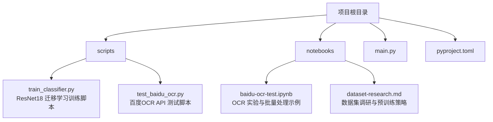
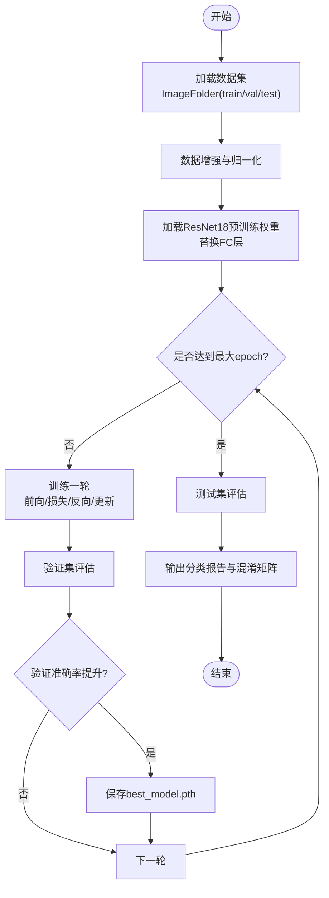
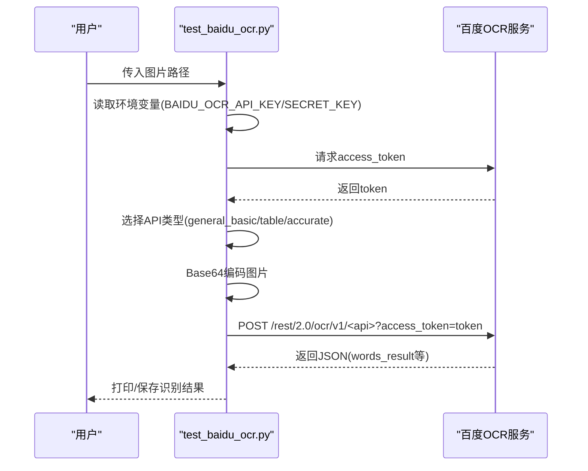
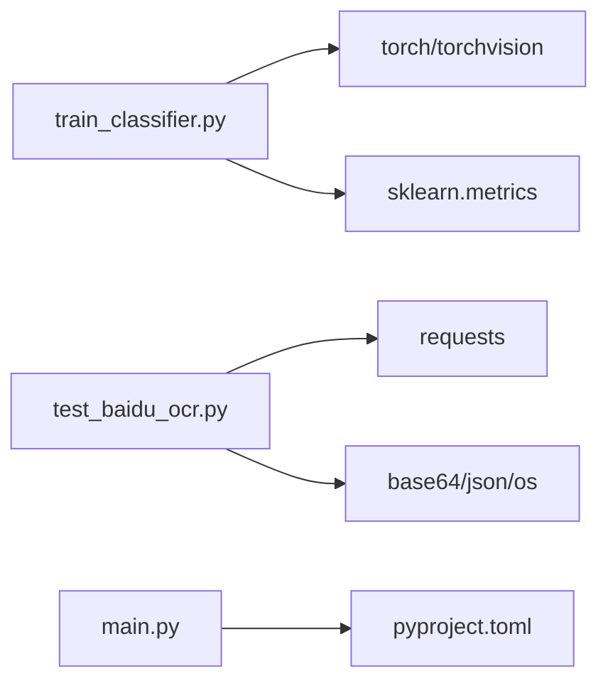

# 核心功能

<cite>
**本文引用的文件**   
- [main.py](file://main.py)
- [scripts/train_classifier.py](file://scripts/train_classifier.py)
- [scripts/test_baidu_ocr.py](file://scripts/test_baidu_ocr.py)
- [notebooks/baidu-ocr-test.ipynb](file://notebooks/baidu-ocr-test.ipynb)
- [notebooks/dataset-research.md](file://notebooks/dataset-research.md)
- [pyproject.toml](file://pyproject.toml)
</cite>

## 目录
1. [简介](#简介)
2. [项目结构](#项目结构)
3. [核心组件](#核心组件)
4. [架构总览](#架构总览)
5. [详细组件分析](#详细组件分析)
6. [依赖关系分析](#依赖关系分析)
7. [性能与优化建议](#性能与优化建议)
8. [故障排查指南](#故障排查指南)
9. [结论](#结论)
10. [附录：使用示例与集成模式](#附录使用示例与集成模式)

## 简介
本项目围绕考古数据处理的两大核心能力展开：
- 考古图像分类器：基于 ResNet18 的迁移学习，面向考古图像的二分类/多分类任务，提供数据预处理、模型微调、训练循环与评估指标。
- OCR 文字识别系统：集成百度 OCR API，支持通用文字（标准版/高精度）、表格识别等，并提供批量图像处理流程。

本文件将系统化梳理上述两个模块的实现原理、调用方式、配置项、参数调优与性能优化建议，并给出可直接复用的集成模式与代码片段路径。

## 项目结构
仓库采用“脚本+笔记本”的轻量组织方式：
- scripts：可执行脚本，包含训练分类器与测试百度 OCR 的能力
- notebooks：实验与探索性内容，包含 OCR 测试 Notebook 与数据集调研报告
- main.py：项目入口占位
- pyproject.toml：项目元信息与依赖声明

图表来源
- [scripts/train_classifier.py:1-124](file://scripts/train_classifier.py#L1-L124)
- [scripts/test_baidu_ocr.py:1-109](file://scripts/test_baidu_ocr.py#L1-L109)
- [notebooks/baidu-ocr-test.ipynb:1-331](file://notebooks/baidu-ocr-test.ipynb#L1-L331)
- [notebooks/dataset-research.md:1-287](file://notebooks/dataset-research.md#L1-L287)
- [main.py:1-7](file://main.py#L1-L7)
- [pyproject.toml:1-8](file://pyproject.toml#L1-L8)

章节来源
- [main.py:1-7](file://main.py#L1-L7)
- [pyproject.toml:1-8](file://pyproject.toml#L1-L8)

## 核心组件
- 图像分类器（ResNet18 迁移学习）
  - 数据加载与增强：ImageFolder + Resize/Flip/Rotate/ColorJitter/Normalize
  - 模型构建：ResNet18 预训练权重 + 替换全连接层适配类别数
  - 训练循环：单轮训练函数 + 验证/测试评估函数
  - 评估指标：损失、准确率、分类报告、混淆矩阵
- OCR 文字识别（百度 OCR API）
  - 认证：通过 client_id/client_secret 获取 access_token
  - API 类型：通用文字（标准/高精度含位置）、表格识别、数字/票据/二维码等
  - 批量处理：遍历目录图片，统一封装为 JSON 结果或结构化文本

章节来源
- [scripts/train_classifier.py:14-38](file://scripts/train_classifier.py#L14-L38)
- [scripts/train_classifier.py:40-66](file://scripts/train_classifier.py#L40-L66)
- [scripts/train_classifier.py:68-124](file://scripts/train_classifier.py#L68-L124)
- [scripts/test_baidu_ocr.py:8-57](file://scripts/test_baidu_ocr.py#L8-L57)
- [notebooks/baidu-ocr-test.ipynb:134-156](file://notebooks/baidu-ocr-test.ipynb#L134-L156)
- [notebooks/baidu-ocr-test.ipynb:262-286](file://notebooks/baidu-ocr-test.ipynb#L262-L286)

## 架构总览
整体由两条独立管线组成：
- 训练管线：本地 PyTorch 环境运行，读取 datasets/ArchaeoMind_dataset 下的 train/val/test 子目录，完成模型训练与保存
- OCR 管线：通过 HTTP 请求调用百度 OCR REST API，返回 JSON 结果，支持批量处理

```mermaid
graph TB
subgraph "训练管线"
T1["数据准备<br/>datasets/ArchaeoMind_dataset/{train,val,test}"]
T2["数据增强与归一化"]
T3["ResNet18 预训练权重加载"]
T4["替换全连接层"]
T5["训练循环(Adam/CrossEntropy)"]
T6["验证/测试评估"]
T7["保存最佳模型 best_model.pth"]
end
subgraph "OCR 管线"
O1["环境变量 BAIDU_OCR_API_KEY / BAIDU_OCR_SECRET_KEY"]
O2["获取 access_token"]
O3["选择API类型<br/>general_basic/general_enhanced/table/accurate"]
O4["Base64编码图片"]
O5["HTTP POST 到百度OCR"]
O6["解析JSON结果"]
O7["批量处理目录图片"]
end
T1 --> T2 --> T3 --> T4 --> T5 --> T6 --> T7
O1 --> O2 --> O3 --> O4 --> O5 --> O6 --> O7
```

图表来源
- [scripts/train_classifier.py:12-38](file://scripts/train_classifier.py#L12-L38)
- [scripts/train_classifier.py:80-105](file://scripts/train_classifier.py#L80-L105)
- [scripts/test_baidu_ocr.py:8-57](file://scripts/test_baidu_ocr.py#L8-L57)
- [notebooks/baidu-ocr-test.ipynb:134-156](file://notebooks/baidu-ocr-test.ipynb#L134-L156)
- [notebooks/baidu-ocr-test.ipynb:262-286](file://notebooks/baidu-ocr-test.ipynb#L262-L286)

## 详细组件分析

### 图像分类器（ResNet18 迁移学习）
- 数据预处理
  - 训练集：Resize 到固定尺寸，随机水平翻转、随机旋转、颜色抖动，ToTensor，ImageNet 均值方差归一化
  - 验证/测试集：仅 Resize、ToTensor、归一化
  - 数据目录约定：datasets/ArchaeoMind_dataset/{train,val,test}，每类一个子文件夹
- 模型构建
  - 使用 torchvision.models.resnet18 加载 ImageNet 预训练权重
  - 替换最终全连接层以匹配类别数量
- 训练循环
  - 单轮训练：前向传播 → 计算交叉熵损失 → 反向传播 → 参数更新
  - 验证/测试：关闭梯度，统计损失与准确率
- 评估指标
  - 训练/验证/测试损失与准确率
  - 分类报告（精确率、召回率、F1）与混淆矩阵
- 训练控制
  - 命令行参数：epochs、lr、batch-size
  - 设备选择：自动检测 CUDA/CPU
  - 模型保存：按验证集准确率保存 best_model.pth

图表来源
- [scripts/train_classifier.py:14-38](file://scripts/train_classifier.py#L14-L38)
- [scripts/train_classifier.py:40-66](file://scripts/train_classifier.py#L40-L66)
- [scripts/train_classifier.py:68-124](file://scripts/train_classifier.py#L68-L124)

章节来源
- [scripts/train_classifier.py:14-38](file://scripts/train_classifier.py#L14-L38)
- [scripts/train_classifier.py:40-66](file://scripts/train_classifier.py#L40-L66)
- [scripts/train_classifier.py:68-124](file://scripts/train_classifier.py#L68-L124)

#### 数据预处理与增强细节
- 训练变换：Resize → RandomHorizontalFlip → RandomRotation(15°) → ColorJitter(brightness/contrast) → ToTensor → Normalize(ImageNet均值方差)
- 评估变换：Resize → ToTensor → Normalize
- DataLoader：num_workers=2，训练集 shuffle=True，验证/测试 shuffle=False

章节来源
- [scripts/train_classifier.py:14-38](file://scripts/train_classifier.py#L14-L38)

#### 模型构建与微调策略
- 预训练权重：models.ResNet18_Weights.IMAGENET1K_V1
- 分类头替换：nn.Linear(model.fc.in_features, len(classes))
- 优化器：仅对 FC 层参数进行 Adam 优化（初始阶段冻结主干）
- 损失函数：CrossEntropyLoss

章节来源
- [scripts/train_classifier.py:80-86](file://scripts/train_classifier.py#L80-L86)

#### 训练与评估流程
- 训练函数：累计 loss 与正确样本数，返回平均 loss 与准确率
- 评估函数：在 eval 模式下统计 loss 与准确率
- 最佳模型保存：依据验证集准确率阈值保存
- 测试评估：加载最佳权重后在测试集上评估，并生成分类报告与混淆矩阵

章节来源
- [scripts/train_classifier.py:40-66](file://scripts/train_classifier.py#L40-L66)
- [scripts/train_classifier.py:91-120](file://scripts/train_classifier.py#L91-L120)

#### 配置与参数
- 命令行参数
  - --epochs：训练轮数（默认 5）
  - --lr：学习率（默认 1e-3）
  - --batch-size：批次大小（默认 32）
- 数据目录
  - DATA_DIR = datasets/ArchaeoMind_dataset
  - 子目录：train、val、test

章节来源
- [scripts/train_classifier.py:68-78](file://scripts/train_classifier.py#L68-L78)
- [scripts/train_classifier.py:12](file://scripts/train_classifier.py#L12)

### OCR 文字识别（百度 OCR API）
- 认证流程
  - 从环境变量读取 BAIDU_OCR_API_KEY 与 BAIDU_OCR_SECRET_KEY
  - 调用 OAuth 接口获取 access_token
- API 类型
  - 通用文字识别（标准版）：适合正文快速提取
  - 通用文字识别（高精度含位置版）：返回每个文字框坐标，便于版面分析
  - 表格识别：保留表格结构，适合墓葬登记表、器物统计表
  - 其他：数字、票据、二维码、手写等（见可用 API 列表）
- 调用封装
  - 将图片 Base64 编码后 POST 至对应端点
  - 返回 JSON，包含 words_result 等字段
- 批量处理
  - 遍历目录中指定后缀的图片，逐张调用 OCR
  - 汇总结果：{filename: [识别到的文字行]}

图表来源
- [scripts/test_baidu_ocr.py:8-57](file://scripts/test_baidu_ocr.py#L8-L57)
- [notebooks/baidu-ocr-test.ipynb:134-156](file://notebooks/baidu-ocr-test.ipynb#L134-L156)

章节来源
- [scripts/test_baidu_ocr.py:8-57](file://scripts/test_baidu_ocr.py#L8-L57)
- [notebooks/baidu-ocr-test.ipynb:134-156](file://notebooks/baidu-ocr-test.ipynb#L134-L156)
- [notebooks/baidu-ocr-test.ipynb:262-286](file://notebooks/baidu-ocr-test.ipynb#L262-L286)

#### 支持的 OCR API 与适用场景
- general_basic：通用文字识别（标准版），适合报告正文
- accurate：通用文字识别（高精度含位置版），适合带坐标定位的精确提取
- table：表格识别，适合墓葬登记表、器物统计表
- 其他：webimage、handwriting、receipt、qrcode 等（详见可用 API 列表）

章节来源
- [scripts/test_baidu_ocr.py:60-81](file://scripts/test_baidu_ocr.py#L60-L81)
- [notebooks/baidu-ocr-test.ipynb:84-115](file://notebooks/baidu-ocr-test.ipynb#L84-L115)

#### 批量处理流程
- 输入：图片目录路径、API 类型、可选扩展名过滤
- 处理：顺序遍历图片，调用 OCR，捕获异常并记录错误信息
- 输出：字典 {文件名: [文字行列表]}

章节来源
- [notebooks/baidu-ocr-test.ipynb:262-286](file://notebooks/baidu-ocr-test.ipynb#L262-L286)

## 依赖关系分析
- 训练脚本依赖
  - torch、torchvision（模型与数据管道）
  - sklearn（classification_report、confusion_matrix）
- OCR 脚本依赖
  - requests、base64、json、os
- 项目元信息
  - pyproject.toml 声明 Python 版本要求与依赖（当前为空数组，需按需安装）

图表来源
- [scripts/train_classifier.py:5-10](file://scripts/train_classifier.py#L5-L10)
- [scripts/train_classifier.py:116-120](file://scripts/train_classifier.py#L116-L120)
- [scripts/test_baidu_ocr.py:1-6](file://scripts/test_baidu_ocr.py#L1-L6)
- [pyproject.toml:1-8](file://pyproject.toml#L1-L8)

章节来源
- [scripts/train_classifier.py:5-10](file://scripts/train_classifier.py#L5-L10)
- [scripts/train_classifier.py:116-120](file://scripts/train_classifier.py#L116-L120)
- [scripts/test_baidu_ocr.py:1-6](file://scripts/test_baidu_ocr.py#L1-L6)
- [pyproject.toml:1-8](file://pyproject.toml#L1-L8)

## 性能与优化建议
- 图像分类器
  - 数据层面
    - 合理设置 img_size（如 224/256/384），平衡精度与速度
    - 针对考古图像特点增加针对性增强（如光照变化、纹理扰动）
  - 模型层面
    - 逐步解冻主干网络进行端到端微调，配合较小学习率
    - 使用更强大的 backbone（如 ResNet50/EfficientNet/ViT）以提升上限
  - 训练层面
    - 增大 batch_size（受显存限制），结合混合精度训练
    - 引入早停与学习率调度（余弦退火/ReduceLROnPlateau）
    - 使用多进程 DataLoader（num_workers）与缓存机制
  - 评估层面
    - 除准确率外，关注各类别 F1 与混淆矩阵，识别困难类别
- OCR 文字识别
  - 并发与限流
    - 控制并发请求数，避免触发服务端限流
    - 实现重试与退避策略，提高鲁棒性
  - 图片预处理
    - 根据场景裁剪、去噪、对比度增强，提升识别质量
  - 结果后处理
    - 对高精度版返回的坐标信息进行版面分析与区域聚合
    - 表格结果转换为结构化 CSV/Excel，便于后续分析

[本节为通用指导，不直接分析具体文件]

## 故障排查指南
- 训练相关
  - 数据目录不存在或格式不正确：确认 datasets/ArchaeoMind_dataset 下存在 train/val/test 且每类有子文件夹
  - 类别数不一致：确保替换 FC 层的输出维度与数据集类别一致
  - 显存不足：降低 batch_size 或 img_size，或使用 CPU 调试
- OCR 相关
  - 环境变量缺失：检查 BAIDU_OCR_API_KEY 与 BAIDU_OCR_SECRET_KEY 是否正确设置
  - Token 获取失败：确认网络连通性与凭证有效性
  - API 调用报错：检查图片路径与 Base64 编码，核对 API 类型与端点

章节来源
- [scripts/train_classifier.py:12](file://scripts/train_classifier.py#L12)
- [scripts/train_classifier.py:80-86](file://scripts/train_classifier.py#L80-L86)
- [scripts/test_baidu_ocr.py:8-17](file://scripts/test_baidu_ocr.py#L8-L17)

## 结论
本项目提供了考古数据处理的两条关键能力：
- 基于 ResNet18 的迁移学习图像分类器，具备完整的数据预处理、模型微调、训练循环与评估体系，适用于考古图像的二分类或多分类任务
- 集成百度 OCR API 的文字识别系统，支持多种识别类型与批量处理流程，满足考古报告中文字与表格的结构化提取需求

两者均具备良好的可扩展性与工程化落地潜力，可在实际项目中作为基础模块进行二次开发与集成。

[本节为总结性内容，不直接分析具体文件]

## 附录：使用示例与集成模式

### 图像分类器使用模式
- 准备数据
  - 将标注好的图像按类别放入 datasets/ArchaeoMind_dataset/{train,val,test} 对应子目录
- 启动训练
  - 命令行参数：--epochs、--lr、--batch-size
  - 训练结束后保存 best_model.pth
- 推理集成
  - 加载 best_model.pth 权重，构造相同的数据预处理流程
  - 对单张或多张图像进行预测，输出类别与置信度

章节来源
- [scripts/train_classifier.py:12](file://scripts/train_classifier.py#L12)
- [scripts/train_classifier.py:68-78](file://scripts/train_classifier.py#L68-L78)
- [scripts/train_classifier.py:91-105](file://scripts/train_classifier.py#L91-L105)

### OCR 集成模式
- 环境变量
  - 设置 BAIDU_OCR_API_KEY 与 BAIDU_OCR_SECRET_KEY
- 获取 Token
  - 调用 get_access_token() 获取 access_token
- 调用 API
  - 选择 API 类型（general_basic/table/accurate）
  - Base64 编码图片并 POST 到对应端点
  - 解析 JSON 结果，提取 words_result 或表格结构
- 批量处理
  - 使用 batch_ocr(token, image_dir, api_type, extensions) 遍历目录图片
  - 输出 {filename: [文字行列表]} 或结构化结果

章节来源
- [scripts/test_baidu_ocr.py:8-57](file://scripts/test_baidu_ocr.py#L8-L57)
- [notebooks/baidu-ocr-test.ipynb:134-156](file://notebooks/baidu-ocr-test.ipynb#L134-L156)
- [notebooks/baidu-ocr-test.ipynb:262-286](file://notebooks/baidu-ocr-test.ipynb#L262-L286)

### 配置选项与参数调优
- 图像分类器
  - epochs：控制训练轮数，过小易欠拟合，过大可能过拟合
  - lr：学习率影响收敛速度与稳定性，建议从 1e-3 起步并结合调度策略
  - batch-size：受显存限制，适当增大可提升稳定性
  - img_size：224 为默认，可根据任务复杂度调整
- OCR
  - API 类型选择：通用文字用于快速提取；高精度含位置用于版面分析；表格用于结构化数据
  - 并发与重试：在高吞吐场景下需要控制并发与实现重试退避

章节来源
- [scripts/train_classifier.py:68-78](file://scripts/train_classifier.py#L68-L78)
- [scripts/test_baidu_ocr.py:60-81](file://scripts/test_baidu_ocr.py#L60-L81)