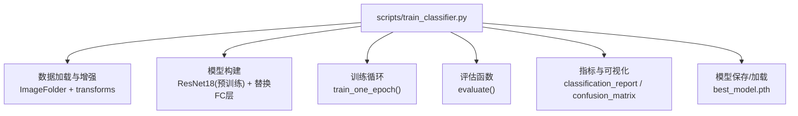
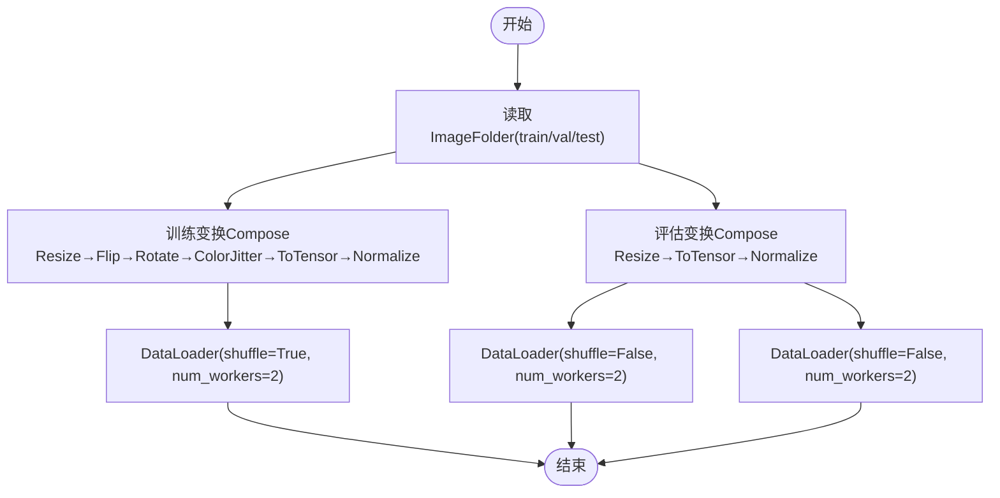
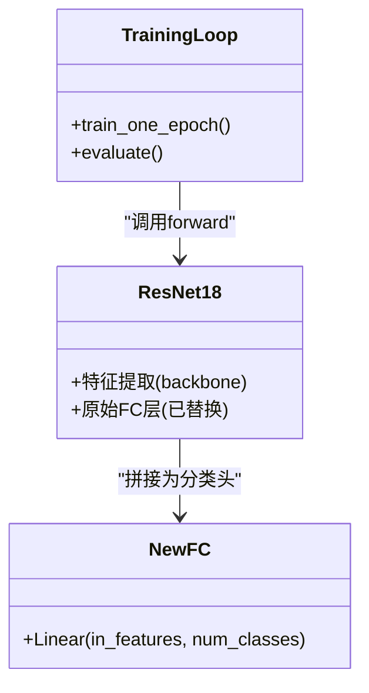
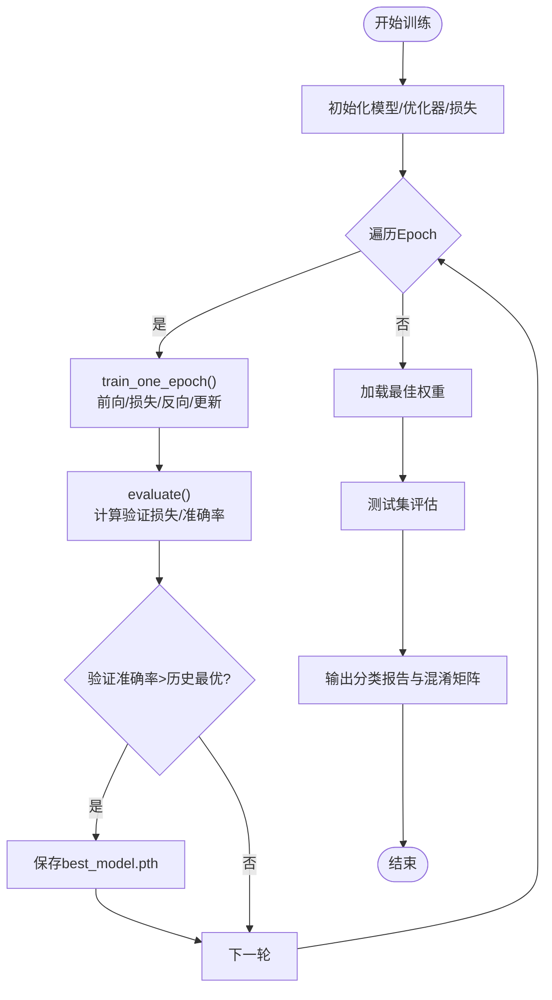
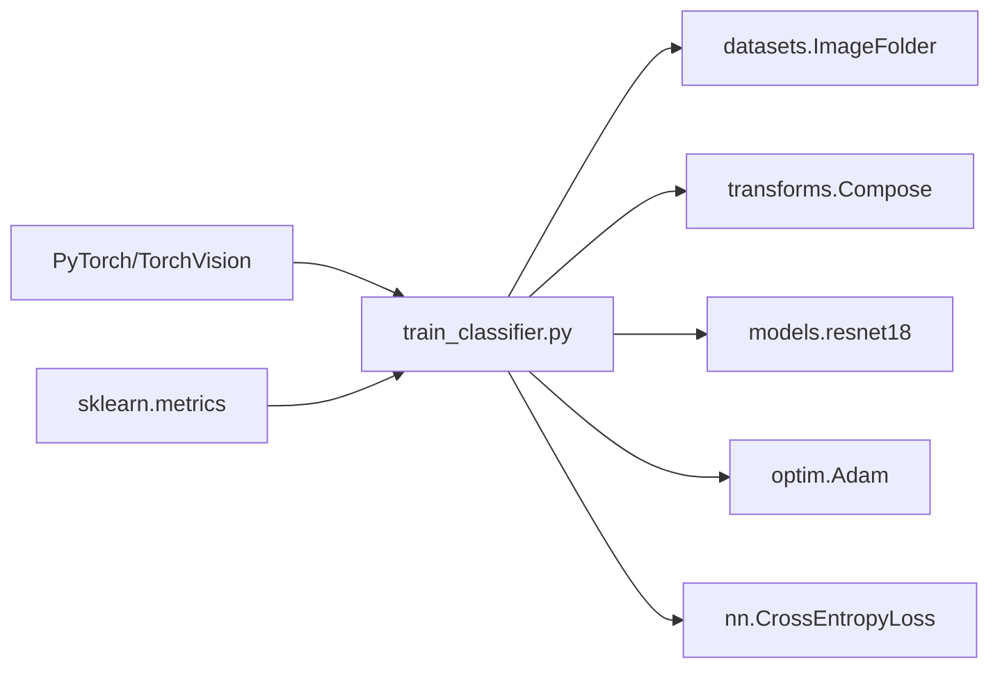

# 考古图像分类器

<cite>
**本文引用的文件**   
- [scripts/train_classifier.py](file://scripts/train_classifier.py)
- [notebooks/dataset-research.md](file://notebooks/dataset-research.md)
</cite>

## 目录
1. [简介](#简介)
2. [项目结构](#项目结构)
3. [核心组件](#核心组件)
4. [架构总览](#架构总览)
5. [详细组件分析](#详细组件分析)
6. [依赖关系分析](#依赖关系分析)
7. [性能与训练调优](#性能与训练调优)
8. [故障排查指南](#故障排查指南)
9. [结论](#结论)
10. [附录：命令与参数参考](#附录命令与参数参考)

## 简介
本项目实现了一个面向考古图像的迁移学习二分类/多分类模型，基于 ResNet18 在 ImageNet 上预训练的权重进行微调。数据预处理包含随机水平翻转、旋转、颜色抖动等增强手段；模型通过替换全连接层适配目标类别数；训练循环采用交叉熵损失与 Adam 优化器，仅对全连接层进行初始微调；评估阶段输出准确率、混淆矩阵与分类报告，并保存验证集表现最佳的模型权重。

## 项目结构
- 脚本入口位于 scripts/train_classifier.py，负责数据加载、模型构建、训练与评估全流程。
- notebooks/dataset-research.md 提供了考古相关数据集背景与策略建议，可作为数据准备与迁移学习策略的参考。



图表来源
- [scripts/train_classifier.py:14-38](file://scripts/train_classifier.py#L14-L38)
- [scripts/train_classifier.py:40-66](file://scripts/train_classifier.py#L40-L66)
- [scripts/train_classifier.py:68-123](file://scripts/train_classifier.py#L68-L123)

章节来源
- [scripts/train_classifier.py:1-123](file://scripts/train_classifier.py#L1-L123)
- [notebooks/dataset-research.md:1-287](file://notebooks/dataset-research.md#L1-L287)

## 核心组件
- 数据加载器与增强
  - 使用 ImageFolder 读取 train/val/test 三个划分，分别应用不同的 transforms。
  - 训练集增强：Resize、随机水平翻转、随机旋转、颜色抖动（亮度/对比度）、ToTensor、归一化（ImageNet 均值/方差）。
  - 验证/测试集：Resize、ToTensor、归一化。
  - DataLoader 配置：批大小、是否打乱、并行 worker 数。
- 模型与迁移学习
  - 加载 ResNet18 的 ImageNet 预训练权重。
  - 将最终全连接层替换为与目标类别数一致的线性层，用于二分类或多分类。
- 训练与评估
  - 训练：前向传播、交叉熵损失、反向传播、参数更新，统计每 epoch 的平均损失与准确率。
  - 评估：冻结梯度，计算平均损失与准确率。
  - 最佳模型保存：以验证集准确率为依据保存 state_dict。
  - 测试评估：加载最佳权重后在测试集上评估，生成分类报告与混淆矩阵。

章节来源
- [scripts/train_classifier.py:14-38](file://scripts/train_classifier.py#L14-L38)
- [scripts/train_classifier.py:40-66](file://scripts/train_classifier.py#L40-L66)
- [scripts/train_classifier.py:68-123](file://scripts/train_classifier.py#L68-L123)

## 架构总览
下图展示了从数据到模型的端到端流程，包括数据增强、模型前向、损失计算、参数更新与评估指标输出。

```mermaid
sequenceDiagram
participant CLI as "命令行"
participant DL as "DataLoader"
participant Model as "ResNet18+FC"
participant Loss as "CrossEntropyLoss"
participant Opt as "Adam"
participant Eval as "评估与报告"
CLI->>DL : 初始化(批大小, 图像尺寸, 增强)
CLI->>Model : 加载预训练权重并替换FC层
loop 每个Epoch
CLI->>DL : 迭代批次(images, labels)
DL-->>CLI : 返回批次数据
CLI->>Model : 前向(outputs)
Model-->>CLI : 预测logits
CLI->>Loss : 计算loss
Loss-->>CLI : loss值
CLI->>Opt : 反向传播与参数更新
Opt-->>CLI : 完成一步优化
CLI->>Eval : 计算训练/验证准确率
Eval-->>CLI : 记录指标
alt 验证准确率提升
CLI->>CLI : 保存最佳模型权重
end
end
CLI->>Eval : 加载最佳权重并在测试集评估
Eval-->>CLI : 输出分类报告与混淆矩阵
```

图表来源
- [scripts/train_classifier.py:14-38](file://scripts/train_classifier.py#L14-L38)
- [scripts/train_classifier.py:40-66](file://scripts/train_classifier.py#L40-L66)
- [scripts/train_classifier.py:68-123](file://scripts/train_classifier.py#L68-L123)

## 详细组件分析

### 数据加载器与增强
- 输入路径
  - 数据根目录由脚本内常量定义，期望存在 datasets/ArchaeoMind_dataset/{train,val,test} 子目录，每个子目录下按类别组织图片。
- 训练集变换
  - Resize 至指定尺寸（默认 224×224）。
  - RandomHorizontalFlip：随机水平翻转，提升姿态鲁棒性。
  - RandomRotation(15)：小角度旋转，适应器物拍摄角度变化。
  - ColorJitter(brightness=0.2, contrast=0.2)：增强光照与对比度差异。
  - ToTensor：将像素映射到 [0,1]。
  - Normalize：使用 ImageNet 的均值与标准差进行标准化，利于迁移学习收敛。
- 验证/测试集变换
  - 仅做 Resize、ToTensor、Normalize，保证与训练一致的数据分布。
- DataLoader 配置
  - batch_size：控制每步样本数量，影响显存占用与训练稳定性。
  - shuffle：训练集开启打乱，验证/测试关闭。
  - num_workers：并行数据加载线程数，提高 I/O 吞吐。



图表来源
- [scripts/train_classifier.py:14-38](file://scripts/train_classifier.py#L14-L38)

章节来源
- [scripts/train_classifier.py:14-38](file://scripts/train_classifier.py#L14-L38)

### 模型架构与迁移学习
- 基座模型
  - 使用 torchvision.models.resnet18 并加载 ImageNet 预训练权重，作为通用视觉特征提取器。
- 分类头修改
  - 将原全连接层替换为新的 nn.Linear(in_features, num_classes)，num_classes 由数据集中类别数决定，支持二分类或多分类。
- 设备与参数
  - 自动选择 CUDA 或 CPU。
  - 优化器仅对 FC 层参数进行更新（适合初期微调），学习率可通过命令行参数设置。



图表来源
- [scripts/train_classifier.py:80-86](file://scripts/train_classifier.py#L80-L86)

章节来源
- [scripts/train_classifier.py:80-86](file://scripts/train_classifier.py#L80-L86)

### 训练循环设计
- 单轮训练
  - 模型进入训练模式，逐批前向、计算交叉熵损失、反向传播、参数更新。
  - 累计损失与正确数，计算平均损失与准确率。
- 验证与早停式保存
  - 每轮结束后在验证集上评估，若验证准确率超过历史最优则保存当前模型权重。
- 测试评估
  - 训练完成后加载最佳权重，在测试集上评估并输出分类报告与混淆矩阵。



图表来源
- [scripts/train_classifier.py:40-66](file://scripts/train_classifier.py#L40-L66)
- [scripts/train_classifier.py:91-105](file://scripts/train_classifier.py#L91-L105)
- [scripts/train_classifier.py:107-120](file://scripts/train_classifier.py#L107-L120)

章节来源
- [scripts/train_classifier.py:40-66](file://scripts/train_classifier.py#L40-L66)
- [scripts/train_classifier.py:91-120](file://scripts/train_classifier.py#L91-L120)

### 评估指标与结果解读
- 指标
  - 准确率：正确预测样本占比。
  - 分类报告：包含精确率、召回率、F1-score 等，便于分析各类别表现。
  - 混淆矩阵：直观展示误分情况，辅助定位困难类别。
- 解读要点
  - 关注少数类的召回率与 F1，避免整体准确率掩盖不平衡问题。
  - 结合混淆矩阵识别易混淆类别，针对性增强数据或调整阈值。

章节来源
- [scripts/train_classifier.py:107-120](file://scripts/train_classifier.py#L107-L120)

## 依赖关系分析
- 外部库
  - torch、torchvision：提供模型、数据加载与变换工具。
  - sklearn.metrics：提供分类报告与混淆矩阵计算。
- 内部模块
  - 数据加载与模型构建均集中在单一脚本中，耦合度高但易于快速实验与复现。



图表来源
- [scripts/train_classifier.py:5-10](file://scripts/train_classifier.py#L5-L10)
- [scripts/train_classifier.py:80-86](file://scripts/train_classifier.py#L80-L86)
- [scripts/train_classifier.py:116-120](file://scripts/train_classifier.py#L116-L120)

章节来源
- [scripts/train_classifier.py:5-10](file://scripts/train_classifier.py#L5-L10)
- [scripts/train_classifier.py:80-86](file://scripts/train_classifier.py#L80-L86)
- [scripts/train_classifier.py:116-120](file://scripts/train_classifier.py#L116-L120)

## 性能与训练调优
- 数据层面
  - 针对考古图像的光照不均、纹理相似等特点，可适度增大旋转角度与颜色抖动强度，或在验证/测试时引入中心裁剪与多尺度评估以提升鲁棒性。
  - 若类别不平衡显著，可在损失函数中加入类别权重或使用重采样策略。
- 模型层面
  - 初期仅训练 FC 层有助于稳定迁移学习；后续可按需解冻部分 backbone 层进行细粒度微调。
  - 尝试不同学习率与优化器（如 SGD with momentum）以获得更好泛化。
- 训练策略
  - 增加 epochs 并结合验证准确率监控，防止过拟合。
  - 使用更大数据集或引入公开数据集（如 COCO/ImageNet）中的相关类别作为辅助数据，提升特征表达能力。
- 资源与效率
  - 合理设置 batch_size 与 num_workers，平衡显存与 I/O 速度。
  - 使用混合精度训练（如 AMP）可加速训练并降低显存占用（需在现有代码基础上扩展）。

[本节为通用指导，不直接分析具体文件]

## 故障排查指南
- 数据路径错误
  - 确认数据目录结构与命名符合 ImageFolder 要求（每个类别一个子文件夹）。
- 类别数不一致
  - 确保替换 FC 层的输出维度与数据集中类别数一致。
- 内存不足
  - 减小 batch_size 或图像尺寸，或减少 num_workers。
- 训练不收敛
  - 检查学习率是否过大；必要时降低 lr 或改用更稳定的优化器。
- 评估指标异常
  - 确认在 evaluate 中使用 model.eval() 且禁用梯度计算；检查标签与预测维度对齐。

章节来源
- [scripts/train_classifier.py:14-38](file://scripts/train_classifier.py#L14-L38)
- [scripts/train_classifier.py:55-66](file://scripts/train_classifier.py#L55-L66)
- [scripts/train_classifier.py:80-86](file://scripts/train_classifier.py#L80-L86)

## 结论
该实现以 ResNet18 为基础，结合考古图像特点的数据增强与轻量级微调策略，提供了完整的训练与评估流程。通过合理的超参调优与数据策略，可在小规模考古数据集上取得稳健的分类效果。建议后续引入更多领域数据与更强的增强策略，并探索逐步解冻 backbone 的微调方案，进一步提升模型性能。

[本节为总结性内容，不直接分析具体文件]

## 附录：命令与参数参考
- 运行方式
  - python scripts/train_classifier.py [--epochs N] [--lr LR] [--batch-size B]
- 关键参数
  - --epochs：训练轮数
  - --lr：学习率（默认 1e-3）
  - --batch-size：批大小（默认 32）
- 数据与模型
  - 数据目录：datasets/ArchaeoMind_dataset/{train,val,test}
  - 模型权重：训练过程中保存 best_model.pth，测试前自动加载
- 考古数据策略参考
  - 可参考 notebooks/dataset-research.md 中关于预训练底座与数据增强的建议，结合考古场景选择合适的增强与辅助数据。

章节来源
- [scripts/train_classifier.py:68-73](file://scripts/train_classifier.py#L68-L73)
- [scripts/train_classifier.py:12](file://scripts/train_classifier.py#L12)
- [scripts/train_classifier.py:98-104](file://scripts/train_classifier.py#L98-L104)
- [notebooks/dataset-research.md:251-269](file://notebooks/dataset-research.md#L251-L269)