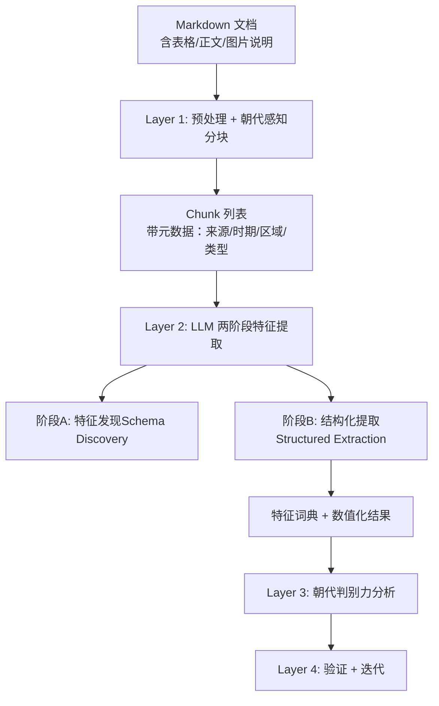
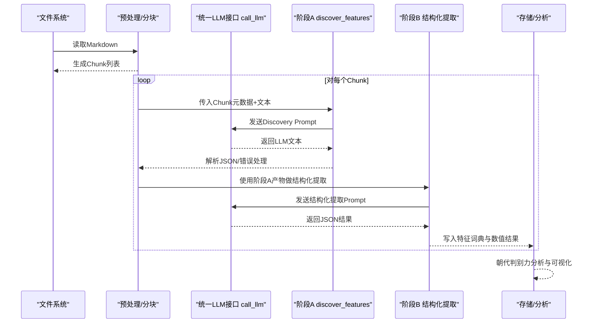
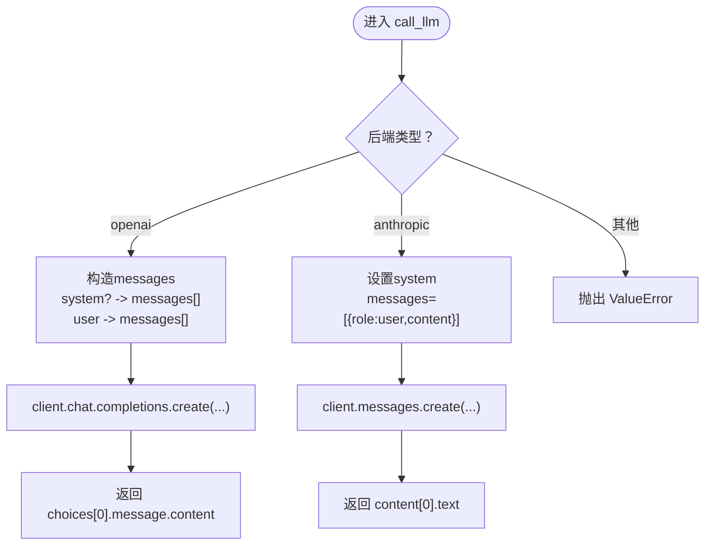
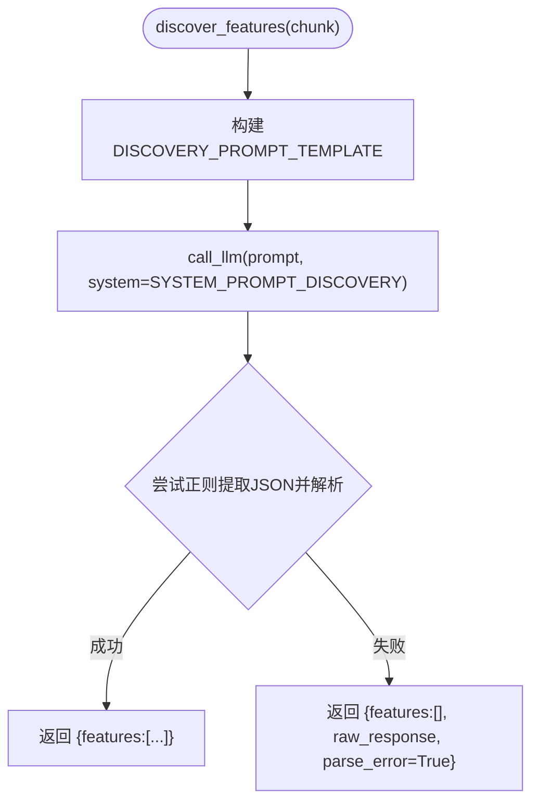
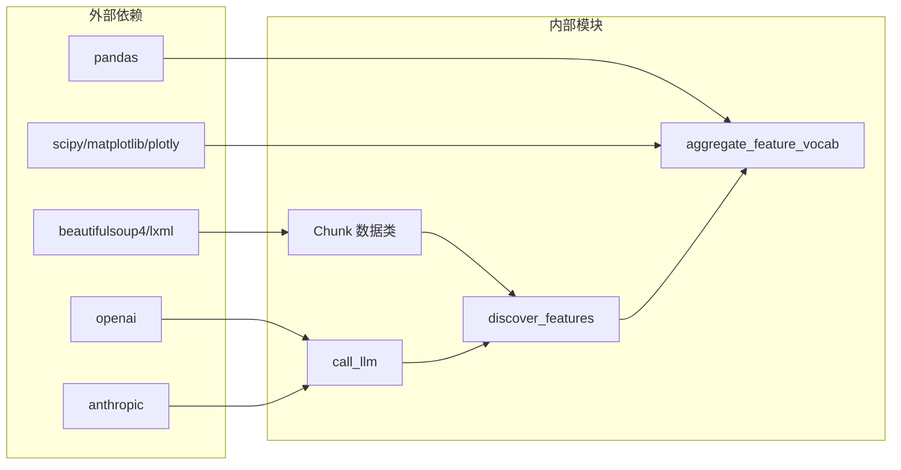

# LLM集成与两阶段特征提取

<cite>
**本文引用的文件**
- [dynasty_feature_pipeline.ipynb](file://dynasty_feature_pipeline.ipynb)
- [图像与装饰_北朝墓葬的生死表象_gq_part2.pdf_by_PaddleOCR-VL-1.6.md](file://data/图像与装饰/图像与装饰_北朝墓葬的生死表象_gq_part2.pdf_by_PaddleOCR-VL-1.6.md)
</cite>

## 目录
1. [引言](#引言)
2. [项目结构](#项目结构)
3. [核心组件](#核心组件)
4. [架构总览](#架构总览)
5. [详细组件分析](#详细组件分析)
6. [依赖关系分析](#依赖关系分析)
7. [性能考量](#性能考量)
8. [故障排查指南](#故障排查指南)
9. [结论](#结论)
10. [附录：Prompt工程与Few-shot策略](#附录prompt工程与few-shot策略)

## 引言
本项目面向考古学文献（以Markdown为主）构建“动态特征提取”流水线，目标是从东汉至北朝的文本中自动发现并量化可区分朝代的关键特征。其核心是Layer 2的两阶段LLM驱动流程：
- 阶段A（Schema Discovery）：不预设特征类别，让LLM从文本中自然发现可量化的器物/墓葬特征，形成“特征词典”。
- 阶段B（Structured Extraction）：基于阶段A生成的特征词典，对每个chunk进行结构化数值/类别提取，输出一致的JSON结果。

同时，系统提供统一的LLM调用接口call_llm，支持OpenAI与Anthropic双后端切换，便于在不同模型能力之间灵活选择。

## 项目结构
仓库包含一个Jupyter Notebook作为主实现载体，以及若干由OCR/Vision模型导出的Markdown数据样例。整体组织如下：
- data/：存放经PaddleOCR-VL等工具导出的Markdown文档，内含图片、表格与正文段落。
- dynasty_feature_pipeline.ipynb：定义预处理、分块、LLM统一接口、两阶段特征提取、聚合与分析流程。

图表来源
- [dynasty_feature_pipeline.ipynb:33-48](file://dynasty_feature_pipeline.ipynb#L33-L48)

章节来源
- [dynasty_feature_pipeline.ipynb:1-48](file://dynasty_feature_pipeline.ipynb#L1-L48)

## 核心组件
- 朝代感知分块器：将Markdown按语义段落与表格切分为Chunk，附带推断的朝代与区域标签。
- 统一LLM接口call_llm：封装OpenAI与Anthropic两种后端，屏蔽差异，返回纯文本响应。
- 阶段A discover_features：构造Discovery Prompt，调用LLM，解析JSON响应，处理异常。
- 批处理与聚合：批量扫描文件、生成chunks、汇总所有发现的特征为“特征词典”。

章节来源
- [dynasty_feature_pipeline.ipynb:360-454](file://dynasty_feature_pipeline.ipynb#L360-L454)
- [dynasty_feature_pipeline.ipynb:507-541](file://dynasty_feature_pipeline.ipynb#L507-L541)
- [dynasty_feature_pipeline.ipynb:556-617](file://dynasty_feature_pipeline.ipynb#L556-L617)
- [dynasty_feature_pipeline.ipynb:666-698](file://dynasty_feature_pipeline.ipynb#L666-L698)

## 架构总览
下图展示从输入到输出的端到端流程，包括两阶段特征提取与后续分析。

图表来源
- [dynasty_feature_pipeline.ipynb:33-48](file://dynasty_feature_pipeline.ipynb#L33-L48)
- [dynasty_feature_pipeline.ipynb:507-541](file://dynasty_feature_pipeline.ipynb#L507-L541)
- [dynasty_feature_pipeline.ipynb:556-617](file://dynasty_feature_pipeline.ipynb#L556-L617)

## 详细组件分析

### 统一LLM调用接口 call_llm
- 设计目标：屏蔽OpenAI与Anthropic的差异，提供一致的消息格式与返回值。
- 关键行为：
  - 根据全局配置选择后端。
  - OpenAI路径：构造messages数组（可选system），调用chat.completions.create，返回choices[0].message.content。
  - Anthropic路径：构造system与messages，调用messages.create，返回content[0].text。
  - 未知后端抛出异常。
- 消息格式转换：
  - OpenAI使用role/content结构；Anthropic使用system参数与user消息体。
- 错误处理：
  - 未识别后端时直接报错；具体网络或鉴权错误由上层捕获重试或降级。

图表来源
- [dynasty_feature_pipeline.ipynb:507-541](file://dynasty_feature_pipeline.ipynb#L507-L541)

章节来源
- [dynasty_feature_pipeline.ipynb:507-541](file://dynasty_feature_pipeline.ipynb#L507-L541)

### 阶段A：特征发现（Schema Discovery）
- 目标：不预设schema，让LLM从考古学文本中自然发现可量化特征，并标注类型、朝代信号与证据。
- SYSTEM_PROMPT_DISCOVERY设计理念：
  - 角色设定：中国考古学专家，聚焦汉代至北朝。
  - 任务边界：只关注可量化、可比较的特征，强调“自然浮现”，避免先验分类。
  - 输出约束：要求JSON格式，字段包含feature_name、feature_type、dynasty_signal、evidence等。
- DISCOVERY_PROMPT_TEMPLATE：
  - 注入上下文：content_type、inferred_dynasty、inferred_region、text。
  - 明确输出JSON结构与字段含义，限制仅输出JSON。
- discover_features实现逻辑：
  - 模板填充：将Chunk元数据与文本填入模板。
  - 调用LLM：通过call_llm发送system与user消息。
  - JSON解析：正则提取首个完整JSON块，json.loads解析；失败则返回空features与raw_response，并标记parse_error。
  - 错误处理：捕获JSONDecodeError，保证下游稳定。

图表来源
- [dynasty_feature_pipeline.ipynb:556-617](file://dynasty_feature_pipeline.ipynb#L556-L617)

章节来源
- [dynasty_feature_pipeline.ipynb:556-617](file://dynasty_feature_pipeline.ipynb#L556-L617)

### 阶段B：结构化提取（Structured Extraction）
- 目标：基于阶段A生成的“特征词典”，对每个chunk进行结构化数值/类别提取，输出稳定的JSON。
- 典型输出结构：
  - dynasty、region、features字典（键为特征名，值为数值/类别/比率等）。
- 提示词要点：
  - 明确“依据特征清单”进行提取。
  - 指定JSON schema，确保字段一致。
  - 必要时加入Few-shot示例，提升稳定性。
- 注意：本仓库Notebook中提供了阶段B的提示词模板占位与示例结构，实际实现可按需扩展。

章节来源
- [dynasty_feature_pipeline.ipynb:108-131](file://dynasty_feature_pipeline.ipynb#L108-L131)

### 预处理与朝代感知分块
- 功能：
  - 表格提取：从HTML table解析为结构化DataFrame-like对象。
  - 叙述文本分段：按markdown标题切分，过滤过短片段。
  - 元数据标注：推断朝代与区域关键词，附加到Chunk。
- 数据结构Chunk：
  - chunk_id、source_file、content_type、text、inferred_dynasty、inferred_region、artifact_category、table_data。
- 复杂度与性能：
  - 主要开销在BeautifulSoup解析与正则分割，适合中等规模Markdown。
  - 可通过并发或流式处理优化吞吐。

章节来源
- [dynasty_feature_pipeline.ipynb:360-454](file://dynasty_feature_pipeline.ipynb#L360-L454)

### 批处理与特征词典聚合
- process_all_files：递归扫描data目录下的Markdown，生成全部Chunk。
- aggregate_feature_vocab：汇总所有阶段A结果，去重统计出现频率，生成排序后的特征词典。
- 用途：
  - 作为阶段B的结构化提取依据。
  - 用于后续朝代判别力分析。

章节来源
- [dynasty_feature_pipeline.ipynb:666-698](file://dynasty_feature_pipeline.ipynb#L666-L698)

## 依赖关系分析
- 外部库：
  - openai、anthropic：分别对应两个LLM后端。
  - pandas、beautifulsoup4、lxml：表格解析与HTML处理。
  - scipy、matplotlib、plotly：统计分析与时序/分布可视化。
  - tqdm：进度条。
- 内部模块耦合：
  - call_llm被discover_features与阶段B提取函数复用。
  - Chunk贯穿预处理、阶段A/B与聚合阶段。
  - 聚合函数依赖阶段A的输出结构。

图表来源
- [dynasty_feature_pipeline.ipynb:248-280](file://dynasty_feature_pipeline.ipynb#L248-L280)
- [dynasty_feature_pipeline.ipynb:360-454](file://dynasty_feature_pipeline.ipynb#L360-L454)
- [dynasty_feature_pipeline.ipynb:507-541](file://dynasty_feature_pipeline.ipynb#L507-L541)
- [dynasty_feature_pipeline.ipynb:666-698](file://dynasty_feature_pipeline.ipynb#L666-L698)

章节来源
- [dynasty_feature_pipeline.ipynb:248-280](file://dynasty_feature_pipeline.ipynb#L248-L280)
- [dynasty_feature_pipeline.ipynb:360-454](file://dynasty_feature_pipeline.ipynb#L360-L454)
- [dynasty_feature_pipeline.ipynb:507-541](file://dynasty_feature_pipeline.ipynb#L507-L541)
- [dynasty_feature_pipeline.ipynb:666-698](file://dynasty_feature_pipeline.ipynb#L666-L698)

## 性能考量
- 并行与缓存：
  - 对大量Markdown文件可采用多线程/多进程并发分块与LLM调用。
  - 对相同Chunk的LLM请求增加缓存（如SQLite/Redis），减少重复调用。
- 超时与重试：
  - 对网络抖动与限流场景增加指数退避重试。
- 文本截断与窗口管理：
  - 长表格/长段落需合理截断，避免超出模型上下文限制。
- 解析鲁棒性：
  - JSON解析失败时的回退策略（保留raw_response供人工复核）。

[本节为通用指导，无需特定文件引用]

## 故障排查指南
- API Key与环境变量：
  - 确认已正确配置OpenAI或Anthropic的认证信息。
- 后端选择：
  - 检查全局后端开关是否设置为openai或anthropic。
- JSON解析失败：
  - 查看返回的raw_response，定位LLM输出格式问题。
  - 调整SYSTEM_PROMPT_DISCOVERY或DISCOVERY_PROMPT_TEMPLATE，强化JSON约束。
- 分块质量：
  - 若某些段落缺失关键信息，调整分块策略（合并相邻段、扩大上下文窗口）。
- 特征词典噪声：
  - 对低置信度或低频特征进行人工审核与合并。

章节来源
- [dynasty_feature_pipeline.ipynb:556-617](file://dynasty_feature_pipeline.ipynb#L556-L617)

## 结论
本项目通过两阶段LLM驱动的动态特征提取，实现了从考古学文本中自动发现并量化可区分朝代的关键特征。统一LLM接口call_llm屏蔽了OpenAI与Anthropic的差异，提升了系统的可移植性与可扩展性。阶段A的自然发现机制避免了先验偏见，阶段B的结构化提取保证了输出一致性。配合批处理与聚合，系统能够持续扩充特征词典，支撑后续的朝代判别力分析与交叉验证。

[本节为总结性内容，无需特定文件引用]

## 附录：Prompt工程与Few-shot策略
- 角色与任务边界：
  - 在SYSTEM_PROMPT_DISCOVERY中明确“考古学专家”身份与“汉代至北朝”范围，限定只关注可量化特征。
- 上下文注入：
  - 在DISCOVERY_PROMPT_TEMPLATE中注入content_type、inferred_dynasty、inferred_region与text，帮助LLM理解数据来源与背景。
- 输出约束：
  - 明确要求JSON格式，列出字段含义与取值范围，禁止额外解释文本。
- Few-shot示例：
  - 在阶段B的提示词中加入少量高质量示例，展示期望的JSON结构与字段值类型，提高稳定性。
- 术语对齐：
  - 结合数据样例中的考古学术语（如“镇墓武士”“神兽”“壁畫墓”等），在Prompt中给出同义词或解释，降低歧义。
- 置信度标注：
  - 在阶段A输出中包含confidence字段，便于后续筛选与人工复核。

章节来源
- [dynasty_feature_pipeline.ipynb:556-617](file://dynasty_feature_pipeline.ipynb#L556-L617)
- [dynasty_feature_pipeline.ipynb:108-131](file://dynasty_feature_pipeline.ipynb#L108-L131)

## 数据样例参考
以下Markdown样例展示了北朝墓葬相关内容的图文混排与专业术语，可作为阶段A与阶段B的输入样本，辅助Prompt工程与Few-shot示例构建。

章节来源
- [图像与装饰_北朝墓葬的生死表象_gq_part2.pdf_by_PaddleOCR-VL-1.6.md:1-200](file://data/图像与装饰/图像与装饰_北朝墓葬的生死表象_gq_part2.pdf_by_PaddleOCR-VL-1.6.md#L1-L200)