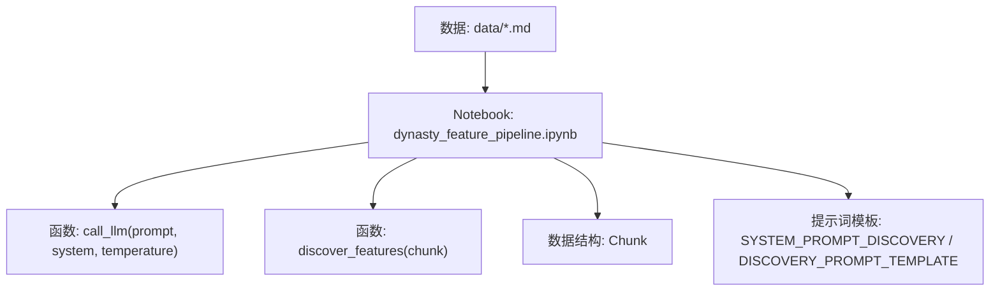
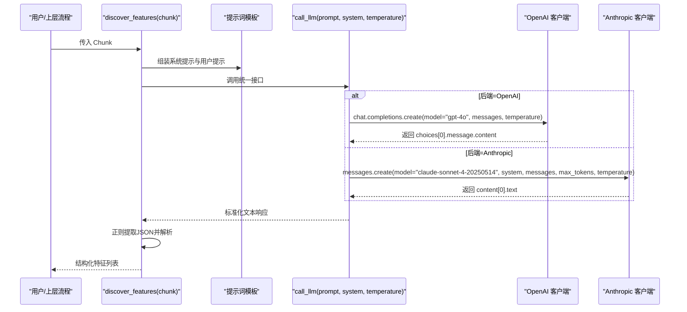
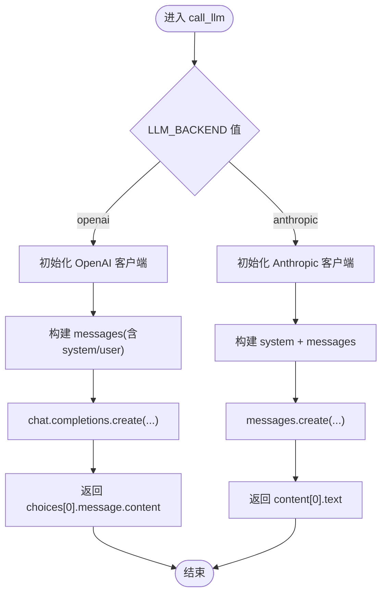
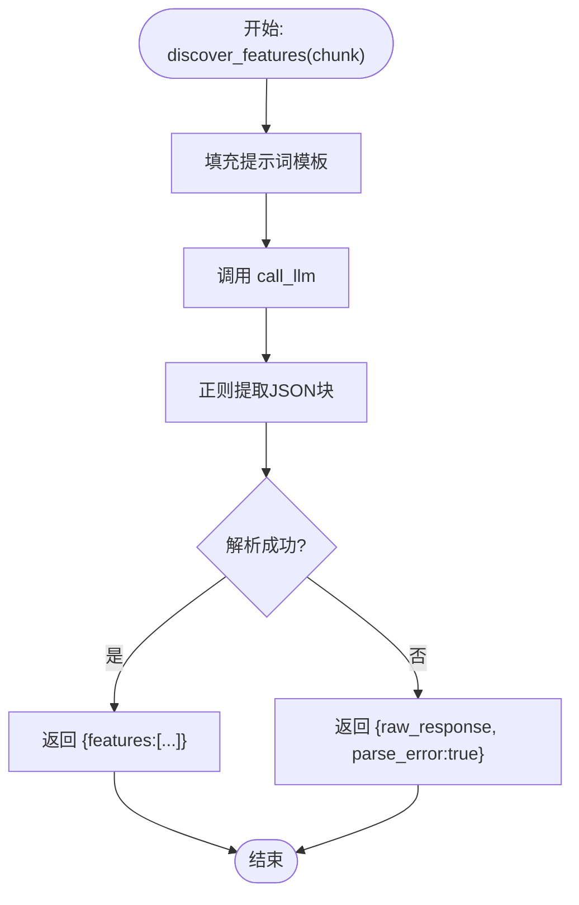
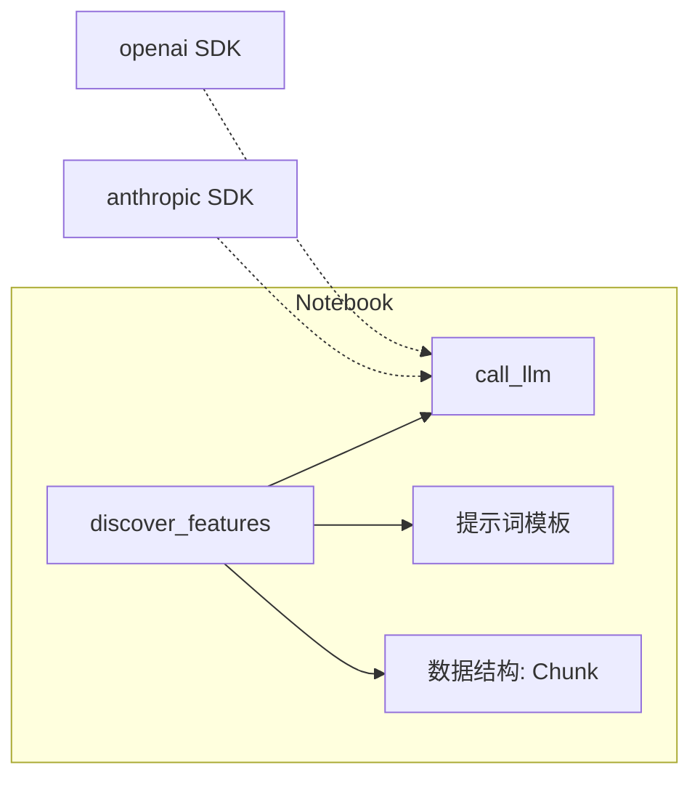

# LLM集成层与后端抽象

<cite>
**本文引用的文件**
- [dynasty_feature_pipeline.ipynb](file://dynasty_feature_pipeline.ipynb)
- [wuziyin.md](file://data/wuziyin.md)
</cite>

## 目录
1. [引言](#引言)
2. [项目结构](#项目结构)
3. [核心组件](#核心组件)
4. [架构总览](#架构总览)
5. [详细组件分析](#详细组件分析)
6. [依赖关系分析](#依赖关系分析)
7. [性能与并发](#性能与并发)
8. [故障排查指南](#故障排查指南)
9. [结论](#结论)
10. [附录：扩展新LLM后端的接口规范与最小实现](#附录扩展新llm后端的接口规范与最小实现)

## 引言
本文件聚焦于考古学特征提取流水线中的“LLM集成层”，围绕统一接口 call_llm 的设计，说明如何以单一入口支持 OpenAI 与 Anthropic 双后端切换；并给出 API 密钥管理、请求参数配置、响应格式标准化的实践建议。同时结合 GPT-4o 与 Claude-sonnet-4 在专业术语理解上的差异，讨论其对“考古学特征提取”的影响，并提供可操作的集成配置示例（环境变量、重试机制、错误处理）、性能监控与成本优化方案，以及扩展新后端的接口规范与最小实现路径。

## 项目结构
仓库包含一个 Jupyter Notebook 作为主流程载体，以及若干经 OCR 转写后的 Markdown 文献数据。Notebook 中定义了预处理、分块、LLM 调用封装、阶段A/阶段B提示词模板等关键逻辑。

图表来源
- [dynasty_feature_pipeline.ipynb](file://dynasty_feature_pipeline.ipynb)

章节来源
- [dynasty_feature_pipeline.ipynb](file://dynasty_feature_pipeline.ipynb)

## 核心组件
- 统一 LLM 调用接口 call_llm
  - 通过全局变量 LLM_BACKEND 选择后端（openai 或 anthropic）
  - 对两类 SDK 的客户端初始化、消息构造、模型名与参数进行适配
  - 返回标准化字符串响应
- 特征发现流程 discover_features
  - 将 Chunk 上下文注入提示词模板
  - 调用 call_llm 获取文本结果
  - 尝试从响应中提取 JSON 片段并解析为结构化字典
- 数据单元 Chunk
  - 承载 chunk_id、source_file、content_type、text、朝代/区域推断标签、表格数据等字段
- 提示词模板
  - SYSTEM_PROMPT_DISCOVERY：角色设定与任务约束
  - DISCOVERY_PROMPT_TEMPLATE：动态填充内容类型、时期、区域、正文，并要求输出 JSON

章节来源
- [dynasty_feature_pipeline.ipynb](file://dynasty_feature_pipeline.ipynb)

## 架构总览
下图展示了从输入文档到 LLM 调用的端到端流程，以及统一接口的职责边界。

图表来源
- [dynasty_feature_pipeline.ipynb](file://dynasty_feature_pipeline.ipynb)

## 详细组件分析

### 统一接口 call_llm 设计
- 目标
  - 屏蔽后端差异，向上层提供一致的调用签名与返回值
- 关键设计点
  - 后端选择：通过 LLM_BACKEND 常量控制分支
  - 客户端初始化：按需导入 openai.OpenAI 与 anthropic.Anthropic
  - 消息构造：OpenAI 使用 messages 数组（含 system/user），Anthropic 使用 system + messages
  - 模型参数：temperature 通用；max_tokens 仅 Anthropic 显式设置
  - 返回值：统一返回字符串，便于后续 JSON 抽取与校验
- 可扩展性
  - 新增后端时仅需增加 elif 分支，遵循相同入参/出参约定

图表来源
- [dynasty_feature_pipeline.ipynb](file://dynasty_feature_pipeline.ipynb)

章节来源
- [dynasty_feature_pipeline.ipynb](file://dynasty_feature_pipeline.ipynb)

### 阶段A：特征发现 discover_features
- 输入：Chunk 对象（包含文本、推断时期/区域、内容类型等）
- 处理
  - 使用 SYSTEM_PROMPT_DISCOVERY 与 DISCOVERY_PROMPT_TEMPLATE 生成最终 prompt
  - 调用 call_llm 获取文本
  - 使用正则匹配首个完整 JSON 块并 json.loads 解析
  - 失败时回退为包含 raw_response 的结构，便于人工复核
- 输出：包含 features 列表的字典（若解析成功）

图表来源
- [dynasty_feature_pipeline.ipynb](file://dynasty_feature_pipeline.ipynb)

章节来源
- [dynasty_feature_pipeline.ipynb](file://dynasty_feature_pipeline.ipynb)

### 数据单元 Chunk 与提示词模板
- Chunk
  - 字段包括：chunk_id、source_file、content_type、text、inferred_dynasty、inferred_region、artifact_category、table_data
  - 用于向 LLM 提供上下文元信息，提升术语识别与数值抽取准确性
- 提示词模板
  - SYSTEM_PROMPT_DISCOVERY：定义专家角色、任务目标、输出要求
  - DISCOVERY_PROMPT_TEMPLATE：动态插入内容类型、时期、区域、正文，并强制 JSON 输出

章节来源
- [dynasty_feature_pipeline.ipynb](file://dynasty_feature_pipeline.ipynb)

### 不同模型特性差异及其对考古学特征提取的影响
- 背景
  - 领域文本涉及大量专业术语（如“坛钮”“桥钮”“龟钮”“螭虎钮”“鼻钮”等）与历史时期表述
- 观察与建议
  - GPT-4o：在通用语言建模与指令遵循方面表现稳定，适合快速原型验证
  - Claude-sonnet-4：在长上下文与结构化输出稳定性上具备优势，适合复杂抽取任务
  - 实际效果需基于真实语料进行对比评测（见“性能与并发”一节）
- 影响维度
  - 术语理解准确度
  - JSON 输出稳定性
  - 长文理解与跨段落关联能力
  - 成本与延迟

章节来源
- [dynasty_feature_pipeline.ipynb](file://dynasty_feature_pipeline.ipynb)
- [wuziyin.md](file://data/wuziyin.md)

## 依赖关系分析
- 运行时依赖
  - openai、anthropic 两个 SDK 按需导入
  - pandas、BeautifulSoup、re、json 等标准库与第三方库用于数据处理与解析
- 模块耦合
  - call_llm 仅依赖后端 SDK
  - discover_features 依赖 call_llm 与提示词模板
  - 上层流程依赖 Chunk 结构与模板

图表来源
- [dynasty_feature_pipeline.ipynb](file://dynasty_feature_pipeline.ipynb)

章节来源
- [dynasty_feature_pipeline.ipynb](file://dynasty_feature_pipeline.ipynb)

## 性能与并发
- 并发策略
  - 使用线程池或异步队列并行处理多个 Chunk，避免串行阻塞
  - 对每个后端设置合理的最大并发数，防止触发速率限制
- 重试与退避
  - 针对网络抖动、限流、临时错误实施指数退避重试
  - 区分可重试错误（如 429、5xx）与不可重试错误（如鉴权失败）
- 超时与熔断
  - 为每次请求设置合理超时时间
  - 当错误率超过阈值时熔断，降级为缓存或人工复核队列
- 监控与指标
  - 记录每次调用的耗时、状态码、token 用量（如可用）、错误类型分布
  - 按模型与后端维度聚合统计，辅助成本与质量评估
- 成本优化
  - 根据任务复杂度选择更经济的模型或版本
  - 对简单任务采用更低 temperature 与较短 max_tokens
  - 批量合并相似请求（在业务允许范围内）
  - 缓存重复或近似的 prompt 结果

[本节为通用指导，不直接分析具体文件]

## 故障排查指南
- 常见问题定位
  - 鉴权失败：检查环境变量是否加载正确（见“附录：环境变量设置”）
  - 模型不存在或版本变更：核对 model 名称与平台发布周期
  - JSON 解析失败：查看 raw_response，必要时调整提示词或后处理正则
  - 速率限制：降低并发或增加退避间隔
- 日志与追踪
  - 记录请求摘要（model、temperature、prompt长度、响应长度）
  - 保留原始响应以便离线复盘
- 回退策略
  - 解析失败时保存 raw_response 并标记 parse_error
  - 对低置信度结果进入人工复核队列

章节来源
- [dynasty_feature_pipeline.ipynb](file://dynasty_feature_pipeline.ipynb)

## 结论
本项目通过统一的 call_llm 接口屏蔽了 OpenAI 与 Anthropic 的差异，实现了灵活的后端切换与稳定的上层调用体验。配合阶段A的特征发现流程与结构化输出约束，能够在考古学专业语境下完成高质量的特征抽取。后续可在并发、重试、监控与成本优化方面进一步完善，并通过对照评测持续优化提示词与模型选择。

[本节为总结性内容，不直接分析具体文件]

## 附录：扩展新LLM后端的接口规范与最小实现

### 接口规范
- 函数签名
  - call_llm(prompt: str, system: str = "", temperature: float = 0.1) -> str
- 入参约定
  - prompt：用户侧提示词
  - system：可选的系统提示词（部分后端需要）
  - temperature：采样温度，保持语义一致性
- 出参约定
  - 返回纯文本字符串，由上层负责 JSON 抽取与校验
- 后端选择
  - 通过 LLM_BACKEND 常量切换
  - 新增后端需在条件分支中注册

### 最小实现步骤
- 新增后端分支
  - 在 call_llm 中添加新的 elif 分支
  - 初始化对应 SDK 客户端
  - 构造符合该后端的消息体与参数
  - 返回标准化文本
- 环境变量
  - OPENAI_API_KEY：OpenAI 鉴权
  - ANTHROPIC_API_KEY：Anthropic 鉴权
  - 其他自定义键（如 BASE_URL、TIMEOUT 等）
- 重试与错误处理
  - 捕获特定异常（如限流、超时、鉴权失败）
  - 实现指数退避与最大重试次数
  - 对不可重试错误直接抛出或记录告警
- 监控与日志
  - 记录请求/响应摘要与耗时
  - 暴露基础指标（QPS、错误率、平均延迟）

### 环境变量设置示例
- 推荐方式
  - 使用 .env 文件与环境变量加载库
  - 或在运行环境中 export 相应变量
- 必要变量
  - OPENAI_API_KEY
  - ANTHROPIC_API_KEY

### 重试机制与错误处理策略（建议）
- 可重试错误
  - 429 Too Many Requests
  - 5xx 服务端错误
  - 网络超时/连接中断
- 不可重试错误
  - 401/403 鉴权失败
  - 400 参数错误
- 退避策略
  - 初始等待时间（如 1s）
  - 指数增长（如 2^n）
  - 上限与抖动（如 30s + 随机抖动）

### 性能监控与成本优化清单
- 监控
  - 每请求：模型、后端、温度、输入长度、输出长度、耗时、状态码
  - 聚合：按模型/后端统计 QPS、P95/P99 延迟、错误率
- 成本优化
  - 选择合适模型与参数
  - 减少不必要的 system 提示长度
  - 复用/缓存近似结果
  - 批处理与去重

### 扩展新后端的最小代码级参考（概念示意）
- 在 call_llm 中新增分支
  - 初始化新后端客户端
  - 构造消息体与参数
  - 返回标准化文本
- 确保上层 discover_features 无需改动即可工作

[本节为通用指导，不直接分析具体文件]