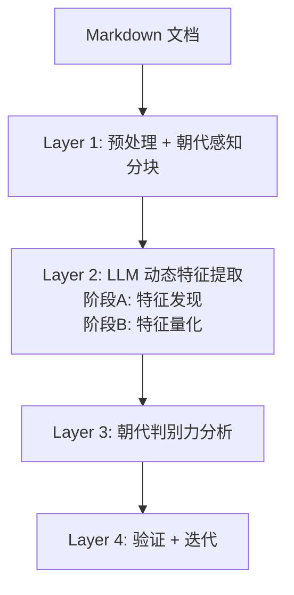
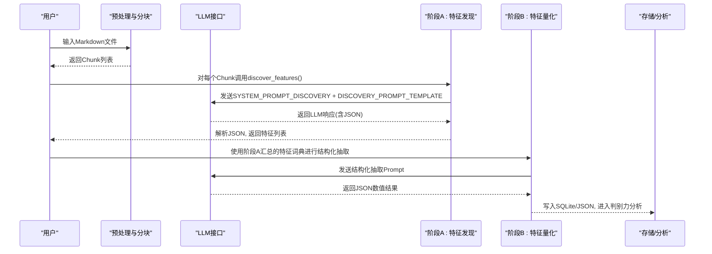
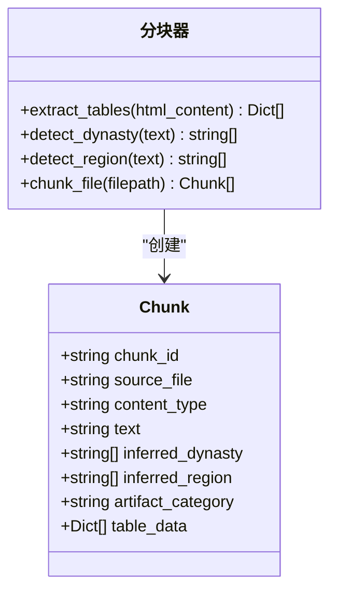
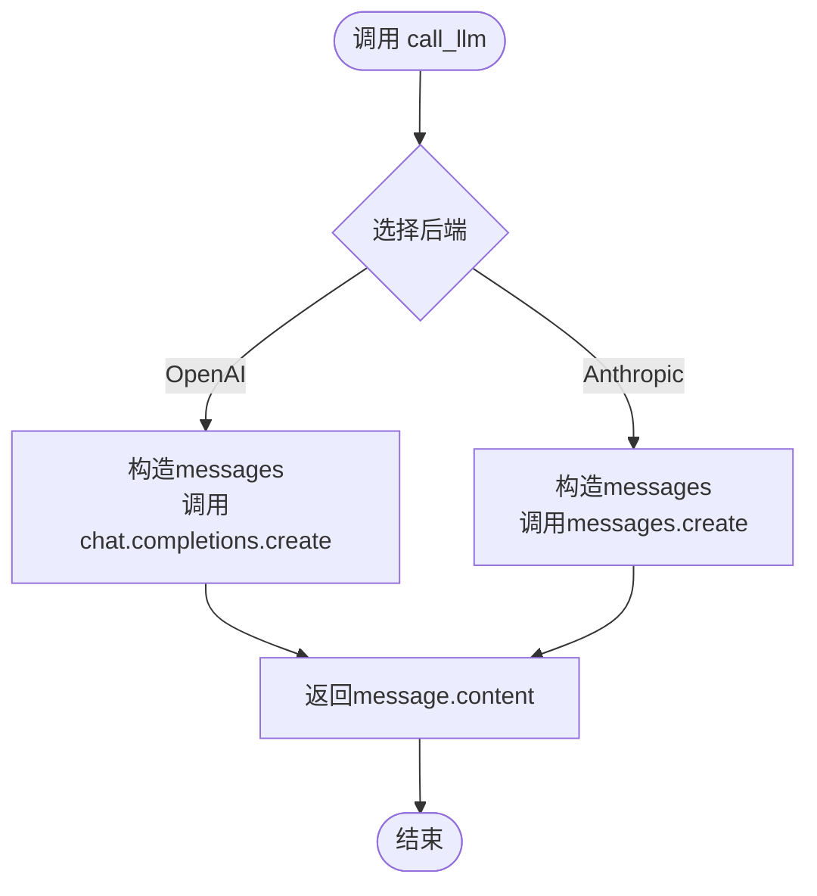
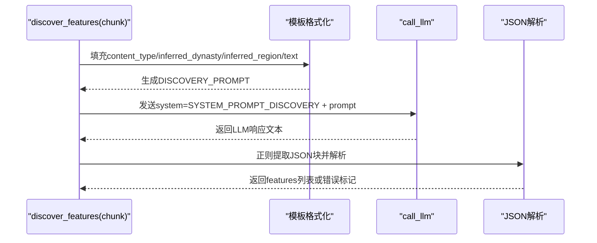
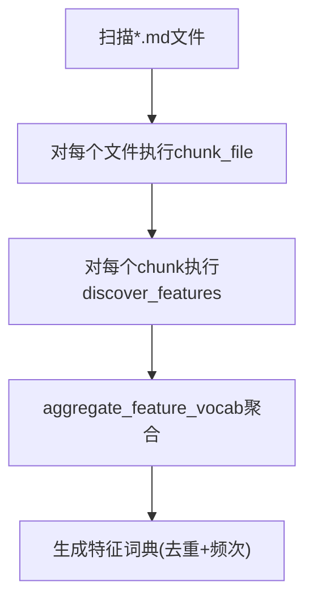
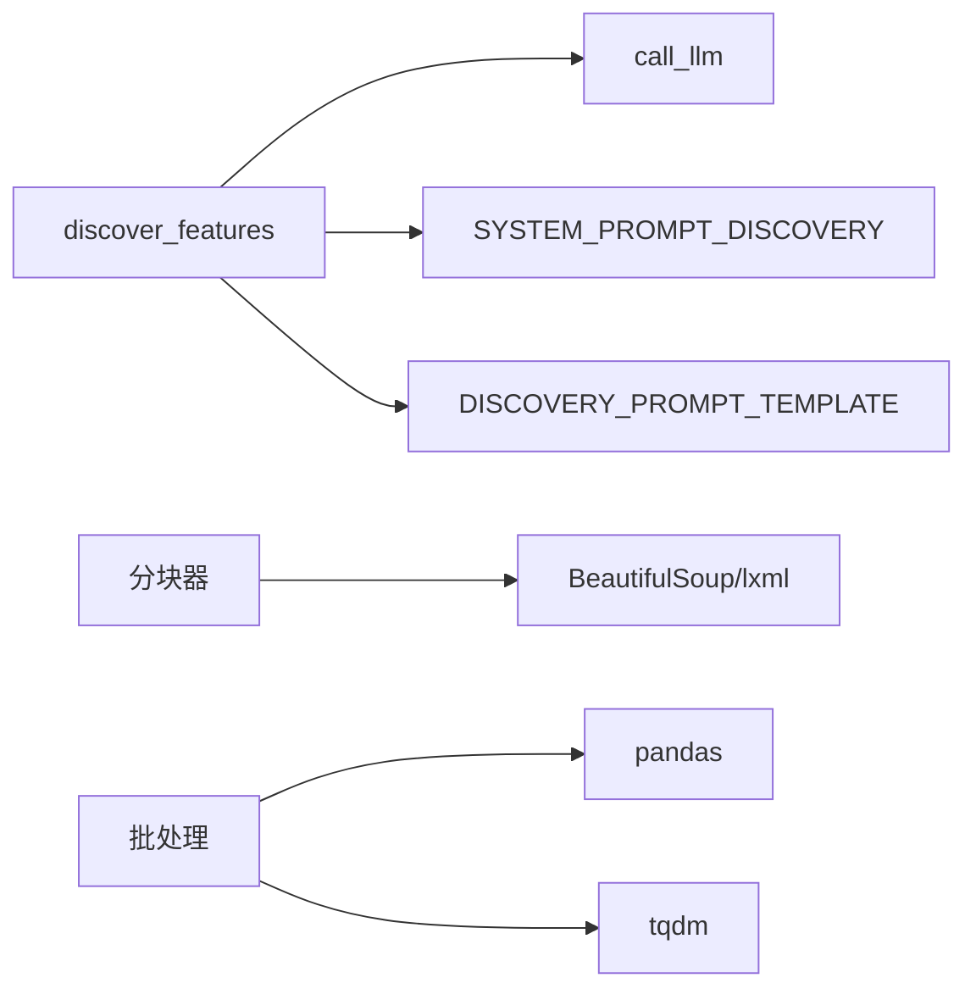

# 两阶段特征提取架构

<cite>
**本文引用的文件**
- [dynasty_feature_pipeline.ipynb](file://dynasty_feature_pipeline.ipynb)
- [图像与装饰_北朝墓葬的生死表象_gq_part2.pdf_by_PaddleOCR-VL-1.6.md](file://data/图像与装饰/图像与装饰_北朝墓葬的生死表象_gq_part2.pdf_by_PaddleOCR-VL-1.6.md)
</cite>

## 目录
1. [引言](#引言)
2. [项目结构](#项目结构)
3. [核心组件](#核心组件)
4. [架构总览](#架构总览)
5. [详细组件分析](#详细组件分析)
6. [依赖关系分析](#依赖关系分析)
7. [性能考量](#性能考量)
8. [故障排查指南](#故障排查指南)
9. [结论](#结论)
10. [附录：Prompt工程最佳实践](#appendixprompt工程最佳实践)

## 引言
本项目面向考古学文献（Markdown），目标是构建“东汉 → 魏晋十六国 → 北魏”的朝代识别模型。其核心在于两阶段特征提取：先让大语言模型从文本中自然发现可量化特征，再基于发现的特征词典进行结构化数值提取，从而避免预设schema导致的遗漏，同时保证数据一致性。该设计强调“先发现、再量化”，在开放探索与严格抽取之间取得平衡。

## 项目结构
仓库包含一个主Notebook与若干由OCR生成的Markdown数据文件。Notebook定义了完整的Pipeline：预处理与分块、LLM接口封装、两阶段特征提取、聚合与分析等。数据文件为北朝墓葬相关研究材料，包含大量叙述性文本与图片说明，适合用于验证分块策略与特征发现能力。

图表来源
- [dynasty_feature_pipeline.ipynb:33-47](file://dynasty_feature_pipeline.ipynb#L33-L47)

章节来源
- [dynasty_feature_pipeline.ipynb:1-47](file://dynasty_feature_pipeline.ipynb#L1-L47)

## 核心组件
- Chunk对象与朝代感知分块器：将输入Markdown按语义段落与朝代边界切分为Chunk，标注推断时期、区域、内容类型，并保留表格数据。
- LLM统一调用接口：支持OpenAI与Anthropic后端，提供统一的call_llm函数。
- 阶段A（特征发现）：通过开放式Prompt让LLM从文本中自然发现可量化特征，输出JSON格式的特征列表。
- 阶段B（特征量化）：基于阶段A汇总的特征词典，对每个Chunk做结构化数值提取，确保字段一致。
- 批处理与特征词典聚合：批量扫描文件、生成chunks、聚合所有发现特征形成词典。

章节来源
- [dynasty_feature_pipeline.ipynb:361-454](file://dynasty_feature_pipeline.ipynb#L361-L454)
- [dynasty_feature_pipeline.ipynb:506-541](file://dynasty_feature_pipeline.ipynb#L506-L541)
- [dynasty_feature_pipeline.ipynb:556-618](file://dynasty_feature_pipeline.ipynb#L556-L618)
- [dynasty_feature_pipeline.ipynb:666-699](file://dynasty_feature_pipeline.ipynb#L666-L699)

## 架构总览
整体流程遵循四层架构：预处理与分块、两阶段特征提取、朝代判别力分析、验证与迭代。两阶段是核心创新点：阶段A不预设schema，鼓励LLM自由发现；阶段B以发现结果作为约束，进行一致的数值化抽取。

图表来源
- [dynasty_feature_pipeline.ipynb:556-618](file://dynasty_feature_pipeline.ipynb#L556-L618)
- [dynasty_feature_pipeline.ipynb:506-541](file://dynasty_feature_pipeline.ipynb#L506-L541)

## 详细组件分析

### Chunk对象与朝代感知分块器
- 目标：在不破坏语义的前提下，按朝代关键词与章节标题切分，并将HTML表格独立成chunk，便于后续数值抽取。
- 关键实现要点：
  - 使用BeautifulSoup解析HTML表格，提取表头与行数据。
  - 通过正则按markdown标题分段，过滤过短段落。
  - 对每个chunk推断朝代与区域标签，便于后续分析与可视化。
- 复杂度与性能：
  - 表格解析时间复杂度与表格规模线性相关；文本分段时间与文本长度线性相关。
  - 截断策略限制最大长度，控制LLM上下文窗口压力。

图表来源
- [dynasty_feature_pipeline.ipynb:361-454](file://dynasty_feature_pipeline.ipynb#L361-L454)

章节来源
- [dynasty_feature_pipeline.ipynb:361-454](file://dynasty_feature_pipeline.ipynb#L361-L454)

### LLM统一调用接口
- 目标：屏蔽不同后端差异，提供统一的call_llm函数。
- 关键点：
  - 支持OpenAI与Anthropic两种后端。
  - 允许传入system提示词与temperature参数。
  - 返回纯文本响应，供上层解析JSON。

图表来源
- [dynasty_feature_pipeline.ipynb:506-541](file://dynasty_feature_pipeline.ipynb#L506-L541)

章节来源
- [dynasty_feature_pipeline.ipynb:506-541](file://dynasty_feature_pipeline.ipynb#L506-L541)

### 阶段A：特征发现（discover_features）
- 设计理念：
  - 不预设schema，让LLM从文本中自然发现可量化特征，避免遗漏。
  - 要求标注特征类型、朝代信号、原文依据与置信度，便于后续筛选与质量控制。
- 工作流程：
  - 将Chunk对象转换为DISCOVERY_PROMPT_TEMPLATE所需的上下文信息（内容类型、推断时期、区域、文本）。
  - 调用call_llm，附带SYSTEM_PROMPT_DISCOVERY作为系统提示。
  - 解析LLM响应中的JSON块，若失败则返回空特征列表与原始响应，便于人工复核。
- JSON响应解析与错误恢复机制：
  - 使用正则匹配第一个完整JSON块，尝试json.loads解析。
  - 捕获JSONDecodeError，返回包含parse_error标志的结构，便于上层记录与重试。
  - 未匹配到JSON时，返回空特征列表与raw_response，便于调试。

图表来源
- [dynasty_feature_pipeline.ipynb:556-618](file://dynasty_feature_pipeline.ipynb#L556-L618)

章节来源
- [dynasty_feature_pipeline.ipynb:556-618](file://dynasty_feature_pipeline.ipynb#L556-L618)

### 阶段B：特征量化（结构化抽取）
- 设计理念：
  - 基于阶段A汇总的特征词典，对每个Chunk进行严格的数值/类别抽取，确保字段一致。
  - 输出JSON结构包含朝代、区域与features字典，便于下游统计与建模。
- 工作流（概念性）：
  - 输入：阶段A汇总的特征词典 + 当前Chunk文本。
  - Prompt：明确列出特征清单与期望输出JSON结构。
  - 解析：校验JSON字段完整性，缺失值用默认或空值填充，低置信度标记人工复核。
- 优势：
  - 避免阶段A的开放性带来的不一致性。
  - 提高跨文档可比性与模型训练质量。

[本节为概念性说明，不直接分析具体代码文件]

### 批处理与特征词典聚合
- 目标：批量扫描Markdown文件，生成chunks，并对所有阶段A结果进行聚合，去重并统计出现频率。
- 关键点：
  - process_all_files遍历DATA_DIR下的所有md文件，调用chunk_file生成chunks。
  - aggregate_feature_vocab将所有features合并为DataFrame，按feature_name分组统计type、dynasty_signal与occurrence_count。
  - 排序后得到高频特征优先的词典，便于阶段B抽取时的优先级与覆盖度评估。

图表来源
- [dynasty_feature_pipeline.ipynb:666-699](file://dynasty_feature_pipeline.ipynb#L666-L699)

章节来源
- [dynasty_feature_pipeline.ipynb:666-699](file://dynasty_feature_pipeline.ipynb#L666-L699)

## 依赖关系分析
- 内部依赖：
  - discover_features依赖call_llm与模板常量（SYSTEM_PROMPT_DISCOVERY、DISCOVERY_PROMPT_TEMPLATE）。
  - 分块器依赖BeautifulSoup与正则表达式。
  - 批处理依赖os/pathlib与tqdm进度条。
- 外部依赖：
  - OpenAI或AnthropicSDK（根据LLM_BACKEND配置）。
  - pandas用于聚合与统计。
  - BeautifulSoup与lxml用于HTML表格解析。

图表来源
- [dynasty_feature_pipeline.ipynb:506-541](file://dynasty_feature_pipeline.ipynb#L506-L541)
- [dynasty_feature_pipeline.ipynb:556-618](file://dynasty_feature_pipeline.ipynb#L556-L618)
- [dynasty_feature_pipeline.ipynb:666-699](file://dynasty_feature_pipeline.ipynb#L666-L699)

章节来源
- [dynasty_feature_pipeline.ipynb:506-541](file://dynasty_feature_pipeline.ipynb#L506-L541)
- [dynasty_feature_pipeline.ipynb:556-618](file://dynasty_feature_pipeline.ipynb#L556-L618)
- [dynasty_feature_pipeline.ipynb:666-699](file://dynasty_feature_pipeline.ipynb#L666-L699)

## 性能考量
- 分块策略：
  - 按语义段落与朝代边界切分，避免固定大小chunk造成的语义断裂。
  - 表格单独处理，减少LLM上下文噪声。
- LLM调用优化：
  - 使用较低temperature提升稳定性。
  - 截断过长文本，控制token消耗与延迟。
- 解析容错：
  - JSON解析失败时返回原始响应，便于快速定位问题与重试。
- 可扩展性：
  - 支持多后端切换，便于在不同环境中部署。
  - 特征词典增量更新，新文件进来后可仅运行阶段A检测新特征。

[本节提供一般性指导，不直接分析具体代码文件]

## 故障排查指南
- JSON解析失败：
  - 现象：discover_features返回parse_error标志与raw_response。
  - 排查：检查LLM是否返回非标准JSON；调整SYSTEM_PROMPT_DISCOVERY强调只输出JSON；必要时增加few-shot示例。
- 无特征发现：
  - 现象：features为空列表。
  - 排查：确认Chunk文本是否足够长且包含可量化信息；调整分块策略，合并过短段落；检查朝代/区域推断是否正确。
- 后端连接异常：
  - 现象：call_llm抛出异常。
  - 排查：确认API key与环境变量；检查网络连通性；切换LLM_BACKEND进行对比测试。
- 表格解析错误：
  - 现象：extract_tables返回空或结构不完整。
  - 排查：检查HTML结构是否规范；确认lxml解析器可用；必要时改用其他解析库。

章节来源
- [dynasty_feature_pipeline.ipynb:556-618](file://dynasty_feature_pipeline.ipynb#L556-L618)
- [dynasty_feature_pipeline.ipynb:395-407](file://dynasty_feature_pipeline.ipynb#L395-L407)

## 结论
两阶段特征提取架构通过“先发现、再量化”的策略，有效解决了预设schema导致的遗漏问题，同时保证了数据的一致性与可比性。阶段A利用LLM的开放理解能力从考古学文本中自然发现特征，阶段B则以发现结果为依据进行结构化抽取，形成闭环。结合朝代感知分块与批处理聚合，该架构具备良好的可扩展性与鲁棒性，适用于多源考古文献的特征工程与朝代识别建模。

[本节为总结性内容，不直接分析具体代码文件]

## 附录：Prompt工程最佳实践
- SYSTEM_PROMPT_DISCOVERY的设计理念：
  - 角色设定：明确LLM为考古学专家，聚焦汉代至北朝时期。
  - 任务导向：强调从文本中识别可量化的器物/墓葬特征，服务于朝代区分。
  - 输出约束：要求标注特征类型、朝代信号、原文依据与置信度，便于后续质量控制。
- Few-shot学习策略：
  - 在DISCOVERY_PROMPT_TEMPLATE中加入少量高质量示例，展示期望的JSON结构与字段含义。
  - 示例应覆盖不同类型特征（numeric、categorical、boolean、ratio），并体现考古学术语。
- 考古学术语适配：
  - 在system提示中列举典型术语（如“坛钮”“桥钮”“砖室墓”“土洞墓”等），引导LLM关注领域内常见指标。
  - 针对北朝墓葬材料（如图像与装饰系列），强化对方位、神兽、镇墓武士等特征的敏感度。
- 错误恢复机制：
  - 当JSON解析失败时，返回raw_response以便人工复核与自动重试。
  - 对低置信度特征标记人工复核队列，逐步完善特征词典。

章节来源
- [dynasty_feature_pipeline.ipynb:556-618](file://dynasty_feature_pipeline.ipynb#L556-L618)
- [图像与装饰_北朝墓葬的生死表象_gq_part2.pdf_by_PaddleOCR-VL-1.6.md:22-64](file://data/图像与装饰/图像与装饰_北朝墓葬的生死表象_gq_part2.pdf_by_PaddleOCR-VL-1.6.md#L22-L64)