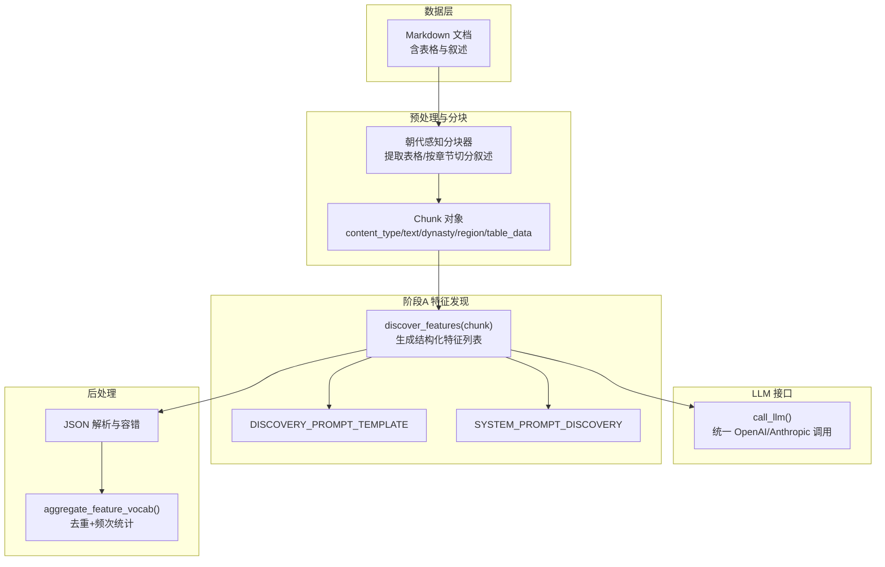
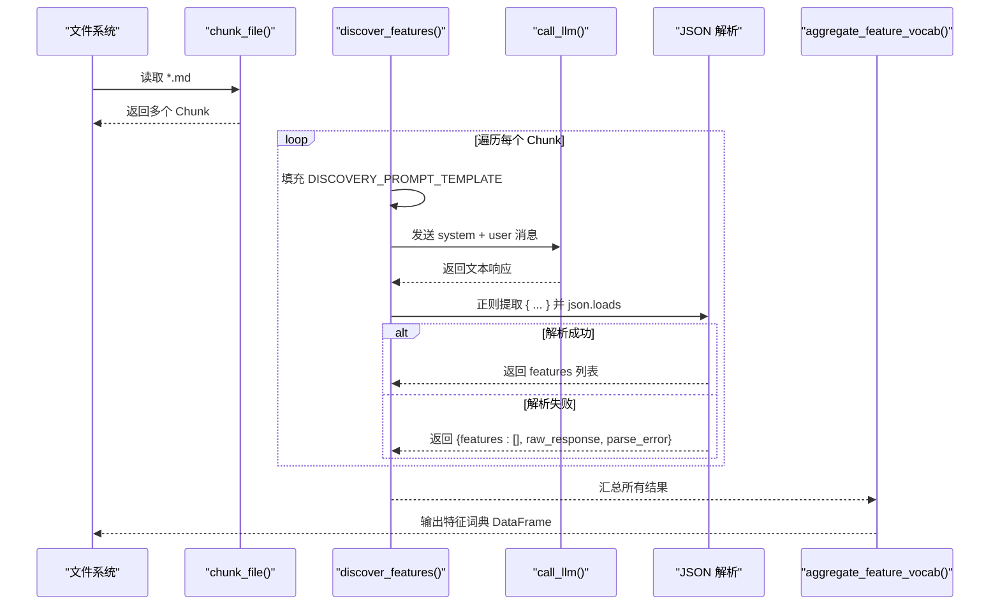
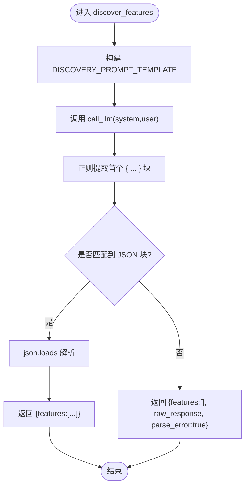
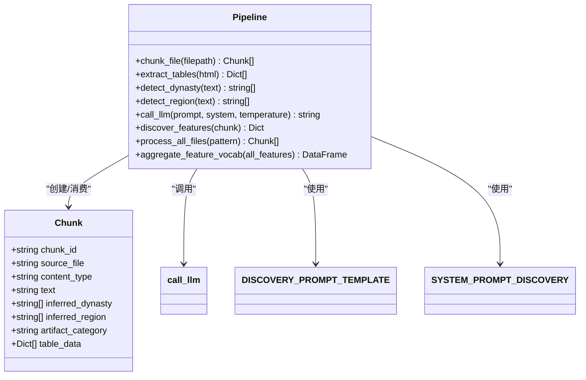

# 阶段A：特征发现（Schema Discovery）

<cite>
**本文引用的文件**
- [dynasty_feature_pipeline.ipynb](file://dynasty_feature_pipeline.ipynb)
- [图像与装饰_北朝墓葬的生死表象_gq_part2.pdf_by_PaddleOCR-VL-1.6.md](file://data/图像与装饰/图像与装饰_北朝墓葬的生死表象_gq_part2.pdf_by_PaddleOCR-VL-1.6.md)
- [京津冀汉墓研究_part1.pdf_by_PaddleOCR-VL-1.6.md](file://data/京津冀/京津冀汉墓研究_part1.pdf_by_PaddleOCR-VL-1.6.md)
</cite>

## 目录
1. [引言](#引言)
2. [项目结构](#项目结构)
3. [核心组件](#核心组件)
4. [架构总览](#架构总览)
5. [详细组件分析](#详细组件分析)
6. [依赖关系分析](#依赖关系分析)
7. [性能考量](#性能考量)
8. [故障排查指南](#故障排查指南)
9. [结论](#结论)
10. [附录](#附录)

## 引言
本文件聚焦“阶段A：特征发现（Schema Discovery）”的核心实现，围绕 discover_features 函数的工作流程展开，解释 Chunk 对象到 Prompt 模板的转换过程、SYSTEM_PROMPT_DISCOVERY 的设计理念以及 DISCOVERY_PROMPT_TEMPLATE 的结构化输出要求。同时阐述开放式 Prompt 如何引导大模型从考古学文本中自然发现可量化特征，避免预设 schema 带来的遗漏；并说明 JSON 响应解析机制、错误恢复策略与置信度标注方法。最后提供 Prompt 工程最佳实践（Few-shot 学习策略、考古学术语适配、朝代信号识别），并结合实际代码示例展示如何处理不同类型的 chunk（表格 vs 叙述文本），以及如何优化特征发现的准确性与完整性。

## 项目结构
该仓库包含一个 Jupyter Notebook 作为主实现入口，以及若干由 OCR 工具生成的 Markdown 数据文件，涵盖表格与叙述文本两类内容。Notebook 定义了预处理、分块、LLM 调用封装、阶段 A/B 的提示词与处理流程，以及批量聚合等能力。

图表来源
- [dynasty_feature_pipeline.ipynb:361-454](file://dynasty_feature_pipeline.ipynb#L361-L454)
- [dynasty_feature_pipeline.ipynb:557-618](file://dynasty_feature_pipeline.ipynb#L557-L618)
- [dynasty_feature_pipeline.ipynb:679-698](file://dynasty_feature_pipeline.ipynb#L679-L698)

章节来源
- [dynasty_feature_pipeline.ipynb:361-454](file://dynasty_feature_pipeline.ipynb#L361-L454)
- [dynasty_feature_pipeline.ipynb:557-618](file://dynasty_feature_pipeline.ipynb#L557-L618)
- [dynasty_feature_pipeline.ipynb:679-698](file://dynasty_feature_pipeline.ipynb#L679-L698)

## 核心组件
- Chunk 数据类：承载单个语义单元，包括 content_type（table/narrative）、text、inferred_dynasty、inferred_region、artifact_category、table_data 等字段，用于下游 LLM 输入与上下文增强。
- 朝代/区域关键词映射：通过 DYNASTY_KEYWORDS 与 REGION_KEYWORDS 进行快速标签推断，辅助 prompt 注入领域先验。
- LLM 调用封装 call_llm：统一 OpenAI 与 Anthropic 后端，支持 system 消息与 temperature 控制。
- 阶段 A 提示词：
  - SYSTEM_PROMPT_DISCOVERY：设定角色与任务边界，强调“不预设类别、让特征自然浮现、关注可量化比较、标注区分度与原文依据”。
  - DISCOVERY_PROMPT_TEMPLATE：将 Chunk 元信息（类型、时期、区域）与正文拼接，要求返回 JSON 格式的特征数组，每个特征包含 feature_name、feature_type、value、dynasty_signal、evidence、confidence。
- discover_features：组装 prompt、调用 LLM、尝试正则提取 JSON 块、解析为字典，失败时回退为包含 raw_response 与 parse_error 标记的结果。
- 批处理与聚合：process_all_files 扫描所有 Markdown 文件并切分；aggregate_feature_vocab 对多源结果进行去重与出现频次统计，形成“特征词典”。

章节来源
- [dynasty_feature_pipeline.ipynb:361-454](file://dynasty_feature_pipeline.ipynb#L361-L454)
- [dynasty_feature_pipeline.ipynb:508-541](file://dynasty_feature_pipeline.ipynb#L508-L541)
- [dynasty_feature_pipeline.ipynb:557-618](file://dynasty_feature_pipeline.ipynb#L557-L618)
- [dynasty_feature_pipeline.ipynb:666-698](file://dynasty_feature_pipeline.ipynb#L666-L698)

## 架构总览
下图展示了从原始 Markdown 到阶段 A 特征发现的关键数据流与控制流。

图表来源
- [dynasty_feature_pipeline.ipynb:410-454](file://dynasty_feature_pipeline.ipynb#L410-L454)
- [dynasty_feature_pipeline.ipynb:557-618](file://dynasty_feature_pipeline.ipynb#L557-L618)
- [dynasty_feature_pipeline.ipynb:666-698](file://dynasty_feature_pipeline.ipynb#L666-L698)

## 详细组件分析

### discover_features 工作流程
- 输入：一个 Chunk 对象，包含 content_type、inferred_dynasty、inferred_region、text、table_data 等。
- 步骤：
  1) 使用 DISCOVERY_PROMPT_TEMPLATE.format(...) 将 Chunk 元信息与正文拼接到用户消息中。
  2) 调用 call_llm(prompt, system=SYSTEM_PROMPT_DISCOVERY)，temperature 默认较低以稳定输出。
  3) 在返回文本中用正则匹配第一个完整的 JSON 块（{...}）。
  4) 若匹配成功则 json.loads 解析；否则返回包含 raw_response 与 parse_error 标记的兜底结构。
- 输出：包含 features 列表的字典，每个元素具备 feature_name、feature_type、value、dynasty_signal、evidence、confidence。

图表来源
- [dynasty_feature_pipeline.ipynb:557-618](file://dynasty_feature_pipeline.ipynb#L557-L618)

章节来源
- [dynasty_feature_pipeline.ipynb:557-618](file://dynasty_feature_pipeline.ipynb#L557-L618)

### Chunk 对象到 Prompt 模板的转换
- Chunk.content_type 决定提示词中的“文本类型”，便于模型理解输入是表格还是叙述。
- inferred_dynasty/inferred_region 作为“推断时期/区域”注入，帮助模型结合时空背景进行特征抽取。
- text 为正文或表格字符串；当 content_type="table" 时，text 来自 extract_tables 的序列化结果，保留表头与行数据，利于模型直接定位数值型特征。
- 模板还要求模型输出 confidence（0.0-1.0），便于后续筛选低置信度条目进行人工复核。

章节来源
- [dynasty_feature_pipeline.ipynb:361-454](file://dynasty_feature_pipeline.ipynb#L361-L454)
- [dynasty_feature_pipeline.ipynb:557-618](file://dynasty_feature_pipeline.ipynb#L557-L618)

### SYSTEM_PROMPT_DISCOVERY 设计理念
- 角色设定：中国考古学专家，专注汉代至北朝。
- 目标约束：不预设类别，让特征从数据中自然浮现；关注可量化、可比较的特征；标注朝代区分度；给出原文依据。
- 设计动机：避免强 schema 导致的遗漏与偏差，利用 LLM 的开放推理能力发现潜在判别性特征。

章节来源
- [dynasty_feature_pipeline.ipynb:557-566](file://dynasty_feature_pipeline.ipynb#L557-L566)

### DISCOVERY_PROMPT_TEMPLATE 结构化输出要求
- 强制 JSON 输出，包含 features 数组。
- 每个特征项字段：
  - feature_name：特征名
  - feature_type：numeric | categorical | boolean | ratio
  - value：具体值（尤其适用于表格数据）
  - dynasty_signal：该特征对哪些时期有区分度
  - evidence：原文依据（引用）
  - confidence：0.0-1.0 的置信度评分
- 仅输出 JSON，不要其他内容，降低解析难度。

章节来源
- [dynasty_feature_pipeline.ipynb:567-592](file://dynasty_feature_pipeline.ipynb#L567-L592)

### 开放式 Prompt 的优势与风险
- 优势：
  - 减少人为 schema 的先验偏见，有利于发现跨材料的新特征组合。
  - 借助考古学语境与 Few-shot 示例，提升术语理解与价值判断。
- 风险：
  - 输出格式不稳定，需要健壮的正则与解析容错。
  - 可能产生冗余或重复特征，需在后端做去重与合并。
  - 置信度主观性强，需结合规则与人工校验。

[本节为概念性讨论，不直接分析具体文件]

### JSON 响应解析机制与错误恢复
- 解析策略：
  - 使用正则匹配首个完整 JSON 块，再 json.loads 解析。
  - 若解析失败，返回包含 raw_response 与 parse_error 标记的兜底结构，便于记录与重试。
- 建议增强：
  - 增加多次重试与温度微调（如 0.1→0.0）。
  - 引入“二次修复”提示，让模型修正 JSON 语法。
  - 对 value 字段进行类型归一化（数字、布尔、比率计算）。

章节来源
- [dynasty_feature_pipeline.ipynb:595-618](file://dynasty_feature_pipeline.ipynb#L595-L618)

### 置信度标注与质量控制
- 模型自评 confidence：反映其对特征存在性与可量化的把握程度。
- 质量控制建议：
  - 设置阈值过滤（如 <0.6 标记人工复核）。
  - 结合证据长度与重复出现次数加权。
  - 对 ratio 类型特征进行一致性检查（分子/分母是否在上下文中明确）。

章节来源
- [dynasty_feature_pipeline.ipynb:567-592](file://dynasty_feature_pipeline.ipynb#L567-L592)

### 不同 Chunk 类型的处理差异（表格 vs 叙述）
- 表格类型（content_type="table"）：
  - 通过 extract_tables 提取 HTML table，转换为 headers+data 结构，并以字符串形式传入 text。
  - 适合发现数值型、分类型、比率型特征（如材质分布、钮式占比、墓室面积等）。
- 叙述类型（content_type="narrative"）：
  - 按 markdown 标题分段，去除表格与 div 后切分，保留段落语义。
  - 适合发现定性描述、趋势变化、文化现象等特征线索。

章节来源
- [dynasty_feature_pipeline.ipynb:395-454](file://dynasty_feature_pipeline.ipynb#L395-L454)

### 实际代码示例路径（不展示源码内容）
- 定义 Chunk 与分块逻辑：
  - [dynasty_feature_pipeline.ipynb:361-454](file://dynasty_feature_pipeline.ipynb#L361-L454)
- 统一 LLM 调用封装：
  - [dynasty_feature_pipeline.ipynb:508-541](file://dynasty_feature_pipeline.ipynb#L508-L541)
- 阶段 A 提示词与 discover_features：
  - [dynasty_feature_pipeline.ipynb:557-618](file://dynasty_feature_pipeline.ipynb#L557-L618)
- 批量处理与特征词典聚合：
  - [dynasty_feature_pipeline.ipynb:666-698](file://dynasty_feature_pipeline.ipynb#L666-L698)

### Prompt 工程最佳实践
- Few-shot 学习策略：
  - 在系统提示或用户提示中加入少量高质量示例，覆盖 numeric/categorical/boolean/ratio 四类特征。
  - 示例应包含明确的 dynasty_signal 与 evidence 引用，示范 confidence 评估方式。
- 考古学术语适配：
  - 在 SYSTEM_PROMPT_DISCOVERY 中补充术语表（如“坛钮/桥钮/龟钮/螭虎钮”、“土坑/砖室/石室”、“壁画墓比例”等），提高模型识别精度。
- 朝代信号识别：
  - 结合 DYNASTY_KEYWORDS 提供的时期标签，在 prompt 中显式提示“东汉中晚期/魏晋过渡”等模糊时段，允许非离散分类。
  - 鼓励模型输出“过渡期混合信号”，并在后续阶段 B 中进行细化。

[本节为通用指导，不直接分析具体文件]

## 依赖关系分析
- 模块内依赖：
  - discover_features 依赖 DISCOVERY_PROMPT_TEMPLATE、SYSTEM_PROMPT_DISCOVERY、call_llm。
  - chunk_file 依赖 extract_tables、detect_dynasty、detect_region。
  - aggregate_feature_vocab 依赖 discover_features 的输出。
- 外部依赖：
  - openai/anthropic SDK（根据 LLM_BACKEND 选择）。
  - pandas、BeautifulSoup、re、json、tqdm 等标准库与第三方库。

图表来源
- [dynasty_feature_pipeline.ipynb:361-454](file://dynasty_feature_pipeline.ipynb#L361-L454)
- [dynasty_feature_pipeline.ipynb:508-541](file://dynasty_feature_pipeline.ipynb#L508-L541)
- [dynasty_feature_pipeline.ipynb:557-618](file://dynasty_feature_pipeline.ipynb#L557-L618)
- [dynasty_feature_pipeline.ipynb:666-698](file://dynasty_feature_pipeline.ipynb#L666-L698)

章节来源
- [dynasty_feature_pipeline.ipynb:361-454](file://dynasty_feature_pipeline.ipynb#L361-L454)
- [dynasty_feature_pipeline.ipynb:508-541](file://dynasty_feature_pipeline.ipynb#L508-L541)
- [dynasty_feature_pipeline.ipynb:557-618](file://dynasty_feature_pipeline.ipynb#L557-L618)
- [dynasty_feature_pipeline.ipynb:666-698](file://dynasty_feature_pipeline.ipynb#L666-L698)

## 性能考量
- 分块粒度：按语义段落与朝代边界切分，避免固定大小 chunk 切断上下文，有助于提高特征发现质量。
- 表格处理：HTML 表格转结构化数据后再送入 LLM，减少噪声，提升数值型特征抽取效率。
- 并发与缓存：
  - 可对相同 chunk 的 LLM 请求进行缓存，避免重复调用。
  - 批量处理时使用 tqdm 显示进度，便于监控。
- 解析开销：正则提取与 json.loads 开销较小，但需考虑大量失败重试的成本，建议增加二次修复提示与重试上限。

[本节为通用指导，不直接分析具体文件]

## 故障排查指南
- JSON 解析失败：
  - 现象：返回 parse_error=true 且 features 为空。
  - 排查：检查 LLM 返回是否包含完整 JSON 块；必要时调整 temperature 或增加“请仅输出合法 JSON”的约束。
- 特征缺失或重复：
  - 现象：某些关键特征未出现，或同一特征多次出现。
  - 排查：在 SYSTEM_PROMPT_DISCOVERY 中强化“不遗漏可量化特征”的要求；在 aggregate_feature_vocab 中加强去重与合并策略。
- 置信度过低：
  - 现象：多数特征 confidence 偏低。
  - 排查：在提示词中加入 Few-shot 示例，明确 confidence 评估维度（证据充分性、数值可验证性、时代相关性）。
- 表格数据丢失：
  - 现象：表格相关特征未被发现。
  - 排查：确认 extract_tables 是否正确提取 headers 与 data；确保 text 中包含足够上下文。

章节来源
- [dynasty_feature_pipeline.ipynb:595-618](file://dynasty_feature_pipeline.ipynb#L595-L618)
- [dynasty_feature_pipeline.ipynb:679-698](file://dynasty_feature_pipeline.ipynb#L679-L698)

## 结论
阶段 A 的特征发现通过开放式 Prompt 与大模型的领域理解能力，有效避免了预设 schema 的局限，能够在考古学文本中自然涌现可量化特征。配合稳健的 JSON 解析与错误恢复、置信度标注与批次聚合，形成了从原始 Markdown 到特征词典的可靠流水线。后续可在 Few-shot 示例、术语适配与朝代信号识别方面持续优化，以提升准确性与完整性。

[本节为总结性内容，不直接分析具体文件]

## 附录

### 数据样例概览（不展示具体内容）
- 表格样例：印章材质与钮式分布、墓葬形制与年代对照、人口密度统计等。
- 叙述样例：墓葬方位与信仰、金属饰品纹样、壁画面内容与布局等。

章节来源
- [图像与装饰_北朝墓葬的生死表象_gq_part2.pdf_by_PaddleOCR-VL-1.6.md:1-200](file://data/图像与装饰/图像与装饰_北朝墓葬的生死表象_gq_part2.pdf_by_PaddleOCR-VL-1.6.md#L1-L200)
- [京津冀汉墓研究_part1.pdf_by_PaddleOCR-VL-1.6.md:245-251](file://data/京津冀/京津冀汉墓研究_part1.pdf_by_PaddleOCR-VL-1.6.md#L245-L251)
- [京津冀汉墓研究_part1.pdf_by_PaddleOCR-VL-1.6.md:704-704](file://data/京津冀/京津冀汉墓研究_part1.pdf_by_PaddleOCR-VL-1.6.md#L704-L704)
- [京津冀汉墓研究_part1.pdf_by_PaddleOCR-VL-1.6.md:1813-1843](file://data/京津冀/京津冀汉墓研究_part1.pdf_by_PaddleOCR-VL-1.6.md#L1813-L1843)
- [京津冀汉墓研究_part1.pdf_by_PaddleOCR-VL-1.6.md:2296-2302](file://data/京津冀/京津冀汉墓研究_part1.pdf_by_PaddleOCR-VL-1.6.md#L2296-L2302)
- [京津冀汉墓研究_part1.pdf_by_PaddleOCR-VL-1.6.md:3284-3284](file://data/京津冀/京津冀汉墓研究_part1.pdf_by_PaddleOCR-VL-1.6.md#L3284-L3284)
- [京津冀汉墓研究_part1.pdf_by_PaddleOCR-VL-1.6.md:4068-4068](file://data/京津冀/京津冀汉墓研究_part1.pdf_by_PaddleOCR-VL-1.6.md#L4068-L4068)