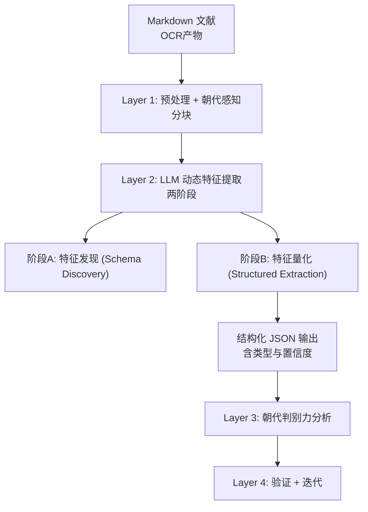
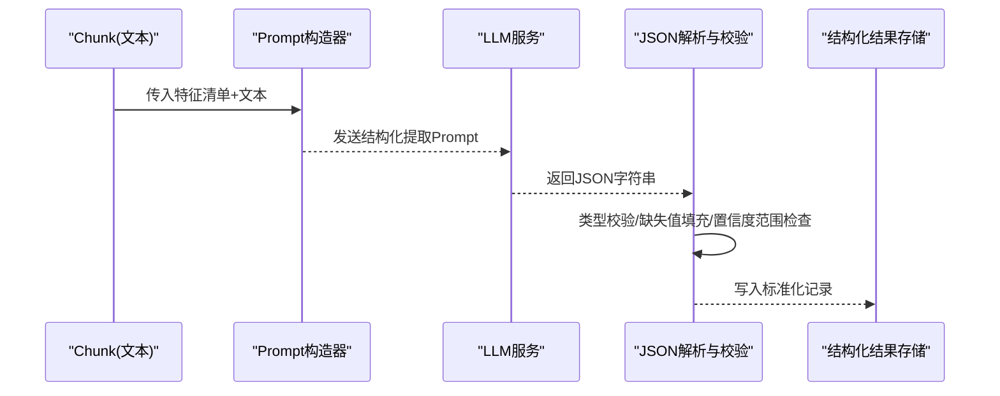
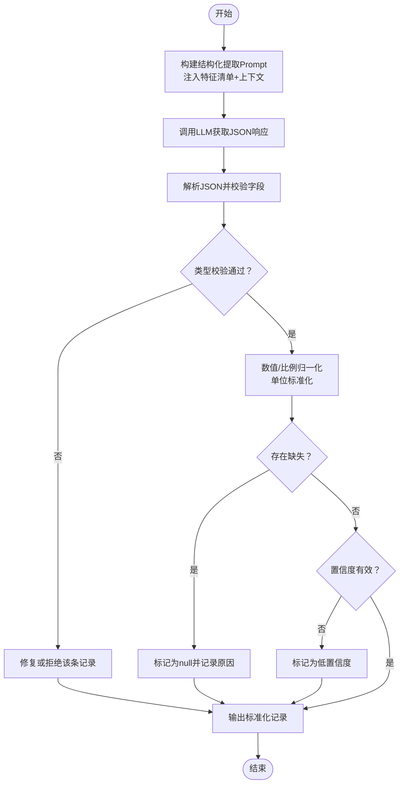
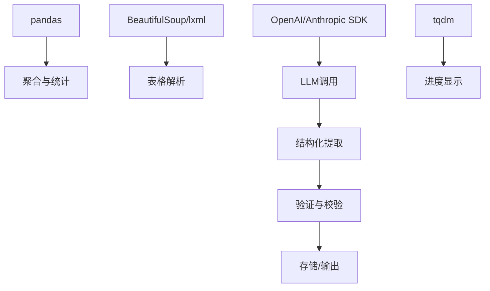

# 阶段B：结构化特征量化

<cite>
**本文引用的文件**   
- [dynasty_feature_pipeline.ipynb](file://dynasty_feature_pipeline.ipynb)
- [wuziyin.md](file://data/wuziyin.md)
- [图像与装饰_北朝墓葬的生死表象_gq_part2.pdf_by_PaddleOCR-VL-1.6.md](file://data/图像与装饰/图像与装饰_北朝墓葬的生死表象_gq_part2.pdf_by_PaddleOCR-VL-1.6.md)
</cite>

## 目录
1. [引言](#引言)
2. [项目结构](#项目结构)
3. [核心组件](#核心组件)
4. [架构总览](#架构总览)
5. [详细组件分析](#详细组件分析)
6. [依赖关系分析](#依赖关系分析)
7. [性能考虑](#性能考虑)
8. [故障排查指南](#故障排查指南)
9. [结论](#结论)
10. [附录](#附录)

## 引言
本文件聚焦“阶段B：结构化特征量化”的技术实现。在阶段A通过LLM从考古学文本中动态发现可量化特征（如数量、比例、类别等）后，阶段B的任务是依据已发现的“特征词典”，将非结构化文本转换为标准化的数值/类别数据，并输出严格约束的JSON结果。重点包括：
- 结构化提取的Prompt设计策略：特征清单的动态生成、JSON输出格式规范与类型约束
- extract_structured_features函数的实现逻辑：多类型特征处理（numeric、categorical、boolean、ratio）、缺失值处理与置信度评估
- 复杂表述的标准化提取示例：如“坛钮占比0.41”“玉印31枚”等
- 错误处理机制、数据验证规则与性能优化建议

## 项目结构
仓库包含一个Jupyter Notebook作为Pipeline主入口，以及若干经过OCR处理的Markdown文献样本。Notebook定义了预处理、分块、LLM调用接口、阶段A特征发现与批处理聚合等关键流程；阶段B的结构化提取逻辑在Notebook中以模板和函数形式给出。

图表来源
- [dynasty_feature_pipeline.ipynb:33-48](file://dynasty_feature_pipeline.ipynb#L33-L48)

章节来源
- [dynasty_feature_pipeline.ipynb:1-208](file://dynasty_feature_pipeline.ipynb#L1-L208)

## 核心组件
- 朝代感知分块器：按语义段落与朝代关键词切分，支持表格与叙述两类chunk
- LLM统一调用接口：封装OpenAI/Anthropic后端，提供系统提示与温度控制
- 阶段A特征发现：基于自由Prompt让LLM自然发现特征，输出带类型、证据与置信度的候选特征
- 阶段B结构化提取：以阶段A产出的特征词典为输入，对每个chunk进行规范化数值/类别抽取，输出强约束JSON
- 批处理与词典聚合：批量扫描、分块、发现与聚合，形成全局特征词典

章节来源
- [dynasty_feature_pipeline.ipynb:352-454](file://dynasty_feature_pipeline.ipynb#L352-L454)
- [dynasty_feature_pipeline.ipynb:492-543](file://dynasty_feature_pipeline.ipynb#L492-L543)
- [dynasty_feature_pipeline.ipynb:548-618](file://dynasty_feature_pipeline.ipynb#L548-L618)
- [dynasty_feature_pipeline.ipynb:656-699](file://dynasty_feature_pipeline.ipynb#L656-L699)

## 架构总览
阶段B的核心在于“以词典驱动的结构化抽取”。其输入为阶段A生成的特征清单（含名称、类型、朝代信号、证据样例），输出为每条特征的标准化值与置信度。整体流程如下：

图表来源
- [dynasty_feature_pipeline.ipynb:108-131](file://dynasty_feature_pipeline.ipynb#L108-L131)
- [dynasty_feature_pipeline.ipynb:548-618](file://dynasty_feature_pipeline.ipynb#L548-L618)

## 详细组件分析

### 结构化提取的Prompt设计策略
- 特征清单动态生成：阶段A输出的特征集合（名称、类型、朝代信号、证据）被拼接入Prompt，使模型仅针对已知特征进行抽取，避免发散
- JSON输出格式规范：要求模型仅输出JSON，字段包含各特征的值、类型、置信度等，便于后续解析与校验
- 类型约束：明确限定feature_type为 numeric | categorical | boolean | ratio，并在Prompt中强调单位与取值范围（如ratio∈[0,1]）
- 上下文注入：将推断的朝代、区域、内容类型等信息注入Prompt，提升抽取准确性

章节来源
- [dynasty_feature_pipeline.ipynb:108-131](file://dynasty_feature_pipeline.ipynb#L108-L131)
- [dynasty_feature_pipeline.ipynb:548-618](file://dynasty_feature_pipeline.ipynb#L548-L618)

### extract_structured_features 函数实现逻辑
该函数负责将阶段A的特征清单应用于具体文本，完成以下任务：
- 多类型特征处理
  - numeric：整数或浮点数，需保留单位信息（如“枚”“平方米”）
  - categorical：离散类别（如“土坑墓/砖室墓/石室墓”）
  - boolean：是否存在某类器物或现象（如“是否出现壁画”）
  - ratio：比例值，归一化到[0,1]区间，必要时由分子/分母计算得出
- 缺失值处理
  - 若文本未提及某特征，则置为null或默认占位，并标注缺失原因
  - 对于ratio，若无法计算，则标记为缺失而非强行估算
- 置信度评估
  - 由LLM自评置信度（0.0-1.0），结合文本证据强度与表达确定性
  - 低置信度条目进入人工复核队列

图表来源
- [dynasty_feature_pipeline.ipynb:548-618](file://dynasty_feature_pipeline.ipynb#L548-L618)

章节来源
- [dynasty_feature_pipeline.ipynb:548-618](file://dynasty_feature_pipeline.ipynb#L548-L618)

### 复杂考古学描述的标准化提取示例
- “玉印31枚”
  - 特征名：玉印数量
  - 类型：numeric
  - 值：31
  - 单位：枚
  - 置信度：高（明确计数）
- “坛钮占比0.41”
  - 特征名：坛钮占比
  - 类型：ratio
  - 值：0.41
  - 范围校验：∈[0,1]
  - 置信度：高（直接给出比例）
- “绝大部分墓葬中只随葬1枚无字印”
  - 特征名：单墓无字印数量
  - 类型：numeric
  - 值：1
  - 置信度：中高（“绝大部分”带来轻微不确定性）
- “陶礼器在一些陪葬品稍多的墓葬中有所发现”
  - 特征名：是否出土陶礼器
  - 类型：boolean
  - 值：true
  - 置信度：中（定性描述，缺乏精确性）

以上示例展示了如何从自然语言中提取并标准化为结构化字段，确保类型一致、单位明确、置信度可追溯。

章节来源
- [wuziyin.md:12-14](file://data/wuziyin.md#L12-L14)
- [图像与装饰_北朝墓葬的生死表象_gq_part2.pdf_by_PaddleOCR-VL-1.6.md:559-618](file://data/图像与装饰/图像与装饰_北朝墓葬的生死表象_gq_part2.pdf_by_PaddleOCR-VL-1.6.md#L559-L618)

### 数据验证规则
- 类型约束
  - numeric：必须为数字，允许负数（如尺寸差值）或零
  - categorical：必须在预定义枚举集内
  - boolean：仅允许true/false
  - ratio：必须∈[0,1]
- 单位一致性
  - 长度统一为厘米或米（根据领域约定）
  - 面积统一为平方米
  - 数量统一为“枚/座/件”等
- 缺失值策略
  - 显式标记为null，并附带缺失原因（如“未提及”“无法计算”）
- 置信度阈值
  - 低于阈值的条目进入人工复核队列

章节来源
- [dynasty_feature_pipeline.ipynb:548-618](file://dynasty_feature_pipeline.ipynb#L548-L618)

### 错误处理机制
- JSON解析失败：捕获异常并记录原始响应，尝试正则提取JSON块
- 类型不匹配：回退至默认值或标记为缺失，记录错误详情
- 置信度异常：超出[0,1]范围时修正或标记为低置信度
- 网络/后端错误：重试策略与降级方案（切换后端或降低temperature）

章节来源
- [dynasty_feature_pipeline.ipynb:548-618](file://dynasty_feature_pipeline.ipynb#L548-L618)

## 依赖关系分析
- 外部依赖
  - pandas：数据处理与聚合
  - BeautifulSoup/lxml：HTML表格解析
  - OpenAI/Anthropic SDK：LLM调用
  - tqdm：进度显示
- 内部依赖
  - 分块器 → LLM接口 → 结构化提取 → 验证与存储

图表来源
- [dynasty_feature_pipeline.ipynb:258-280](file://dynasty_feature_pipeline.ipynb#L258-L280)
- [dynasty_feature_pipeline.ipynb:492-543](file://dynasty_feature_pipeline.ipynb#L492-L543)

章节来源
- [dynasty_feature_pipeline.ipynb:258-280](file://dynasty_feature_pipeline.ipynb#L258-L280)
- [dynasty_feature_pipeline.ipynb:492-543](file://dynasty_feature_pipeline.ipynb#L492-L543)

## 性能考虑
- 并行化
  - 对多个chunk并发调用LLM（注意API速率限制）
  - 使用进程池或异步IO提高吞吐
- 缓存与去重
  - 对相同文本片段的结果进行缓存，避免重复调用
  - 对特征词典进行增量更新，减少不必要的重新发现
- 文本截断与窗口管理
  - 对过长表格或段落进行合理截断，控制token消耗
- 模型参数调优
  - 降低temperature以提升稳定性
  - 使用function calling或JSON模式（若可用）增强输出一致性

[本节为通用指导，无需特定文件引用]

## 故障排查指南
- 常见问题
  - JSON解析失败：检查LLM返回是否包含完整JSON块，必要时增加容错正则
  - 类型不匹配：确认Prompt中的类型约束是否清晰，必要时增加few-shot示例
  - 置信度过低：调整Prompt强调证据强度，或引入二次校验步骤
- 调试建议
  - 打印中间结果（Prompt、响应、解析后的JSON）
  - 记录错误日志与原始响应，便于回溯
  - 对低置信度条目进行抽样人工复核

章节来源
- [dynasty_feature_pipeline.ipynb:548-618](file://dynasty_feature_pipeline.ipynb#L548-L618)

## 结论
阶段B通过“以词典驱动的结构化提取”，将考古学文本中的复杂表述转化为标准化、可比较的数据。其关键在于：
- 明确的类型约束与JSON规范
- 完善的缺失值与置信度处理
- 稳健的错误处理与验证机制
- 面向性能的并行与缓存策略

该流程为后续的朝代判别力分析与交叉验证奠定了高质量的数据基础。

[本节为总结，无需特定文件引用]

## 附录
- 典型特征类型与示例
  - numeric：玉印数量=31（枚）
  - ratio：坛钮占比=0.41
  - categorical：墓葬形制=砖室墓
  - boolean：是否出现壁画=true
- 数据来源示例
  - 无字印论文中的数量与比例表述
  - 北朝墓葬研究中的方位与组合描述

章节来源
- [wuziyin.md:12-14](file://data/wuziyin.md#L12-L14)
- [图像与装饰_北朝墓葬的生死表象_gq_part2.pdf_by_PaddleOCR-VL-1.6.md:559-618](file://data/图像与装饰/图像与装饰_北朝墓葬的生死表象_gq_part2.pdf_by_PaddleOCR-VL-1.6.md#L559-L618)