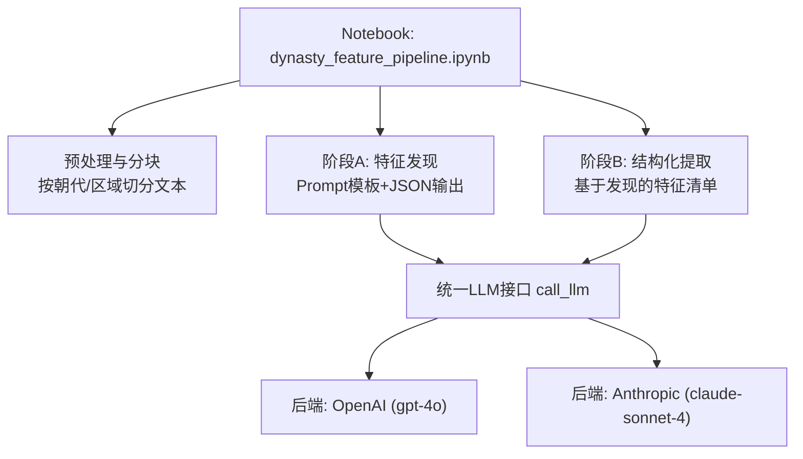
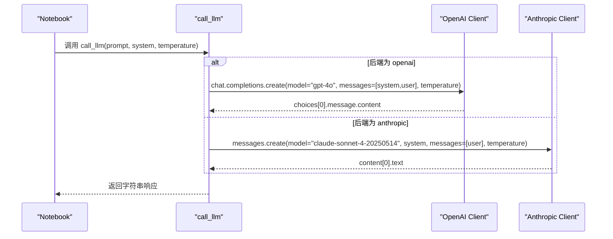
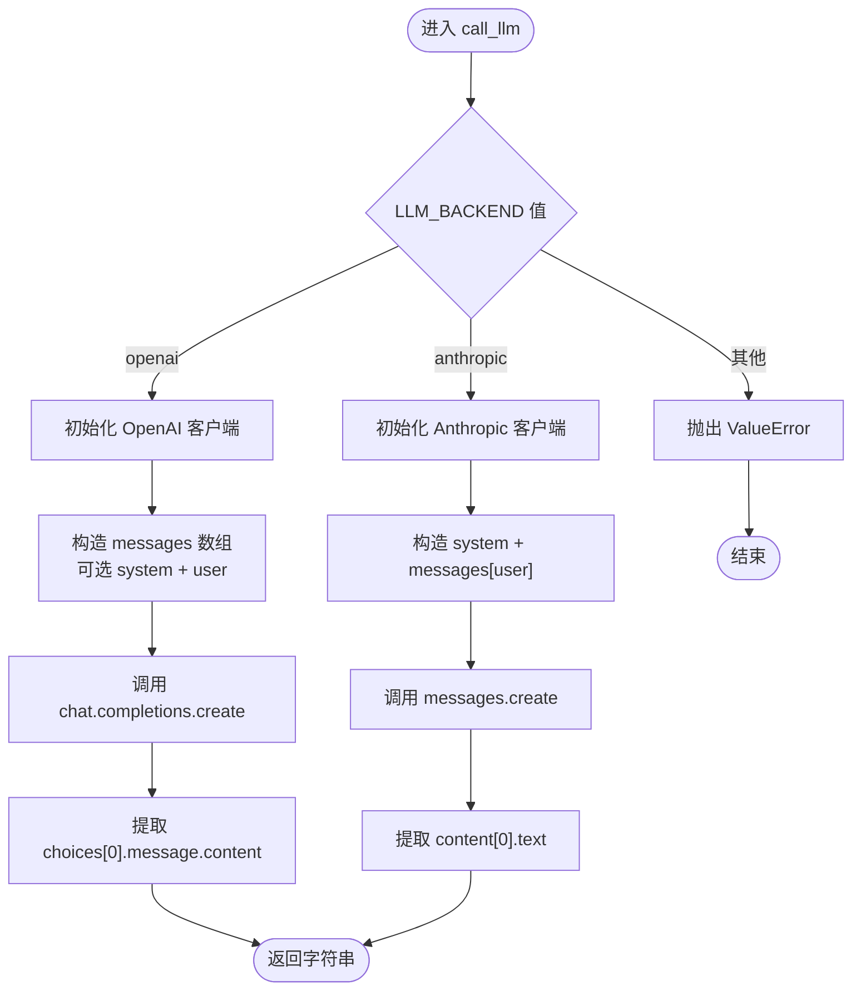
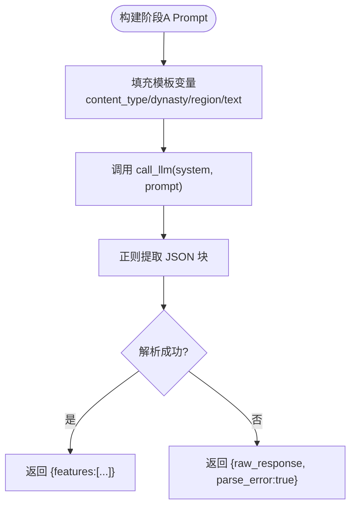
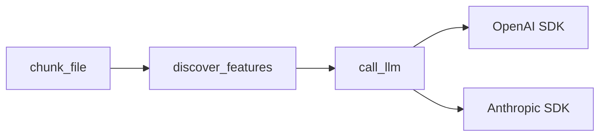

# 统一LLM调用接口

<cite>
**本文引用的文件**
- [dynasty_feature_pipeline.ipynb](file://dynasty_feature_pipeline.ipynb)
</cite>

## 目录
1. [简介](#简介)
2. [项目结构](#项目结构)
3. [核心组件](#核心组件)
4. [架构总览](#架构总览)
5. [详细组件分析](#详细组件分析)
6. [依赖关系分析](#依赖关系分析)
7. [性能与参数调优](#性能与参数调优)
8. [故障排除指南](#故障排除指南)
9. [结论](#结论)

## 简介
本文件聚焦于统一LLM调用接口 call_llm 的实现，解析其如何在 OpenAI 与 Anthropic 双后端之间切换，涵盖：
- API 客户端初始化
- 消息格式转换（OpenAI 的 messages 数组 vs Anthropic 的 system + messages）
- 响应内容提取
- 错误处理机制
- temperature 对特征发现质量的影响
- 模型选择（gpt-4o 与 claude-sonnet-4）的特点与适用场景
- 配置示例与故障排除（API 密钥、网络超时、重试机制）

## 项目结构
仓库包含一个 Jupyter Notebook，定义了考古学文献特征提取 Pipeline，其中 Layer 2 使用 LLM 进行动态特征发现与结构化提取。call_llm 即位于该 Notebook 中，作为统一的 LLM 调用入口。

图表来源
- [dynasty_feature_pipeline.ipynb:498-542](file://dynasty_feature_pipeline.ipynb#L498-L542)
- [dynasty_feature_pipeline.ipynb:548-618](file://dynasty_feature_pipeline.ipynb#L548-L618)

章节来源
- [dynasty_feature_pipeline.ipynb:1-100](file://dynasty_feature_pipeline.ipynb#L1-L100)
- [dynasty_feature_pipeline.ipynb:498-542](file://dynasty_feature_pipeline.ipynb#L498-L542)

## 核心组件
- 统一接口 call_llm：根据 LLM_BACKEND 在 OpenAI 与 Anthropic 间切换，封装消息构造、调用与响应解析。
- 阶段A提示词：SYSTEM_PROMPT_DISCOVERY 与 DISCOVERY_PROMPT_TEMPLATE，驱动 LLM 从文本中自然发现可量化特征并输出 JSON。
- 数据分块与元信息：将输入文档切分为 chunk，附带推断的朝代与区域，用于构建上下文丰富的 prompt。

章节来源
- [dynasty_feature_pipeline.ipynb:498-542](file://dynasty_feature_pipeline.ipynb#L498-L542)
- [dynasty_feature_pipeline.ipynb:548-618](file://dynasty_feature_pipeline.ipynb#L548-L618)
- [dynasty_feature_pipeline.ipynb:360-454](file://dynasty_feature_pipeline.ipynb#L360-L454)

## 架构总览
下图展示了从 Notebook 到 LLM 后端的整体流程，包括后端切换、消息格式适配与响应解析。

图表来源
- [dynasty_feature_pipeline.ipynb:498-542](file://dynasty_feature_pipeline.ipynb#L498-L542)

## 详细组件分析

### 统一接口 call_llm 实现要点
- 后端切换
  - 通过全局变量 LLM_BACKEND 控制，支持 "openai" 与 "anthropic"。
  - 未知后端会抛出异常，便于快速定位配置问题。
- 客户端初始化
  - OpenAI：使用默认环境变量加载 API Key，实例化 OpenAI 客户端。
  - Anthropic：使用默认环境变量加载 API Key，实例化 anthropic.Anthropic 客户端。
- 消息格式转换
  - OpenAI：messages 数组，若提供 system，则插入 role=system 的消息；否则仅 user 消息。
  - Anthropic：使用独立的 system 字段与 messages 数组（role=user）。
- 响应内容提取
  - OpenAI：取 choices[0].message.content。
  - Anthropic：取 content[0].text。
- 错误处理
  - 当前实现未显式捕获网络或认证异常，上层需结合重试与日志策略。
  - 未知后端直接抛出 ValueError，避免静默失败。

图表来源
- [dynasty_feature_pipeline.ipynb:498-542](file://dynasty_feature_pipeline.ipynb#L498-L542)

章节来源
- [dynasty_feature_pipeline.ipynb:498-542](file://dynasty_feature_pipeline.ipynb#L498-L542)

### 阶段A提示词与JSON解析
- SYSTEM_PROMPT_DISCOVERY：设定角色与任务目标，强调“不预设类别”“关注可量化特征”“标注区分度与依据”。
- DISCOVERY_PROMPT_TEMPLATE：将 chunk 的 content_type、inferred_dynasty、inferred_region 与 text 注入 prompt，要求输出 JSON，包含 features 列表及每个特征的属性。
- JSON 解析：
  - 尝试用正则提取第一个 JSON 块，再 json.loads 解析。
  - 若解析失败，返回包含 raw_response 与 parse_error 标记的结构，便于后续人工复核或二次尝试。

图表来源
- [dynasty_feature_pipeline.ipynb:548-618](file://dynasty_feature_pipeline.ipynb#L548-L618)

章节来源
- [dynasty_feature_pipeline.ipynb:548-618](file://dynasty_feature_pipeline.ipynb#L548-L618)

### 数据分块与上下文注入
- 分块策略：优先提取表格作为独立 chunk；叙述文本按 markdown 标题分段，去除 HTML 标签，限制长度以避免超出上下文窗口。
- 元信息：每个 chunk 附带 inferred_dynasty 与 inferred_region，用于增强 prompt 的领域与时间背景。
- 这些上下文被注入到 DISCOVERY_PROMPT_TEMPLATE，提升 LLM 对考古学术语与时期的理解。

章节来源
- [dynasty_feature_pipeline.ipynb:360-454](file://dynasty_feature_pipeline.ipynb#L360-L454)
- [dynasty_feature_pipeline.ipynb:548-618](file://dynasty_feature_pipeline.ipynb#L548-L618)

## 依赖关系分析
- 运行时依赖
  - OpenAI：需要安装 openai 包，并通过环境变量设置 API Key。
  - Anthropic：需要安装 anthropic 包，并通过环境变量设置 API Key。
- 内部依赖
  - call_llm 被 discover_features 调用，后者负责组装系统提示与用户提示，并解析 JSON。
  - 分块器 chunk_file 生成 Chunk 对象，供阶段A使用。

图表来源
- [dynasty_feature_pipeline.ipynb:360-454](file://dynasty_feature_pipeline.ipynb#L360-L454)
- [dynasty_feature_pipeline.ipynb:548-618](file://dynasty_feature_pipeline.ipynb#L548-L618)
- [dynasty_feature_pipeline.ipynb:498-542](file://dynasty_feature_pipeline.ipynb#L498-L542)

章节来源
- [dynasty_feature_pipeline.ipynb:360-454](file://dynasty_feature_pipeline.ipynb#L360-L454)
- [dynasty_feature_pipeline.ipynb:498-542](file://dynasty_feature_pipeline.ipynb#L498-L542)
- [dynasty_feature_pipeline.ipynb:548-618](file://dynasty_feature_pipeline.ipynb#L548-L618)

## 性能与参数调优

### temperature 对特征发现质量的影响
- 低温度（如 0.1）：输出更稳定、重复性高，适合结构化抽取与一致性要求高的任务。
- 中等温度（如 0.3–0.7）：在保持一定一致性的同时，允许更多样化的表达，有助于发现新特征。
- 高温度（>0.7）：创造性更强，但可能引入噪声或不一致的 JSON 结构，增加解析失败率。
- 建议：
  - 阶段A（特征发现）：temperature 0.1–0.3，兼顾稳定性与多样性。
  - 阶段B（结构化提取）：temperature 0.0–0.2，确保严格遵循 schema。

章节来源
- [dynasty_feature_pipeline.ipynb:498-542](file://dynasty_feature_pipeline.ipynb#L498-L542)
- [dynasty_feature_pipeline.ipynb:548-618](file://dynasty_feature_pipeline.ipynb#L548-L618)

### 模型选择：gpt-4o vs claude-sonnet-4
- gpt-4o（OpenAI）
  - 特点：多模态能力强、指令跟随好、生态完善。
  - 适用：复杂推理、跨语言/术语理解、需要强指令遵循的场景。
- claude-sonnet-4（Anthropic）
  - 特点：长上下文友好、安全对齐较好、输出稳定。
  - 适用：长文档处理、需要稳健输出的结构化抽取任务。
- 选择建议：
  - 若追求更强的通用能力与生态集成，选 gpt-4o。
  - 若注重长上下文与输出稳定性，选 claude-sonnet-4。
  - 可通过 A/B 测试对比不同模型的 JSON 解析成功率与特征召回率。

章节来源
- [dynasty_feature_pipeline.ipynb:498-542](file://dynasty_feature_pipeline.ipynb#L498-L542)

## 故障排除指南

### API 密钥设置
- OpenAI
  - 环境变量：OPENAI_API_KEY
  - 验证方法：在 Notebook 中执行一次简单调用，确认无认证错误。
- Anthropic
  - 环境变量：ANTHROPIC_API_KEY
  - 验证方法：同上，确认 messages.create 可正常返回。

章节来源
- [dynasty_feature_pipeline.ipynb:498-542](file://dynasty_feature_pipeline.ipynb#L498-L542)

### 网络超时与重试机制
- 现状
  - 当前 call_llm 未内置超时与重试逻辑。
- 建议改进
  - 添加请求级超时参数（如 connect_timeout、read_timeout），并在异常时触发指数退避重试。
  - 针对速率限制（429）与临时网络错误（5xx）进行重试，记录失败样本以便分析。
  - 在 Notebook 中封装带重试的调用函数，保留原始响应与错误堆栈。

章节来源
- [dynasty_feature_pipeline.ipynb:498-542](file://dynasty_feature_pipeline.ipynb#L498-L542)

### JSON 解析失败
- 现象
  - 正则未匹配或 json.loads 报错，返回 parse_error:true。
- 排查步骤
  - 检查 LLM 是否按要求输出 JSON，必要时在 prompt 中加入“只输出 JSON，不要其他内容”的约束。
  - 降低 temperature，提高稳定性。
  - 对 raw_response 做二次清洗（如修复缺失括号、转义字符等）。
  - 记录失败样例，迭代优化提示词与分块策略。

章节来源
- [dynasty_feature_pipeline.ipynb:548-618](file://dynasty_feature_pipeline.ipynb#L548-L618)

### 后端切换问题
- 现象
  - 抛出 ValueError，提示未知 backend。
- 排查步骤
  - 确认 LLM_BACKEND 值为 "openai" 或 "anthropic"。
  - 检查对应 SDK 是否已安装，环境变量是否正确设置。
  - 分别测试两个后端，定位具体失败点。

章节来源
- [dynasty_feature_pipeline.ipynb:498-542](file://dynasty_feature_pipeline.ipynb#L498-L542)

## 结论
call_llm 提供了简洁而强大的统一 LLM 调用接口，屏蔽了 OpenAI 与 Anthropic 的差异，使上层流程（尤其是阶段A的特征发现）无需关心后端细节。配合合理的 temperature 与模型选择，可在保证输出稳定性的同时提升特征发现的质量。建议在工程化落地时补充超时、重试与健壮的错误处理，进一步提升鲁棒性与可观测性。