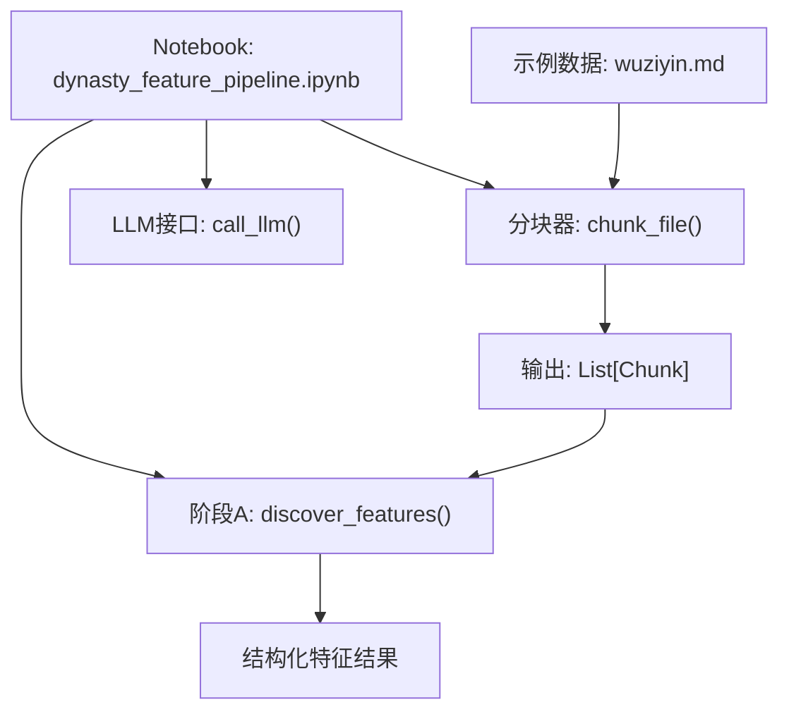
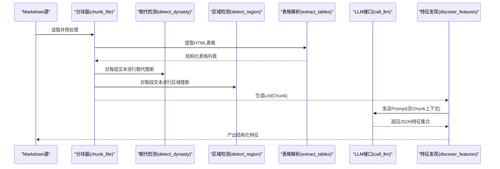
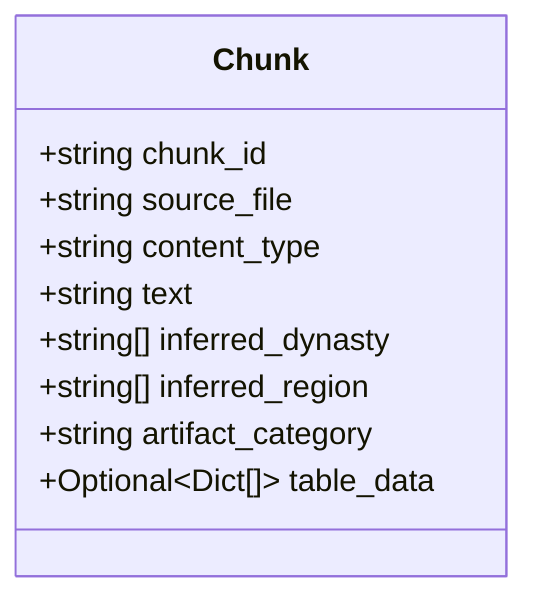
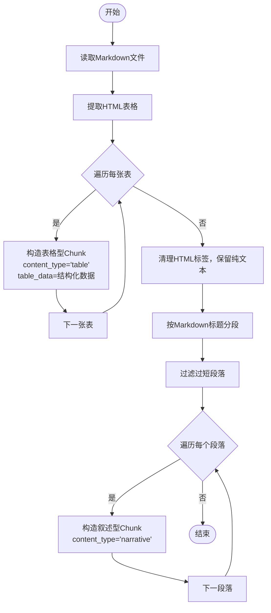
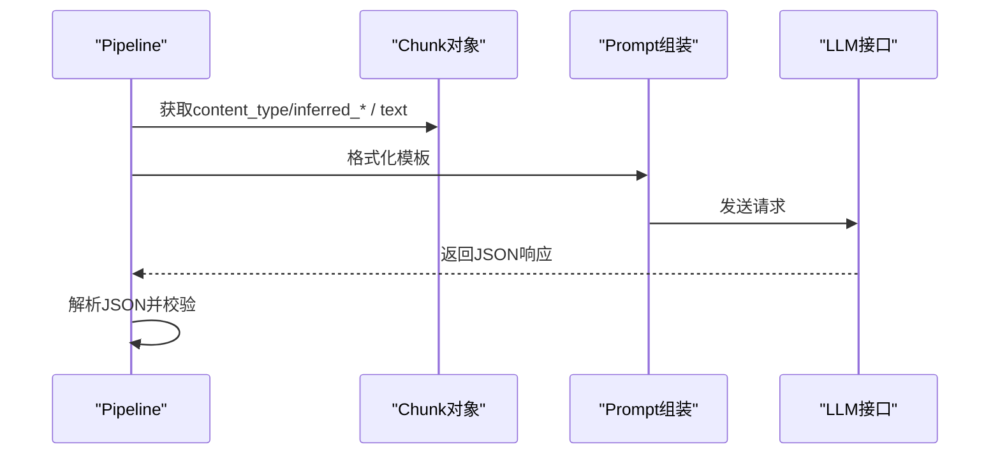

# Chunk数据结构设计

<cite>
**本文引用的文件**   
- [dynasty_feature_pipeline.ipynb](file://dynasty_feature_pipeline.ipynb)
- [wuziyin.md](file://data/wuziyin.md)
</cite>

## 目录
1. [引言](#引言)
2. [项目结构](#项目结构)
3. [核心组件](#核心组件)
4. [架构总览](#架构总览)
5. [详细组件分析](#详细组件分析)
6. [依赖关系分析](#依赖关系分析)
7. [性能与可扩展性](#性能与可扩展性)
8. [故障排查指南](#故障排查指南)
9. [结论](#结论)
10. [附录：实例化示例与使用模式](#附录实例化示例与使用模式)

## 引言
本文件聚焦于“Chunk数据类”的设计与实现，系统阐述其设计理念、字段语义、类型约束以及为何采用 dataclass 而非普通字典。该设计服务于考古学文献的朝代感知分块与后续LLM动态特征提取工作流，为特征发现与量化提供稳定、可追溯的数据载体。

## 项目结构
本项目以Jupyter Notebook为核心编排，包含：
- 数据处理与分块逻辑（含Chunk定义）
- LLM调用封装与两阶段特征提取流程
- 示例数据（Markdown格式，含表格与叙述文本）

图表来源
- [dynasty_feature_pipeline.ipynb:360-454](file://dynasty_feature_pipeline.ipynb#L360-L454)
- [dynasty_feature_pipeline.ipynb:498-542](file://dynasty_feature_pipeline.ipynb#L498-L542)
- [dynasty_feature_pipeline.ipynb:595-618](file://dynasty_feature_pipeline.ipynb#L595-L618)
- [wuziyin.md:1-155](file://data/wuziyin.md#L1-L155)

章节来源
- [dynasty_feature_pipeline.ipynb:1-200](file://dynasty_feature_pipeline.ipynb#L1-L200)
- [wuziyin.md:1-155](file://data/wuziyin.md#L1-L155)

## 核心组件
- Chunk数据类：承载单个语义单元（段落或表格）及其上下文元信息
- 朝代/区域检测：基于关键词匹配推断时期与地域
- 表格解析：从HTML表格抽取结构化数据
- 分块器：将Markdown文档切分为“表格型”和“叙述型”两类chunk
- LLM接口与两阶段特征提取：用于发现与量化特征

章节来源
- [dynasty_feature_pipeline.ipynb:360-454](file://dynasty_feature_pipeline.ipynb#L360-L454)
- [dynasty_feature_pipeline.ipynb:498-542](file://dynasty_feature_pipeline.ipynb#L498-L542)
- [dynasty_feature_pipeline.ipynb:595-618](file://dynasty_feature_pipeline.ipynb#L595-L618)

## 架构总览
下图展示从原始Markdown到结构化特征的端到端流程，其中Chunk作为关键中间表示贯穿始终。

图表来源
- [dynasty_feature_pipeline.ipynb:360-454](file://dynasty_feature_pipeline.ipynb#L360-L454)
- [dynasty_feature_pipeline.ipynb:498-542](file://dynasty_feature_pipeline.ipynb#L498-L542)
- [dynasty_feature_pipeline.ipynb:595-618](file://dynasty_feature_pipeline.ipynb#L595-L618)

## 详细组件分析

### Chunk数据类设计与字段语义
Chunk是Pipeline中的最小处理单元，代表一个语义完整的片段（一段叙述或一张表格）。其字段如下：

- chunk_id: 唯一标识符，用于追踪每个chunk的来源与顺序
- source_file: 来源文件名，便于溯源与审计
- content_type: 内容类型，枚举值为“table”或“narrative”，指示该chunk是表格还是叙述文本
- text: 文本内容主体，供LLM分析与人类阅读
- inferred_dynasty: 推断朝代列表，由关键词匹配得到，支持多标签（如“东汉”“魏晋”）
- inferred_region: 推断区域列表，由关键词匹配得到，支持多标签（如“山东”“京津冀”）
- artifact_category: 器物类别，当前为空字符串占位，未来可用于更细粒度的分类（如“印章”“陶器”等）
- table_data: 表格数据，当content_type为“table”时填充，类型为可选的结构化列表；叙述型chunk中为None

选择dataclass的原因
- 强类型与可读性：通过类型注解明确字段含义与约束，降低误用风险
- 默认值与工厂函数：使用field(default_factory=list)确保可变字段安全初始化
- 可序列化与调试友好：自动生成__init__/__repr__等方法，便于日志记录与持久化
- 扩展性与契约清晰：新增字段不影响已有代码，且IDE能给出提示与校验
- 与后续工作流契合：在LLM两阶段提取、统计聚合、可视化等环节，稳定的对象模型比自由字典更易维护

章节来源
- [dynasty_feature_pipeline.ipynb:360-371](file://dynasty_feature_pipeline.ipynb#L360-L371)
- [dynasty_feature_pipeline.ipynb:373-392](file://dynasty_feature_pipeline.ipynb#L373-L392)
- [dynasty_feature_pipeline.ipynb:395-407](file://dynasty_feature_pipeline.ipynb#L395-L407)
- [dynasty_feature_pipeline.ipynb:410-450](file://dynasty_feature_pipeline.ipynb#L410-L450)

#### 类图（代码级映射）

图表来源
- [dynasty_feature_pipeline.ipynb:360-371](file://dynasty_feature_pipeline.ipynb#L360-L371)

### 朝代与区域检测
- 朝代检测：遍历预定义的DYNASTY_KEYWORDS，若文本中出现任一关键词则加入推断列表
- 区域检测：同理，基于REGION_KEYWORDS进行匹配
- 两者均返回字符串列表，允许模糊或多标签标注，适配过渡期与复合语境

章节来源
- [dynasty_feature_pipeline.ipynb:316-346](file://dynasty_feature_pipeline.ipynb#L316-L346)
- [dynasty_feature_pipeline.ipynb:373-392](file://dynasty_feature_pipeline.ipynb#L373-L392)

### 表格解析与分块策略
- 表格解析：使用BeautifulSoup解析HTML表格，提取表头与行数据，形成结构化列表
- 分块策略：
  - 表格型chunk：每张表独立为一个chunk，content_type="table"，text为表格字符串截断，table_data为结构化数据
  - 叙述型chunk：按Markdown标题分段，过滤过短段落，content_type="narrative"，text为正文截断
- 分块不采用固定长度，而是依据语义边界与朝代关键词，保证后续特征提取的连贯性

章节来源
- [dynasty_feature_pipeline.ipynb:395-407](file://dynasty_feature_pipeline.ipynb#L395-L407)
- [dynasty_feature_pipeline.ipynb:410-450](file://dynasty_feature_pipeline.ipynb#L410-L450)

#### 流程图（分块算法）

图表来源
- [dynasty_feature_pipeline.ipynb:410-450](file://dynasty_feature_pipeline.ipynb#L410-L450)

### LLM接口与两阶段特征提取
- 统一接口：call_llm支持OpenAI与Anthropic后端，屏蔽差异
- 阶段A（特征发现）：discover_features根据Chunk上下文构建Prompt，请求LLM自然发现可量化特征，返回JSON
- 阶段B（特征量化）：基于阶段A发现的特征清单，对每个Chunk做结构化数值/类别提取（本仓库已预留接口与模板）

章节来源
- [dynasty_feature_pipeline.ipynb:498-542](file://dynasty_feature_pipeline.ipynb#L498-L542)
- [dynasty_feature_pipeline.ipynb:557-618](file://dynasty_feature_pipeline.ipynb#L557-L618)

#### 序列图（阶段A调用）

图表来源
- [dynasty_feature_pipeline.ipynb:595-618](file://dynasty_feature_pipeline.ipynb#L595-L618)
- [dynasty_feature_pipeline.ipynb:498-542](file://dynasty_feature_pipeline.ipynb#L498-L542)

## 依赖关系分析
- 外部库：pandas、BeautifulSoup、re、json、typing、tqdm、openai/anthropic（按需）
- 内部模块：分块器、检测器、LLM接口、特征发现函数
- 数据流向：Markdown → 分块器 → Chunk列表 → LLM → 结构化特征

图表来源
- [dynasty_feature_pipeline.ipynb:360-454](file://dynasty_feature_pipeline.ipynb#L360-L454)
- [dynasty_feature_pipeline.ipynb:595-618](file://dynasty_feature_pipeline.ipynb#L595-L618)

章节来源
- [dynasty_feature_pipeline.ipynb:258-280](file://dynasty_feature_pipeline.ipynb#L258-L280)
- [dynasty_feature_pipeline.ipynb:316-346](file://dynasty_feature_pipeline.ipynb#L316-L346)

## 性能与可扩展性
- 分块复杂度：O(N)扫描文本，正则分割与HTML解析开销可控
- 表格数据：仅保存必要结构，避免冗余；长表格文本截断控制内存占用
- 可扩展点：
  - 新增artifact_category枚举与自动分类器
  - 增加置信度字段（LLM自评），辅助人工复核
  - 引入缓存机制（重复chunk跳过LLM调用）

[本节为通用指导，不涉及具体文件分析]

## 故障排查指南
- JSON解析失败：discover_features中对LLM返回进行正则提取与异常捕获，建议检查网络与API Key配置
- 空特征返回：确认Prompt模板是否包含足够的上下文（content_type、inferred_*、text）
- 表格未识别：检查Markdown中HTML表格是否完整闭合，必要时调整解析规则
- 朝代/区域未检出：核对关键词词典覆盖度，补充领域术语

章节来源
- [dynasty_feature_pipeline.ipynb:595-618](file://dynasty_feature_pipeline.ipynb#L595-L618)
- [dynasty_feature_pipeline.ipynb:498-542](file://dynasty_feature_pipeline.ipynb#L498-L542)

## 结论
Chunk数据类以强类型、可追溯、可扩展为核心目标，支撑了从原始文献到结构化特征的完整流水线。相比普通字典，dataclass提供了更好的契约与工具链集成能力，有利于后续的特征发现、量化、统计与可视化。

[本节为总结性内容，不涉及具体文件分析]

## 附录：实例化示例与使用模式
以下示例展示如何创建不同场景下的Chunk对象，并说明各字段的典型取值与用途。为避免直接粘贴代码，此处以路径引用方式呈现。

- 表格型Chunk（来自某篇论文的统计表）
  - 参考路径：[dynasty_feature_pipeline.ipynb:410-428](file://dynasty_feature_pipeline.ipynb#L410-L428)
  - 关键字段：
    - content_type = "table"
    - table_data = 结构化表格（headers + rows）
    - text = 表格字符串截断
    - inferred_dynasty / inferred_region = 由detect_*函数推断
    - artifact_category = 可根据上下文填写（如“印章”）

- 叙述型Chunk（来自某篇论文的章节段落）
  - 参考路径：[dynasty_feature_pipeline.ipynb:430-449](file://dynasty_feature_pipeline.ipynb#L430-L449)
  - 关键字段：
    - content_type = "narrative"
    - table_data = None
    - text = 段落正文截断
    - inferred_dynasty / inferred_region = 由detect_*函数推断
    - artifact_category = 可为空或根据主题设置

- 示例数据对照
  - 示例文件：[wuziyin.md:1-155](file://data/wuziyin.md#L1-L155)
  - 该文件包含大量表格与叙述段落，适合验证分块器与Chunk字段填充的正确性

- 使用模式建议
  - 批量处理：process_all_files收集所有Markdown文件，生成List[Chunk]
  - 单样本测试：选取一个叙述型chunk进行discover_features试运行
  - 迭代优化：根据LLM返回质量调整Prompt与分块粒度

章节来源
- [dynasty_feature_pipeline.ipynb:410-449](file://dynasty_feature_pipeline.ipynb#L410-L449)
- [wuziyin.md:1-155](file://data/wuziyin.md#L1-L155)