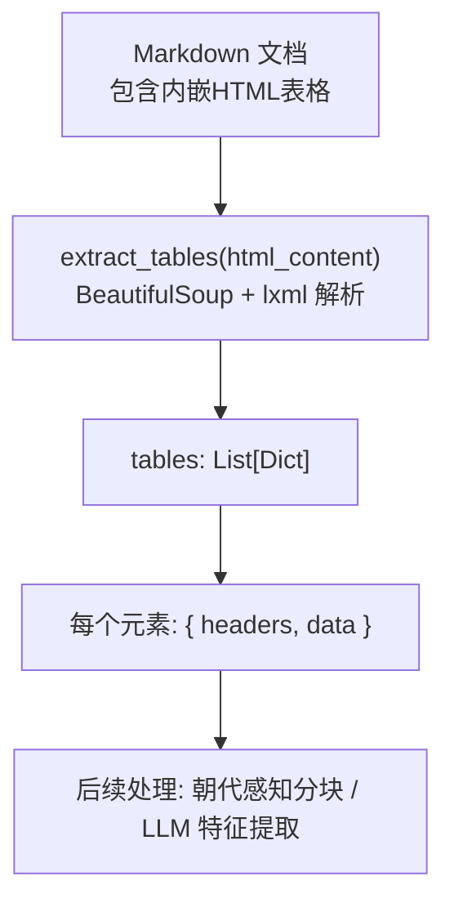
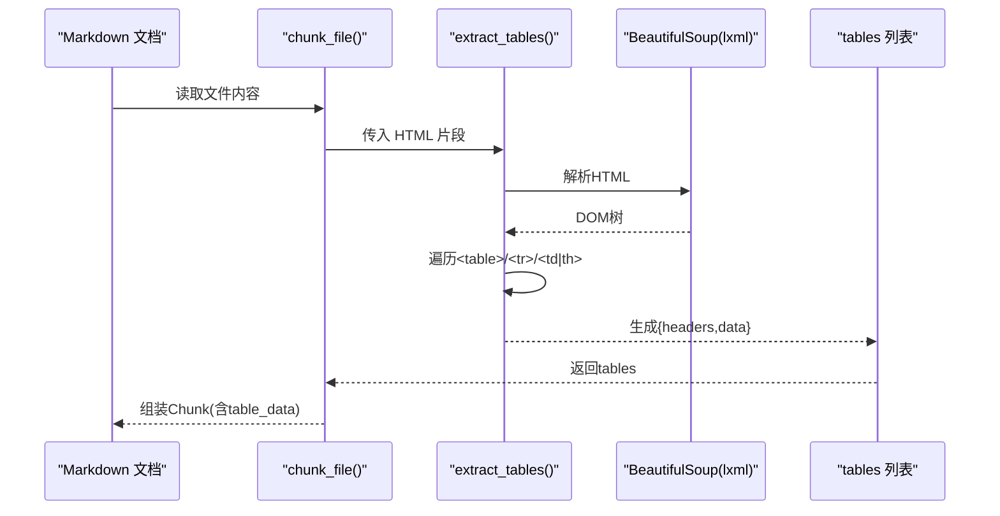
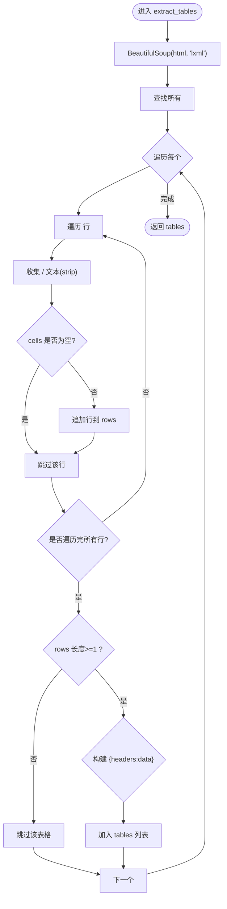
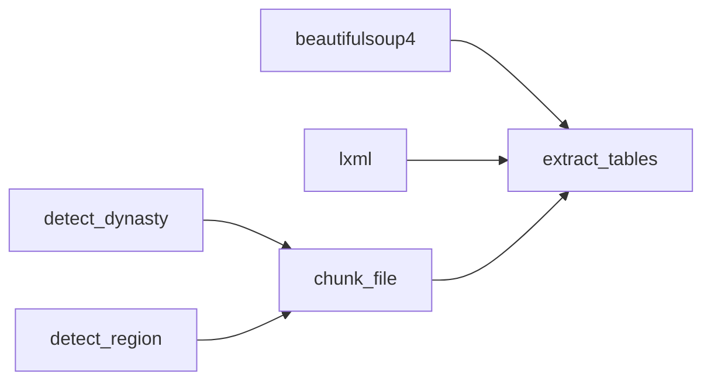

# HTML表格提取器

<cite>
**本文引用的文件**
- [dynasty_feature_pipeline.ipynb](file://dynasty_feature_pipeline.ipynb)
- [wuziyin.md](file://data/wuziyin.md)
- [京津冀汉墓研究_part1.pdf_by_PaddleOCR-VL-1.6.md](file://data/京津冀/京津冀汉墓研究_part1.pdf_by_PaddleOCR-VL-1.6.md)
</cite>

## 目录
1. [简介](#简介)
2. [项目结构](#项目结构)
3. [核心组件](#核心组件)
4. [架构总览](#架构总览)
5. [详细组件分析](#详细组件分析)
6. [依赖关系分析](#依赖关系分析)
7. [性能与复杂度](#性能与复杂度)
8. [疑难排查](#疑难排查)
9. [结论](#结论)
10. [附录：输入输出示例](#附录输入输出示例)

## 简介
本文件聚焦于 extract_tables 函数，深入解析其如何使用 BeautifulSoup 与 lxml 解析 HTML 表格结构，并说明从 HTML table 元素到结构化字典（headers 与 data）的转换过程。文档涵盖 tr 行遍历、td/th 单元格文本提取、表头识别与数据行分离策略，同时讨论复杂表格（合并单元格、嵌套表格等）的处理现状与改进建议，并提供基于仓库中真实 Markdown 文件的输入输出示例路径，帮助读者理解完整流程。

## 项目结构
该 Notebook 包含完整的考古特征提取 Pipeline 设计与实现，其中 Layer 1 负责预处理与分块，表格提取是其中的关键步骤之一。extract_tables 函数位于 Notebook 的代码单元中，用于将 HTML 片段中的 <table> 解析为结构化列表。

图表来源
- [dynasty_feature_pipeline.ipynb:394-407](file://dynasty_feature_pipeline.ipynb#L394-L407)

章节来源
- [dynasty_feature_pipeline.ipynb:394-407](file://dynasty_feature_pipeline.ipynb#L394-L407)

## 核心组件
- extract_tables(html_content: str) -> List[Dict]
  - 使用 BeautifulSoup 加载 HTML，选择器 "lxml" 解析器
  - 遍历所有 <table> 节点
  - 对每个 <table>，逐行遍历 <tr>，收集 <td>/<th> 文本
  - 将第一行视为表头 headers，其余行作为数据 data
  - 返回 tables 列表，每个元素为 {"headers": [...], "data": [[...]]}

数据结构约定
- tables: 列表，每个元素代表一个表格
- headers: 字符串列表，表示表头列名
- data: 二维字符串列表，每行对应一条记录

章节来源
- [dynasty_feature_pipeline.ipynb:394-407](file://dynasty_feature_pipeline.ipynb#L394-L407)

## 架构总览
在整体 Pipeline 中，extract_tables 处于“Layer 1: 预处理 + 朝代感知分块”阶段，负责将 Markdown 中的 HTML 表格抽取为结构化数据，供后续 LLM 特征发现与量化使用。

图表来源
- [dynasty_feature_pipeline.ipynb:394-407](file://dynasty_feature_pipeline.ipynb#L394-L407)
- [dynasty_feature_pipeline.ipynb:410-450](file://dynasty_feature_pipeline.ipynb#L410-L450)

## 详细组件分析

### extract_tables 函数实现要点
- 解析器选择：使用 "lxml" 解析器，提升解析速度与容错性
- 节点遍历：find_all("table") 获取所有表格；对每个表格 find_all("tr") 逐行处理
- 单元格提取：tr.find_all(["td", "th"]) 统一收集 td 与 th 文本，strip=True 去除空白
- 表头识别：rows[0] 作为 headers，rows[1:] 作为 data
- 空行过滤：仅当 cells 非空时追加行，避免空行污染
- 结果组织：每个表格以 {"headers": rows[0], "data": rows[1:]} 形式加入 tables

图表来源
- [dynasty_feature_pipeline.ipynb:394-407](file://dynasty_feature_pipeline.ipynb#L394-L407)

章节来源
- [dynasty_feature_pipeline.ipynb:394-407](file://dynasty_feature_pipeline.ipynb#L394-L407)

### 表头识别与数据行分离策略
- 当前策略：默认第一行为表头，其余为数据行
- 适用场景：规整的二维表格，首行即为列名
- 风险点：
  - 若表格无显式表头或表头跨多行，则 headers 可能不准确
  - 若首行仅为分类标题而非列名，headers 会误取
- 改进建议：
  - 检测 <thead>/<tbody> 结构，优先使用 thead 作为表头
  - 支持多级表头合并（colspan/rowspan）展开为扁平列名
  - 对空行或分隔行进行过滤

章节来源
- [dynasty_feature_pipeline.ipynb:394-407](file://dynasty_feature_pipeline.ipynb#L394-L407)

### 复杂表格结构的处理现状与建议
- 合并单元格（rowspan/colspan）
  - 现状：当前实现未处理合并，直接按行列顺序提取文本，可能导致列错位
  - 建议：解析合并属性，填充缺失列以保持矩阵一致性
- 嵌套表格
  - 现状：find_all("table") 会递归找到子表格，可能被当作独立表格处理
  - 建议：限制搜索深度或标记父子关系，避免重复解析
- 多层表头
  - 现状：仅取第一行作为 headers
  - 建议：结合 thead 与 colspan/rowspan 构建层级表头，或展平为复合列名
- 空单元格与占位符
  - 现状：strip=True 会保留空字符串
  - 建议：统一空值标记（如 None 或 NaN），便于下游处理

章节来源
- [dynasty_feature_pipeline.ipynb:394-407](file://dynasty_feature_pipeline.ipynb#L394-L407)

### 与 chunk_file 的集成
- chunk_file 调用 extract_tables 提取表格，并为每个表格构造 Chunk，包含：
  - content_type = "table"
  - text = 表格文本前若干字符（截断）
  - table_data = 原始 tables 条目（包含 headers 与 data）
- 随后移除表格部分，按章节标题切分叙述文本，形成 narrative 类型的 Chunk

章节来源
- [dynasty_feature_pipeline.ipynb:410-450](file://dynasty_feature_pipeline.ipynb#L410-L450)

## 依赖关系分析
- 外部库
  - beautifulsoup4：HTML 解析
  - lxml：高性能解析后端
- 内部依赖
  - chunk_file：调用 extract_tables 并将结果封装为 Chunk
  - detect_dynasty/detect_region：对表格文本进行朝代与区域标注（可选）

图表来源
- [dynasty_feature_pipeline.ipynb:394-407](file://dynasty_feature_pipeline.ipynb#L394-L407)
- [dynasty_feature_pipeline.ipynb:410-450](file://dynasty_feature_pipeline.ipynb#L410-L450)

章节来源
- [dynasty_feature_pipeline.ipynb:394-407](file://dynasty_feature_pipeline.ipynb#L394-L407)
- [dynasty_feature_pipeline.ipynb:410-450](file://dynasty_feature_pipeline.ipynb#L410-L450)

## 性能与复杂度
- 时间复杂度
  - 设文档中有 N 个表格，第 i 个表格有 R_i 行、C_i 列
  - 总体复杂度约为 O(Σ(R_i × C_i))，即线性于单元格总数
- 空间复杂度
  - 存储 tables 列表，空间与单元格总数成正比
- 优化建议
  - 对超大表格可流式处理或分批写入
  - 使用 lxml 解析器已具备较好性能，必要时可考虑增量解析

章节来源
- [dynasty_feature_pipeline.ipynb:394-407](file://dynasty_feature_pipeline.ipynb#L394-L407)

## 疑难排查
- 常见问题
  - 表头错位：合并单元格导致列数不一致
    - 检查 rowspan/colspan，必要时展开合并
  - 空行干扰：出现空行导致 headers/data 分割错误
    - 增加空行过滤逻辑
  - 嵌套表格：子表格被当作独立表格解析
    - 控制 find_all 的深度或过滤子表格
- 调试建议
  - 打印每个表格的行数与列数，确认结构是否符合预期
  - 对 headers 与 data 做基本校验（如列数一致）

章节来源
- [dynasty_feature_pipeline.ipynb:394-407](file://dynasty_feature_pipeline.ipynb#L394-L407)

## 结论
extract_tables 提供了简洁高效的 HTML 表格提取能力，适用于规整表格的快速解析。对于复杂表格（合并单元格、多层表头、嵌套表格），建议在现有基础上增强解析逻辑，以提升鲁棒性与准确性。通过将其嵌入 chunk_file 的流程，可将表格数据无缝接入后续的朝代感知分块与 LLM 特征提取环节。

## 附录：输入输出示例
以下示例来自仓库中的真实 Markdown 文件，展示 extract_tables 的典型输入与输出结构。

- 示例一：印章材质分布表（简单二维表）
  - 输入位置：[wuziyin.md](file://data/wuziyin.md)
  - 说明：表格首行为材质类别，后续行为不同钮式的计数统计
  - 输出结构：
    - headers: ["材质\n钮式", "玉", "滑石", "铜", "铜鎏金", "玛瑙", "绿松石", "其他", "总计"]
    - data: 多行数值统计
  - 参考行号：[wuziyin.md:21](file://data/wuziyin.md#L21)

- 示例二：墓葬信息明细表（带编号、尺寸、位置等字段）
  - 输入位置：[wuziyin.md](file://data/wuziyin.md)
  - 说明：表格包含多个字段，部分单元格为空
  - 输出结构：
    - headers: ["编号", "材质", "钮制", "尺寸(厘米)", "位置", "伴随印章", "年代", "资料出处", "墓室面积(平方米)"]
    - data: 多条记录，空单元格以空字符串表示
  - 参考行号：[wuziyin.md:124](file://data/wuziyin.md#L124), [wuziyin.md:130](file://data/wuziyin.md#L130), [wuziyin.md:136](file://data/wuziyin.md#L136), [wuziyin.md:142](file://data/wuziyin.md#L142), [wuziyin.md:148](file://data/wuziyin.md#L148)

- 示例三：行政区划对照表（存在合并单元格）
  - 输入位置：[京津冀汉墓研究_part1.pdf_by_PaddleOCR-VL-1.6.md](file://data/京津冀/京津冀汉墓研究_part1.pdf_by_PaddleOCR-VL-1.6.md)
  - 说明：表格使用 rowspan 合并“西汉时期”“并州刺史部”等单元格
  - 输出结构（当前实现）：
    - headers: 第一行各列文本
    - data: 后续行按顺序提取，合并单元格不会自动填充，可能导致列对齐偏差
  - 参考行号：[京津冀汉墓研究_part1.pdf_by_PaddleOCR-VL-1.6.md:245](file://data/京津冀/京津冀汉墓研究_part1.pdf_by_PaddleOCR-VL-1.6.md#L245), [京津冀汉墓研究_part1.pdf_by_PaddleOCR-VL-1.6.md:251](file://data/京津冀/京津冀汉墓研究_part1.pdf_by_PaddleOCR-VL-1.6.md#L251)

- 示例四：多层级器物型别表（多级表头与合并）
  - 输入位置：[京津冀汉墓研究_part1.pdf_by_PaddleOCR-VL-1.6.md](file://data/京津冀/京津冀汉墓研究_part1.pdf_by_PaddleOCR-VL-1.6.md)
  - 说明：表格具有多级表头（组别、鼎/盒/壶/罐等大类与小类），并使用 colspan/rowspan
  - 输出结构（当前实现）：
    - headers: 仅第一行文本
    - data: 后续行按顺序提取，多级表头未被展平，列名不完整
  - 参考行号：[京津冀汉墓研究_part1.pdf_by_PaddleOCR-VL-1.6.md:1813](file://data/京津冀/京津冀汉墓研究_part1.pdf_by_PaddleOCR-VL-1.6.md#L1813), [京津冀汉墓研究_part1.pdf_by_PaddleOCR-VL-1.6.md:1820](file://data/京津冀/京津冀汉墓研究_part1.pdf_by_PaddleOCR-VL-1.6.md#L1820), [京津冀汉墓研究_part1.pdf_by_PaddleOCR-VL-1.6.md:1832](file://data/京津冀/京津冀汉墓研究_part1.pdf_by_PaddleOCR-VL-1.6.md#L1832), [京津冀汉墓研究_part1.pdf_by_PaddleOCR-VL-1.6.md:1833](file://data/京津冀/京津冀汉墓研究_part1.pdf_by_PaddleOCR-VL-1.6.md#L1833), [京津冀汉墓研究_part1.pdf_by_PaddleOCR-VL-1.6.md:1836](file://data/京津冀/京津冀汉墓研究_part1.pdf_by_PaddleOCR-VL-1.6.md#L1836), [京津冀汉墓研究_part1.pdf_by_PaddleOCR-VL-1.6.md:1843](file://data/京津冀/京津冀汉墓研究_part1.pdf_by_PaddleOCR-VL-1.6.md#L1843)

章节来源
- [wuziyin.md:21](file://data/wuziyin.md#L21)
- [wuziyin.md:124](file://data/wuziyin.md#L124)
- [wuziyin.md:130](file://data/wuziyin.md#L130)
- [wuziyin.md:136](file://data/wuziyin.md#L136)
- [wuziyin.md:142](file://data/wuziyin.md#L142)
- [wuziyin.md:148](file://data/wuziyin.md#L148)
- [京津冀汉墓研究_part1.pdf_by_PaddleOCR-VL-1.6.md:245](file://data/京津冀/京津冀汉墓研究_part1.pdf_by_PaddleOCR-VL-1.6.md#L245)
- [京津冀汉墓研究_part1.pdf_by_PaddleOCR-VL-1.6.md:251](file://data/京津冀/京津冀汉墓研究_part1.pdf_by_PaddleOCR-VL-1.6.md#L251)
- [京津冀汉墓研究_part1.pdf_by_PaddleOCR-VL-1.6.md:1813](file://data/京津冀/京津冀汉墓研究_part1.pdf_by_PaddleOCR-VL-1.6.md#L1813)
- [京津冀汉墓研究_part1.pdf_by_PaddleOCR-VL-1.6.md:1820](file://data/京津冀/京津冀汉墓研究_part1.pdf_by_PaddleOCR-VL-1.6.md#L1820)
- [京津冀汉墓研究_part1.pdf_by_PaddleOCR-VL-1.6.md:1832](file://data/京津冀/京津冀汉墓研究_part1.pdf_by_PaddleOCR-VL-1.6.md#L1832)
- [京津冀汉墓研究_part1.pdf_by_PaddleOCR-VL-1.6.md:1833](file://data/京津冀/京津冀汉墓研究_part1.pdf_by_PaddleOCR-VL-1.6.md#L1833)
- [京津冀汉墓研究_part1.pdf_by_PaddleOCR-VL-1.6.md:1836](file://data/京津冀/京津冀汉墓研究_part1.pdf_by_PaddleOCR-VL-1.6.md#L1836)
- [京津冀汉墓研究_part1.pdf_by_PaddleOCR-VL-1.6.md:1843](file://data/京津冀/京津冀汉墓研究_part1.pdf_by_PaddleOCR-VL-1.6.md#L1843)