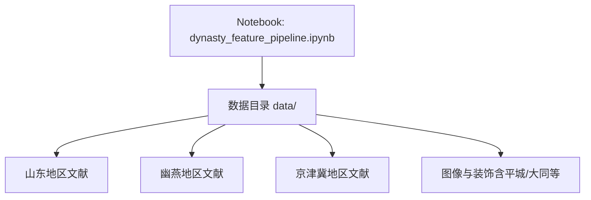
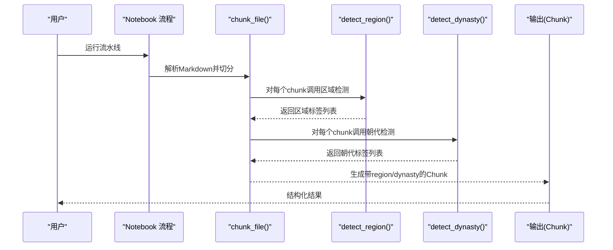
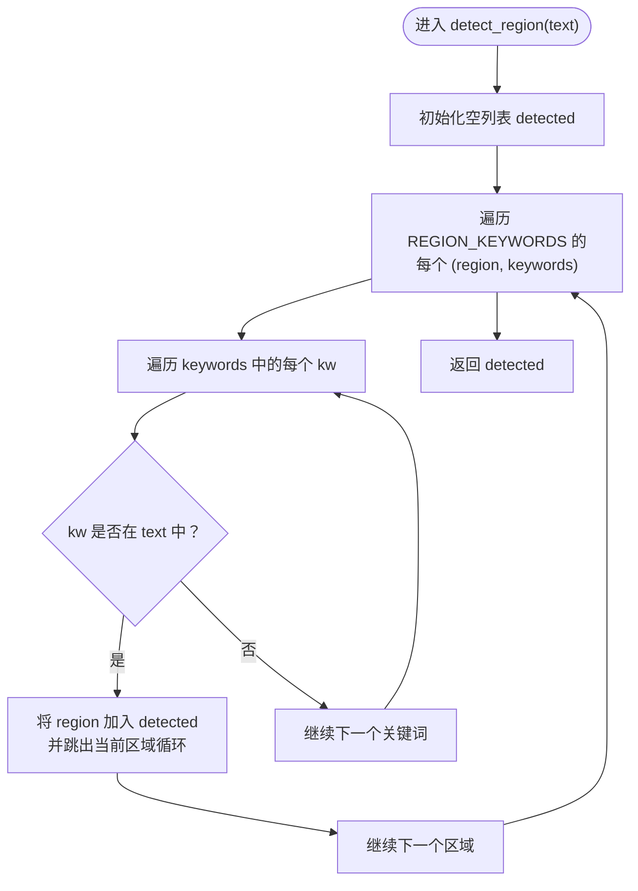
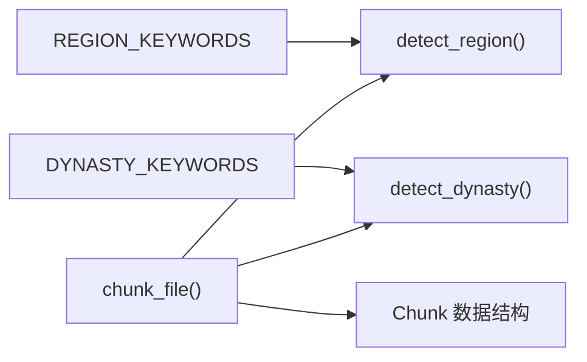

# 区域标签识别算法

<cite>
**本文引用的文件**   
- [dynasty_feature_pipeline.ipynb](file://dynasty_feature_pipeline.ipynb)
- [图像与装饰_北朝墓葬的生死表象_gq_part2.pdf_by_PaddleOCR-VL-1.6.md](file://data/图像与装饰/图像与装饰_北朝墓葬的生死表象_gq_part2.pdf_by_PaddleOCR-VL-1.6.md)
- [山东地区汉代墓葬的考古学研究_刘剑_完整版.md](file://data/山东地区汉代墓葬的考古学研究_刘剑_完整版.md)
- [幽燕地区两汉墓葬研究_张婕妤.md](file://data/幽燕地区两汉墓葬研究_张婕妤.md)
- [京津冀汉墓研究_part1.pdf_by_PaddleOCR-VL-1.6.md](file://data/京津冀/京津冀汉墓研究_part1.pdf_by_PaddleOCR-VL-1.6.md)
</cite>

## 目录
1. [引言](#引言)
2. [项目结构](#项目结构)
3. [核心组件](#核心组件)
4. [架构总览](#架构总览)
5. [详细组件分析](#详细组件分析)
6. [依赖关系分析](#依赖关系分析)
7. [性能考量](#性能考量)
8. [故障排查指南](#故障排查指南)
9. [结论](#结论)
10. [附录：实际文本示例与处理效果](#附录实际文本示例与处理效果)

## 引言
本文件聚焦于“区域标签识别算法”，围绕 detect_region 函数的实现原理、REGION_KEYWORDS 字典的组织结构，以及地理区域的分类体系进行系统化说明。同时，阐述其与朝代检测相同的字符串匹配算法实现方式，并给出跨区域文献标注的处理策略与实际文本文本的区域识别示例，展示不同地区考古文献的处理效果。

## 项目结构
该仓库包含一个 Jupyter Notebook 作为主流程入口，以及若干经 OCR 转换后的 Markdown 文献样例，覆盖山东、幽燕（北京/天津/河北北部）、京津冀等典型考古学区域。Notebook 中定义了朝代与区域的关键词词典、分块器、以及基于关键词的朝代/区域检测函数。

图表来源
- [dynasty_feature_pipeline.ipynb](file://dynasty_feature_pipeline.ipynb)

章节来源
- [dynasty_feature_pipeline.ipynb](file://dynasty_feature_pipeline.ipynb)

## 核心组件
- REGION_KEYWORDS 字典：定义各考古学区域与其候选关键词的映射，用于快速定位文本中的区域信息。
- detect_region 函数：遍历 REGION_KEYWORDS，对输入文本执行子串匹配，返回所有匹配到的区域标签列表。
- detect_dynasty 函数：采用与 detect_region 完全一致的字符串匹配逻辑，用于朝代标签识别。
- Chunk 数据类与 chunk_file 分块器：将文档切分为表格或叙述段落，并在每个 chunk 上调用 detect_region/detect_dynasty 进行标注。

章节来源
- [dynasty_feature_pipeline.ipynb](file://dynasty_feature_pipeline.ipynb)

## 架构总览
整体流程为：读取 Markdown → 提取表格与按标题分段 → 在每个 chunk 上运行 detect_region 与 detect_dynasty → 输出带 region/dynasty 标注的结构化结果。区域与朝代检测均基于关键词子串匹配，简单高效且可解释性强。

图表来源
- [dynasty_feature_pipeline.ipynb](file://dynasty_feature_pipeline.ipynb)

## 详细组件分析

### REGION_KEYWORDS 字典组织结构
- 键：考古学区域名称，如“山东”“幽燕”“关中”“中原”“山西”“京津冀”。
- 值：与该区域相关的候选关键词列表，涵盖现代地名、历史地名、古称及常见别称。例如：
  - “山东”对应齐鲁、齐地、鲁地、胶东、鲁北、鲁南等；
  - “幽燕”对应幽燕、幽州、燕、北京、河北北部等；
  - “关中”对应关中、长安、西安、陕西等；
  - “中原”对应中原、河南、洛阳等；
  - “山西”对应山西、并州、晋、大同、平城等；
  - “京津冀”对应京津冀、北京、天津、河北等。
- 设计要点：
  - 多词同义覆盖：兼顾古今地名与常用表述，提高召回率；
  - 去重与冲突控制：同一文本可能命中多个区域，后续可通过优先级或上下文消歧；
  - 可扩展性：新增区域只需在字典中添加条目，无需改动检测逻辑。

章节来源
- [dynasty_feature_pipeline.ipynb](file://dynasty_feature_pipeline.ipynb)

### detect_region 函数实现原理
- 输入：一段文本（通常为单个 chunk）。
- 处理：
  - 遍历 REGION_KEYWORDS 的每个区域及其关键词列表；
  - 对每个关键词执行子串匹配（in text），若命中则将该区域加入检测结果；
  - 一旦某区域命中任一关键词即停止对该区域的进一步扫描，避免重复添加。
- 输出：区域标签列表（可能为空或多项）。
- 复杂度：时间复杂度近似 O(R × K × L)，其中 R 为区域数，K 为该区域关键词数，L 为文本长度；空间复杂度为 O(M)，M 为匹配到的区域数量。
- 行为特性：
  - 支持多标签：同一文本可同时属于多个区域（如“京津冀”与“幽燕”）；
  - 顺序稳定：返回顺序与 REGION_KEYWORDS 的定义顺序一致，便于后续排序或权重分配。

图表来源
- [dynasty_feature_pipeline.ipynb](file://dynasty_feature_pipeline.ipynb)

章节来源
- [dynasty_feature_pipeline.ipynb](file://dynasty_feature_pipeline.ipynb)

### 与朝代检测相同的字符串匹配算法
- detect_dynasty 的实现与 detect_region 完全一致，仅替换关键词源为 DYNASTY_KEYWORDS。
- 两者共享相同的设计模式：
  - 字典驱动：通过配置字典集中管理领域知识；
  - 子串匹配：使用 in 操作符进行快速命中判断；
  - 多标签输出：允许文本同时命中多个类别；
  - 顺序稳定：输出顺序由字典定义顺序决定。
- 优势：
  - 代码复用度高，维护成本低；
  - 规则透明，易于人工校验与扩展；
  - 计算开销小，适合大规模批量处理。

章节来源
- [dynasty_feature_pipeline.ipynb](file://dynasty_feature_pipeline.ipynb)

### 跨区域文献的标注策略
- 多标签并存：当文本中出现多个区域关键词时，detect_region 会返回多个区域标签，体现“跨区域”属性。
- 优先级与消歧：
  - 可在上层逻辑中根据关键词粒度或语义范围设定优先级（如“京津冀”优先于“河北”）；
  - 结合上下文窗口或相邻段落的标签一致性进行平滑；
  - 引入置信度评分（例如基于命中关键词数量、位置靠近标题/摘要等）。
- 与朝代标签协同：
  - 同一 chunk 可同时拥有 region 与 dynasty 标签，便于后续按“时期×区域”维度聚合统计；
  - 对于过渡期或模糊期，可采用模糊标签（如“魏晋过渡”）以保留不确定性。

章节来源
- [dynasty_feature_pipeline.ipynb](file://dynasty_feature_pipeline.ipynb)

## 依赖关系分析
- 外部库：
  - pandas、BeautifulSoup、re、json、tqdm 等用于数据处理、HTML 解析、正则、进度条等；
  - LLM 接口（OpenAI/Anthropic）可选，用于特征发现与量化阶段，但区域/朝代检测不依赖 LLM。
- 内部模块关系：
  - chunk_file 依赖 detect_region 与 detect_dynasty；
  - detect_region 依赖 REGION_KEYWORDS；
  - detect_dynasty 依赖 DYNASTY_KEYWORDS。

图表来源
- [dynasty_feature_pipeline.ipynb](file://dynasty_feature_pipeline.ipynb)

章节来源
- [dynasty_feature_pipeline.ipynb](file://dynasty_feature_pipeline.ipynb)

## 性能考量
- 时间复杂度：主要取决于关键词总数与文本长度，适合中等规模文本批处理；
- 内存占用：低，仅需存储关键词字典与少量中间变量；
- 优化建议：
  - 对长文本可先做预处理（去除无关 HTML 标签、标点规范化）；
  - 对高频区域关键词建立索引或使用 Aho-Corasick 多模式匹配以提升效率；
  - 并行化处理：对大量 chunk 可多线程/多进程并行执行 detect_region。

[本节为通用指导，不涉及具体文件分析]

## 故障排查指南
- 常见问题：
  - 未检测到任何区域：检查 REGION_KEYWORDS 是否覆盖目标术语；确认文本清洗后仍保留关键地名；
  - 误检过多：调整关键词粒度，增加限定词或上下文约束；
  - 跨区域冲突：在上层逻辑中加入优先级规则或置信度评估。
- 调试方法：
  - 打印每个 chunk 的 inferred_region 与 inferred_dynasty；
  - 针对疑似误判的片段，单独传入 detect_region 观察命中关键词；
  - 逐步扩充 REGION_KEYWORDS 并回归验证。

章节来源
- [dynasty_feature_pipeline.ipynb](file://dynasty_feature_pipeline.ipynb)

## 结论
区域标签识别算法以 REGION_KEYWORDS 为核心，配合 detect_region 的字符串匹配实现，具备高可解释性与易扩展性。其设计与朝代检测保持一致，便于统一维护与迭代。通过合理的跨区域标注策略与优先级消歧，可有效处理复杂文献中的多区域共存问题。

[本节为总结性内容，不涉及具体文件分析]

## 附录：实际文本示例与处理效果
以下示例基于仓库中的真实 Markdown 文献，展示 detect_region 在不同区域文献上的预期识别效果（依据 REGION_KEYWORDS 的关键词匹配逻辑推断）：

- 山东地区文献
  - 文本特征：频繁出现“山东”“齐鲁”“齐地”“鲁地”“胶东”“鲁北”“鲁南”等关键词；
  - 预期结果：inferred_region 包含“山东”。
  - 参考文件：[山东地区汉代墓葬的考古学研究_刘剑_完整版.md](file://data/山东地区汉代墓葬的考古学研究_刘剑_完整版.md)

- 幽燕地区文献
  - 文本特征：出现“幽燕”“幽州”“燕”“北京”“河北北部”等关键词；
  - 预期结果：inferred_region 包含“幽燕”。
  - 参考文件：[幽燕地区两汉墓葬研究_张婕妤.md](file://data/幽燕地区两汉墓葬研究_张婕妤.md)

- 京津冀地区文献
  - 文本特征：出现“京津冀”“北京”“天津”“河北”等关键词；
  - 预期结果：inferred_region 包含“京津冀”；若同时出现“幽燕”相关词，也可能同时命中“幽燕”。
  - 参考文件：[京津冀汉墓研究_part1.pdf_by_PaddleOCR-VL-1.6.md](file://data/京津冀/京津冀汉墓研究_part1.pdf_by_PaddleOCR-VL-1.6.md)

- 图像与装饰（含平城/大同等）
  - 文本特征：出现“平城”“大同”“山西”“并州”等关键词；
  - 预期结果：inferred_region 包含“山西”；若同时出现“幽燕”相关词，也可能同时命中“幽燕”。
  - 参考文件：[图像与装饰_北朝墓葬的生死表象_gq_part2.pdf_by_PaddleOCR-VL-1.6.md](file://data/图像与装饰/图像与装饰_北朝墓葬的生死表象_gq_part2.pdf_by_PaddleOCR-VL-1.6.md)

以上示例展示了不同地区考古文献在区域识别上的差异化表现，体现了 REGION_KEYWORDS 的多词同义覆盖与 detect_region 的多标签输出能力。

章节来源
- [dynasty_feature_pipeline.ipynb](file://dynasty_feature_pipeline.ipynb)
- [山东地区汉代墓葬的考古学研究_刘剑_完整版.md](file://data/山东地区汉代墓葬的考古学研究_刘剑_完整版.md)
- [幽燕地区两汉墓葬研究_张婕妤.md](file://data/幽燕地区两汉墓葬研究_张婕妤.md)
- [京津冀汉墓研究_part1.pdf_by_PaddleOCR-VL-1.6.md](file://data/京津冀/京津冀汉墓研究_part1.pdf_by_PaddleOCR-VL-1.6.md)
- [图像与装饰_北朝墓葬的生死表象_gq_part2.pdf_by_PaddleOCR-VL-1.6.md](file://data/图像与装饰/图像与装饰_北朝墓葬的生死表象_gq_part2.pdf_by_PaddleOCR-VL-1.6.md)