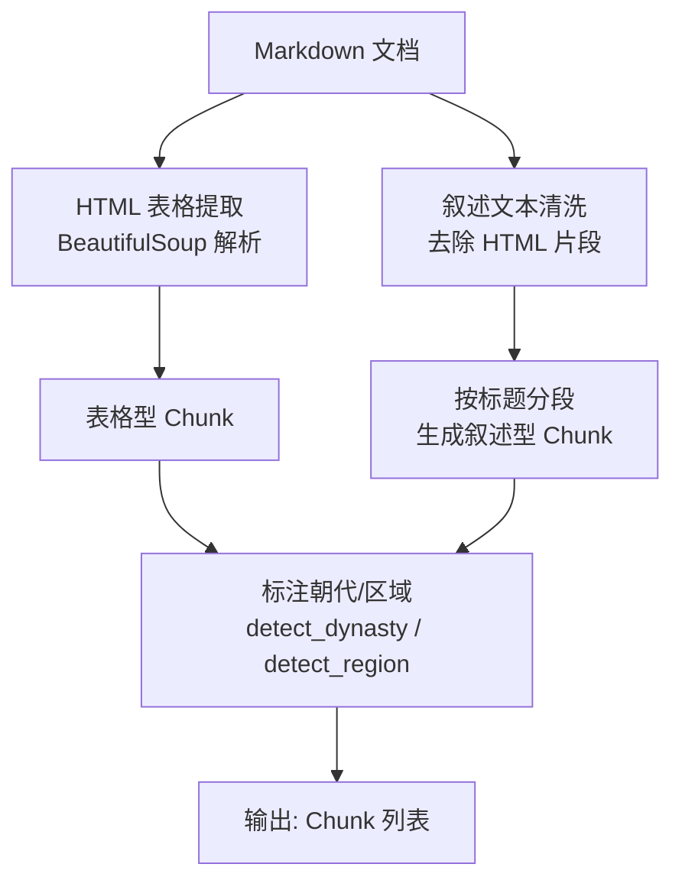
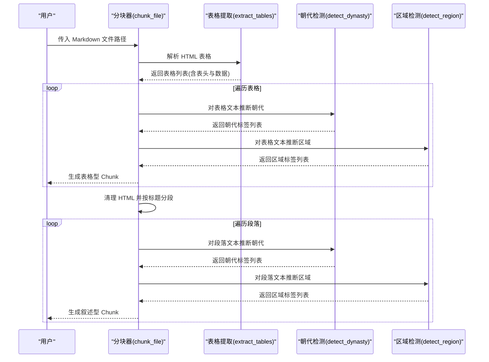
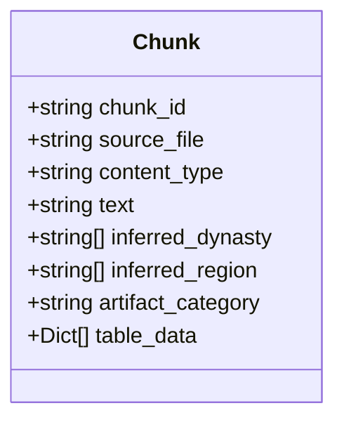
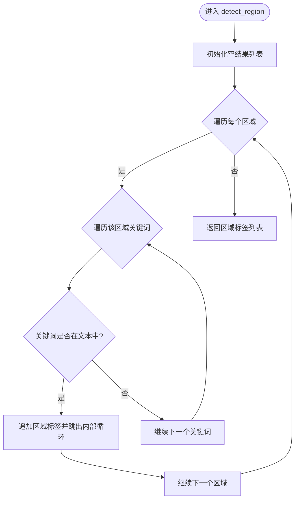
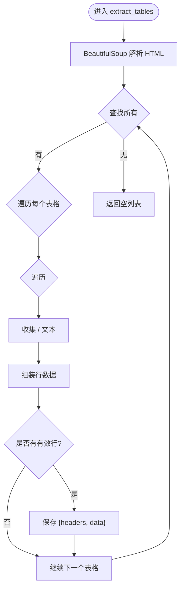
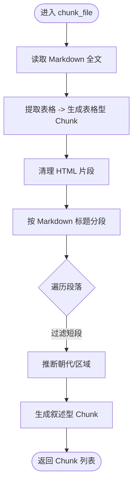
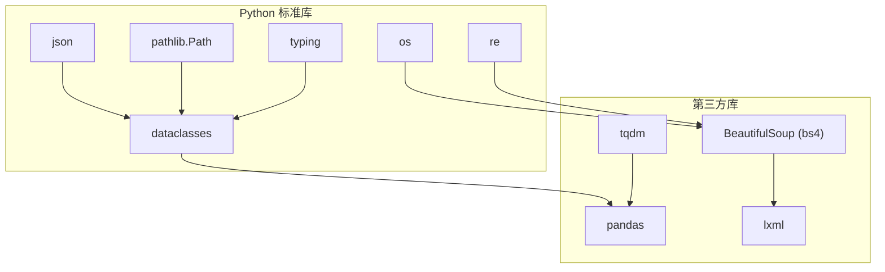

# 数据预处理与分块算法

<cite>
**本文引用的文件**
- [dynasty_feature_pipeline.ipynb](file://dynasty_feature_pipeline.ipynb)
</cite>

## 目录
1. [引言](#引言)
2. [项目结构](#项目结构)
3. [核心组件](#核心组件)
4. [架构总览](#架构总览)
5. [详细组件分析](#详细组件分析)
6. [依赖关系分析](#依赖关系分析)
7. [性能考量](#性能考量)
8. [故障排查指南](#故障排查指南)
9. [结论](#结论)
10. [附录：示例与输出说明](#附录示例与输出说明)

## 引言
本文件聚焦于 Layer 1 的数据预处理与“朝代感知分块”的核心实现，围绕以下目标展开：
- 解释 Chunk 数据结构的设计理念与字段含义（chunk_id、source_file、content_type、text、inferred_dynasty、inferred_region 等）
- 深入阐述朝代关键词匹配算法 detect_dynasty 与区域标签识别 detect_region 的实现逻辑
- 详细说明 HTML 表格提取器 extract_tables 如何使用 BeautifulSoup 解析 HTML 并转换为结构化字典列表
- 解释朝代感知分块策略 chunk_file 如何基于语义段落和朝代边界进行智能切分，而非固定大小分块
- 提供具体代码路径与运行示例，展示表格 chunk 与叙述文本 chunk 的生成过程

## 项目结构
仓库包含一个 Jupyter Notebook，承载了从数据扫描、预处理、分块到后续 LLM 特征提取的完整 Pipeline。Layer 1 相关实现集中在 Notebook 的代码单元中，包括：
- 朝代/区域关键词定义
- 朝代感知分块器（Chunk 类、detect_* 函数、extract_tables、chunk_file）
- 试运行与批量处理接口

图表来源
- [dynasty_feature_pipeline.ipynb:395-407](file://dynasty_feature_pipeline.ipynb#L395-L407)
- [dynasty_feature_pipeline.ipynb:410-450](file://dynasty_feature_pipeline.ipynb#L410-L450)

章节来源
- [dynasty_feature_pipeline.ipynb:307-346](file://dynasty_feature_pipeline.ipynb#L307-L346)
- [dynasty_feature_pipeline.ipynb:352-454](file://dynasty_feature_pipeline.ipynb#L352-L454)

## 核心组件
本节对 Layer 1 的关键组件进行概览性说明，并在后文给出更深入的实现细节与图示。

- 朝代/区域关键词词典：用于快速匹配文本中的时期与地域信息，作为分块与标注的依据
- 朝代感知分块器：将 Markdown 内容拆分为“表格型”和“叙述型”两类 Chunk，并自动推断朝代与区域
- 表格提取器：使用 BeautifulSoup 遍历 table/tr/td/th，抽取表头与数据行，形成结构化字典
- 朝代/区域检测器：基于关键词集合的精确匹配，返回匹配的标签列表

章节来源
- [dynasty_feature_pipeline.ipynb:316-346](file://dynasty_feature_pipeline.ipynb#L316-L346)
- [dynasty_feature_pipeline.ipynb:361-450](file://dynasty_feature_pipeline.ipynb#L361-L450)

## 架构总览
Layer 1 的整体流程如下：
- 输入：Markdown 文档（可能内嵌 HTML 表格）
- 预处理：
  - 提取所有 <table> 为独立 Chunk（表格型）
  - 清理 HTML 片段，按 Markdown 标题分段得到叙述文本（叙述型）
- 标注：对每个 Chunk 调用 detect_dynasty 与 detect_region 推断时期与区域
- 输出：Chunk 列表，供后续 LLM 特征发现与量化阶段使用

图表来源
- [dynasty_feature_pipeline.ipynb:395-407](file://dynasty_feature_pipeline.ipynb#L395-L407)
- [dynasty_feature_pipeline.ipynb:410-450](file://dynasty_feature_pipeline.ipynb#L410-L450)
- [dynasty_feature_pipeline.ipynb:373-392](file://dynasty_feature_pipeline.ipynb#L373-L392)

## 详细组件分析

### Chunk 数据结构设计
Chunk 是 Layer 1 的基本产出单元，承载单个语义块及其元数据。其设计理念是：
- 以“语义完整性”优先：尽量保持一段论述或一张表的完整性，避免机械式固定长度切分
- 以“可追溯性”为核心：保留来源文件、类型、推断标签，便于后续溯源与校验
- 以“可扩展性”为目标：预留 artifact_category、table_data 等字段，支持后续扩展

字段说明：
- chunk_id：唯一标识，通常由文件名与序号组合而成，便于定位
- source_file：原始 Markdown 文件名，用于溯源
- content_type：内容类型，区分“table”与“narrative”，影响下游处理
- text：文本主体，表格型为表格序列化字符串，叙述型为段落文本
- inferred_dynasty：推断出的朝代标签列表，来自 detect_dynasty
- inferred_region：推断出的区域标签列表，来自 detect_region
- artifact_category：器物类别（可选），当前为空字符串，可在后续阶段填充
- table_data：当 content_type 为“table”时，保存结构化表格数据（表头+数据行）

图表来源
- [dynasty_feature_pipeline.ipynb:361-371](file://dynasty_feature_pipeline.ipynb#L361-L371)

章节来源
- [dynasty_feature_pipeline.ipynb:361-371](file://dynasty_feature_pipeline.ipynb#L361-L371)

### 朝代关键词匹配算法 detect_dynasty
实现要点：
- 维护朝代关键词词典，每个朝代对应一组候选词
- 对输入文本逐一对候选词进行子串匹配，命中即记录该朝代
- 为避免重复，每个朝代仅记录一次（break 跳出内部循环）
- 返回匹配的朝代标签列表

复杂度分析：
- 时间复杂度：O(D*K*L)，其中 D 为朝代数，K 为该朝代的关键词数，L 为文本长度（子串匹配）
- 空间复杂度：O(M)，M 为匹配到的朝代数量

优化建议：
- 可将关键词集合转为正则表达式一次性匹配，减少多次遍历
- 可对长文本先做去噪（如移除标点、统一全半角）提升稳定性

图表来源
- [dynasty_feature_pipeline.ipynb:373-381](file://dynasty_feature_pipeline.ipynb#L373-L381)

章节来源
- [dynasty_feature_pipeline.ipynb:316-328](file://dynasty_feature_pipeline.ipynb#L316-L328)
- [dynasty_feature_pipeline.ipynb:373-381](file://dynasty_feature_pipeline.ipynb#L373-L381)

### 区域标签识别 detect_region
实现要点：
- 结构与 detect_dynasty 一致，但使用区域关键词词典
- 同样采用子串匹配，命中即记录区域标签
- 返回匹配的区域标签列表

复杂度与优化建议同 detect_dynasty。

图表来源
- [dynasty_feature_pipeline.ipynb:384-392](file://dynasty_feature_pipeline.ipynb#L384-L392)

章节来源
- [dynasty_feature_pipeline.ipynb:331-338](file://dynasty_feature_pipeline.ipynb#L331-L338)
- [dynasty_feature_pipeline.ipynb:384-392](file://dynasty_feature_pipeline.ipynb#L384-L392)

### HTML 表格提取器 extract_tables
实现要点：
- 使用 BeautifulSoup 解析 HTML 内容
- 遍历所有 <table>，再遍历 <tr>，收集 <td>/<th> 的文本
- 将第一行视为表头，其余行作为数据行，形成 {"headers": [...], "data": [...]} 的结构
- 返回表格列表

注意事项：
- 若表格存在合并单元格或嵌套结构，需根据实际 HTML 调整选择器
- 对于超长表格，建议在下游进行截断或分页处理

图表来源
- [dynasty_feature_pipeline.ipynb:395-407](file://dynasty_feature_pipeline.ipynb#L395-L407)

章节来源
- [dynasty_feature_pipeline.ipynb:395-407](file://dynasty_feature_pipeline.ipynb#L395-L407)

### 朝代感知分块策略 chunk_file
实现要点：
- 读取 Markdown 全文
- 第一步：提取所有表格，生成“表格型”Chunk，并对表格文本进行朝代/区域推断
- 第二步：清理 HTML 片段（<table>、
），按 Markdown 标题（# 至 ####）分段，生成“叙述型”Chunk，并对段落文本进行朝代/区域推断
- 跳过过短段落（长度阈值），保证语义完整性
- 对过长文本进行截断，控制后续处理成本

与传统固定大小分块的区别：
- 不依赖字符数或 token 数硬性切分
- 尊重文档结构（标题、表格），确保语义连贯
- 结合朝代关键词，使每个 Chunk 具备明确的时期与区域上下文

图表来源
- [dynasty_feature_pipeline.ipynb:410-450](file://dynasty_feature_pipeline.ipynb#L410-L450)

章节来源
- [dynasty_feature_pipeline.ipynb:410-450](file://dynasty_feature_pipeline.ipynb#L410-L450)

## 依赖关系分析
Layer 1 的主要依赖：
- Python 标准库：os、json、re、pathlib、typing、dataclasses
- 数据处理：pandas（在后续聚合中使用）
- HTML 解析：BeautifulSoup（lxml 解析器）
- 进度条：tqdm（批处理时使用）

图表来源
- [dynasty_feature_pipeline.ipynb:263-276](file://dynasty_feature_pipeline.ipynb#L263-L276)
- [dynasty_feature_pipeline.ipynb:395-407](file://dynasty_feature_pipeline.ipynb#L395-L407)

章节来源
- [dynasty_feature_pipeline.ipynb:263-276](file://dynasty_feature_pipeline.ipynb#L263-L276)

## 性能考量
- 关键词匹配：可采用正则一次性匹配或多模式匹配（如 Aho-Corasick）降低时间复杂度
- HTML 解析：BeautifulSoup 在大型文档上开销较大，可考虑流式解析或预过滤
- 文本截断：对超长表格与段落进行截断，避免下游处理负担
- 并行化：多文件处理可使用并发框架（如 concurrent.futures）加速

[本节为通用指导，不涉及具体文件分析]

## 故障排查指南
常见问题与建议：
- 表格未正确提取：检查 HTML 结构是否规范；确认 <table>/<tr>/<td>/<th> 标签齐全
- 朝代/区域误判：核对关键词词典覆盖度；必要时增加同义词或模糊匹配
- 段落过短被丢弃：调整最小长度阈值，避免丢失重要信息
- 解析异常：确认 lxml 解析器可用；必要时回退到默认解析器

章节来源
- [dynasty_feature_pipeline.ipynb:395-407](file://dynasty_feature_pipeline.ipynb#L395-L407)
- [dynasty_feature_pipeline.ipynb:410-450](file://dynasty_feature_pipeline.ipynb#L410-L450)

## 结论
Layer 1 通过“语义段落 + 朝代边界”的智能分块策略，避免了固定大小切分带来的语义断裂问题。结合朝代与区域关键词的快速匹配，以及基于 BeautifulSoup 的表格提取，形成了稳定、可追溯、可扩展的数据预处理管线，为后续的 LLM 动态特征发现与量化奠定了坚实基础。

[本节为总结性内容，不涉及具体文件分析]

## 附录：示例与输出说明
- 试运行步骤：
  - 选择一个测试文件（例如 wuziyin.md）
  - 调用 chunk_file 进行分块
  - 打印前几个 Chunk 的 ID、类型、朝代、区域与文本预览
- 输出格式：
  - 表格型 Chunk：text 为表格序列化字符串，table_data 为结构化数据
  - 叙述型 Chunk：text 为段落文本，table_data 为空
- 参考代码路径：
  - 试运行与打印示例：[dynasty_feature_pipeline.ipynb:468-486](file://dynasty_feature_pipeline.ipynb#L468-L486)
  - 分块主函数：[dynasty_feature_pipeline.ipynb:410-450](file://dynasty_feature_pipeline.ipynb#L410-L450)

章节来源
- [dynasty_feature_pipeline.ipynb:468-486](file://dynasty_feature_pipeline.ipynb#L468-L486)
- [dynasty_feature_pipeline.ipynb:410-450](file://dynasty_feature_pipeline.ipynb#L410-L450)