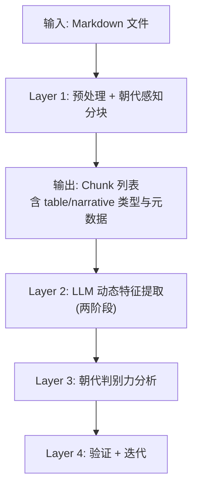
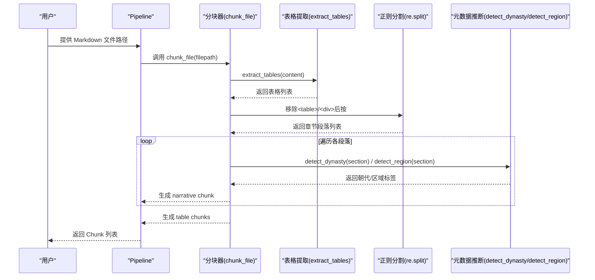
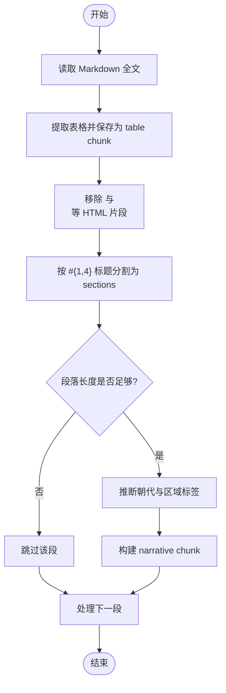
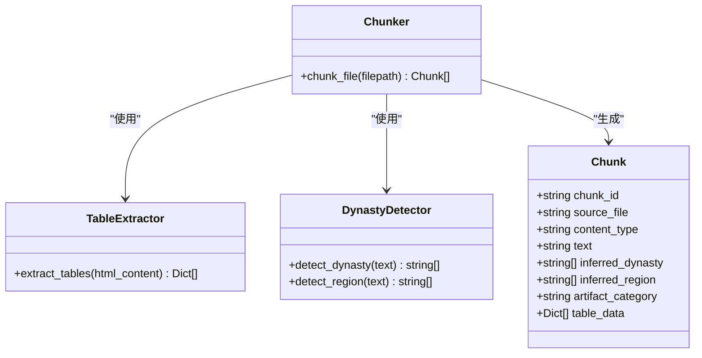
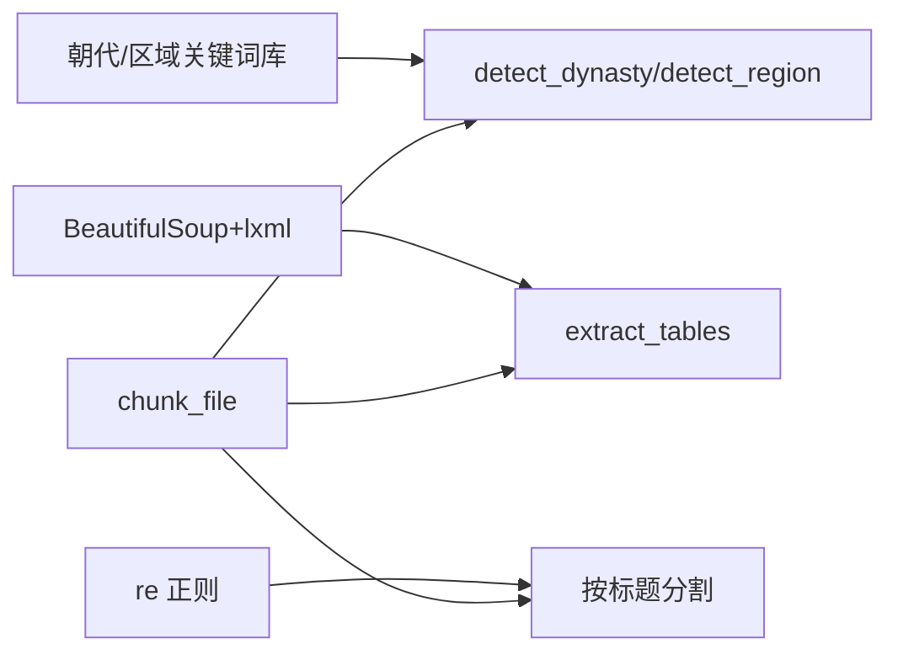

# 朝代感知分块策略

<cite>
**本文引用的文件**
- [dynasty_feature_pipeline.ipynb](file://dynasty_feature_pipeline.ipynb)
- [图像与装饰_北朝墓葬的生死表象_gq_part2.pdf_by_PaddleOCR-VL-1.6.md](file://data/图像与装饰/图像与装饰_北朝墓葬的生死表象_gq_part2.pdf_by_PaddleOCR-VL-1.6.md)
</cite>

## 目录
1. [引言](#引言)
2. [项目结构](#项目结构)
3. [核心组件](#核心组件)
4. [架构总览](#架构总览)
5. [详细组件分析](#详细组件分析)
6. [依赖关系分析](#依赖关系分析)
7. [性能考量](#性能考量)
8. [故障排查指南](#故障排查指南)
9. [结论](#结论)
10. [附录：分块效果示例](#附录分块效果示例)

## 引言
本文件聚焦于“朝代感知分块策略”，围绕 notebook 中实现的 chunk_file 函数，系统阐述其核心分块算法与朝代感知机制。该策略不采用固定大小切分，而是基于语义段落（Markdown 章节标题）与朝代边界进行智能切分；同时针对表格内容、短段落等噪声进行过滤，并生成两类 chunk：table chunk 与 narrative chunk，分别附带不同的元数据标注策略。

## 项目结构
仓库包含一个 Jupyter Notebook 与若干由 OCR 生成的 Markdown 文档。Notebook 定义了完整的预处理与分块流程，包括朝代关键词库、区域关键词库、表格提取、按章节标题分割、以及两种 chunk 类型的构建与元数据推断。

图表来源
- [dynasty_feature_pipeline.ipynb:32-48](file://dynasty_feature_pipeline.ipynb#L32-L48)

章节来源
- [dynasty_feature_pipeline.ipynb:1-48](file://dynasty_feature_pipeline.ipynb#L1-L48)

## 核心组件
- 朝代与区域关键词库：用于在文本中检测时期与地域信息，作为 chunk 的元数据标注依据。
- 表格提取器：从 HTML 片段中解析 <table> 结构，抽取表头与数据行，形成结构化表格对象。
- 朝代感知分块器（chunk_file）：将 Markdown 文件切分为多个语义单元，支持两类 chunk：
  - table chunk：以表格为独立单元，保留结构化数据与上下文元数据。
  - narrative chunk：以章节标题为边界的叙述性文本单元，去除表格与无关 HTML 标签，并进行长度过滤。
- 元数据推断：对每个 chunk 自动推断朝代与区域标签，便于后续特征发现与统计。

章节来源
- [dynasty_feature_pipeline.ipynb:316-346](file://dynasty_feature_pipeline.ipynb#L316-L346)
- [dynasty_feature_pipeline.ipynb:395-450](file://dynasty_feature_pipeline.ipynb#L395-L450)

## 架构总览
整体流水线遵循四层设计：预处理与分块、LLM 动态特征提取、朝代判别力分析、验证与迭代。其中 Layer 1 的分块策略是后续所有步骤的基础，决定了特征发现的粒度与质量。

图表来源
- [dynasty_feature_pipeline.ipynb:395-450](file://dynasty_feature_pipeline.ipynb#L395-L450)

## 详细组件分析

### 为什么不做固定大小分块？
- 考古学文献具有强结构性：章节标题、表格、注释等元素天然构成语义边界。固定大小切分会割裂完整论述或跨页表格，导致特征发现不稳定。
- 朝代与区域信息常集中在特定段落或表格中，按语义段落切分能更好地保持上下文一致性，提升后续 LLM 特征发现的质量。
- 通过朝代关键词匹配，可在段落级别进行“朝代感知”标注，避免跨朝代混合导致的信号稀释。

章节来源
- [dynasty_feature_pipeline.ipynb:54-80](file://dynasty_feature_pipeline.ipynb#L54-L80)

### 正则表达式分割逻辑
- 章节标题识别：使用模式 \n(?=#{1,4}\s) 在换行后匹配 Markdown 一级至四级标题，确保按自然章节切分。
- 表格内容移除：先通过 re.sub 移除 <table.*?</table> 与 <div.*?
 等 HTML 片段，避免干扰叙述文本的切分。
- 短段落过滤：对分割后的段落执行长度阈值判断（小于一定字符数则跳过），减少噪声与碎片化单元。

图表来源
- [dynasty_feature_pipeline.ipynb:410-450](file://dynasty_feature_pipeline.ipynb#L410-L450)

章节来源
- [dynasty_feature_pipeline.ipynb:410-450](file://dynasty_feature_pipeline.ipynb#L410-L450)

### 两种 chunk 类型的生成与元数据标注
- table chunk
  - 生成流程：使用 BeautifulSoup 解析 <table>，逐行抽取单元格文本，构造 {headers, data} 的结构化对象；将其转换为字符串作为 text 字段，并截断过长内容。
  - 元数据标注：对表格文本运行 detect_dynasty 与 detect_region，得到 inferred_dynasty 与 inferred_region；同时保留 table_data 以便后续结构化分析。
- narrative chunk
  - 生成流程：在移除表格与无关 HTML 后，按章节标题分割；对每个段落执行长度过滤；截取上限以保证后续 LLM 处理的稳定性。
  - 元数据标注：对段落文本运行 detect_dynasty 与 detect_region，得到对应的朝代与区域标签。

图表来源
- [dynasty_feature_pipeline.ipynb:361-450](file://dynasty_feature_pipeline.ipynb#L361-L450)

章节来源
- [dynasty_feature_pipeline.ipynb:361-450](file://dynasty_feature_pipeline.ipynb#L361-L450)

### 朝代关键词与区域关键词的作用
- 朝代关键词覆盖西汉、东汉、魏晋、十六国、北魏、北朝等细分时段，并包含典型帝王名、都城名等辅助词，提高检测鲁棒性。
- 区域关键词覆盖山东、幽燕、关中、中原、山西、京津冀等地理范围，有助于在分块阶段即建立空间维度标注。
- 这些关键词在 detect_dynasty 与 detect_region 中被顺序匹配，一旦命中即加入对应列表，允许一个 chunk 关联多个朝代或区域。

章节来源
- [dynasty_feature_pipeline.ipynb:316-346](file://dynasty_feature_pipeline.ipynb#L316-L346)
- [dynasty_feature_pipeline.ipynb:373-392](file://dynasty_feature_pipeline.ipynb#L373-L392)

## 依赖关系分析
- 外部库
  - pandas：用于后续特征聚合与分析（在本分块阶段未直接调用）。
  - beautifulsoup4 + lxml：用于 HTML 表格解析。
  - re：正则表达式用于章节标题分割与 HTML 清理。
  - pathlib：路径操作。
  - tqdm：进度条显示（批处理时使用）。
- 内部依赖
  - DYNASTY_KEYWORDS 与 REGION_KEYWORDS 被 detect_* 函数使用。
  - extract_tables 被 chunk_file 调用。
  - detect_dynasty 与 detect_region 被 chunk_file 在生成两类 chunk 时调用。

图表来源
- [dynasty_feature_pipeline.ipynb:316-346](file://dynasty_feature_pipeline.ipynb#L316-L346)
- [dynasty_feature_pipeline.ipynb:395-450](file://dynasty_feature_pipeline.ipynb#L395-L450)

章节来源
- [dynasty_feature_pipeline.ipynb:316-346](file://dynasty_feature_pipeline.ipynb#L316-L346)
- [dynasty_feature_pipeline.ipynb:395-450](file://dynasty_feature_pipeline.ipynb#L395-L450)

## 性能考量
- 表格提取复杂度：与表格行数与单元格数量线性相关；对于超大表格，text 字段会被截断以避免后续处理开销过大。
- 正则分割复杂度：与文档长度线性相关；由于仅做简单模式匹配，开销较低。
- 短段落过滤：减少无效 chunk 的数量，降低后续 LLM 调用成本。
- 建议优化点
  - 对长文档可引入流式读取与增量分块，避免一次性加载大文本。
  - 表格解析可考虑并行化处理多表，但需注意内存占用。
  - 可根据文件大小动态调整 text 截断阈值。

[本节为通用指导，不涉及具体文件分析]

## 故障排查指南
- 表格未被正确提取
  - 检查 HTML 片段是否包含标准 <table>/<tr>/<td> 结构；若为自定义容器，需扩展 extract_tables 的解析规则。
  - 确认已安装 beautifulsoup4 与 lxml。
- 章节标题分割异常
  - 确认 Markdown 标题格式符合 #{1,4} 规范；若存在空行或缩进差异，可调整正则模式。
- 短段落过多
  - 适当调低长度阈值或合并相邻短段，避免产生大量碎片化 chunk。
- 朝代/区域标签缺失
  - 检查关键词库是否覆盖目标术语；必要时扩充 DYNASTY_KEYWORDS 与 REGION_KEYWORDS。

章节来源
- [dynasty_feature_pipeline.ipynb:395-450](file://dynasty_feature_pipeline.ipynb#L395-L450)
- [dynasty_feature_pipeline.ipynb:316-346](file://dynasty_feature_pipeline.ipynb#L316-L346)

## 结论
该分块策略通过“语义段落 + 朝代边界”的智能切分，有效避免了固定大小切分的语义断裂问题；结合表格提取与短段落过滤，提升了后续特征发现与朝代判别分析的稳定性与准确性。两种 chunk 类型及其元数据标注策略，为考古学量化研究提供了高质量的数据基础。

[本节为总结，不涉及具体文件分析]

## 附录：分块效果示例
以下以一个实际 OCR 输出的 Markdown 为例，展示 chunk_file 的处理结果与分块效果。该文件包含图片、图注与正文段落，且多处出现“北魏”“平城”等朝代关键词。

- 输入文件
  - [图像与装饰_北朝墓葬的生死表象_gq_part2.pdf_by_PaddleOCR-VL-1.6.md](file://data/图像与装饰/图像与装饰_北朝墓葬的生死表象_gq_part2.pdf_by_PaddleOCR-VL-1.6.md)

- 分块流程概览
  - 表格提取：若存在 <table> 结构，会生成独立的 table chunk，并附带 headers 与 data。
  - 文本清理：移除 <table> 与 
 等 HTML 片段，避免干扰叙述文本。
  - 章节分割：按 #{1,4} 标题切分，例如 “## （二）墓葬的方位”、“## （三）金属饰品”、“## 四、壁畫內容” 等。
  - 短段落过滤：过短的段落将被跳过，减少噪声。
  - 元数据标注：对每个 chunk 运行 detect_dynasty 与 detect_region，得到朝代与区域标签。

- 预期输出样例（示意）
  - table chunk
    - chunk_id: “文件名_table_0”
    - content_type: “table”
    - text: “表格字符串（截断至限定长度）”
    - inferred_dynasty: “[“北魏”, …]”
    - inferred_region: “[“京津冀”, …]”
    - table_data: {“headers”: [...], “data”: [...]}
  - narrative chunk
    - chunk_id: “文件名_section_0”
    - content_type: “narrative”
    - text: “章节段落文本（截断至限定长度）”
    - inferred_dynasty: “[“北魏”, “平城”, …]”
    - inferred_region: “[“京津冀”, “山西”, …]”

- 关键观察
  - 章节标题如 “## （二）墓葬的方位” 会触发新的 narrative chunk，保证讨论主题的一致性。
  - 文本中出现“北魏”“平城”“洛阳”等词时，inferred_dynasty 会包含相应标签，体现朝代感知。
  - 若文件中存在表格，会被单独提取为 table chunk，便于后续结构化特征量化。

章节来源
- [dynasty_feature_pipeline.ipynb:410-450](file://dynasty_feature_pipeline.ipynb#L410-L450)
- [图像与装饰_北朝墓葬的生死表象_gq_part2.pdf_by_PaddleOCR-VL-1.6.md:22-122](file://data/图像与装饰/图像与装饰_北朝墓葬的生死表象_gq_part2.pdf_by_PaddleOCR-VL-1.6.md#L22-L122)