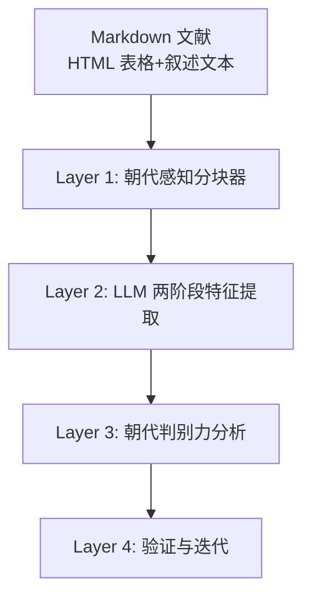
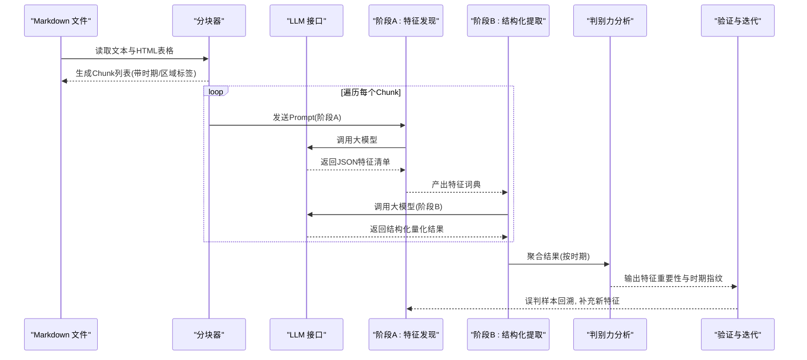
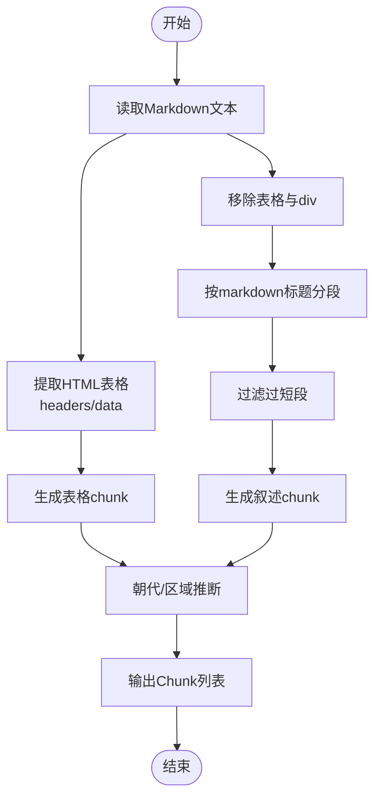
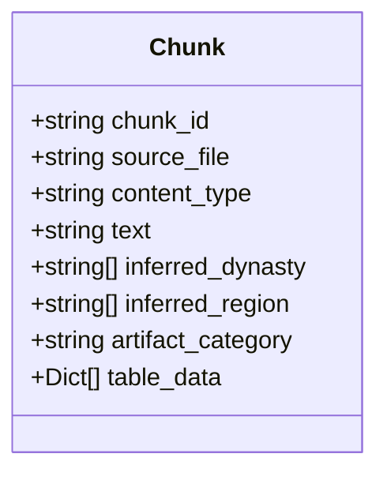
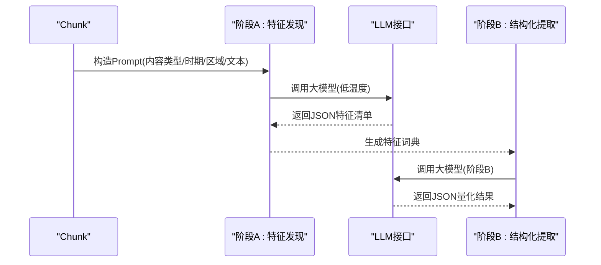
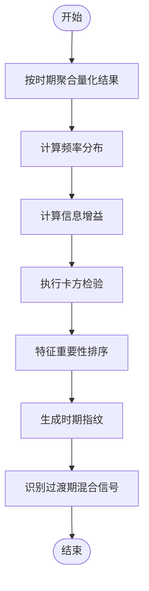
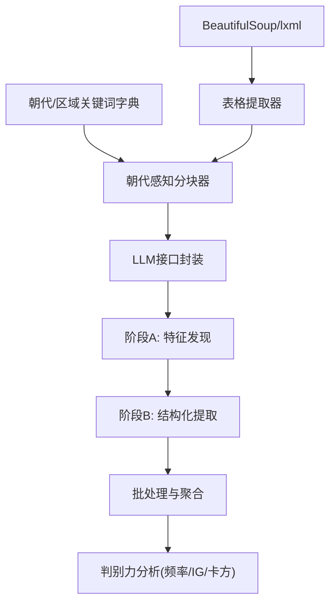

# 核心算法详解

<cite>
**本文引用的文件**   
- [dynasty_feature_pipeline.ipynb](file://dynasty_feature_pipeline.ipynb)
- [图像与装饰_北朝墓葬的生死表象_gq_part2.pdf_by_PaddleOCR-VL-1.6.md](file://data/图像与装饰/图像与装饰_北朝墓葬的生死表象_gq_part2.pdf_by_PaddleOCR-VL-1.6.md)
- [京津冀汉墓研究_part1.pdf_by_PaddleOCR-VL-1.6.md](file://data/京津冀/京津冀汉墓研究_part1.pdf_by_PaddleOCR-VL-1.6.md)
</cite>

## 目录
1. [引言](#引言)
2. [项目结构](#项目结构)
3. [核心组件](#核心组件)
4. [架构总览](#架构总览)
5. [详细组件分析](#详细组件分析)
6. [依赖关系分析](#依赖关系分析)
7. [性能考量](#性能考量)
8. [故障排查指南](#故障排查指南)
9. [结论](#结论)
10. [附录](#附录)

## 引言
本仓库实现了一个面向考古学文献的四层处理流水线，目标是从多源 Markdown 文献中动态提取可量化的器物/墓葬特征，构建用于东汉→魏晋十六国→北魏朝代识别的特征体系。流水线包含：
- Layer 1：预处理 + 朝代感知分块（按语义段落与朝代边界切分）
- Layer 2：LLM 两阶段特征提取（阶段A发现特征词典；阶段B基于词典结构化量化）
- Layer 3：朝代判别力分析（频率统计、信息增益、卡方检验等）
- Layer 4：验证与迭代（交叉验证与特征回补）

该文档聚焦于四层架构的核心算法实现细节，包括朝代感知分块器的工作原理、表格提取器的 HTML 解析逻辑、Chunk 数据结构设计，以及 LLM 两阶段特征提取机制与判别力分析的统计方法，并辅以流程图和代码片段路径帮助开发者理解。

## 项目结构
- 顶层为 Jupyter Notebook 实现的完整 Pipeline，包含数据扫描、分块、LLM 调用封装、阶段 A/B 提示词模板、批处理与聚合函数等。
- data 目录下存放由 OCR 工具生成的 Markdown 文本，其中包含大量 HTML 表格与叙述性文本，适合作为分块与特征提取的输入。

图表来源
- [dynasty_feature_pipeline.ipynb:33-48](file://dynasty_feature_pipeline.ipynb#L33-L48)

章节来源
- [dynasty_feature_pipeline.ipynb:1-48](file://dynasty_feature_pipeline.ipynb#L1-L48)

## 核心组件
- 朝代关键词与区域关键词字典：用于推断每个 chunk 的时期与区域标签，驱动分块策略。
- Chunk 数据结构：统一承载内容类型、文本、推断标签、表格数据等元信息。
- 表格提取器：从 HTML 中提取 table 结构，转换为 headers/data 列表。
- LLM 接口封装：统一 OpenAI/Anthropic 后端调用，返回结构化 JSON。
- 阶段 A 提示词模板：引导模型自然发现可量化特征，输出特征清单。
- 阶段 B 提示词模板：基于阶段 A 发现的特征词典进行结构化量化。
- 批处理与特征词典聚合：汇总所有发现特征，去重并按出现频次排序。

章节来源
- [dynasty_feature_pipeline.ipynb:307-347](file://dynasty_feature_pipeline.ipynb#L307-L347)
- [dynasty_feature_pipeline.ipynb:352-454](file://dynasty_feature_pipeline.ipynb#L352-L454)
- [dynasty_feature_pipeline.ipynb:492-543](file://dynasty_feature_pipeline.ipynb#L492-L543)
- [dynasty_feature_pipeline.ipynb:548-618](file://dynasty_feature_pipeline.ipynb#L548-L618)
- [dynasty_feature_pipeline.ipynb:657-699](file://dynasty_feature_pipeline.ipynb#L657-L699)

## 架构总览
整体流程如下：
- 输入：Markdown 文件（含 HTML 表格与叙述文本）
- Layer 1：按朝代关键词与章节标题切分为语义 chunk，同时标注时期与区域
- Layer 2：阶段 A 让 LLM 从各 chunk 自然发现特征；阶段 B 用发现出的特征词典对每个 chunk 做结构化量化
- Layer 3：将量化结果按时期聚合，计算频率分布与信息增益/卡方值，输出特征重要性排序与各时期“指纹”
- Layer 4：使用已知年代样本做交叉验证，误判样本回溯缺失特征，回到阶段 A 迭代扩充词典

图表来源
- [dynasty_feature_pipeline.ipynb:33-48](file://dynasty_feature_pipeline.ipynb#L33-L48)
- [dynasty_feature_pipeline.ipynb:548-618](file://dynasty_feature_pipeline.ipynb#L548-L618)
- [dynasty_feature_pipeline.ipynb:657-699](file://dynasty_feature_pipeline.ipynb#L657-L699)

## 详细组件分析

### 朝代感知分块器
- 工作原理
  - 先提取所有 HTML 表格作为独立 chunk（content_type="table"），便于后续结构化量化。
  - 去除表格与 div 后，按 markdown 标题分段（# ~ ####），得到叙述型 chunk（content_type="narrative"）。
  - 对每个 chunk 使用朝代关键词与区域关键词匹配，推断其所属时期与区域，形成元数据标注。
- 触发词与策略
  - 朝代关键词覆盖西汉早期/中期/晚期、东汉早期/中期/晚期、魏晋、十六国、北魏、北朝等细分时段。
  - 区域关键词覆盖山东、幽燕、关中、中原、山西、京津冀等。
  - 不做固定大小 chunk，而是以语义段落与朝代边界切分，避免切断上下文。
- 输出格式
  - 每个 chunk 包含 chunk_id、source_file、content_type、text、inferred_dynasty、inferred_region、artifact_category、table_data 等字段。

图表来源
- [dynasty_feature_pipeline.ipynb:352-454](file://dynasty_feature_pipeline.ipynb#L352-L454)
- [dynasty_feature_pipeline.ipynb:307-347](file://dynasty_feature_pipeline.ipynb#L307-L347)

章节来源
- [dynasty_feature_pipeline.ipynb:352-454](file://dynasty_feature_pipeline.ipynb#L352-L454)
- [dynasty_feature_pipeline.ipynb:307-347](file://dynasty_feature_pipeline.ipynb#L307-L347)

### 表格提取器的 HTML 解析逻辑
- 解析步骤
  - 使用 BeautifulSoup 解析 HTML，定位所有 table 节点。
  - 遍历 tr 行，收集 td/th 单元格文本，构建 rows。
  - 若存在行，则取第一行为 headers，其余为 data，存入 {headers, data} 结构。
- 适用场景
  - 适用于 PaddleOCR-VL 输出的 Markdown 中包含的 HTML 表格，如材质-钮式统计表、墓葬形制分类表、人口密度表等。
- 示例数据参考
  - 材质-钮式统计表：[wuziyin.md 中的表格:21-21](file://data/wuziyin.md#L21-L21)
  - 墓葬形制与分期表：[京津冀汉墓研究_part1.md:704-704](file://data/京津冀/京津冀汉墓研究_part1.pdf_by_PaddleOCR-VL-1.6.md#L704-L704)

章节来源
- [dynasty_feature_pipeline.ipynb:395-407](file://dynasty_feature_pipeline.ipynb#L395-L407)
- [图像与装饰_北朝墓葬的生死表象_gq_part2.pdf_by_PaddleOCR-VL-1.6.md:1-200](file://data/图像与装饰/图像与装饰_北朝墓葬的生死表象_gq_part2.pdf_by_PaddleOCR-VL-1.6.md#L1-L200)
- [京津冀汉墓研究_part1.pdf_by_PaddleOCR-VL-1.6.md:704-704](file://data/京津冀/京津冀汉墓研究_part1.pdf_by_PaddleOCR-VL-1.6.md#L704-L704)

### Chunk 数据结构设计
- 字段说明
  - chunk_id：唯一标识，如 file_table_i 或 file_section_i
  - source_file：来源文件名
  - content_type："table" 或 "narrative"
  - text：文本内容（表格或叙述）
  - inferred_dynasty：推断的朝代标签列表
  - inferred_region：推断的区域标签列表
  - artifact_category：器物类别（可选）
  - table_data：表格结构化数据（仅表格类型）
- 用途
  - 作为下游 LLM 两阶段提取的统一输入载体，确保元数据一致性与可扩展性。

图表来源
- [dynasty_feature_pipeline.ipynb:361-371](file://dynasty_feature_pipeline.ipynb#L361-L371)

章节来源
- [dynasty_feature_pipeline.ipynb:361-371](file://dynasty_feature_pipeline.ipynb#L361-L371)

### LLM 两阶段特征提取机制
- 阶段 A：特征发现（Schema Discovery）
  - 目标：不预设 schema，让模型从数据中自然发现可量化特征（计数特征）。
  - Prompt 要点：强调“不要预设类别”，要求输出 feature_name、feature_type、dynasty_signal、evidence 等字段，并以 JSON 形式返回。
  - 输出：特征清单（可能包含数值型、类别型、布尔型、比率型等）。
- 阶段 B：结构化提取（Structured Extraction）
  - 目标：基于阶段 A 发现的特征词典，对每个 chunk 进行具体数值/类别的量化提取。
  - Prompt 要点：提供“特征清单”与“文本”，要求输出 JSON，包含 dynasty、region、features 等字段。
  - 输出：结构化量化结果，便于后续统计与分析。
- 接口封装
  - 支持 OpenAI 与 Anthropic 两种后端，统一 call_llm 接口，temperature 控制稳定性。

图表来源
- [dynasty_feature_pipeline.ipynb:548-618](file://dynasty_feature_pipeline.ipynb#L548-L618)
- [dynasty_feature_pipeline.ipynb:492-543](file://dynasty_feature_pipeline.ipynb#L492-L543)

章节来源
- [dynasty_feature_pipeline.ipynb:548-618](file://dynasty_feature_pipeline.ipynb#L548-L618)
- [dynasty_feature_pipeline.ipynb:492-543](file://dynasty_feature_pipeline.ipynb#L492-L543)

### 朝代判别力分析的统计方法
- 频率统计
  - 将量化结果按时期聚合，计算每个特征在各时期的分布比例，例如某类钮式在“西汉”占比高而在“北魏”占比低。
- 信息增益
  - 衡量特征对朝代区分的贡献度，选择信息增益高的特征作为关键指标。
- 卡方检验
  - 评估特征取值与时期之间的独立性，显著性高的特征具有更强的判别力。
- 输出
  - 特征重要性排序、各时期“指纹”（关键特征组合）、过渡期的混合信号。

图表来源
- [dynasty_feature_pipeline.ipynb:158-173](file://dynasty_feature_pipeline.ipynb#L158-L173)

章节来源
- [dynasty_feature_pipeline.ipynb:158-173](file://dynasty_feature_pipeline.ipynb#L158-L173)

### 代码示例与实现路径
- 朝代关键词定义与区域关键词定义
  - 路径：[dynasty_feature_pipeline.ipynb:307-347](file://dynasty_feature_pipeline.ipynb#L307-L347)
- 朝代感知分块器实现
  - 路径：[dynasty_feature_pipeline.ipynb:352-454](file://dynasty_feature_pipeline.ipynb#L352-L454)
- 表格提取器实现
  - 路径：[dynasty_feature_pipeline.ipynb:395-407](file://dynasty_feature_pipeline.ipynb#L395-L407)
- LLM 接口封装
  - 路径：[dynasty_feature_pipeline.ipynb:492-543](file://dynasty_feature_pipeline.ipynb#L492-L543)
- 阶段 A 提示词模板与发现函数
  - 路径：[dynasty_feature_pipeline.ipynb:548-618](file://dynasty_feature_pipeline.ipynb#L548-L618)
- 批量处理与特征词典聚合
  - 路径：[dynasty_feature_pipeline.ipynb:657-699](file://dynasty_feature_pipeline.ipynb#L657-L699)

章节来源
- [dynasty_feature_pipeline.ipynb:307-347](file://dynasty_feature_pipeline.ipynb#L307-L347)
- [dynasty_feature_pipeline.ipynb:352-454](file://dynasty_feature_pipeline.ipynb#L352-L454)
- [dynasty_feature_pipeline.ipynb:395-407](file://dynasty_feature_pipeline.ipynb#L395-L407)
- [dynasty_feature_pipeline.ipynb:492-543](file://dynasty_feature_pipeline.ipynb#L492-L543)
- [dynasty_feature_pipeline.ipynb:548-618](file://dynasty_feature_pipeline.ipynb#L548-L618)
- [dynasty_feature_pipeline.ipynb:657-699](file://dynasty_feature_pipeline.ipynb#L657-L699)

## 依赖关系分析
- 外部库
  - pandas：数据处理与聚合
  - beautifulsoup4 + lxml：HTML 表格解析
  - openai / anthropic：LLM 调用
  - scipy：统计检验（卡方检验等）
  - matplotlib / plotly：可视化
  - tqdm：进度条
- 内部模块关系
  - 分块器依赖朝代/区域关键词字典
  - 表格提取器依赖 BeautifulSoup/lxml
  - LLM 接口封装被阶段 A/B 共同调用
  - 批处理与聚合函数串联阶段 A/B 的输出

图表来源
- [dynasty_feature_pipeline.ipynb:307-347](file://dynasty_feature_pipeline.ipynb#L307-L347)
- [dynasty_feature_pipeline.ipynb:395-407](file://dynasty_feature_pipeline.ipynb#L395-L407)
- [dynasty_feature_pipeline.ipynb:492-543](file://dynasty_feature_pipeline.ipynb#L492-L543)
- [dynasty_feature_pipeline.ipynb:657-699](file://dynasty_feature_pipeline.ipynb#L657-L699)

章节来源
- [dynasty_feature_pipeline.ipynb:307-347](file://dynasty_feature_pipeline.ipynb#L307-L347)
- [dynasty_feature_pipeline.ipynb:395-407](file://dynasty_feature_pipeline.ipynb#L395-L407)
- [dynasty_feature_pipeline.ipynb:492-543](file://dynasty_feature_pipeline.ipynb#L492-L543)
- [dynasty_feature_pipeline.ipynb:657-699](file://dynasty_feature_pipeline.ipynb#L657-L699)

## 性能考量
- 分块策略优化
  - 避免固定大小 chunk，减少上下文断裂导致的特征遗漏。
  - 对过长表格进行截断，降低 LLM 调用成本与超时风险。
- LLM 调用优化
  - 使用较低 temperature 提升输出稳定性。
  - 阶段 A 与阶段 B 分离，先发现再量化，减少一次性提示词长度。
- 统计计算优化
  - 使用 pandas 向量化操作进行频率统计与聚合。
  - 对大规模特征矩阵采用稀疏表示，提高信息增益与卡方检验效率。

## 故障排查指南
- HTML 表格解析失败
  - 检查 BeautifulSoup 是否成功定位 table 节点，确认 tr/td/th 是否存在。
  - 参考实现路径：[dynasty_feature_pipeline.ipynb:395-407](file://dynasty_feature_pipeline.ipynb#L395-L407)
- 分块后文本过短或缺失
  - 调整最小长度阈值，检查 markdown 标题分割正则是否正确。
  - 参考实现路径：[dynasty_feature_pipeline.ipynb:430-450](file://dynasty_feature_pipeline.ipynb#L430-L450)
- LLM 返回非 JSON 或解析错误
  - 增加 JSON 块提取逻辑与异常处理，记录 raw_response 以便人工复核。
  - 参考实现路径：[dynasty_feature_pipeline.ipynb:606-615](file://dynasty_feature_pipeline.ipynb#L606-L615)
- 判别力分析结果不稳定
  - 检查聚合维度与缺失值处理，必要时对稀疏特征进行平滑或合并。
  - 参考实现路径：[dynasty_feature_pipeline.ipynb:679-699](file://dynasty_feature_pipeline.ipynb#L679-L699)

章节来源
- [dynasty_feature_pipeline.ipynb:395-407](file://dynasty_feature_pipeline.ipynb#L395-L407)
- [dynasty_feature_pipeline.ipynb:430-450](file://dynasty_feature_pipeline.ipynb#L430-L450)
- [dynasty_feature_pipeline.ipynb:606-615](file://dynasty_feature_pipeline.ipynb#L606-L615)
- [dynasty_feature_pipeline.ipynb:679-699](file://dynasty_feature_pipeline.ipynb#L679-L699)

## 结论
本流水线通过“朝代感知分块 + LLM 两阶段特征提取 + 判别力分析 + 验证迭代”的设计，实现了从考古学文献中自动发现与量化可区分朝代的关键特征。其优势在于：
- 分块策略尊重语义与历史边界，避免上下文断裂
- 阶段 A 的自然发现机制扩展了特征空间，阶段 B 的结构化提取保证一致性
- 判别力分析提供可解释的特征重要性排序与时期间差异
- 验证与迭代闭环持续提升特征质量与模型表现

## 附录
- 示例数据参考
  - 图像与装饰（北朝墓葬）：[图像与装饰_北朝墓葬的生死表象_gq_part2.pdf_by_PaddleOCR-VL-1.6.md:1-200](file://data/图像与装饰/图像与装饰_北朝墓葬的生死表象_gq_part2.pdf_by_PaddleOCR-VL-1.6.md#L1-L200)
  - 京津冀汉墓研究（分区与形制表）：[京津冀汉墓研究_part1.pdf_by_PaddleOCR-VL-1.6.md:704-704](file://data/京津冀/京津冀汉墓研究_part1.pdf_by_PaddleOCR-VL-1.6.md#L704-L704)