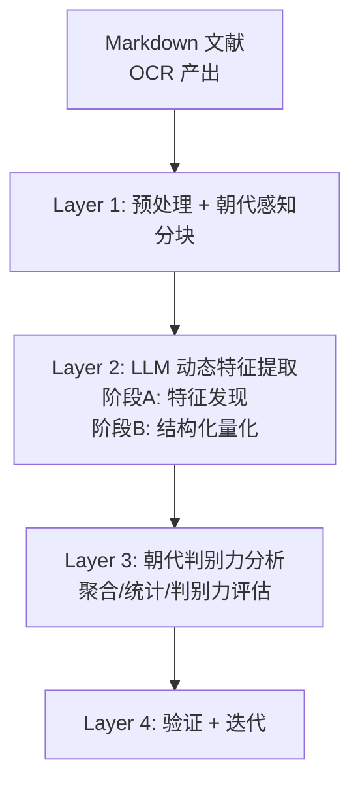
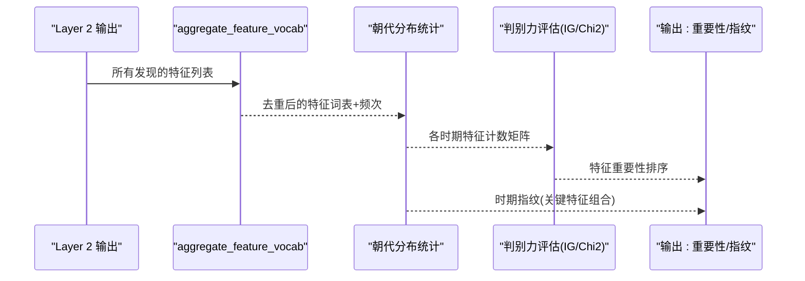
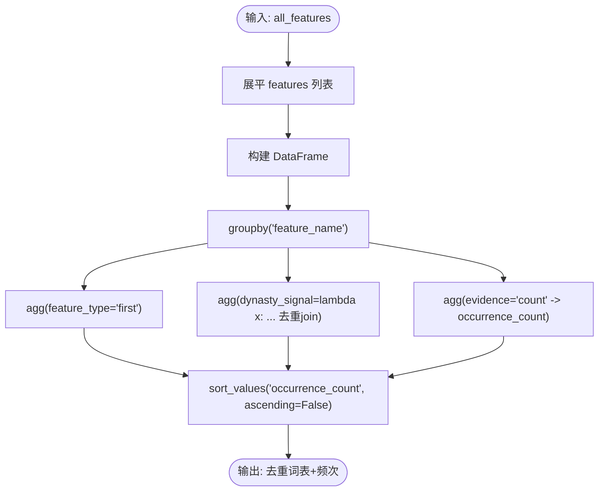
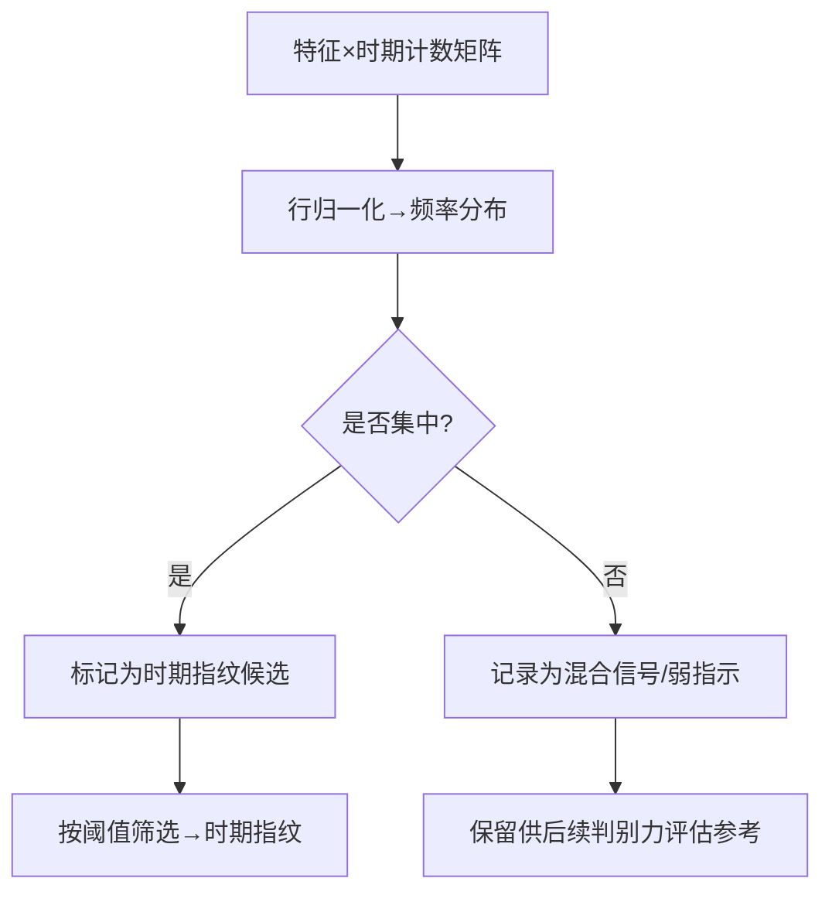
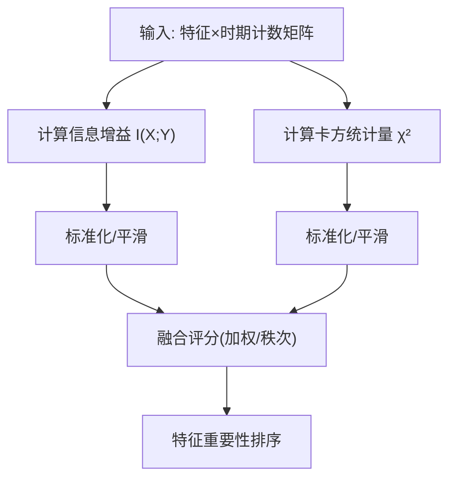
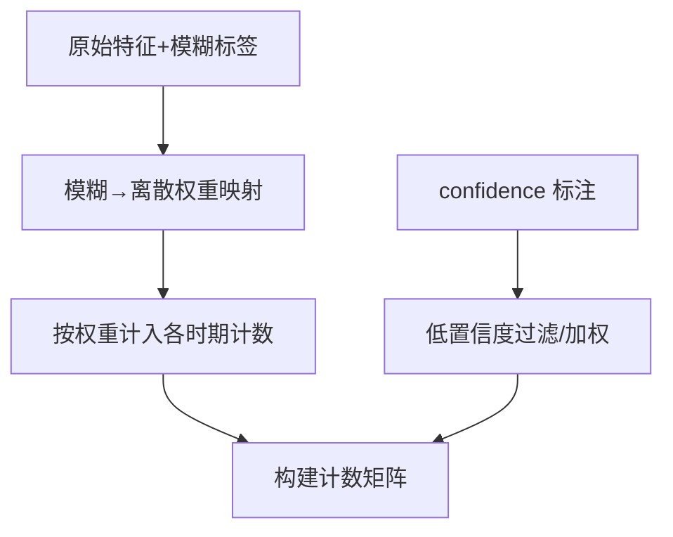
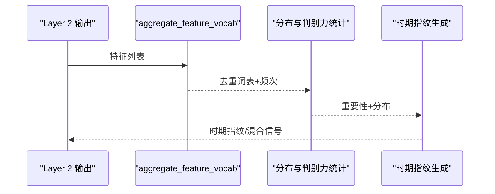

# 特征聚合与判别力分析

<cite>
**本文引用的文件**
- [dynasty_feature_pipeline.ipynb](file://dynasty_feature_pipeline.ipynb)
- [图像与装饰_北朝墓葬的生死表象_gq_part2.pdf_by_PaddleOCR-VL-1.6.md](file://data/图像与装饰/图像与装饰_北朝墓葬的生死表象_gq_part2.pdf_by_PaddleOCR-VL-1.6.md)
</cite>

## 目录
1. [引言](#引言)
2. [项目结构](#项目结构)
3. [核心组件](#核心组件)
4. [架构总览](#架构总览)
5. [详细组件分析](#详细组件分析)
6. [依赖关系分析](#依赖关系分析)
7. [性能考量](#性能考量)
8. [故障排查指南](#故障排查指南)
9. [结论](#结论)
10. [附录：示例与操作指引](#附录示例与操作指引)

## 引言
本文件聚焦于“Layer 3 朝代判别力分析”的统计方法与实现逻辑，围绕以下目标展开：
- 深入解释 aggregate_feature_vocab 函数如何实现特征去重、频率统计和重要性排序（包括 groupby 操作、lambda 函数应用与结果排序逻辑）。
- 阐述朝代分布统计方法：如何计算每个特征在不同历史时期的出现频率与分布模式。
- 详细说明信息增益与卡方检验的统计学原理，以及如何通过这些方法评估特征的朝代区分度。
- 解释如何处理模糊的朝代标签（如“东汉中晚期”“魏晋过渡”），以及置信度标注机制。
- 提供具体的统计分析示例，展示从原始特征数据生成“特征重要性”和“时期指纹”。

## 项目结构
仓库包含一个 Jupyter Notebook 作为主流程定义，以及若干 OCR 产出的 Markdown 文献作为数据来源。Notebook 定义了四层 Pipeline：预处理与分块、LLM 动态特征提取（两阶段）、朝代判别力分析、验证与迭代。Layer 3 负责将 Layer 2 输出的结构化特征按时期聚合，进行频率统计、判别力评估与输出“时期指纹”。

图表来源
- [dynasty_feature_pipeline.ipynb:33-47](file://dynasty_feature_pipeline.ipynb#L33-L47)

章节来源
- [dynasty_feature_pipeline.ipynb:1-48](file://dynasty_feature_pipeline.ipynb#L1-L48)

## 核心组件
- 朝代关键词与区域关键词映射：用于在分块阶段推断 chunk 所属朝代与区域。
- Chunk 数据结构：承载文本、表格、推断朝代/区域、内容类型等元信息。
- 分块器：按语义段落与朝代边界切分，并独立抽取 HTML 表格为结构化数据。
- LLM 调用封装：统一 OpenAI/Anthropic 后端接口。
- 阶段 A/B Prompt 模板：驱动 LLM 发现与量化特征。
- 批处理与特征词典聚合：aggregate_feature_vocab 对多源特征进行去重、合并与排序。

章节来源
- [dynasty_feature_pipeline.ipynb:316-346](file://dynasty_feature_pipeline.ipynb#L316-L346)
- [dynasty_feature_pipeline.ipynb:361-453](file://dynasty_feature_pipeline.ipynb#L361-L453)
- [dynasty_feature_pipeline.ipynb:506-541](file://dynasty_feature_pipeline.ipynb#L506-L541)
- [dynasty_feature_pipeline.ipynb:557-617](file://dynasty_feature_pipeline.ipynb#L557-L617)
- [dynasty_feature_pipeline.ipynb:666-698](file://dynasty_feature_pipeline.ipynb#L666-L698)

## 架构总览
Layer 3 的核心任务是将 Layer 2 产出的特征集合按“朝代/时期”维度进行聚合，完成：
- 特征去重与频次统计
- 各时期分布模式估计
- 判别力指标计算（信息增益、卡方检验）
- 输出“特征重要性排序”和“时期指纹”

图表来源
- [dynasty_feature_pipeline.ipynb:158-173](file://dynasty_feature_pipeline.ipynb#L158-L173)
- [dynasty_feature_pipeline.ipynb:678-698](file://dynasty_feature_pipeline.ipynb#L678-L698)

## 详细组件分析

### 组件一：aggregate_feature_vocab 的实现逻辑
该函数接收 Layer 2 产出的所有特征条目，执行以下关键步骤：
- 展平与构建 DataFrame：将所有 features 列表扁平化，构造以 feature_name 为主键的数据表。
- 去重与聚合：使用 groupby("feature_name") 对同名特征进行合并。
  - feature_type：取首个值（first）。
  - dynasty_signal：通过 lambda 函数对逗号分隔的字符串做 split 与 set 去重后重新 join，消除重复信号项。
  - occurrence_count：统计同一特征出现的次数（evidence 列 count）。
- 重要性排序：按 occurrence_count 降序排列，得到“高频优先”的特征词表。

图表来源
- [dynasty_feature_pipeline.ipynb:678-698](file://dynasty_feature_pipeline.ipynb#L678-L698)

章节来源
- [dynasty_feature_pipeline.ipynb:678-698](file://dynasty_feature_pipeline.ipynb#L678-L698)

说明要点
- groupby 分组键为 feature_name，确保同名特征被合并。
- lambda 函数内部先拼接再 split 与 set 去重，避免 dynasty_signal 中出现重复项。
- sort_values 基于 occurrence_count 降序，体现“出现越频繁，越重要”的启发式排序。

### 组件二：朝代分布统计方法
目标：计算每个特征在各历史时期的出现频率与分布模式，形成“时期指纹”。

建议实现路径（概念性说明，不直接引用代码片段）：
- 构建“特征×时期”的计数矩阵：行是特征名，列是时期（如西汉早期、东汉中期、魏晋、十六国、北魏等），值为该特征在该时期出现的次数。
- 归一化为频率：对每行求和并按行归一化，得到“某特征在各时期的相对分布”。
- 分布模式刻画：
  - 峰值时期：某特征占比最高的时期。
  - 集中度指标：可用熵或基尼系数衡量分布集中程度。
  - 混合信号：若某特征在相邻时期均有较高占比，则视为过渡期混合信号。
- 时期指纹：对各时期选取“高占比且高判别力”的特征子集，构成该时期的代表性特征组合。

[此图为概念流程图，无需图表来源]

### 组件三：信息增益与卡方检验的统计学原理与应用
- 信息增益（Mutual Information / Feature Importance via Entropy）
  - 思想：衡量特征 X 与类别 Y（朝代）之间的互信息大小。互信息越大，说明 X 对 Y 的预测能力越强。
  - 离散情形：I(X;Y)=Σ_x Σ_y P(x,y) log(P(x,y)/(P(x)P(y)))。实践中常用基于计数的近似估计。
  - 用途：对每个特征计算其 I(X;Y)，作为重要性评分；可结合阈值筛选强判别特征。
- 卡方检验（Chi-squared Test of Independence）
  - 思想：检验特征取值与朝代是否独立。若拒绝独立性假设，说明特征与朝代相关。
  - 统计量：χ²=Σ (O-E)²/E，其中 O 为观测频数，E 为期望频数（基于行列边际分布）。
  - 用途：对每个特征计算 χ² 及 p 值，p 值越小表示与朝代关联越强；可用于显著性筛选。

实践建议
- 将“特征×时期”计数矩阵作为输入，分别计算 IG 与 χ²。
- 对 IG 与 χ² 进行标准化与融合（如加权平均或秩次融合），得到综合重要性。
- 针对稀疏特征（低频）可采用平滑（如加一平滑）以避免零概率问题。

[此图为概念流程图，无需图表来源]

### 组件四：模糊朝代标签与置信度标注机制
- 模糊标签处理
  - 允许“东汉中晚期”“魏晋过渡”等连续/过渡型标签，不强制离散分类。
  - 策略：
    - 区间映射：将模糊标签映射到多个离散时期并赋予权重（如“东汉中晚期”→“东汉早期:0.3, 东汉中期:0.4, 东汉晚期:0.3”）。
    - 邻域扩散：在相邻时期间进行软分配，保留过渡期的混合信号。
- 置信度标注
  - 每个提取值附带 confidence（0~1），由 LLM 自评。
  - 低置信度样本进入人工复核队列；在统计时可按 confidence 加权计数，降低噪声影响。
  - 在判别力评估中，可对低置信度样本施加惩罚或剔除。

[此图为概念流程图，无需图表来源]

章节来源
- [dynasty_feature_pipeline.ipynb:217-219](file://dynasty_feature_pipeline.ipynb#L217-L219)
- [dynasty_feature_pipeline.ipynb:586-592](file://dynasty_feature_pipeline.ipynb#L586-L592)

### 组件五：从原始特征到“时期指纹”的具体流程
- 输入：Layer 2 的结构化特征（含 feature_name、feature_type、dynasty_signal、evidence、confidence 等）。
- 步骤：
  1) 使用 aggregate_feature_vocab 去重与频次统计。
  2) 依据朝代标签（含模糊标签）构建“特征×时期”计数矩阵。
  3) 计算信息增益与卡方，得到特征重要性。
  4) 对每个时期选择“高占比+高判别力”的特征子集，形成“时期指纹”。
  5) 输出：特征重要性排序、各时期指纹、过渡期混合信号清单。

图表来源
- [dynasty_feature_pipeline.ipynb:678-698](file://dynasty_feature_pipeline.ipynb#L678-L698)
- [dynasty_feature_pipeline.ipynb:158-173](file://dynasty_feature_pipeline.ipynb#L158-L173)

## 依赖关系分析
- 外部库
  - pandas：DataFrame 构建、groupby/agg/sort_values 等数据处理。
  - scipy：统计模块（卡方检验、信息增益等）。
  - matplotlib/plotly：可视化（可选）。
  - tqdm：进度条。
  - BeautifulSoup/lxml：HTML 表格解析。
  - openai/anthropic：LLM 调用。
- 内部依赖
  - Chunk 结构与分块器为 Layer 2 提供输入。
  - LLM Prompt 模板决定特征发现与量化的质量。
  - aggregate_feature_vocab 为 Layer 3 统计提供基础词表与频次。

章节来源
- [dynasty_feature_pipeline.ipynb:253-255](file://dynasty_feature_pipeline.ipynb#L253-L255)
- [dynasty_feature_pipeline.ipynb:204-206](file://dynasty_feature_pipeline.ipynb#L204-L206)
- [dynasty_feature_pipeline.ipynb:395-407](file://dynasty_feature_pipeline.ipynb#L395-L407)
- [dynasty_feature_pipeline.ipynb:506-541](file://dynasty_feature_pipeline.ipynb#L506-L541)
- [dynasty_feature_pipeline.ipynb:678-698](file://dynasty_feature_pipeline.ipynb#L678-L698)

## 性能考量
- 大数据量下的 groupby 与 agg：尽量向量化操作，避免逐行 Python 循环；必要时分块处理。
- 稀疏矩阵：当特征×时期矩阵稀疏时，可使用稀疏格式存储与运算，减少内存占用。
- 平滑与数值稳定：在 IG 与 χ² 计算中加入小常数平滑，防止零计数导致数值不稳定。
- 并行化：对大量 chunk 的 LLM 调用与统计计算可进行并发处理，注意 API 限流与重试。

[本节为通用指导，无需章节来源]

## 故障排查指南
- JSON 解析失败
  - 现象：LLM 返回非标准 JSON，导致解析错误。
  - 处理：正则提取 JSON 块，捕获异常并回退到空特征列表；记录 raw_response 便于人工审查。
- 低置信度特征过多
  - 现象：大量 confidence 偏低，影响统计稳定性。
  - 处理：设置阈值过滤或加权计数；建立人工复核队列。
- 模糊标签导致分布分散
  - 现象：过渡期标签使特征分布过于分散，难以识别指纹。
  - 处理：采用区间映射与邻域扩散策略；对过渡期单独建模。
- 统计结果不稳定
  - 现象：某些特征因样本少导致 IG/χ² 波动大。
  - 处理：增加平滑；提高最小样本阈值；对结果进行稳健性检验。

章节来源
- [dynasty_feature_pipeline.ipynb:606-617](file://dynasty_feature_pipeline.ipynb#L606-L617)
- [dynasty_feature_pipeline.ipynb:586-592](file://dynasty_feature_pipeline.ipynb#L586-L592)

## 结论
Layer 3 通过“去重—聚合—分布—判别力—指纹”的流水线，将 Layer 2 的动态特征转化为可解释的考古学知识：
- aggregate_feature_vocab 提供了高效、可扩展的词表构建与排序机制。
- 朝代分布统计与信息增益/卡方检验共同刻画了特征的时期区分度。
- 模糊标签与置信度机制增强了系统对真实考古语境的适应性。
- “时期指纹”为后续模型训练与交叉验证提供了高质量特征集。

[本节为总结性内容，无需章节来源]

## 附录：示例与操作指引

### 示例一：从原始特征到词表与频次
- 输入：Layer 2 输出的 features 列表（每条包含 feature_name、feature_type、dynasty_signal、evidence、confidence）。
- 处理：
  - 展平列表，构建 DataFrame。
  - 使用 groupby("feature_name") 聚合：
    - feature_type 取 first。
    - dynasty_signal 经 lambda 去重后 join。
    - evidence 计数得到 occurrence_count。
  - 按 occurrence_count 降序排序。
- 输出：去重词表与频次，用于后续判别力评估。

章节来源
- [dynasty_feature_pipeline.ipynb:678-698](file://dynasty_feature_pipeline.ipynb#L678-L698)

### 示例二：构建“特征×时期”计数矩阵
- 输入：带朝代标签（含模糊标签）的特征条目。
- 处理：
  - 对模糊标签进行区间映射，得到各时期的权重。
  - 按权重累加至对应单元格，得到计数矩阵。
  - 行归一化得到频率分布。
- 输出：计数矩阵与频率矩阵，用于 IG/χ² 计算与指纹生成。

[本节为概念性示例，无需章节来源]

### 示例三：信息增益与卡方检验
- 输入：计数矩阵。
- 处理：
  - 计算 I(X;Y) 与 χ²，并进行标准化与平滑。
  - 融合两项指标得到综合重要性。
- 输出：特征重要性排序与显著性列表。

[本节为概念性示例，无需章节来源]

### 示例四：生成“时期指纹”
- 输入：频率矩阵与重要性排序。
- 处理：
  - 对每个时期选择“高占比+高重要性”的特征子集。
  - 对过渡期保留“混合信号”特征。
- 输出：各时期指纹与混合信号清单。

[本节为概念性示例，无需章节来源]

### 数据样例参考
- 数据文件示例：北朝墓葬图像与装饰相关 Markdown，可作为 Layer 1 与 Layer 2 的输入素材。
- 观察点：文本中包含丰富的时期描述与器物细节，适合用于特征发现与量化。

章节来源
- [图像与装饰_北朝墓葬的生死表象_gq_part2.pdf_by_PaddleOCR-VL-1.6.md:1-200](file://data/图像与装饰/图像与装饰_北朝墓葬的生死表象_gq_part2.pdf_by_PaddleOCR-VL-1.6.md#L1-L200)