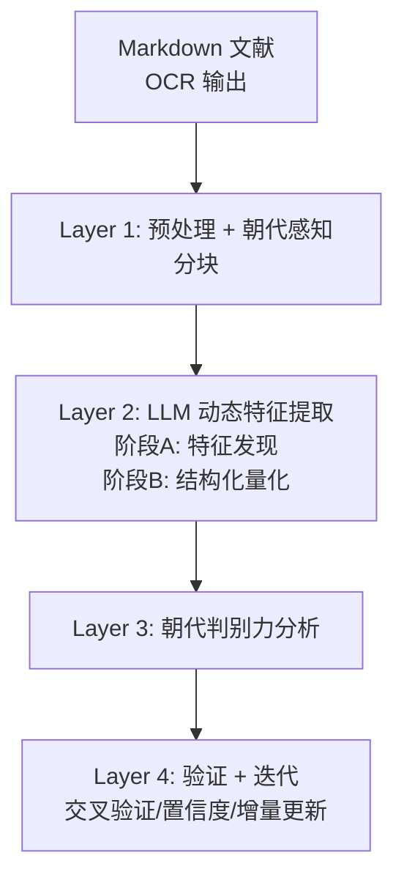
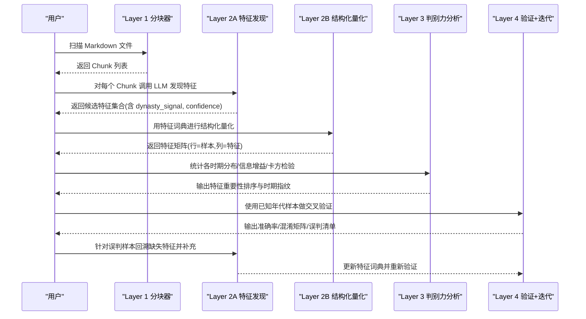
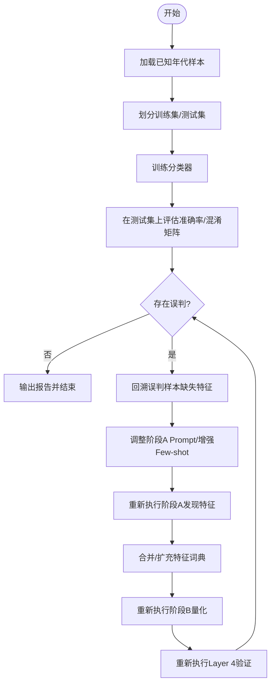
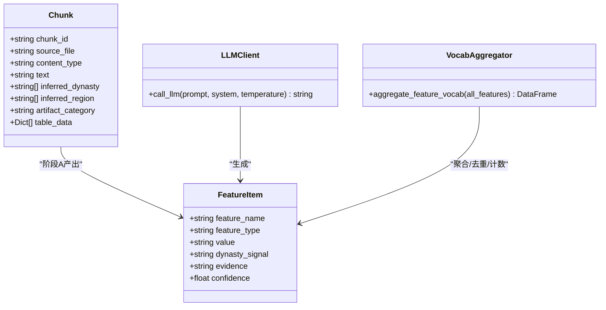
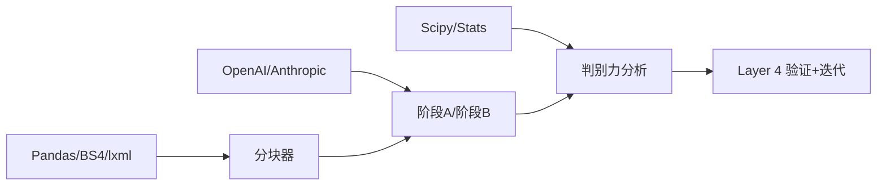

# 验证机制与迭代优化

<cite>
**本文引用的文件**   
- [dynasty_feature_pipeline.ipynb](file://dynasty_feature_pipeline.ipynb)
- [图像与装饰_北朝墓葬的生死表象_gq_part2.pdf_by_PaddleOCR-VL-1.6.md](file://data/图像与装饰/图像与装饰_北朝墓葬的生死表象_gq_part2.pdf_by_PaddleOCR-VL-1.6.md)
</cite>

## 目录
1. [引言](#引言)
2. [项目结构](#项目结构)
3. [核心组件](#核心组件)
4. [架构总览](#架构总览)
5. [详细组件分析](#详细组件分析)
6. [依赖关系分析](#依赖关系分析)
7. [性能考量](#性能考量)
8. [故障排查指南](#故障排查指南)
9. [结论](#结论)
10. [附录：示例与案例](#附录示例与案例)

## 引言
本文件聚焦于“Layer 4 验证与迭代优化”的工作流程，围绕以下目标展开：
- 说明如何利用已知年代的墓葬数据进行交叉验证，包括训练集/测试集划分、分类准确率计算与误判分析。
- 阐述迭代优化流程：当某些墓葬被误判时，如何回看缺失特征并补充新特征类型。
- 解释置信度评估机制：LLM 自评置信度的含义与低置信度结果的标记策略。
- 说明增量更新机制：新文件进入后如何扩充特征词典。
- 提供具体验证示例与优化案例，展示如何通过迭代改进特征提取质量与朝代识别准确性。

## 项目结构
仓库包含一个 Jupyter Notebook 作为主实现载体，以及若干经 OCR 处理后的 Markdown 数据文件。Notebook 定义了四层 Pipeline，其中 Layer 4 负责“验证 + 迭代”。

图示来源
- [dynasty_feature_pipeline.ipynb:33-48](file://dynasty_feature_pipeline.ipynb#L33-L48)

章节来源
- [dynasty_feature_pipeline.ipynb:1-48](file://dynasty_feature_pipeline.ipynb#L1-L48)

## 核心组件
- 朝代关键词与区域关键词：用于分块与元数据标注，支撑后续分层处理与可追溯性。
- Chunk 数据结构：统一封装文本/表格片段及其推断标签，便于下游 LLM 调用与聚合。
- 分块器：按语义段落与朝代边界切分，避免固定长度切分导致的语义断裂。
- LLM 接口：统一封装 OpenAI/Anthropic 调用，支持 function calling/JSON 模式。
- 阶段 A（特征发现）：从文本中自然浮现可量化特征，附带 dynasty_signal 与 confidence。
- 阶段 B（结构化量化）：基于已发现特征词典对每个 chunk 做数值/类别抽取。
- 批处理与词表聚合：汇总所有发现的特征，生成去重且带频次的特征词典。

章节来源
- [dynasty_feature_pipeline.ipynb:316-346](file://dynasty_feature_pipeline.ipynb#L316-L346)
- [dynasty_feature_pipeline.ipynb:361-454](file://dynasty_feature_pipeline.ipynb#L361-L454)
- [dynasty_feature_pipeline.ipynb:506-541](file://dynasty_feature_pipeline.ipynb#L506-L541)
- [dynasty_feature_pipeline.ipynb:557-618](file://dynasty_feature_pipeline.ipynb#L557-L618)
- [dynasty_feature_pipeline.ipynb:665-698](file://dynasty_feature_pipeline.ipynb#L665-L698)

## 架构总览
下图展示了从输入到 Layer 4 的整体数据流与控制流，突出 Layer 4 在闭环中的位置。

图示来源
- [dynasty_feature_pipeline.ipynb:33-48](file://dynasty_feature_pipeline.ipynb#L33-L48)
- [dynasty_feature_pipeline.ipynb:557-618](file://dynasty_feature_pipeline.ipynb#L557-L618)
- [dynasty_feature_pipeline.ipynb:665-698](file://dynasty_feature_pipeline.ipynb#L665-L698)

## 详细组件分析

### Layer 4 验证与迭代优化工作流
Layer 4 的核心目标是：以“已知年代的墓葬”为真值，利用已提取的特征进行模型验证，并通过误判驱动特征迭代与增量更新。

- 交叉验证机制
  - 训练集/测试集划分：将带有明确朝代标签的样本划分为训练集与测试集；可采用 K 折或留一法，保证不同时期/区域的均衡覆盖。
  - 分类准确率计算：在测试集上统计预测朝代与真实朝代一致的比例；同时输出混淆矩阵，定位易混淆的时期对。
  - 误判分析：对错误样本逐条回溯其缺失/弱信号特征，结合 Layer 3 的判别力结果，识别“该时期指纹”是否缺失或不稳定。

- 迭代优化流程
  - 触发条件：当某类样本（如“十六国”）频繁误判为相邻时期（如“魏晋”或“北魏”），则进入回看环节。
  - 回看缺失特征：检查这些样本在 Layer 2A 的发现阶段是否遗漏了关键区分特征（例如特定器物组合、形制比例、方位偏好等）。
  - 补充新特征类型：通过调整 Prompt 或引入新的上下文提示，让 LLM 在阶段 A 中主动关注该类差异点，并在阶段 B 中新增对应字段。
  - 重新验证：用更新后的特征词典再次运行 Layer 2B 与 Layer 4，观察准确率与混淆矩阵变化，确认改进有效。

- 置信度评估机制
  - LLM 自评置信度：在阶段 A 的输出中包含 confidence 字段（0.0–1.0），表示 LLM 对当前特征提取结果的把握程度。
  - 低置信度标记策略：对低于阈值的条目自动标记为“待复核”，并纳入人工校验队列；在 Layer 4 中可将低置信度样本单独统计，观察其对整体准确率的贡献与影响。
  - 置信度与误判联动：若某类误判集中出现在低置信度样本上，应优先对该类特征进行 Prompt 强化或增加 Few-shot 示例。

- 增量更新机制
  - 新文件进入：先跑阶段 A，检测是否存在新特征；若有，则合并入现有特征词典（去重、保留最高频次/最强信号）。
  - 增量验证：仅对新加入的特征维度进行局部再训练与验证，避免全量重算带来的成本。
  - 版本化：对特征词典与验证结果进行版本管理，便于回溯与对比。

图示来源
- [dynasty_feature_pipeline.ipynb:179-188](file://dynasty_feature_pipeline.ipynb#L179-L188)
- [dynasty_feature_pipeline.ipynb:557-618](file://dynasty_feature_pipeline.ipynb#L557-L618)
- [dynasty_feature_pipeline.ipynb:665-698](file://dynasty_feature_pipeline.ipynb#L665-L698)

章节来源
- [dynasty_feature_pipeline.ipynb:179-188](file://dynasty_feature_pipeline.ipynb#L179-L188)
- [dynasty_feature_pipeline.ipynb:557-618](file://dynasty_feature_pipeline.ipynb#L557-L618)
- [dynasty_feature_pipeline.ipynb:665-698](file://dynasty_feature_pipeline.ipynb#L665-L698)

### 数据与对象模型
- Chunk 数据类：承载 chunk_id、source_file、content_type、text、inferred_dynasty、inferred_region、artifact_category、table_data 等字段，确保下游处理一致性。
- 分块器：按朝代关键词与章节标题切分，分别处理表格与叙述文本，输出多个 Chunk。
- LLM 接口：统一封装 OpenAI/Anthropic 调用，支持 system prompt 与 temperature 控制。
- 阶段 A 发现：要求输出 JSON，包含 feature_name、feature_type、value、dynasty_signal、evidence、confidence。
- 批处理与词表聚合：遍历所有文件生成 chunks，聚合特征并统计出现次数，形成特征词典。

图示来源
- [dynasty_feature_pipeline.ipynb:361-454](file://dynasty_feature_pipeline.ipynb#L361-L454)
- [dynasty_feature_pipeline.ipynb:506-541](file://dynasty_feature_pipeline.ipynb#L506-L541)
- [dynasty_feature_pipeline.ipynb:557-618](file://dynasty_feature_pipeline.ipynb#L557-L618)
- [dynasty_feature_pipeline.ipynb:665-698](file://dynasty_feature_pipeline.ipynb#L665-L698)

章节来源
- [dynasty_feature_pipeline.ipynb:361-454](file://dynasty_feature_pipeline.ipynb#L361-L454)
- [dynasty_feature_pipeline.ipynb:506-541](file://dynasty_feature_pipeline.ipynb#L506-L541)
- [dynasty_feature_pipeline.ipynb:557-618](file://dynasty_feature_pipeline.ipynb#L557-L618)
- [dynasty_feature_pipeline.ipynb:665-698](file://dynasty_feature_pipeline.ipynb#L665-L698)

### 置信度评估与低置信度标记策略
- 置信度含义：confidence 反映 LLM 对当前特征提取结果的把握程度，来源于模型自评估（可通过温度、系统提示与 Few-shot 示例调节）。
- 阈值策略：设定阈值（如 0.6 或 0.7），低于阈值的条目自动标记为“待复核”，并记录到审计日志。
- 误判关联：在 Layer 4 中将低置信度样本单独统计，观察其对混淆矩阵的影响；若某类误判集中在低置信度样本上，应优先强化相关特征的发现与量化。
- 人工复核：对低置信度条目进行专家复核，修正或补充证据（evidence），并反馈至 Prompt 优化。

章节来源
- [dynasty_feature_pipeline.ipynb:557-618](file://dynasty_feature_pipeline.ipynb#L557-L618)

### 增量更新机制与新文件处理
- 新文件进入：先执行阶段 A，检测是否有新特征；若有，则合并入现有特征词典（去重、保留最高频次/最强信号）。
- 局部再训练：仅对新加入的特征维度进行局部再训练与验证，避免全量重算。
- 版本管理：对特征词典与验证结果进行版本化存储，便于回溯与对比。
- 持续监控：对新增特征的稳定性与判别力进行跟踪，防止噪声特征污染。

章节来源
- [dynasty_feature_pipeline.ipynb:665-698](file://dynasty_feature_pipeline.ipynb#L665-L698)

## 依赖关系分析
- 外部依赖：pandas、BeautifulSoup、lxml、OpenAI/Anthropic SDK、scipy（可选）、matplotlib/plotly（可视化）。
- 内部依赖：分块器 → 阶段 A/B → 判别力分析 → 验证与迭代。
- 耦合与内聚：Chunk 作为核心数据载体贯穿全流程；LLM 接口解耦后端选择；词表聚合模块独立，便于替换与扩展。

图示来源
- [dynasty_feature_pipeline.ipynb:248-280](file://dynasty_feature_pipeline.ipynb#L248-L280)
- [dynasty_feature_pipeline.ipynb:506-541](file://dynasty_feature_pipeline.ipynb#L506-L541)

章节来源
- [dynasty_feature_pipeline.ipynb:248-280](file://dynasty_feature_pipeline.ipynb#L248-L280)
- [dynasty_feature_pipeline.ipynb:506-541](file://dynasty_feature_pipeline.ipynb#L506-L541)

## 性能考量
- 分块粒度：按语义段落与朝代边界切分，避免过长导致 LLM 注意力分散，也避免过短丢失上下文。
- LLM 调用成本：阶段 A 建议批量并行调用，设置较低 temperature 提升稳定性；阶段 B 可使用 JSON mode 减少解析开销。
- 特征词典规模：定期清理低频/低判别力特征，控制维度爆炸。
- 增量更新：优先局部再训练与验证，降低计算成本。

[本节为通用指导，不直接分析具体文件]

## 故障排查指南
- JSON 解析失败：阶段 A 可能返回非标准 JSON，需健壮解析（正则提取 JSON 块），并记录 raw_response 以便调试。
- 低置信度过高：检查 Prompt 是否过于宽泛或缺少 Few-shot 示例；适当提高约束与领域术语密度。
- 误判集中：查看混淆矩阵，定位易混淆时期对；针对性增强相关特征的发现与量化。
- 新特征噪声：对新增特征进行判别力分析，剔除不稳定或低区分度特征。

章节来源
- [dynasty_feature_pipeline.ipynb:557-618](file://dynasty_feature_pipeline.ipynb#L557-L618)

## 结论
Layer 4 验证与迭代优化构成了整个 Pipeline 的质量保障与进化引擎。通过交叉验证、置信度评估与误判分析，系统能够持续发现并补充关键特征，从而提升朝代识别的准确性与鲁棒性。增量更新机制确保了系统在数据增长时的可扩展性与经济性。

[本节为总结，不直接分析具体文件]

## 附录：示例与案例

### 验证示例：利用已知年代样本进行交叉验证
- 步骤
  - 准备已知年代样本：从数据集中筛选具有明确朝代标签的墓葬条目（如“北魏”、“十六国”等）。
  - 划分训练集/测试集：采用分层抽样，确保各时期/区域均衡。
  - 训练分类器：使用 Layer 2B 输出的特征矩阵训练分类器（如逻辑回归、随机森林、XGBoost 等）。
  - 评估指标：计算总体准确率、各时期召回率/精确率，输出混淆矩阵。
  - 误判分析：对错误样本回溯缺失特征，结合 Layer 3 的判别力结果，定位薄弱环节。

章节来源
- [dynasty_feature_pipeline.ipynb:179-188](file://dynasty_feature_pipeline.ipynb#L179-L188)

### 优化案例：从误判到特征补充
- 场景
  - “十六国”常被误判为“魏晋”或“北魏”，混淆矩阵显示这两类对易混淆。
- 操作
  - 回溯缺失特征：检查这些样本在阶段 A 是否遗漏了关键区分特征（如金属饰品母题、方位偏好、器物组合等）。
  - 调整 Prompt：在阶段 A 的 Prompt 中加入 Few-shot 示例，强调上述差异点。
  - 补充新特征：在阶段 B 中新增对应字段（如“双鹿纹牌饰数量”、“墓向朝向分布”等）。
  - 重新验证：再次运行 Layer 4，观察准确率与混淆矩阵改善情况。

章节来源
- [dynasty_feature_pipeline.ipynb:557-618](file://dynasty_feature_pipeline.ipynb#L557-L618)
- [dynasty_feature_pipeline.ipynb:665-698](file://dynasty_feature_pipeline.ipynb#L665-L698)

### 置信度评估与低置信度标记
- 置信度含义：confidence 表示 LLM 对当前特征提取结果的把握程度。
- 标记策略：低于阈值的条目自动标记为“待复核”，并纳入人工校验队列。
- 误判联动：若某类误判集中在低置信度样本上，应优先强化相关特征的发现与量化。

章节来源
- [dynasty_feature_pipeline.ipynb:557-618](file://dynasty_feature_pipeline.ipynb#L557-L618)

### 增量更新：新文件进来后的特征词典扩充
- 新文件进入：先跑阶段 A，检测是否有新特征；若有，则合并入现有特征词典（去重、保留最高频次/最强信号）。
- 局部再训练：仅对新加入的特征维度进行局部再训练与验证，避免全量重算。
- 版本管理：对特征词典与验证结果进行版本化存储，便于回溯与对比。

章节来源
- [dynasty_feature_pipeline.ipynb:665-698](file://dynasty_feature_pipeline.ipynb#L665-L698)

### 数据样例参考
- 样例文件：图像与装饰_北朝墓葬的生死表象_gq_part2.pdf_by_PaddleOCR-VL-1.6.md
- 用途：可作为 Layer 1 分块与 Layer 2 特征发现的输入样例，观察 LLM 是否能发现与北朝相关的特征（如方位、金属饰品、壁畫内容等）。

章节来源
- [图像与装饰_北朝墓葬的生死表象_gq_part2.pdf_by_PaddleOCR-VL-1.6.md:1-200](file://data/图像与装饰/图像与装饰_北朝墓葬的生死表象_gq_part2.pdf_by_PaddleOCR-VL-1.6.md#L1-L200)