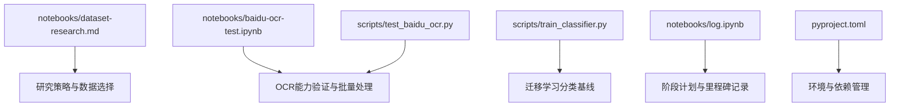
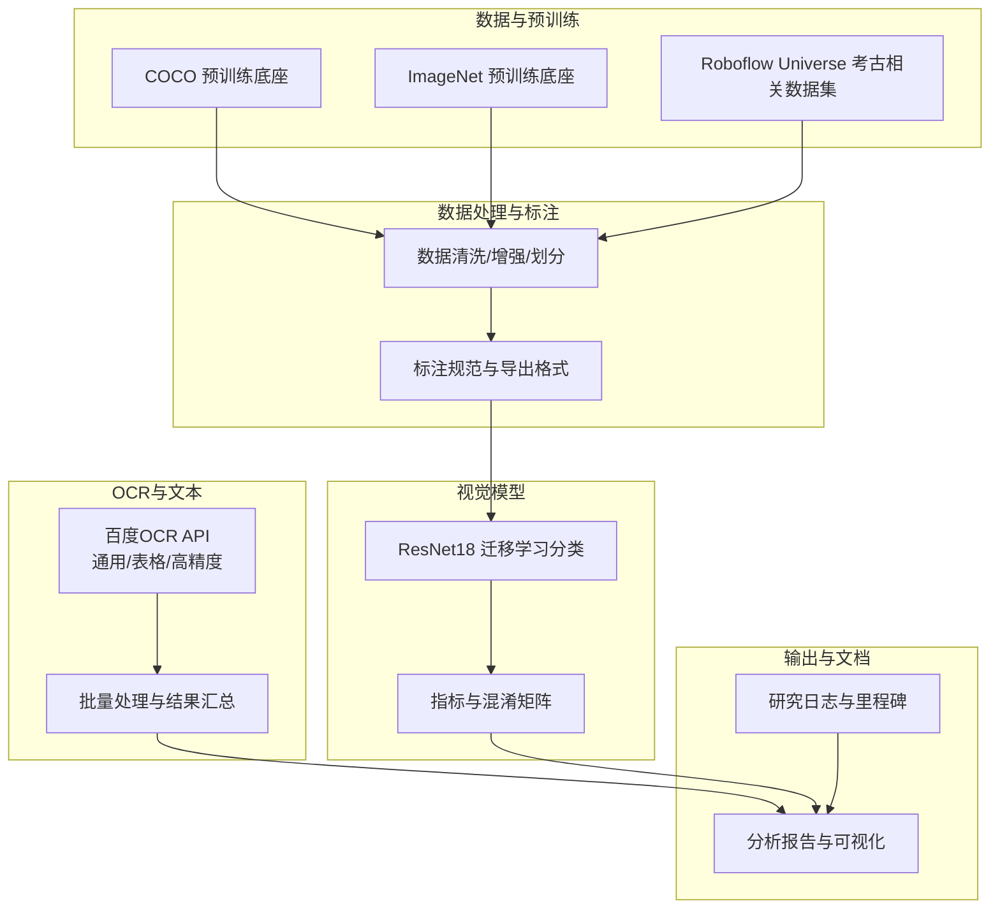
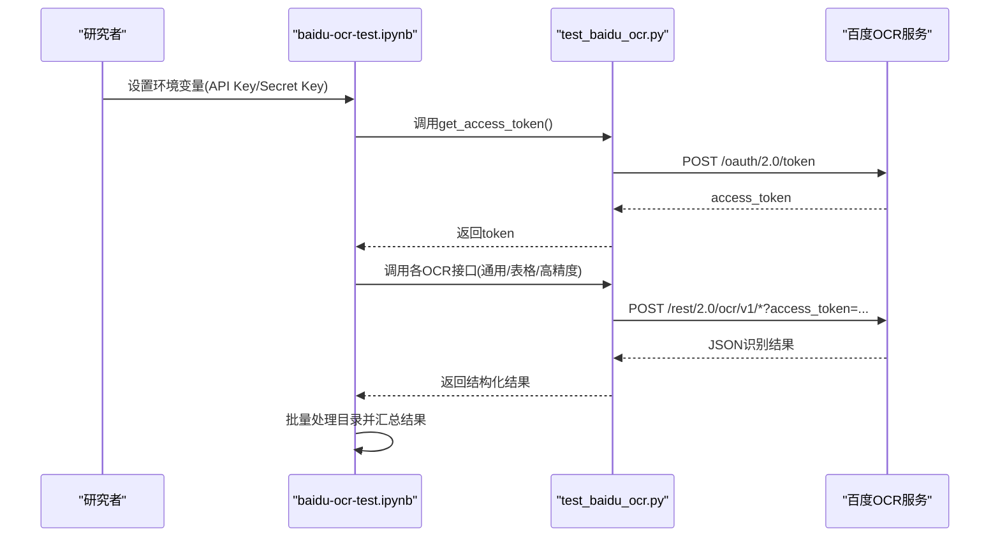
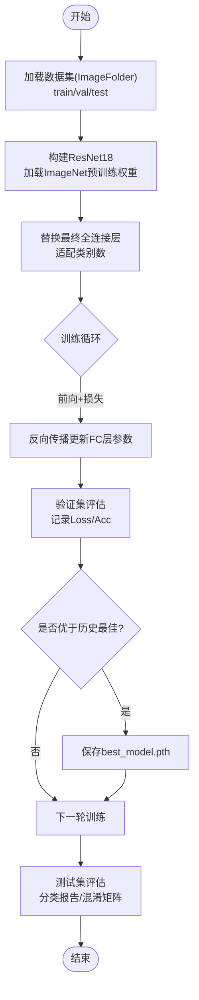
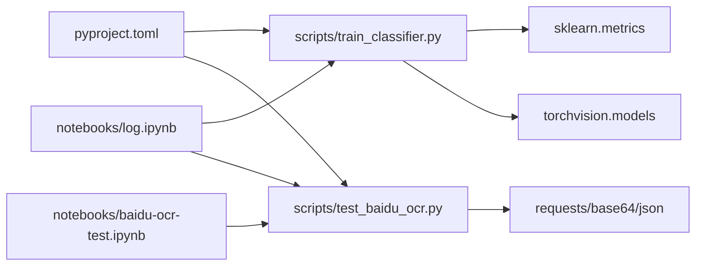

# 研究与实验

<cite>
**本文引用的文件**   
- [notebooks/dataset-research.md](file://notebooks/dataset-research.md)
- [notebooks/baidu-ocr-test.ipynb](file://notebooks/baidu-ocr-test.ipynb)
- [scripts/test_baidu_ocr.py](file://scripts/test_baidu_ocr.py)
- [scripts/train_classifier.py](file://scripts/train_classifier.py)
- [notebooks/log.ipynb](file://notebooks/log.ipynb)
- [pyproject.toml](file://pyproject.toml)
</cite>

## 目录
1. [引言](#引言)
2. [项目结构](#项目结构)
3. [核心组件](#核心组件)
4. [架构总览](#架构总览)
5. [详细组件分析](#详细组件分析)
6. [依赖关系分析](#依赖关系分析)
7. [性能与评估](#性能与评估)
8. [复现实验指南](#复现实验指南)
9. [故障排查](#故障排查)
10. [结论与建议](#结论与建议)
11. [附录：Jupyter Notebook 实验流程与可视化](#附录jupyter-notebook-实验流程与可视化)

## 引言
本章节聚焦考古LLM项目的“研究”与“实验”部分，围绕以下目标展开：
- 基于数据集调研报告，梳理COCO、Roboflow Universe、ImageNet等预训练资源的特点与适用性。
- 给出可复现的实验设计与结果分析方法，包括模型对比、OCR精度测试与性能评估。
- 提供从数据准备、环境配置到运行脚本的完整复现步骤。
- 展示Jupyter Notebook中的实验过程与可视化思路。
- 总结研究结论、最佳实践建议与未来研究方向，为研究人员和开发者提供可复现的实验框架与分析方法。

## 项目结构
仓库采用“研究笔记 + 可执行脚本 + 工程配置”的组织方式：
- notebooks：调研与实验记录（Markdown/Notebook）
- scripts：可执行的OCR测试与分类训练脚本
- pyproject.toml：项目元信息与依赖声明入口
- main.py：最小化入口（占位）

图表来源
- [notebooks/dataset-research.md:1-287](file://notebooks/dataset-research.md#L1-L287)
- [notebooks/baidu-ocr-test.ipynb:1-331](file://notebooks/baidu-ocr-test.ipynb#L1-L331)
- [scripts/test_baidu_ocr.py:1-109](file://scripts/test_baidu_ocr.py#L1-L109)
- [scripts/train_classifier.py:1-124](file://scripts/train_classifier.py#L1-L124)
- [notebooks/log.ipynb:1-370](file://notebooks/log.ipynb#L1-L370)
- [pyproject.toml:1-8](file://pyproject.toml#L1-L8)

章节来源
- [notebooks/dataset-research.md:1-287](file://notebooks/dataset-research.md#L1-L287)
- [notebooks/log.ipynb:1-370](file://notebooks/log.ipynb#L1-L370)
- [pyproject.toml:1-8](file://pyproject.toml#L1-L8)

## 核心组件
- 数据集调研与策略制定：对COCO、Roboflow Universe、ImageNet进行特性与适用性评估，形成“通用预训练 + 领域微调”的策略。
- OCR能力验证：通过百度OCR API进行通用文字、表格、高精度识别的连通性与可用性验证，并支持批量处理。
- 图像分类基线：基于ResNet18在ImageNet预训练权重上进行迁移学习，完成二分类任务的数据加载、训练、验证与测试评估。
- 研究日志与行动计划：以Notebook形式记录阶段性进展、任务拆解与并行执行策略。

章节来源
- [notebooks/dataset-research.md:1-287](file://notebooks/dataset-research.md#L1-L287)
- [notebooks/baidu-ocr-test.ipynb:1-331](file://notebooks/baidu-ocr-test.ipynb#L1-L331)
- [scripts/test_baidu_ocr.py:1-109](file://scripts/test_baidu_ocr.py#L1-L109)
- [scripts/train_classifier.py:1-124](file://scripts/train_classifier.py#L1-L124)
- [notebooks/log.ipynb:1-370](file://notebooks/log.ipynb#L1-L370)

## 架构总览
整体研究-实验架构由“数据与预训练资源 → 数据处理与标注 → OCR与文本提取 → 视觉模型训练与评估 → 结果分析与可视化”构成。

图表来源
- [notebooks/dataset-research.md:1-287](file://notebooks/dataset-research.md#L1-L287)
- [scripts/test_baidu_ocr.py:1-109](file://scripts/test_baidu_ocr.py#L1-L109)
- [scripts/train_classifier.py:1-124](file://scripts/train_classifier.py#L1-L124)
- [notebooks/log.ipynb:1-370](file://notebooks/log.ipynb#L1-L370)

## 详细组件分析

### 组件A：数据集调研与预训练策略
- 目标：明确COCO、Roboflow Universe、ImageNet三类资源的规模、标注类型、许可证与考古相关性，形成“通用预训练 + 领域微调”的可行路径。
- 关键要点：
  - COCO：大规模通用检测/分割/关键点/全景/描述，适合作为目标检测backbone预训练；考古类别间接相关（如vase、bowl）。
  - Roboflow Universe：直接包含考古器物相关数据集，支持多格式导出，适合直接用于训练或混合训练。
  - ImageNet：超大规模分类数据集，广泛用于分类backbone预训练，考古相关synset可用于细粒度特征学习。
- 推荐策略：
  - 检测任务：使用COCO预训练权重作为backbone，结合考古数据集微调。
  - 分类任务：使用ImageNet预训练权重，针对陶瓷/石器/金属器等类别进行迁移学习。
  - 小样本场景：优先尝试Roboflow Universe考古数据集，辅以数据增强与few-shot/zero-shot策略。

章节来源
- [notebooks/dataset-research.md:1-287](file://notebooks/dataset-research.md#L1-L287)

### 组件B：OCR能力验证与批量处理
- 目标：验证百度OCR API连通性与多种识别能力（通用、表格、高精度），并实现批量处理与结构化输出。
- 关键流程：
  - 获取access token（使用API Key与Secret Key）。
  - 调用不同OCR端点（通用基础版、高精度含位置、表格识别等）。
  - 封装统一调用函数，支持任意图片路径与批量目录扫描。
  - 输出结构化结果（行级文本、表格结构、坐标信息）。
- 适用场景：
  - 报告正文文字提取（通用版）
  - 带坐标定位的精确提取（高精度版）
  - 墓葬登记表、器物统计表（表格识别）
  - 手写批注、田野记录（手写识别）
  - 低质量扫描件（网络图片识别）

图表来源
- [notebooks/baidu-ocr-test.ipynb:1-331](file://notebooks/baidu-ocr-test.ipynb#L1-L331)
- [scripts/test_baidu_ocr.py:1-109](file://scripts/test_baidu_ocr.py#L1-L109)

章节来源
- [notebooks/baidu-ocr-test.ipynb:1-331](file://notebooks/baidu-ocr-test.ipynb#L1-L331)
- [scripts/test_baidu_ocr.py:1-109](file://scripts/test_baidu_ocr.py#L1-L109)

### 组件C：迁移学习分类基线（ResNet18）
- 目标：构建一个可复现的二分类基线，验证迁移学习在考古图像上的有效性。
- 关键实现：
  - 数据加载：ImageFolder按train/val/test划分，标准化与增强（随机翻转、旋转、色彩抖动）。
  - 模型：ResNet18使用ImageNet预训练权重，替换最终全连接层适配类别数。
  - 训练：仅优化FC层参数，交叉熵损失，Adam优化器。
  - 评估：每轮计算训练/验证损失与准确率，保存最佳模型，最终在测试集上输出分类报告与混淆矩阵。
- 复杂度与性能：
  - 时间复杂度：每个epoch O(N·B)，N为样本数，B为batch_size。
  - 空间复杂度：O(C·H·W)用于单张图像张量存储，C=3，H=W=224。
  - 设备：自动选择CUDA/CPU。

图表来源
- [scripts/train_classifier.py:1-124](file://scripts/train_classifier.py#L1-L124)

章节来源
- [scripts/train_classifier.py:1-124](file://scripts/train_classifier.py#L1-L124)

### 组件D：研究日志与行动计划
- 目标：以Notebook形式记录调研发现、阶段计划与里程碑，确保研究过程可追踪与可复现。
- 内容要点：
  - 考古ML领域数据集现状与策略（通用预训练 + 自建小规模数据）。
  - 五层任务拆解（环境→PDF→QGIS→PyTorch→OCR），支持并行执行。
  - 突破记录与进度跟踪。

章节来源
- [notebooks/log.ipynb:1-370](file://notebooks/log.ipynb#L1-L370)

## 依赖关系分析
- 外部依赖与服务：
  - PyTorch/Torchvision：用于ResNet18迁移学习与数据加载。
  - scikit-learn：用于分类报告与混淆矩阵。
  - requests/base64/json：用于百度OCR API通信与结果解析。
  - 百度OCR服务：云端OCR能力。
- 内部依赖：
  - notebooks与scripts之间通过约定路径与环境变量协作。
  - pyproject.toml作为项目元信息入口，便于后续依赖管理与版本锁定。

图表来源
- [pyproject.toml:1-8](file://pyproject.toml#L1-L8)
- [scripts/train_classifier.py:1-124](file://scripts/train_classifier.py#L1-L124)
- [scripts/test_baidu_ocr.py:1-109](file://scripts/test_baidu_ocr.py#L1-L109)
- [notebooks/baidu-ocr-test.ipynb:1-331](file://notebooks/baidu-ocr-test.ipynb#L1-L331)
- [notebooks/log.ipynb:1-370](file://notebooks/log.ipynb#L1-L370)

章节来源
- [pyproject.toml:1-8](file://pyproject.toml#L1-L8)
- [scripts/train_classifier.py:1-124](file://scripts/train_classifier.py#L1-L124)
- [scripts/test_baidu_ocr.py:1-109](file://scripts/test_baidu_ocr.py#L1-L109)
- [notebooks/baidu-ocr-test.ipynb:1-331](file://notebooks/baidu-ocr-test.ipynb#L1-L331)
- [notebooks/log.ipynb:1-370](file://notebooks/log.ipynb#L1-L370)

## 性能与评估
- 图像分类基线：
  - 指标：训练/验证/测试损失与准确率；分类报告（precision/recall/f1）；混淆矩阵。
  - 训练策略：仅优化FC层，降低过拟合风险，加速收敛。
  - 设备利用：自动选择CUDA/CPU，便于在不同环境下复现。
- OCR精度测试：
  - 维度：通用文字、表格、高精度识别的召回率与准确率；手写与低质量图像的鲁棒性。
  - 输出：行级文本、表格结构、坐标信息，便于后续版面分析与区域裁剪。
- 建议：
  - 引入更多增强策略（MixUp、CutMix、RandAugment）提升泛化。
  - 使用更强大的backbone（如EfficientNet/ViT）进行对比实验。
  - 对OCR结果进行后处理（正则表达式、规则校验）提高结构化质量。

[本节为一般性讨论，不直接分析具体文件]

## 复现实验指南

### 环境配置
- Python版本要求：>=3.14（见项目配置）
- 依赖安装（示例）：
  - torch/torchvision（GPU可选）
  - scikit-learn
  - requests、base64、json（标准库）
- 环境变量：
  - BAIDU_OCR_API_KEY
  - BAIDU_OCR_SECRET_KEY

章节来源
- [pyproject.toml:1-8](file://pyproject.toml#L1-L8)

### 数据准备
- 图像分类：
  - 将数据按train/val/test组织至datasets/ArchaeoMind_dataset目录下，每个类别对应一个子文件夹。
  - 参考脚本中的数据加载逻辑与预处理配置。
- OCR测试：
  - 准备测试图片（PNG/JPG/BMP），放置于data/raw/目录，并在Notebook中修改TEST_IMAGE路径。

章节来源
- [scripts/train_classifier.py:1-124](file://scripts/train_classifier.py#L1-L124)
- [notebooks/baidu-ocr-test.ipynb:1-331](file://notebooks/baidu-ocr-test.ipynb#L1-L331)

### 运行步骤
- OCR连通性与能力验证：
  - 在终端运行：python scripts/test_baidu_ocr.py <image_path>
  - 或在Notebook中依次执行各单元，观察返回的结构化结果。
- 分类基线训练与评估：
  - 在终端运行：python scripts/train_classifier.py --epochs 5 --lr 1e-3 --batch-size 32
  - 查看控制台输出的训练/验证/测试指标与混淆矩阵。

章节来源
- [scripts/test_baidu_ocr.py:1-109](file://scripts/test_baidu_ocr.py#L1-L109)
- [scripts/train_classifier.py:1-124](file://scripts/train_classifier.py#L1-L124)
- [notebooks/baidu-ocr-test.ipynb:1-331](file://notebooks/baidu-ocr-test.ipynb#L1-L331)

## 故障排查
- 百度OCR API无法获取token：
  - 检查BAIDU_OCR_API_KEY与BAIDU_OCR_SECRET_KEY是否正确设置。
  - 确认网络连接与API配额未耗尽。
- OCR调用失败：
  - 检查图片路径是否存在且可读。
  - 确认选择的API类型有效（general_basic/table/accurate等）。
- 分类训练异常：
  - 检查datasets/ArchaeoMind_dataset目录结构与类别命名。
  - 确认torch/torchvision与scikit-learn版本兼容。
  - 若显存不足，减小batch_size或使用CPU模式。

章节来源
- [scripts/test_baidu_ocr.py:1-109](file://scripts/test_baidu_ocr.py#L1-L109)
- [scripts/train_classifier.py:1-124](file://scripts/train_classifier.py#L1-L124)

## 结论与建议
- 研究结论：
  - 考古领域缺乏统一的基准数据集，普遍采用“通用预训练 + 领域微调”的路径。
  - COCO与ImageNet分别适用于检测与分类任务的预训练底座；Roboflow Universe提供可直接使用的考古相关数据集。
  - 百度OCR在通用文字、表格与高精度识别方面具备良好可用性，适合考古报告与表格的数字化提取。
- 最佳实践：
  - 先跑通基线（ResNet18迁移学习），再逐步引入更强模型与数据增强。
  - 建立规范的标注流程与导出格式，便于后续扩展与共享。
  - 对OCR结果进行后处理与校验，提升结构化质量。
- 未来方向：
  - 探索few-shot/zero-shot方法，利用COCO/ImageNet的通用知识。
  - 构建更大规模的考古专用数据集，推动领域基准建设。
  - 集成OCR与视觉模型，形成端到端的考古资料数字化与分析流水线。

[本节为总结性内容，不直接分析具体文件]

## 附录：Jupyter Notebook 实验流程与可视化
- baidu-ocr-test.ipynb：
  - 目标：测试百度OCR API的图像识别能力，评估其对考古报告中文字、表格、手写内容的识别效果。
  - 成功标准：能正确获取access token；能调用至少3种OCR API；能输出结构化的识别结果。
  - 流程：获取token → 列出可用API → 封装OCR调用函数 → 单图测试（通用/表格/高精度）→ 批量处理 → 结果汇总。
- log.ipynb：
  - 目标：记录考古AI/ML领域的调研发现与行动计划，确保研究过程可追踪。
  - 内容：数据集现状、策略路线图、五层任务拆解、并行执行策略、突破记录。

章节来源
- [notebooks/baidu-ocr-test.ipynb:1-331](file://notebooks/baidu-ocr-test.ipynb#L1-L331)
- [notebooks/log.ipynb:1-370](file://notebooks/log.ipynb#L1-L370)