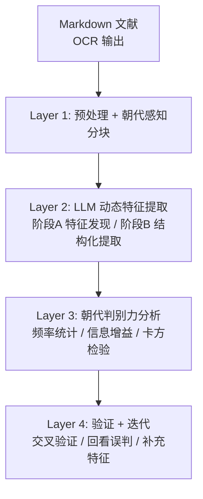
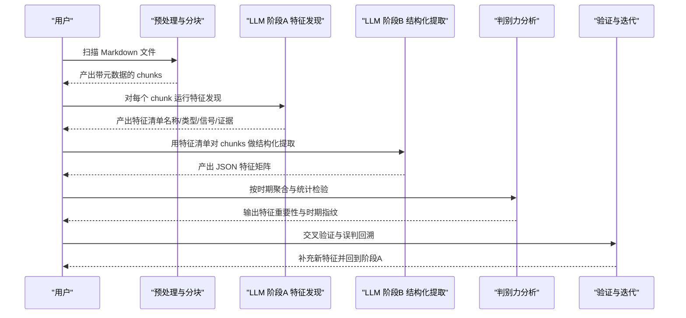
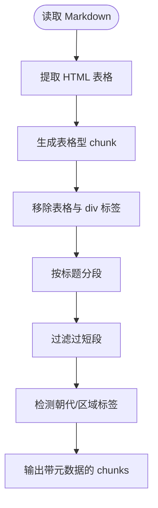
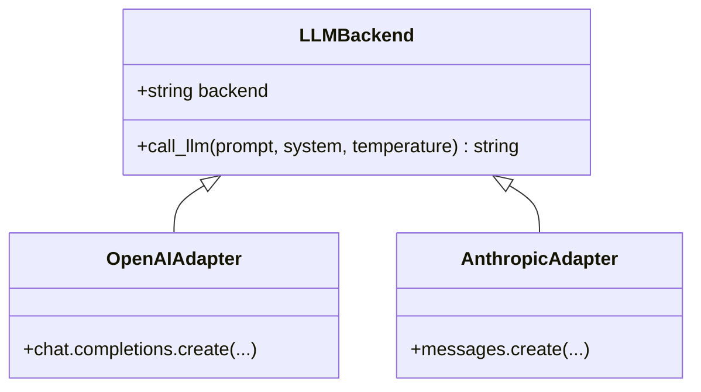
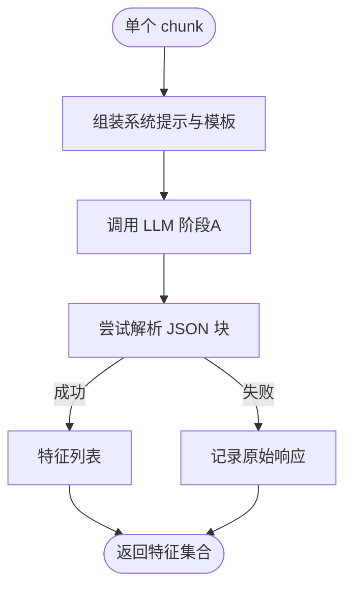
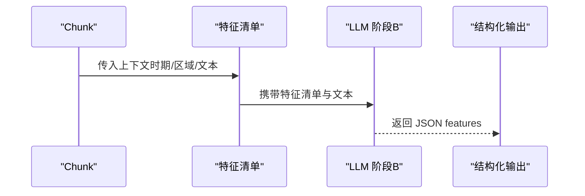
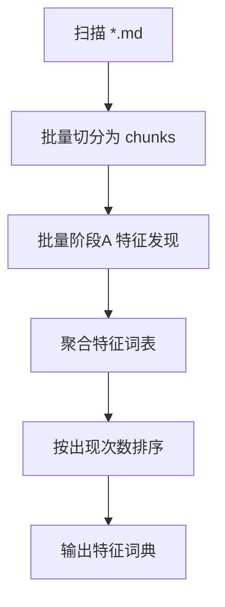
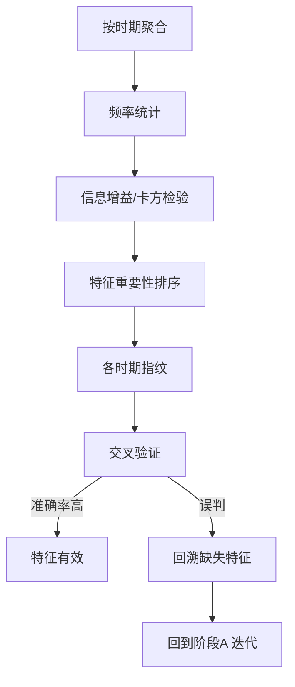
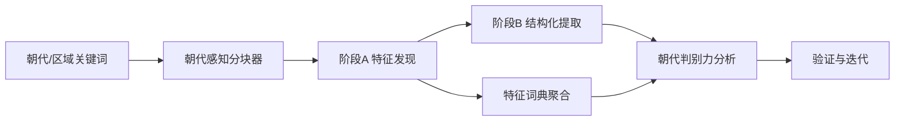

# 项目概述

<cite>
**本文引用的文件**   
- [dynasty_feature_pipeline.ipynb](file://dynasty_feature_pipeline.ipynb)
- [图像与装饰_北朝墓葬的生死表象_gq_part2.pdf_by_PaddleOCR-VL-1.6.md](file://data/图像与装饰/图像与装饰_北朝墓葬的生死表象_gq_part2.pdf_by_PaddleOCR-VL-1.6.md)
</cite>

## 目录
1. [引言](#引言)
2. [项目结构](#项目结构)
3. [核心组件](#核心组件)
4. [架构总览](#架构总览)
5. [详细组件分析](#详细组件分析)
6. [依赖关系分析](#依赖关系分析)
7. [性能考量](#性能考量)
8. [故障排查指南](#故障排查指南)
9. [结论](#结论)
10. [附录](#附录)

## 引言
本项目面向数字人文学科，目标是从考古学 Markdown 文献中动态提取可量化的器物/墓葬特征，构建东汉→魏晋十六国→北魏的朝代识别模型。项目采用四层处理架构：预处理+朝代感知分块、LLM 动态特征提取（两阶段）、朝代判别力分析、验证+迭代。通过“不预设 schema”的特征发现机制，结合大语言模型的语义理解能力与传统考古学的分期断代方法，实现对不同时期墓葬文化特征的量化建模与对比分析。

项目的创新价值在于：
- 以 LLM 驱动的特征自发现，避免人工先验类别带来的偏差；
- 将传统考古学“类型学/组合学”思路转化为可计算的特征体系；
- 在数据层面打通 OCR 文本、表格与叙述性段落，形成统一的数据管道；
- 提供从特征到判别力的闭环流程，支持持续迭代与扩展。

## 项目结构
仓库包含一个主 Notebook 与示例数据目录：
- dynasty_feature_pipeline.ipynb：定义四层 Pipeline、数据处理函数、LLM 调用接口、批处理与聚合逻辑等；
- data/图像与装饰：存放经 PaddleOCR-VL 转换的 Markdown 文档，内容涉及北朝墓葬图像与装饰主题；
- data/京津冀：预留目录，用于后续扩展其他区域数据。

图表来源
- [dynasty_feature_pipeline.ipynb:33-47](file://dynasty_feature_pipeline.ipynb#L33-L47)

章节来源
- [dynasty_feature_pipeline.ipynb:1-28](file://dynasty_feature_pipeline.ipynb#L1-L28)

## 核心组件
- 朝代关键词与区域关键词库：用于标注每个 chunk 的推断时期与区域，支撑后续分层与可视化。
- 朝代感知分块器：按语义段落与朝代边界切分，保留表格为独立 chunk，避免通用 chunker 切断语义。
- LLM 调用封装：统一 OpenAI 与 Anthropic 后端，支持 system prompt 与 temperature 控制。
- 阶段 A 特征发现：让 LLM 从数据中自然浮现可量化特征，并给出类型、朝代信号与证据。
- 阶段 B 结构化提取：基于阶段 A 发现的特征清单，对每个 chunk 做 JSON 格式的结构化数值/类别抽取。
- 批处理与特征词典聚合：遍历所有 Markdown 文件，生成去重后的特征词表及出现频次。
- 朝代判别力分析：对各时期特征分布进行统计与显著性检验，输出特征重要性排序与各时期“指纹”。
- 验证与迭代：用已知年代样本做交叉验证，根据误判结果回溯缺失特征并回到阶段 A 迭代。

章节来源
- [dynasty_feature_pipeline.ipynb:307-346](file://dynasty_feature_pipeline.ipynb#L307-L346)
- [dynasty_feature_pipeline.ipynb:352-454](file://dynasty_feature_pipeline.ipynb#L352-L454)
- [dynasty_feature_pipeline.ipynb:492-542](file://dynasty_feature_pipeline.ipynb#L492-L542)
- [dynasty_feature_pipeline.ipynb:548-618](file://dynasty_feature_pipeline.ipynb#L548-L618)
- [dynasty_feature_pipeline.ipynb:657-699](file://dynasty_feature_pipeline.ipynb#L657-L699)

## 架构总览
四层架构的设计要点：
- Layer 1：输入处理包括表格提取（HTML table → DataFrame）、叙述文本按朝代关键词分段、元数据标注（来源、时期、区域、器物类别）。
- Layer 2：两阶段 LLM 提取。阶段 A 不预设 schema，阶段 B 使用阶段 A 产出的特征清单进行结构化抽取。
- Layer 3：按时期聚合，进行频率统计与信息增益/卡方检验，输出特征重要性与各时期“指纹”。
- Layer 4：用已知年代样本做交叉验证，若误判则回溯缺失特征，回到阶段 A 迭代扩充。

图表来源
- [dynasty_feature_pipeline.ipynb:33-47](file://dynasty_feature_pipeline.ipynb#L33-L47)
- [dynasty_feature_pipeline.ipynb:548-618](file://dynasty_feature_pipeline.ipynb#L548-L618)
- [dynasty_feature_pipeline.ipynb:657-699](file://dynasty_feature_pipeline.ipynb#L657-L699)

## 详细组件分析

### 组件一：朝代感知分块器
- 功能：从 Markdown 中提取 HTML 表格作为独立 chunk，并对叙述文本按标题分段；同时检测朝代与区域标签。
- 关键设计：
  - 不做固定大小 chunk，而是按语义段落+朝代边界切分；
  - 触发词覆盖西汉/东汉/魏晋/十六国/北魏/拓跋/平城/洛阳/大同等；
  - 输出包含 chunk_id、source_file、content_type、text、inferred_dynasty、inferred_region、artifact_category、table_data。
- 复杂度：主要受限于正则分割与 BeautifulSoup 解析，时间复杂度近似 O(N)（N 为文本长度），空间复杂度取决于 chunk 数量与表格规模。

图表来源
- [dynasty_feature_pipeline.ipynb:352-454](file://dynasty_feature_pipeline.ipynb#L352-L454)

章节来源
- [dynasty_feature_pipeline.ipynb:352-454](file://dynasty_feature_pipeline.ipynb#L352-L454)

### 组件二：LLM 调用封装
- 功能：统一 OpenAI 与 Anthropic 后端，支持 system prompt 与 temperature 参数。
- 关键点：
  - 选择 backend 后自动加载对应 SDK；
  - 返回消息体中的文本内容；
  - 便于替换或扩展更多后端。

图表来源
- [dynasty_feature_pipeline.ipynb:492-542](file://dynasty_feature_pipeline.ipynb#L492-L542)

章节来源
- [dynasty_feature_pipeline.ipynb:492-542](file://dynasty_feature_pipeline.ipynb#L492-L542)

### 组件三：阶段 A — 特征发现
- 功能：不预设类别，让 LLM 从数据中自然发现可量化特征，并输出 JSON 结构（特征名、类型、朝代信号、证据、置信度）。
- Prompt 设计：强调“不要预设类别”“关注可量化、可比较的特征”“标注区分度与原文依据”。
- 解析策略：尝试从响应中提取 JSON 块，失败时记录原始响应以便人工复核。

图表来源
- [dynasty_feature_pipeline.ipynb:548-618](file://dynasty_feature_pipeline.ipynb#L548-L618)

章节来源
- [dynasty_feature_pipeline.ipynb:548-618](file://dynasty_feature_pipeline.ipynb#L548-L618)

### 组件四：阶段 B — 结构化提取
- 功能：基于阶段 A 发现的特征清单，对每个 chunk 做结构化数值/类别抽取，输出 JSON（含时期、区域、features 字典）。
- 优势：保证输出格式一致，便于后续聚合与分析。

图表来源
- [dynasty_feature_pipeline.ipynb:108-131](file://dynasty_feature_pipeline.ipynb#L108-L131)

章节来源
- [dynasty_feature_pipeline.ipynb:108-131](file://dynasty_feature_pipeline.ipynb#L108-L131)

### 组件五：批处理与特征词典聚合
- 功能：遍历所有 Markdown 文件，生成全部 chunks；聚合阶段 A 的结果，去重并统计出现次数，得到特征词表。
- 关键点：
  - 使用 tqdm 显示进度；
  - 按 feature_name 分组，合并 dynasty_signal，统计 occurrence_count。

图表来源
- [dynasty_feature_pipeline.ipynb:657-699](file://dynasty_feature_pipeline.ipynb#L657-L699)

章节来源
- [dynasty_feature_pipeline.ipynb:657-699](file://dynasty_feature_pipeline.ipynb#L657-L699)

### 组件六：朝代判别力分析与验证迭代
- 判别力分析：按时期聚合特征，进行频率统计与信息增益/卡方检验，输出特征重要性排序与各时期“指纹”，以及过渡期的混合信号。
- 验证与迭代：用已知年代的墓葬样本做交叉验证；若某些墓葬被误判，回看缺失特征，补充新特征并回到阶段 A 迭代。

图表来源
- [dynasty_feature_pipeline.ipynb:158-189](file://dynasty_feature_pipeline.ipynb#L158-L189)

章节来源
- [dynasty_feature_pipeline.ipynb:158-189](file://dynasty_feature_pipeline.ipynb#L158-L189)

## 依赖关系分析
- 外部依赖：pandas、BeautifulSoup、lxml、openai/anthropic、scipy、matplotlib/plotly、tqdm。
- 内部模块关系：
  - 分块器依赖朝代/区域关键词库；
  - 阶段 A/B 依赖 LLM 调用封装；
  - 批处理与聚合依赖分块器与阶段 A 的输出；
  - 判别力分析依赖聚合后的特征矩阵；
  - 验证与迭代依赖判别力分析结果。

图表来源
- [dynasty_feature_pipeline.ipynb:307-346](file://dynasty_feature_pipeline.ipynb#L307-L346)
- [dynasty_feature_pipeline.ipynb:352-454](file://dynasty_feature_pipeline.ipynb#L352-L454)
- [dynasty_feature_pipeline.ipynb:548-618](file://dynasty_feature_pipeline.ipynb#L548-L618)
- [dynasty_feature_pipeline.ipynb:657-699](file://dynasty_feature_pipeline.ipynb#L657-L699)

章节来源
- [dynasty_feature_pipeline.ipynb:307-346](file://dynasty_feature_pipeline.ipynb#L307-L346)
- [dynasty_feature_pipeline.ipynb:352-454](file://dynasty_feature_pipeline.ipynb#L352-L454)
- [dynasty_feature_pipeline.ipynb:548-618](file://dynasty_feature_pipeline.ipynb#L548-L618)
- [dynasty_feature_pipeline.ipynb:657-699](file://dynasty_feature_pipeline.ipynb#L657-L699)

## 性能考量
- 分块与解析：
  - 表格解析使用 BeautifulSoup + lxml，适合规整 HTML 表格；
  - 文本分割基于正则与标题层级，避免长文本截断导致的语义丢失。
- LLM 调用：
  - 建议设置较低 temperature 以保证输出稳定性；
  - 对长文本可进行分段或摘要后再调用，降低 token 成本与延迟。
- 批处理：
  - 使用 tqdm 监控进度；
  - 可并行化阶段 A/B 调用（注意 API 限流与并发限制）。
- 存储与分析：
  - SQLite + JSON 字段便于灵活 schema；
  - 统计与可视化使用 pandas + scipy + matplotlib/plotly。

[本节为一般性指导，不涉及具体文件分析]

## 故障排查指南
- JSON 解析失败：
  - 现象：阶段 A 返回非 JSON 或格式错误；
  - 处理：记录 raw_response，人工检查 LLM 输出，必要时调整 prompt 或增加 few-shot 示例。
- 分块质量不佳：
  - 现象：chunk 过短或跨段落；
  - 处理：优化标题正则与阈值，增加朝代触发词，确保表格独立成 chunk。
- 朝代/区域标签缺失：
  - 现象：inferred_dynasty/inferred_region 为空；
  - 处理：扩充关键词库，或在阶段 A prompt 中加入“若未明确则标注‘未明确’”的约束。
- LLM 后端配置问题：
  - 现象：OpenAI/Anthropic 调用报错；
  - 处理：检查环境变量与 API key，确认 backend 选择正确。

章节来源
- [dynasty_feature_pipeline.ipynb:548-618](file://dynasty_feature_pipeline.ipynb#L548-L618)
- [dynasty_feature_pipeline.ipynb:352-454](file://dynasty_feature_pipeline.ipynb#L352-L454)
- [dynasty_feature_pipeline.ipynb:492-542](file://dynasty_feature_pipeline.ipynb#L492-L542)

## 结论
本项目通过四层架构将考古学 Markdown 文献转化为可量化的特征矩阵，并以 LLM 驱动的特征自发现为核心，实现从东汉到北魏的朝代识别建模。其技术突破在于：
- 以“不预设 schema”的方式让特征自然浮现，提升覆盖面与客观性；
- 将传统考古学类型学与组合学思想数字化，形成可计算、可验证的特征体系；
- 提供从特征到判别力的闭环流程，支持持续迭代与扩展。

预期成果包括：
- 一套可复用的考古特征提取 Pipeline；
- 东汉→魏晋十六国→北魏的特征指纹与判别力报告；
- 可扩展的区域与专题数据集（如图像与装饰、京津冀等）。

[本节为总结性内容，不涉及具体文件分析]

## 附录

### 技术选型说明
- 表格解析：pandas.read_html + BeautifulSoup/lxml；
- 文本分块：自定义 splitter（按朝代关键词 + 章节标题）；
- 特征发现：Claude/GPT-4 + few-shot prompt；
- 结构化提取：LLM function calling / JSON mode；
- 存储：SQLite + JSON 字段；
- 分析：pandas + scipy（卡方/信息增益）；
- 可视化：matplotlib / plotly。

章节来源
- [dynasty_feature_pipeline.ipynb:196-207](file://dynasty_feature_pipeline.ipynb#L196-L207)

### 数据源介绍
- 山东地区汉代墓葬研究（刘剑）；
- 幽燕地区两汉墓葬研究；
- 光宅中原：拓跋至北魏的墓葬文化；
- 京津冀汉墓研究；
- 图像与装饰：北朝墓葬（示例数据已提供）；
- 各类发掘报告（屯留后河、朝阳袁台子、长清西汉济北王陵等）；
- 专题论文（无字印研究等）。

章节来源
- [dynasty_feature_pipeline.ipynb:19-26](file://dynasty_feature_pipeline.ipynb#L19-L26)

### 示例数据概览
- 图像与装饰_北朝墓葬的生死表象_gq_part2.pdf_by_PaddleOCR-VL-1.6.md：包含大量北朝墓葬图像与装饰描述，涉及方位、金属饰品、神兽、镇墓武士等内容，适合作为阶段 A/B 的测试语料。

章节来源
- [图像与装饰_北朝墓葬的生死表象_gq_part2.pdf_by_PaddleOCR-VL-1.6.md:1-200](file://data/图像与装饰/图像与装饰_北朝墓葬的生死表象_gq_part2.pdf_by_PaddleOCR-VL-1.6.md#L1-L200)