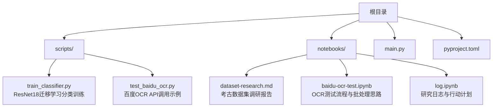
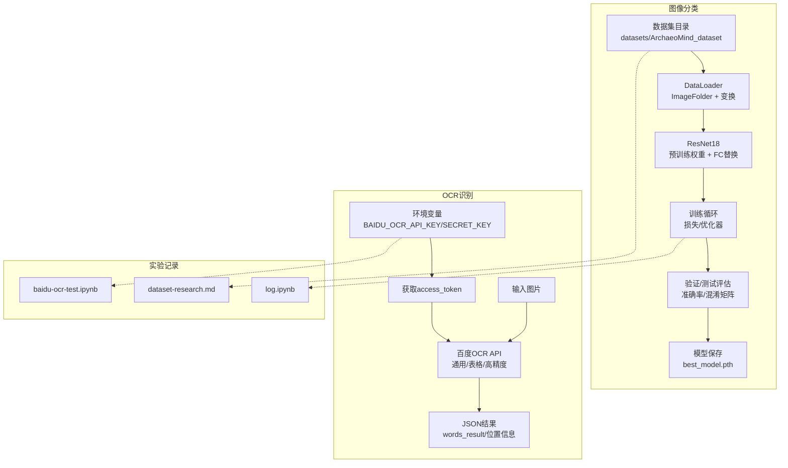
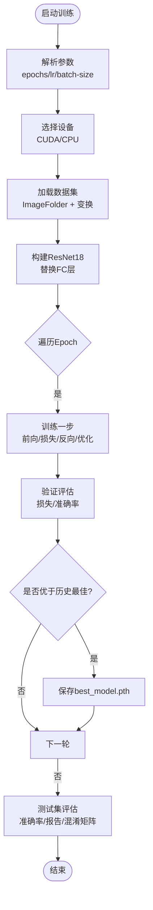
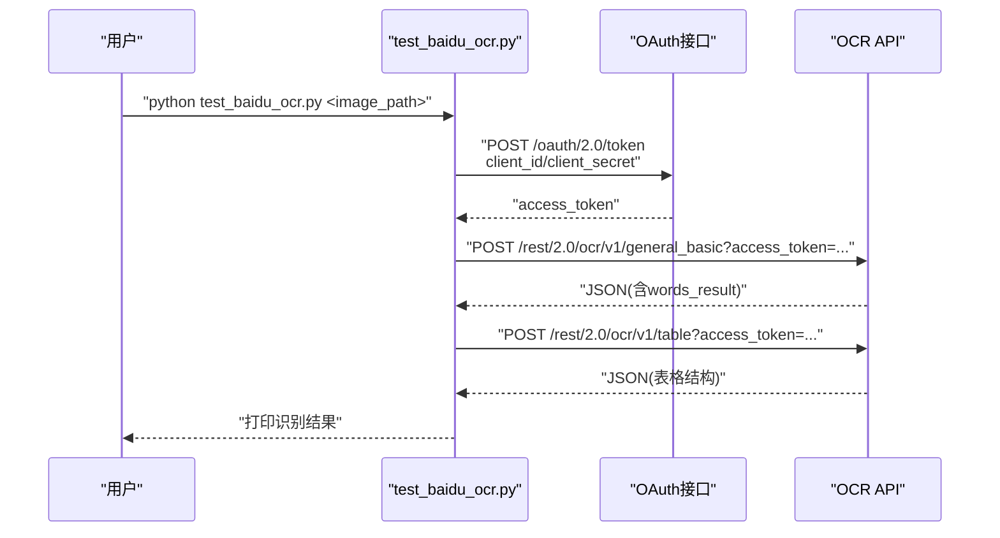
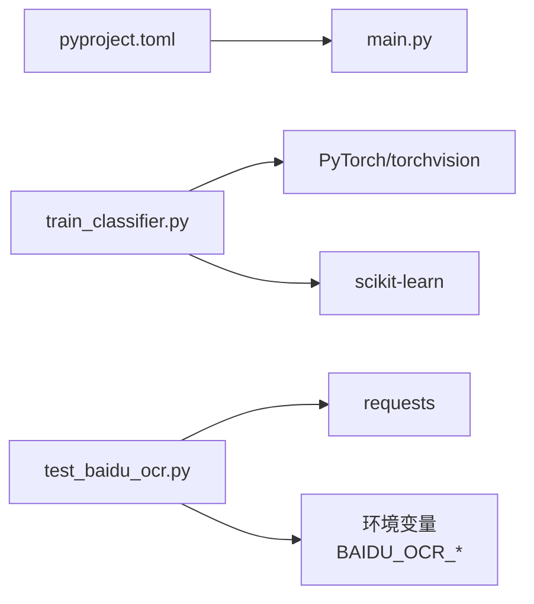

# 项目概述

<cite>
**本文引用的文件**
- [main.py](file://main.py)
- [scripts/train_classifier.py](file://scripts/train_classifier.py)
- [scripts/test_baidu_ocr.py](file://scripts/test_baidu_ocr.py)
- [notebooks/dataset-research.md](file://notebooks/dataset-research.md)
- [notebooks/baidu-ocr-test.ipynb](file://notebooks/baidu-ocr-test.ipynb)
- [notebooks/log.ipynb](file://notebooks/log.ipynb)
- [pyproject.toml](file://pyproject.toml)
</cite>

## 目录
1. [简介](#简介)
2. [项目结构](#项目结构)
3. [核心组件](#核心组件)
4. [架构总览](#架构总览)
5. [详细组件分析](#详细组件分析)
6. [依赖关系分析](#依赖关系分析)
7. [性能与可扩展性](#性能与可扩展性)
8. [故障排查指南](#故障排查指南)
9. [结论](#结论)
10. [附录](#附录)

## 简介
本项目是一个面向考古学的AI/ML工具集原型，聚焦两大能力：
- 考古图像分类：基于PyTorch的迁移学习实现ResNet18图像分类器，用于对考古相关图像进行类别判定。
- OCR文字识别：集成百度OCR API，支持通用文字、表格、高精度等场景，服务于考古报告中的文本提取与结构化。

项目采用模块化脚本组织，提供训练入口、OCR测试脚本以及实验记录Notebook，便于快速验证与迭代。整体设计强调“可运行、可复现、可扩展”，为后续引入更多考古数据与模型打下基础。

## 项目结构
仓库采用“脚本+笔记”的轻量结构：
- scripts：包含训练脚本与OCR测试脚本
- notebooks：包含数据集调研、OCR测试流程与项目日志
- main.py：项目主入口（占位）
- pyproject.toml：项目元信息与依赖声明

图表来源
- [scripts/train_classifier.py:1-124](file://scripts/train_classifier.py#L1-L124)
- [scripts/test_baidu_ocr.py:1-109](file://scripts/test_baidu_ocr.py#L1-L109)
- [notebooks/dataset-research.md:1-287](file://notebooks/dataset-research.md#L1-L287)
- [notebooks/baidu-ocr-test.ipynb:1-331](file://notebooks/baidu-ocr-test.ipynb#L1-L331)
- [notebooks/log.ipynb:1-370](file://notebooks/log.ipynb#L1-L370)
- [main.py:1-7](file://main.py#L1-L7)
- [pyproject.toml:1-8](file://pyproject.toml#L1-L8)

章节来源
- [main.py:1-7](file://main.py#L1-L7)
- [pyproject.toml:1-8](file://pyproject.toml#L1-L8)

## 核心组件
- 图像分类训练脚本：基于torchvision的ResNet18预训练权重，替换全连接层以适配考古图像的二分类或多分类任务；提供训练、验证、测试评估与混淆矩阵输出。
- OCR测试脚本：封装百度OCR鉴权与多种API调用（通用、表格、高精度），支持命令行传入图片路径进行端到端测试。
- 实验记录与调研：通过Notebook记录数据集调研、OCR测试步骤与项目推进计划，形成从数据到模型的闭环文档化过程。

章节来源
- [scripts/train_classifier.py:1-124](file://scripts/train_classifier.py#L1-L124)
- [scripts/test_baidu_ocr.py:1-109](file://scripts/test_baidu_ocr.py#L1-L109)
- [notebooks/dataset-research.md:1-287](file://notebooks/dataset-research.md#L1-L287)
- [notebooks/baidu-ocr-test.ipynb:1-331](file://notebooks/baidu-ocr-test.ipynb#L1-L331)
- [notebooks/log.ipynb:1-370](file://notebooks/log.ipynb#L1-L370)

## 架构总览
系统由“数据处理—模型训练—OCR服务—实验记录”四部分组成，数据流如下：
- 图像分类：数据集目录 → 数据加载与增强 → ResNet18微调 → 指标评估与模型保存
- OCR识别：环境变量鉴权 → 获取access token → 调用OCR接口 → 返回结构化结果

图表来源
- [scripts/train_classifier.py:12-38](file://scripts/train_classifier.py#L12-L38)
- [scripts/train_classifier.py:68-124](file://scripts/train_classifier.py#L68-L124)
- [scripts/test_baidu_ocr.py:8-57](file://scripts/test_baidu_ocr.py#L8-L57)
- [notebooks/dataset-research.md:1-287](file://notebooks/dataset-research.md#L1-L287)
- [notebooks/baidu-ocr-test.ipynb:1-331](file://notebooks/baidu-ocr-test.ipynb#L1-L331)
- [notebooks/log.ipynb:1-370](file://notebooks/log.ipynb#L1-L370)

## 详细组件分析

### 图像分类训练脚本（ResNet18迁移学习）
- 数据准备与加载
  - 使用ImageFolder按train/val/test划分读取数据，统一Resize至指定尺寸，并进行随机翻转、旋转、色彩抖动等增强；标准化使用ImageNet均值与方差。
  - DataLoader设置batch_size与num_workers，提升I/O吞吐。
- 模型构建
  - 加载ResNet18在ImageNet上的预训练权重，替换最终全连接层以匹配类别数。
- 训练与评估
  - 训练函数执行前向传播、计算交叉熵损失、反向传播与参数更新；评估函数在no_grad模式下统计损失与准确率。
  - 每轮验证后保存最佳模型权重；最终在测试集上输出准确率与分类报告、混淆矩阵。
- 关键参数
  - 可通过命令行控制epochs、学习率、batch-size等超参。

图表来源
- [scripts/train_classifier.py:14-38](file://scripts/train_classifier.py#L14-L38)
- [scripts/train_classifier.py:40-66](file://scripts/train_classifier.py#L40-L66)
- [scripts/train_classifier.py:68-124](file://scripts/train_classifier.py#L68-L124)

章节来源
- [scripts/train_classifier.py:1-124](file://scripts/train_classifier.py#L1-L124)

### OCR测试脚本（百度OCR API）
- 鉴权流程
  - 通过环境变量读取API Key与Secret Key，调用OAuth接口获取access_token。
- API封装
  - 提供通用文字识别、表格识别、高精度识别等函数，将本地图片转为Base64并POST至对应端点。
- 使用方式
  - 支持命令行传入图片路径，依次演示通用与表格识别，打印结构化结果。

图表来源
- [scripts/test_baidu_ocr.py:8-17](file://scripts/test_baidu_ocr.py#L8-L17)
- [scripts/test_baidu_ocr.py:20-57](file://scripts/test_baidu_ocr.py#L20-L57)
- [scripts/test_baidu_ocr.py:83-109](file://scripts/test_baidu_ocr.py#L83-L109)

章节来源
- [scripts/test_baidu_ocr.py:1-109](file://scripts/test_baidu_ocr.py#L1-L109)

### 实验记录与调研（Notebooks）
- 数据集调研
  - 梳理COCO、Roboflow Universe、ImageNet等数据集规模、标注类型与考古相关性，给出预训练与微调策略建议。
- OCR测试流程
  - Notebook中定义了token获取、API列表、批量处理函数与结果汇总思路，便于扩展至PDF→OCR→结构化流水线。
- 项目日志
  - 记录环境搭建、数据集下载、模型基线结果与下一步行动计划，体现“先跑通、再优化”的迭代节奏。

章节来源
- [notebooks/dataset-research.md:1-287](file://notebooks/dataset-research.md#L1-L287)
- [notebooks/baidu-ocr-test.ipynb:1-331](file://notebooks/baidu-ocr-test.ipynb#L1-L331)
- [notebooks/log.ipynb:1-370](file://notebooks/log.ipynb#L1-L370)

## 依赖关系分析
- 运行时依赖
  - PyTorch与torchvision：用于模型构建、训练与推理
  - requests：用于HTTP请求（OCR鉴权与API调用）
  - scikit-learn：用于分类报告与混淆矩阵
- 配置与环境
  - pyproject.toml声明项目名称、版本与Python版本要求；当前未显式列出依赖，实际运行需安装上述库
  - OCR鉴权依赖环境变量BAIDU_OCR_API_KEY与BAIDU_OCR_SECRET_KEY

图表来源
- [pyproject.toml:1-8](file://pyproject.toml#L1-L8)
- [scripts/train_classifier.py:1-10](file://scripts/train_classifier.py#L1-L10)
- [scripts/train_classifier.py:116-120](file://scripts/train_classifier.py#L116-L120)
- [scripts/test_baidu_ocr.py:1-17](file://scripts/test_baidu_ocr.py#L1-L17)

章节来源
- [pyproject.toml:1-8](file://pyproject.toml#L1-L8)
- [scripts/train_classifier.py:1-124](file://scripts/train_classifier.py#L1-L124)
- [scripts/test_baidu_ocr.py:1-109](file://scripts/test_baidu_ocr.py#L1-L109)

## 性能与可扩展性
- 训练性能
  - 使用预训练ResNet18显著降低训练成本；仅微调FC层可在CPU上快速完成小数据集训练
  - 可通过增大batch_size、启用多进程DataLoader与GPU加速进一步提升吞吐
- 模型扩展
  - 更换backbone（如ResNet50、EfficientNet、ViT）或冻结更多层进行渐进式微调
  - 增加数据增强策略（MixUp、CutMix、RandAugment）以提升泛化
- OCR扩展
  - 封装统一的OCR客户端类，支持重试、限流与错误码处理
  - 结合PDF解析管线，实现“扫描版报告→OCR→结构化字段抽取”的自动化流程

[本节为通用指导，不直接分析具体文件]

## 故障排查指南
- 训练阶段
  - 数据路径错误：确认数据集位于datasets/ArchaeoMind_dataset且包含train/val/test子目录
  - 类别不一致：确保ImageFolder自动推断的类别数与FC层输出一致
  - 内存不足：减小batch_size或关闭多进程workers
- OCR阶段
  - 鉴权失败：检查环境变量BAIDU_OCR_API_KEY与BAIDU_OCR_SECRET_KEY是否正确设置
  - 网络异常：确认服务器可访问aip.baidubce.com，必要时配置代理
  - 图片格式：确保传入图片可读且非损坏文件

章节来源
- [scripts/train_classifier.py:12-38](file://scripts/train_classifier.py#L12-L38)
- [scripts/train_classifier.py:68-124](file://scripts/train_classifier.py#L68-L124)
- [scripts/test_baidu_ocr.py:8-17](file://scripts/test_baidu_ocr.py#L8-L17)
- [scripts/test_baidu_ocr.py:83-109](file://scripts/test_baidu_ocr.py#L83-L109)

## 结论
本项目以“最小可用原型”为目标，围绕考古图像分类与OCR文字识别两条主线，提供了可运行的训练脚本与OCR测试脚本，并通过Notebook沉淀了数据集调研与实验记录。整体架构清晰、模块职责明确，便于后续引入更多考古数据与模型能力，逐步演进为更完善的考古AI工具链。

[本节为总结性内容，不直接分析具体文件]

## 附录
- 快速开始
  - 图像分类：准备数据集目录并按train/val/test组织，运行训练脚本并观察验证准确率与测试报告
  - OCR测试：设置环境变量后，运行OCR测试脚本并传入图片路径验证连通性与识别效果
- 术语说明
  - ArchaeoMind：项目中使用的考古图像数据集名称
  - ResNet18：一种轻量级卷积神经网络，常用于迁移学习
  - 百度OCR：百度提供的图像文字识别云服务，支持多种识别模式

[本节为补充说明，不直接分析具体文件]