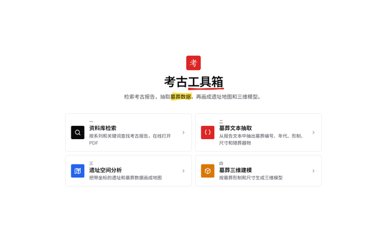
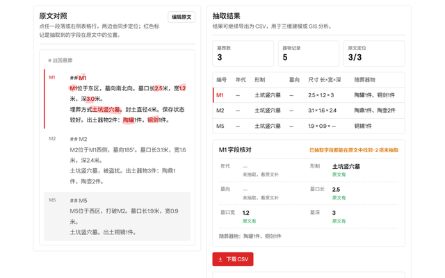
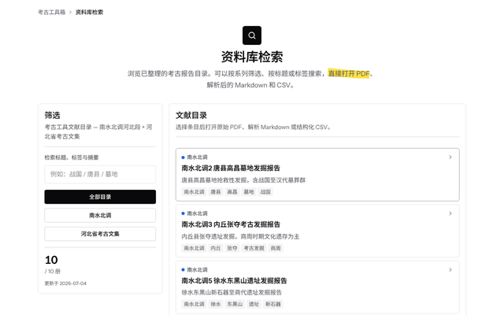
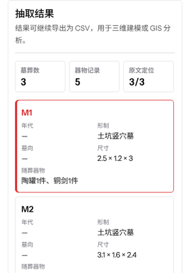
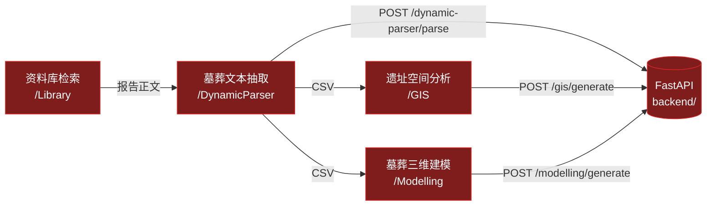

# Untangle
<!-- architect-team:readme-theme=crimson -->

<div align="center">
  <picture>
    <source media="(prefers-color-scheme: dark)" srcset="./assets/readme/hero-dark.svg">
    
  </picture>
</div>

从考古报告里抽取墓葬数据，逐条对照原文核对，再画成遗址地图和三维模型。
Extract tomb records from Chinese archaeological reports, check them against the source, then map and model them.

> 项目名 **Untangle**，仓库名保留为 `kaogu-tools`，已有的链接不受影响。

<div align="center">
  
  
  
</div>

<p align="center">
  <a href="#screens">Screens</a> ·
  <a href="#quick-start">Quick Start</a> ·
  <a href="#workflow">Workflow</a> ·
  <a href="#tools">Tools</a> ·
  <a href="#layout">Layout</a> ·
  <a href="#status">Status</a>
</p>

<a id="screens"></a>
## Screens · 界面

<table>
  <tr>
    <td width="28%" align="center"><br><sub>首页 · Home</sub></td>
    <td width="28%" align="center"><br><sub>抽取 · Parser</sub></td>
    <td width="28%" align="center"><br><sub>文献库 · Library</sub></td>
    <td width="16%" align="center"><br><sub>手机 · Mobile</sub></td>
  </tr>
</table>

<a id="quick-start"></a>
## Quick Start · 快速上手

需要 / Requires: Python 3.12（见 `mise.toml`）、[uv](https://docs.astral.sh/uv/)、[pnpm](https://pnpm.io/)。

**1. 后端 Backend**（FastAPI，端口 8000）

```bash
cp .env.example .env
uv run uvicorn backend.main:app --host 127.0.0.1 --port 8000 --reload
```

**2. 前端 Frontend**（Next.js，端口 3000）

```bash
echo "NEXT_PUBLIC_KAOGU_API_BASE_URL=http://localhost:8000" > frontend/.env.local
cd frontend
pnpm install
pnpm dev
```

打开 <http://localhost:3000>。

**3. 验证 Verify**

```bash
curl -s http://127.0.0.1:8000/health
curl -s -X POST http://127.0.0.1:8000/dynamic-parser/parse \
  -H 'Content-Type: application/json' \
  -d '{"text":"## M1\nM1位于东区，墓向南北向。墓口长2.5米，宽1.2米，深3.0米。土坑竖穴墓。出土器物2件：陶罐1件，铜剑1件。","report_name":"demo"}'
```

期望输出（节选）/ Expected output (abridged):

```text
{"status":"ok"}
{"ok": true, "data": {"json": {"墓葬列表": [{"墓葬编号": "M1", "墓葬形制": "土坑竖穴墓",
  "墓口长": 2.5, "墓口宽": 1.2, "墓深": 3.0, "随葬器物": [{"器物名称": "陶罐", ...}, {"器物名称": "铜剑", ...}], ...}]}, ...}}
```

**4. 测试 Tests**

```bash
uv run python -m unittest shared/tests/test_dynamic_parser.py
```

<a id="workflow"></a>
## How it fits together · 工作流



| 路由 Route | 做什么 What it does |
|---|---|
| `GET /health` | 返回 `{"status": "ok"}` |
| `POST /dynamic-parser/parse` | 从墓葬文本抽取墓葬编号、年代、墓向、形制、尺寸和随葬器物，返回 JSON、Markdown、CSV |
| `POST /modelling/generate` | 上传墓葬 CSV，返回可在浏览器旋转查看的三维模型 HTML |
| `POST /gis/generate` | 上传含遗址与坐标的 CSV，返回遗址地图 HTML（可选总览图） |

<a id="tools"></a>
## Tools · 四个工具

| 工具 | 页面 | 现在能做的 |
|---|---|---|
| 资料库检索 | `/Library` | 浏览报告目录，按系列筛选、按标题和标签搜索，打开 PDF / Markdown / CSV |
| 墓葬文本抽取 | `/DynamicParser` | 粘贴报告文本 → 墓葬表；原文与结果逐段联动，字段核对卡标出「原文有 / 推断或待核 / 未抽取」；下载 CSV |
| 遗址空间分析 | `/GIS` | 上传 CSV 生成遗址地图，结果直接显示在页面里，多站点用标签切换 |
| 墓葬三维建模 | `/Modelling` | 上传 CSV 生成墓葬三维模型，结果直接显示在页面里，可导出 GLB |

<a id="layout"></a>
## Repository layout · 仓库结构

根目录是工具箱应用；其他考古相关仓库于 2026 年 11 月用 `git subtree` 并入，保留了完整历史。

| 目录 | 内容 |
|---|---|
| `frontend/`、`backend/`、`shared/` | 工具箱应用：Next.js 前端、FastAPI 后端、数据目录与测试 |
| `parsers/archaeo-doc-parser/` | MCP 服务器：用 MinerU 把 PDF、图片、Office 文件转成 Markdown |
| `parsers/archaeo-tomb-parser/` | 墓葬解析：MCP 服务器、Obsidian 插件源码、agent 技能、示例 |
| `plugins/obsidian-archaeo-doc-parser/` | Obsidian 插件：文档转 Markdown |
| `plugins/obsidian-archaeo-tombs/` | Obsidian 插件：抽取墓葬数据 |
| `catalogue/kaogu-lib/` | 静态 PDF 目录（BunnyCDN） |
| `research/llm-kaogu/` | 研究工作区：OCR、GIS、聚类、年代规则 |
| `research/kaogu-db/` | SQLite 数据库设计、CSV 导入、Leaflet 地图 |
| `pipelines/` | 计数特征抽取、LLM 抽取管线、朝代特征管线 |
| `web/` | 早期版本的 API 与前端（已被根目录应用取代） |

<details>
<summary><strong>环境变量 · Environment variables (<code>.env.example</code>)</strong></summary>

| 变量 | 默认值 | 说明 |
|---|---|---|
| `KAOGU_CORS_ORIGINS` | `http://localhost:3000,http://127.0.0.1:3000` | 允许访问后端的前端地址 |
| `KAOGU_MAX_UPLOAD_MB` | `25` | 上传 CSV 的大小上限 |
| `KAOGU_USE_SEMANTIC_CHUNKER` | `0` | 写在 `.env.example` 里，后端代码目前没有读取 |
| `EXA_API_KEY`、`FIRECRAWL_API_KEY` | 空 | 后端配置里预留的第三方 key，目前没有功能调用；只放在后端 `.env` |
| `NEXT_PUBLIC_KAOGU_API_BASE_URL` | — | 写在 `frontend/.env.local`，指向后端地址 |

</details>

<a id="status"></a>
## Status · 当前状态

- 抽取器目前会漏掉部分墓向和年代（例如「墓向南北向」「墓向185°」），字段核对卡会把它们标成「未抽取」。
- GIS 地图底图和三维场景从 CDN 加载 Leaflet 和 Three.js，离线时不显示。
- 仓库还没有 LICENSE 文件。

## Credits · 致谢

- 头图金字塔字符画来自 [textart.sh](https://textart.sh/topic/pyramid)。
- 手绘高亮：[Rough Notation](https://roughnotation.com)（MIT）。
- 字体：[Instrument Sans](https://fontsource.org/fonts/instrument-sans)、思源黑体 / 宋体（Noto Sans SC / Noto Serif SC）、朱雀仿宋。

## License

尚未选择开源许可证。旧版说明保留在 [`README.old.md`](./README.old.md)。
